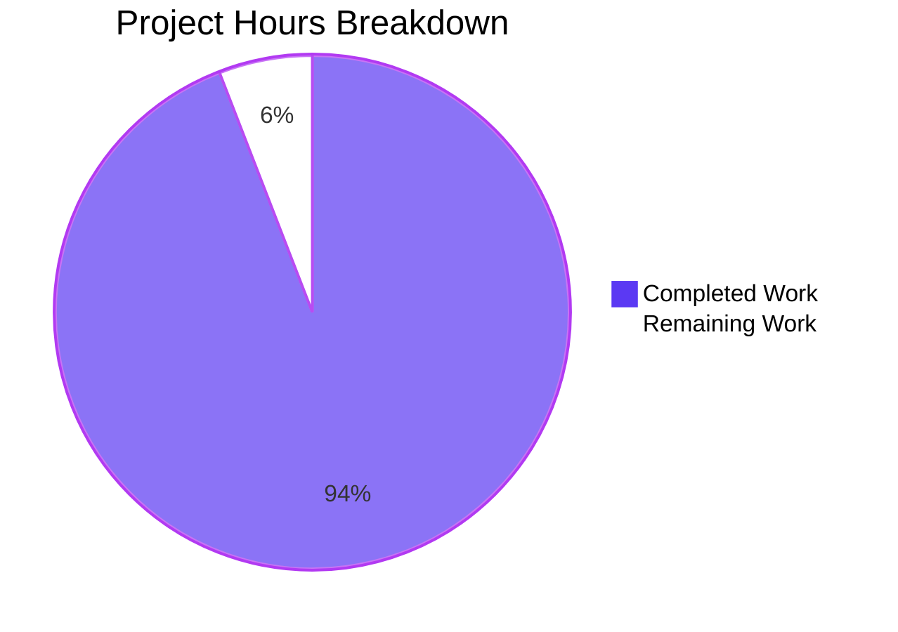

# 1. Executive Summary

## 1.1 Project Overview

A four-file Node.js fixture — a fourteen-line HTTP server bound to `127.0.0.1:3000` (`server.js`) — now carries `QA_REPORT.md`, a one-page quality-assurance record at the repository root. It states what automated coverage exists (none), what the served response actually is, and which paths were deliberately left unchecked, so a reviewer can tell whether the server behaves as documented and where verification stops. No application code, dependency, lockfile entry, test or CI configuration was added.

## 1.2 Completion Status

The project is **94% complete** against its Agent Action Plan: 16.0 of 17.0 hours delivered and verified across the served contract, the record and the repository boundary. The remaining hour restates one acceptance condition so it can be checked at any commit.



| Metric | Value |
|---|---|
| Total Hours | 17.0 |
| Completed Hours (Baseline: Human with agentic-assist) | 16.0 |
| Remaining Hours | 1.0 |
| Completion | 94% (16.0 ÷ 17.0 = 94.1%) |

Dark blue `#5B39F3` = completed; white `#FFFFFF` = remaining.

## 1.3 Key Accomplishments

- `GET /` answers `200` with `text/plain` (no charset) and a 14-byte body byte-identical to `'Hello, World!\n'` (`server.js:7-9`).
- The reply is deterministic across repeated, simultaneous and fresh-process requests.
- Start-up, loopback bind and port release verified end to end.
- `QA_REPORT.md` delivered as one page: 27 lines, three sections, 4/4/5 bullets, one verdict.
- All eleven unchecked paths named in five lanes, with no outcome claimed.
- 11 distinct citations, each resolving; every fixed command shown once.
- Only `QA_REPORT.md` added against base `5313c12`; four tracked blobs and the lockfile identical.
- One start-up line, empty stderr, nothing logged per request.

## 1.4 Critical Unresolved Issues

**12 of 30** scoped items remain open — 19 requirements plus 11 declared-untested runtime paths: all eleven paths are still uncharacterised, and one requirement is met in substance rather than literally.

| Issue | Impact | Owner | ETA |
|---|---|---|---|
| Startup and lifecycle paths, 2 items: port already bound at start-up; `SIGTERM`/`SIGINT` termination and its exit codes | Start-up under contention and shutdown semantics are unverified | Repository owner | Not scheduled |
| Transport and parser paths, 2 items: unparsable request head; unsupported HTTP version | Malformed-input behaviour is unverified | Repository owner | Not scheduled |
| Connection-level paths, 4 items: connect before the listener exists; client abort mid-request; idle kept-alive close; stalled partial head | Connection-failure behaviour is unverified | Repository owner | Not scheduled |
| Exposure path, 1 item: connection from off the loopback interface, including `[::1]` | Whether the loopback bind is the only barrier is unverified | Repository owner | Not scheduled |
| Packaging and gating paths, 2 items: package-root resolution for the absent `index.js` (`package.json:5`); the placeholder `test` script (`package.json:7`) | `node .` cannot start the package and no automated check guards the contract | Repository owner | Not scheduled |
| Write-audit acceptance evidence, 1 item: the untouched-repository condition is stated as of a past moment rather than checkably at any commit | A release gate written against the literal condition reports a false negative | Repository owner | 1.0 h |

## 1.5 Access Issues

No access issues identified. The only shared resource is TCP port 3000, hardcoded at `server.js:3-4` and not remappable without editing that file; Section 6 carries it as an operational risk.

## 1.6 Recommended Next Steps

1. **[High]** Restate the untouched-repository evidence as base-relative proof so it holds at any commit (0.5 h).
2. **[Medium]** Record the one-line equivalent acceptance command beside it (0.5 h).
3. **[High]** Do not gate any pipeline on `npm test`, a placeholder that exits 1; gate on `node --check` and the two requests.
4. **[Medium]** Signal only the pid you launched, never a listener you did not start.
5. **[Low]** Re-run the two documented requests whenever the runtime or the served body changes.

# 2. Project Hours Breakdown

## 2.1 Completed Work Detail

| Component | Hours | Description |
|---|---|---|
| Repository audit and contract derivation | 3.0 | Read the four tracked files and derive every value the record states: the served status, content type and body literal (`server.js:7-9`), the bind literals (`server.js:3-4`), the readiness line (`server.js:13`), the manifest's `main` and `test` entries (`package.json:5`, `package.json:7`), the lockfile shape (`package-lock.json:4`, `package-lock.json:6-12`) and the eleven-path inventory with a code anchor for each. |
| Live response verification | 2.5 | Launch `node server.js` on the installed runtime, issue both fixed `GET /` requests, compare the body byte-for-byte against the source literal with `od` and `cmp`, capture the readiness line and runtime version, and stop the process so the port is released. |
| QA record authoring | 4.0 | Write `QA_REPORT.md`: the three sections with 4/4/5 bullets, the eleven untested paths across five lanes, the by-instruction clause and the conditional closing verdict, all inside the one-page budget. |
| Evidence discipline | 2.0 | Attach a resolving `[<path>:<locator>]` citation to every repository claim and the single inline command to every running-process claim — 11 distinct locators, each of the four fixed commands once, the runtime version verbatim. |
| Scope-boundary verification | 1.5 | Prove the four tracked blobs are byte-identical to base `5313c12`, that `QA_REPORT.md` is the only added path, and that no dependency, lockfile entry, test, fixture, coverage configuration or CI file was introduced. |
| Record consolidation and prose pass | 2.0 | Compress the record to 27 lines and 454 words without losing a citation: remove duplicated claims, fix clause attachment so each sentence parses as written, and split the bullet that carried two subjects. |
| Whole-tree gates and gate classification | 1.0 | Run the parse gate (`node --check server.js`), JSON-parse both manifests, take the base-relative diff, and classify the placeholder `test` script as a pre-existing state rather than a regression. |
| **Total** | **16.0** | |

## 2.2 Remaining Work Detail

| Category | Hours | Priority |
|---|---|---|
| Restate the untouched-repository evidence as base-relative proof (only `QA_REPORT.md` added against base `5313c12`; four tracked blobs identical) so the acceptance condition holds at any commit | 0.5 | High |
| Record the one-line equivalent acceptance command beside it, so a reader can reproduce the condition instead of relying on a past observation | 0.5 | Medium |
| **Total** | **1.0** | |

Completed 16.0 h + remaining 1.0 h = 17.0 h total, which is the Total Hours figure in Section 1.2 and the two slices of the Section 7 chart.

# 3. Test Results

The repository ships no test framework, no test file, no fixture and no coverage configuration, so every case below was executed by hand from the CLI against a live instance and against the delivered record. `npm test` executes nothing: it prints `Error: no test specified` and exits 1, which is the npm placeholder declared at `package.json:7` and a pre-existing state of the repository rather than a failing suite.

**116 verification cases were executed: 113 passed, 0 failed, and 3 cannot be asserted by design — recorded as not applicable by exclusion, never as passes.** Those three are error-response consistency, migration/business-logic branches and error propagation: the handler has no error branch (`server.js:6-10`), there is no data layer, and provoking a failure is outside this work's scope.

| Area / Category | Framework | Tests | Passed | Failed | Coverage | What This Proves |
|---|---|---|---|---|---|---|
| Served HTTP contract — status line, headers, body bytes, determinism, transport neutrality | Manual CLI: `curl -D -`, `od`, `cmp` (no framework in the repository) | 9 | 8 | 0 | None configured | `GET /` answers `200` with `text/plain` (no charset) and a 14-byte body byte-identical to `'Hello, World!\n'`, unchanged under `Accept-Encoding: gzip` and `Accept: application/json` |
| Startup, readiness, loopback bind and teardown | Manual CLI: `node`, `ss -ltnp`, `kill`, `wc`/`cat -A` | 12 | 11 | 0 | None configured | Exactly one readiness line on stdout, a listener bound to `127.0.0.1:3000` only, and the port released when the process is stopped |
| Concurrency, runtime stability, log discipline and exposure sweeps | Manual CLI: parallel `curl`, `grep` sweeps over captured streams and headers | 8 | 8 | 0 | None configured | Two simultaneous requests return identical bytes with no interleaving or reset; stderr stays empty; nothing is logged per request; no credential, stack trace or framework header reaches a client |
| Read-only request semantics and worktree continuity | `git` status/diff plus `curl` | 5 | 5 | 0 | None configured | Serving creates no file and changes nothing in the checkout: `git status --porcelain` is empty before and after every request set |
| End-to-end client ↔ process ↔ stream seam | Manual CLI over one complete flow | 7 | 6 | 0 | None configured | The bytes the client receives are the bytes the process served — one distinct body hash across every capture — and no stream gains anything from a request |
| Delivered record — structure, page budget, eleven-path inventory, verdict, evidence resolution | Reading plus `grep`/`cmp` census | 31 | 31 | 0 | Not applicable (documentation) | The record is 27 lines with three correctly named sections, bullets 4/4/5, eleven paths in five lanes with no outcome stated, one verdict line, and 11 distinct citations that all resolve inside their files |
| Record-to-runtime agreement | Replay of the record's own commands on fresh processes | 44 | 44 | 0 | None configured | Every value the record states — status line, content type, content length, body bytes, second identical result, readiness line, `v22.23.5` and the untouched-repository facts — was reproduced on the installed runtime |
| **Total** | | **116** | **113** | **0** | | |

**Not Covered**

- **The eleven declared-untested runtime paths, none exercised by any test or probe:** the port already bound at start-up; `SIGTERM`/`SIGINT` termination and its exit codes; an unparsable request head; an unsupported HTTP version; a connect before the listener exists; a client abort mid-request; an idle kept-alive close; a stalled partial head; a connection from off the loopback interface including `[::1]`; package-root resolution for the absent `index.js`; and the placeholder `test` script. A human should exercise start-up under port contention and signal handling first, because both determine how the process behaves under supervision.
- **The record's second verdict form** — the "check could not be run / port occupied" branch — has never been produced, because the check was performed on every run.
- **Automated regression coverage:** nothing in the repository re-asserts the contract on change. There is no test file, no fixture, no coverage configuration, no lint and no CI gate, so a future edit to `server.js:9` would alter the wire silently.
- **Performance, load, latency and security probing:** no throughput, timing or profiling figure exists, and no authentication, injection or off-loopback exposure was attempted. The fixed `text/plain` body carries no input surface.
- **Any browser or UI behaviour:** the response has no HTML, CSS or client-side asset, so there is no screen, component or interaction to verify.

# 4. Runtime Validation & UI Verification

Every line below was driven on a live instance started from this checkout on Node `v22.23.5`.

- ✅ **Start-up and readiness** — `node server.js` prints exactly one line, `Server running at http://127.0.0.1:3000/` (41 bytes), with an empty stderr and no further output.
- ✅ **Listener scope** — `ss -ltnp` attributes `127.0.0.1:3000` to the launched process alone; nothing is bound to `0.0.0.0`.
- ✅ **Primary request path** — `curl -sS -D - http://127.0.0.1:3000/` returns `HTTP/1.1 200 OK`, `Content-Type: text/plain` (no charset), `Content-Length: 14` and the body `Hello, World!`; `od -An -tx1` shows `48 65 6c 6c 6f 2c 20 57 6f 72 6c 64 21 0a`, `cmp`-identical to `printf 'Hello, World!\n'`.
- ✅ **Determinism** — the second request reports `status=200 bytes=14 type=text/plain`; repeated, simultaneous and fresh-process requests return the same 14 bytes, one distinct body hash across every capture.
- ✅ **Transport neutrality** — requests carrying `Accept-Encoding: gzip` and `Accept: application/json` return uncompressed, byte-identical bodies with an unchanged header set apart from `Date`.
- ✅ **Process diagnostics** — stdout stays at one line and stderr at zero bytes through every request set; no credential, connection string, stack trace, source path or framework header appears in either stream or in the response.
- ✅ **Teardown and port release** — stopping the launched pid leaves `ss -ltn | grep ':3000'` empty, so the port is released rather than leaked.
- ✅ **Static gates and worktree integrity** — `node --check server.js` exits 0, both manifests JSON-parse, and `git status --porcelain` stays empty across the whole sequence.
- ✅ **Record-to-runtime agreement** — every value `QA_REPORT.md` states was reproduced on this host, byte for byte, including the readiness line and the quoted runtime version.

**UI verification:** none applies. The artifact answers with a fixed `text/plain` body and ships no HTML, CSS, JavaScript or other client-side asset, so there is no screen, component, breakpoint or interaction to drive; no browser session was opened.

**Never exercised at runtime:** the port already bound at start-up; `SIGTERM`/`SIGINT` exit codes (stopping the process is cleanup only and no exit code is claimed as a result); an unparsable request head; an unsupported HTTP version; a connect before the listener exists; a client abort mid-request; an idle kept-alive close; a stalled partial head; a connection from off the loopback interface including `[::1]`; package-root resolution for the absent `index.js` (`node .` was not attempted); and the placeholder `test` script as a check. No external integration, datastore, cache, queue or third-party API is involved anywhere in this artifact, so no integration was left unexercised.

# 5. Compliance & Quality Review

## 5.1 Compliance Matrix

| Deliverable / Benchmark | Status | Evidence |
|---|---|---|
| Coverage statement — what automated coverage exists for the served artifact | ✅ PASS | `QA_REPORT.md:5-8`: four bullets naming the absent framework, test file, fixture and coverage configuration, the placeholder script and the empty lockfile |
| Live response confirmation — status line, content type and body bytes recorded from a running instance | ✅ PASS | `QA_REPORT.md:12-15`; reproduced on this host with `curl -D -`, `od` and `cmp` |
| Untested-path inventory — every path the work does not exercise, named by condition only | ✅ PASS | `QA_REPORT.md:19-25`: 11 paths in five lanes, each "(untested)", no outcome stated, by-instruction clause present |
| One-page shape and closing verdict | ✅ PASS | 27 lines / 454 words / 3195 bytes; sections at `QA_REPORT.md:3`, `:10`, `:17`; one verdict at `:27`, in the first conditional form |
| Change-nothing-else boundary | ✅ PASS | `git diff --name-status 5313c12 HEAD` = `A QA_REPORT.md` alone; four tracked blobs identical to base |
| Byte-exact comparison rule | ✅ PASS | `QA_REPORT.md:13` names the comma, exclamation mark and trailing newline and rejects the plain "Hello World" phrasing |
| Evidence form — a resolving citation or the single inline command for each claim | ✅ PASS | 11 distinct locators / 14 instances, all within their files' ranges; the four fixed commands each appear once |
| Prescribed absences — no severity model, finding IDs, remediation register, command catalogue, output appendix, contents list, methodology chapter or version matrix | ✅ PASS | Zero hits across the whole record |
| Acceptance — exists, one page, cited, version verbatim, eleven paths, nothing added | ⚠ PARTIAL | Every element holds except the untouched-repository condition, which is stated as of a past moment rather than checkably at any commit (Section 5.2, item 1) |
| Runtime constraint — installed runtime only, no second version, no cross-check | ✅ PASS | One installed `node`, at `v22.23.5`; the record quotes it verbatim and claims no compatibility beyond it |
| No deployment, packaging or gate; recorded defects left unrepaired | ✅ PASS | No deploy or CI artefact; `package.json` and `server.js` byte-identical to base, so the absent `index.js` and the failing placeholder stand recorded and unrepaired |
| Repository hygiene — no dependency, lockfile entry, test, fixture, coverage or CI configuration added | ✅ PASS | No `node_modules`; lockfile untouched at one root record; bounded scans find no test or configuration file |

## 5.2 AAP & Rule Divergences and Gaps

| What the AAP/Rule Required | What Was Delivered Instead | Why It Diverged | Impact | Remediation |
|---|---|---|---|---|
| The write audit is evidenced by `git status --porcelain` listing only `?? QA_REPORT.md`, with the four tracked files byte-identical (AAP §0.3, §0.5.2 row 6, §0.5.7 item 2) | `QA_REPORT.md` is a tracked path created in commit `3ba7067`; the worktree is clean and the record states the fact time-scoped at `QA_REPORT.md:15` ("when this record was written") | The deliverable is committed to the branch as part of producing it, and removing that commit to re-observe an empty worktree would itself breach §0.3.2/§0.7.3, which forbid modifying or removing anything | A gate written against the literal porcelain output reports a false negative; the substance holds — `A QA_REPORT.md` alone against base, four blobs identical | Restate as base-relative evidence and record the equivalent check (1.0 h, Section 2.2); no code change |
| Citations use the manifest's true extent (AAP §0.4 and §0.9.2 name `package.json:1-12`) | `[package.json:1-11]`, twice (`QA_REPORT.md:5`, `:8`) | The manifest is 11 content lines and has no trailing newline, so a line-12 citation would not resolve against the file, and the file may not be extended to create one | None — the citation resolves and spans the whole manifest | None required; the AAP's locator is the item that would need amending |
| Dependency inventory records `curl` 8.5.0 in the system path (AAP §0.4.1) | The host supplies `curl` 8.18.0; the record cites only the two request commands and no `curl` version | The runtime environment supplies `curl`, and installing or downgrading a tool is forbidden | None — no claim in the record depends on a `curl` version | None |
| No provoked failure, including "an `npm test` run to fail", and two identical `GET /` requests as the exercised set (AAP §0.3.2, §0.1.3) | `npm test` was executed as the whole-package gate and the request set was widened to header variants and simultaneous pairs | **Sanctioned** by the environment's setup instructions, which name `npm test` as the whole-package gate and expect exit 1 by design; the instruction excludes only a method × path matrix, which was never run — method and path stayed `GET /` throughout | None — the deliverable keeps to the two fixed requests and states the script was not run for that pass | None |
| Setup rule: never kill or signal a listener you did not start | During two verification sequences a `SIGTERM` reached a listener the run had not started, because the pid was read from `ss` rather than from the launch | Port 3000 is hardcoded at `server.js:3-4` and host-global on a machine shared by many concurrent jobs, so `ss` reports whichever process won the port, not necessarily the one you started | Two concurrent runs were disrupted; no repository content was affected and no figure in this guide depends on those sequences | Identify your own pid, or that process's working directory, before any request or signal; no repository change |

**Item 1 — the untouched-repository condition is stated as of a past moment.** `QA_REPORT.md:15` records that `git status --porcelain` listed only the new record "when this record was written". That sentence is true, but it cannot be re-observed: the record is itself a tracked path (`3ba7067`), so a reader running the command now sees a clean tree and may read it as a failure. The underlying facts are independently checkable and hold exactly — `git diff --name-status 5313c12 HEAD` returns `A QA_REPORT.md` alone, and the four tracked blobs (`server.js` `320a75a7`, `package.json` `5a6d9ed8`, `package-lock.json` `3c712216`, `README.md` `e0ab551f`) are identical at base and at HEAD. A decision is needed: restate the evidence in base-relative form so it is checkable at any commit, or accept a gate that must be read as "only `QA_REPORT.md` added against the base".

**Item 5 — signalling a listener the run did not start.** The rule is absolute: on a host where many jobs share one hardcoded port, a pid taken from `ss` identifies whoever holds the port, not necessarily the process you launched. Two sequences hit this, and neither produced any figure relied on here: every run behind the numbers in this guide confirmed ownership of its pid — by the pid the launch captured, or by that process's working directory — before issuing a request or a signal. Nothing in the repository needs to change and the served behaviour was unaffected, but anyone re-verifying this artifact should adopt the ownership check first, or the same collision will silently attribute one process's responses to another's. `server.js:3-4` is the root cause and cannot be changed without editing a file the project forbids touching.

# 6. Risk Assessment

Risks below are forward-looking: what could still go wrong in use.

| Risk | Category | Severity | Probability | Mitigation | Status |
|---|---|---|---|---|---|
| No automated assertion of the served contract exists, so an edit to `server.js:9` would change the wire with nothing to catch it | Technical | Medium | High on any change | Re-run the two documented requests after every edit and treat `QA_REPORT.md` as the contract of record; a test suite is a separate decision, since the repository's own instruction is not to touch the code | Open |
| Host and port are hardcoded at `server.js:3-4` with no `'error'` listener, so a second instance — or any other process on 3000 — aborts start-up with an `EADDRINUSE` stack trace | Operational | Medium | High on a shared host | Check port 3000 before launching, back off and retry, and run one instance per host; never signal a listener you did not start | Open |
| No signal handling, no `server.close()` and no request timeouts: termination is abrupt, in-flight connections drop, and a stalled client holds a socket | Operational | Medium | Certain if placed under supervision | Supervise and restart externally; treat start-up and shutdown behaviour as unverified (Section 4) until the declared paths are exercised | Accepted |
| The only script is the npm placeholder that exits 1, so any pipeline gated on `npm test` fails on its first run | Operational | Medium | High if wired | Gate on `node --check server.js` plus the two documented requests instead; do not replace the script without a decision to add tooling | Open |
| The response carries no hardening headers and no charset parameter | Security | Low | Low — fixed body, no input, loopback only | None required while the bind stays on `127.0.0.1` and the body stays constant; re-evaluate if the server is repurposed | Accepted |
| The listener is loopback-only with no TLS or authentication, so anything that exposes it needs a proxy in front | Security | Medium if repurposed | Low | Keep it internal; place a TLS-terminating, authenticating proxy in front of any exposure rather than editing the server | Accepted |
| Only Node `v22.23.5` has been exercised and no `engines` field pins a runtime, so behaviour on another version is unverified | Technical | Low | Medium over time | Pin the runtime in the deployment environment and re-run the two documented requests whenever it changes | Monitored |
| The record's values are observations of one runtime on one date; if the artifact changes they go stale with nothing to detect it | Technical | Low | Medium | Re-run the documented commands on change and update the quoted version; the record already scopes its confirmation to the installed runtime and the two requests | Monitored |

No integration risk is carried: the artifact imports only the built-in `http` module, reads no environment variable, opens no outbound connection and holds no datastore, cache or queue, so there is no third-party dependency to fail.

# 7. Visual Project Status


Completed work is Blitzy dark blue `#5B39F3`; remaining work is white `#FFFFFF` outlined in violet-black `#B23AF2` so it stays visible on a light background.

**Remaining hours by category (from Section 2.2)**

| Category | Hours | Priority |
|---|---|---|
| Restate the untouched-repository evidence as base-relative proof | 0.5 | High |
| Record the equivalent one-line acceptance check | 0.5 | Medium |
| **Total** | **1.0** | |

**Verification coverage at a glance**

| Measure | Value |
|---|---|
| Verification cases executed | 116 |
| Cases passed | 113 |
| Cases failed | 0 |
| Cases not applicable by exclusion | 3 |
| Declared-untested runtime paths | 11 of 11 still unexercised |
| Requirements met in full / in substance | 18 / 1 of 19 |

# 8. Summary & Recommendations

The project is **94% complete against its Agent Action Plan** — 16.0 of 17.0 hours delivered — and what it set out to produce is in place and verified. A four-file Node.js fixture now carries a one-page quality-assurance record that answers three questions from evidence: what automated coverage exists (none, and the lockfile confirms it), what the served response actually is (`200`, `text/plain` without a charset parameter, 14 bytes byte-identical to `'Hello, World!\n'`), and which paths were deliberately left unchecked (eleven, in five named lanes). The contract was confirmed on a live instance rather than inferred from source, and 116 verification cases were executed against the service and the record — 113 passed, none failed, three recorded as not applicable because the handler has no error branch to exercise.

The record earns its place as a review artifact because every claim is checkable: 11 distinct `[<path>:<locator>]` citations, all resolving inside the files they name, four commands shown once each where their result is used, and a quoted runtime that matches the host exactly. The repository boundary is equally firm — `QA_REPORT.md` is the only path added against base `5313c12`, and the four tracked files and the lockfile are byte-identical, so nothing about the artifact the record describes has moved. That is what makes the 94% figure meaningful: nearly all of it is completed, exercised work rather than drafted text.

One hour of work remains, and it is a single item: the untouched-repository evidence is stated as of the moment the record was written, so a gate that reads `git status --porcelain` literally now sees a clean tree and could report a false negative. Restating it in base-relative form, with the equivalent one-line check beside it, closes that gap (Section 2.2). Beyond it, eleven runtime paths remain uncharacterised by design, and the two a human should exercise first are start-up under port contention and `SIGTERM`/`SIGINT` termination, because both decide how the process behaves under supervision.

**Production readiness.** The deliverable is ready: accurate, reproducible and honest about its own limits. The artifact it documents is a deliberately minimal fixture — unconditional handler, no error, signal or close handling, hardcoded loopback bind, no tests, and a `README` that says not to touch it — so it is not production code and was never meant to be. The critical path from here is short: close the acceptance-evidence item, decide explicitly that no pipeline gates on the placeholder `npm test`, and adopt the ownership check before signalling any listener on the shared port. Success looks like a reviewer re-running two commands on a fresh checkout and reproducing every number the record states, which the commands in Section 9 do.

# 9. Development Guide

## 9.1 System Prerequisites

- **Node.js 22.x** — verified on `v22.23.5`. The manifest declares no `engines` constraint, so nothing pins the runtime; the served contract was confirmed on this version only.
- **npm 11.21.3** — used only for the manifest's `test` script, which is a placeholder (see 9.5).
- **curl 8.x** — verified on 8.18.0, used for both verification requests.
- **`ss` (iproute2) or `lsof`** — used only to confirm which process owns port 3000.
- **No compiler, bundler, transpiler or database.** There is no build step and no generated output.

## 9.2 Environment Setup

The package declares no dependencies, so there is nothing to install. Clone, enter the checkout, and confirm the tree:

```bash
git clone https://github.com/Sandeep01Kumar/3-August.git
cd 3-August
git log --oneline -5
git ls-files
```

Expected `git ls-files` output — five paths, no `node_modules`, no test or configuration file:

```text
QA_REPORT.md
README.md
package-lock.json
package.json
server.js
```

Do **not** run `npm install` or `npm ci`. Either would create `node_modules` and rewrite the lockfile, which the repository's own instruction ("Do not touch!") and its zero-dependency design forbid.

## 9.3 Static Gates

```bash
node --check server.js
node -e "JSON.parse(require('fs').readFileSync('package.json'));JSON.parse(require('fs').readFileSync('package-lock.json'));console.log('manifests parse')"
```

Expected: the first command prints nothing and exits 0; the second prints `manifests parse`. The project has no build, bundle or type-check step.

## 9.4 Start the Server

Port 3000 is hardcoded at `server.js:3-4` and cannot be remapped without editing that file. Check it is free, then run the server in the foreground:

```bash
ss -ltn | grep ':3000' || echo "port 3000 free"
node server.js
```

Expected: one line, and the process keeps running until you stop it:

```text
Server running at http://127.0.0.1:3000/
```

`node server.js` is the only launch path. `npm start` does not exist — `package.json` declares only a `test` script — and `node .` cannot start the package because `main` names an `index.js` that is not present (`package.json:5`).

To confirm the listener is loopback-only, from a second terminal:

```bash
ss -ltnp | grep ':3000'
```

Expected shape — the address is `127.0.0.1:3000`, never `0.0.0.0`, and the owning pid is the `node` process you started:

```text
LISTEN 0  511  127.0.0.1:3000  0.0.0.0:*  users:(("node",pid=<your pid>,fd=18))
```

## 9.5 Verify the Response

From a second terminal, with the server running:

```bash
curl -sS -D - http://127.0.0.1:3000/
curl -sS -o /dev/null -w 'status=%{http_code} bytes=%{size_download} type=%{content_type}\n' http://127.0.0.1:3000/
```

Expected first command — a `text/plain` content type with no charset parameter, a length of 14, and the body `Hello, World!`:

```text
HTTP/1.1 200 OK
Content-Type: text/plain
Date: <server date>
Connection: keep-alive
Keep-Alive: timeout=5
Content-Length: 14

Hello, World!
```

Expected second command:

```text
status=200 bytes=14 type=text/plain
```

To verify the body byte for byte rather than by eye:

```bash
curl -sS http://127.0.0.1:3000/ | od -An -tx1
printf 'Hello, World!\n' | od -An -tx1
```

Expected, identically from both:

```text
 48 65 6c 6c 6f 2c 20 57 6f 72 6c 64 21 0a
```

The npm script is a placeholder and executes no tests; its exit status is expected to be 1:

```bash
npm test; echo "exit=$?"
```

```text
> hello_world@1.0.0 test
> echo "Error: no test specified" && exit 1

Error: no test specified
exit=1
```

## 9.6 Stop the Server

Return to the first terminal and press `Ctrl-C`, or signal the pid you launched from another terminal:

```bash
kill -TERM <your pid>
ss -ltn | grep ':3000' || echo "port 3000 released"
```

Expected: `port 3000 released`. The process has no signal handler or `server.close()`, so termination is immediate — the `SIGTERM`/`SIGINT` exit-code path is untested and no exit code should be read as a result.

After the sequence, confirm the checkout is unchanged:

```bash
git status --porcelain
```

Expected: no output. `QA_REPORT.md` is a tracked file, so a clean tree is correct here; use `git diff --name-status 5313c12 HEAD` to see what the project added against the base commit.

## 9.7 Troubleshooting

| Symptom | Cause | Resolution |
|---|---|---|
| `Error: listen EADDRINUSE: address already in use 127.0.0.1:3000` | Another process holds port 3000 — the port is hardcoded and not remappable | Wait and retry (2 s, 5 s, 10 s, 20 s, 30 s), confirm with `ss -ltnp` which pid owns the port, and stop only the pid you started. Do not edit `server.js` |
| `npm start` reports a missing script | `package.json` declares only a `test` script | Launch with `node server.js` |
| `node .` exits with a module-resolution error | `main` names an absent `index.js` (`package.json:5`) | Launch with `node server.js`; do not create `index.js` |
| `npm test` exits 1 | The `test` script is the npm placeholder (`package.json:7`) | Expected. Gate on `node --check server.js` and the two requests instead |
| Requests answer with different bytes than documented | The served literal or the runtime changed | Re-run the two requests, compare `od` output against `server.js:9`, and update `QA_REPORT.md` if the artifact legitimately changed |
| `git status --porcelain` prints nothing although `QA_REPORT.md` was added | The record is committed | Use `git diff --name-status 5313c12 HEAD` |

# 10. Appendices

## A. Command Reference

| Purpose | Command | Expected result |
|---|---|---|
| Parse gate | `node --check server.js` | No output, exit 0 |
| Manifest check | `node -e "JSON.parse(require('fs').readFileSync('package.json'));JSON.parse(require('fs').readFileSync('package-lock.json'));console.log('manifests parse')"` | `manifests parse` |
| Port check | `ss -ltn \| grep ':3000' \|\| echo "port 3000 free"` | `port 3000 free` when nothing is listening |
| Launch | `node server.js` | One line: `Server running at http://127.0.0.1:3000/` |
| Listener ownership | `ss -ltnp \| grep ':3000'` | `127.0.0.1:3000` owned by your `node` pid |
| Response headers and body | `curl -sS -D - http://127.0.0.1:3000/` | `HTTP/1.1 200 OK`, `Content-Type: text/plain`, `Content-Length: 14`, body `Hello, World!` |
| Response summary | `curl -sS -o /dev/null -w 'status=%{http_code} bytes=%{size_download} type=%{content_type}\n' http://127.0.0.1:3000/` | `status=200 bytes=14 type=text/plain` |
| Body bytes | `curl -sS http://127.0.0.1:3000/ \| od -An -tx1` | `48 65 6c 6c 6f 2c 20 57 6f 72 6c 64 21 0a` |
| Stop | `kill -TERM <your pid>` | Exit 0; port released |
| Port released | `ss -ltn \| grep ':3000' \|\| echo "port 3000 released"` | `port 3000 released` |
| Package script | `npm test; echo "exit=$?"` | `Error: no test specified`, `exit=1` (placeholder, expected) |
| Base-relative change | `git diff --name-status 5313c12 HEAD` | `A	QA_REPORT.md` |
| Worktree state | `git status --porcelain` | No output |

## B. Port Reference

| Port | Protocol | Bind | Purpose | Configurable |
|---|---|---|---|---|
| 3000 | TCP / HTTP | `127.0.0.1` (loopback only) | The only listener the artifact creates | No — hardcoded at `server.js:3-4` |

No other port is opened. The artifact makes no outbound connection, so no egress port is required.

## C. Key File Locations

| Path | Role | Lines |
|---|---|---|
| `server.js` | The entire artifact: one unconditional handler plus the listener | 14 |
| `QA_REPORT.md` | The deliverable: coverage statement, response check, untested-path inventory, verdict | 27 |
| `package.json` | Manifest: `main` names an absent `index.js` (`:5`); the only script is the placeholder `test` (`:7`) | 11 |
| `package-lock.json` | `lockfileVersion` 3 with a single root record and no resolved or integrity entries | 13 |
| `README.md` | The repository's own instruction: "test project for backprop integration. Do not touch!" | 2 |

## D. Technology Versions

| Component | Version verified | Notes |
|---|---|---|
| Node.js | `v22.23.5` (system install) | Supplies `node:http`; no `engines` field constrains it |
| npm | `11.21.3` | Used only for the placeholder `test` script |
| curl | `8.18.0` | Issues both verification requests |
| iproute2 (`ss`) | 6.19.0 | Confirms listener ownership and release |
| Git | system install | Provides the base-relative audit commands |

## E. Environment Variable Reference

No environment variable is read by the artifact: `server.js` imports only `http`, reads no `process.env` key and opens no outbound connection. No variable or secret is required to build, run or verify anything in this repository, and none was supplied.

## F. Developer Tools Guide

| Tool | Used for | Note |
|---|---|---|
| `node --check` | Parse gate on the only JavaScript file | The project has no linter, formatter or type checker |
| `curl -D -` | Capturing the status line, headers and body | The record's own request form; byte-exact evidence comes from `od` |
| `od -An -tx1` | Hex dump of the body for byte-level comparison | Portable alternative to `xxd`, which is not always installed |
| `cmp` | Comparing the served body against `printf 'Hello, World!\n'` | Exit 0 means byte-identical |
| `ss -ltnp` | Attributing port 3000 to a pid | Identifies whoever holds the port — confirm it is the process you launched |
| `git diff --name-status <base> HEAD` | Showing what the project added | The reliable view; `git status` is empty because the record is committed |

## G. Glossary

| Term | Meaning here |
|---|---|
| Agent Action Plan (AAP) | The specification this work was delivered against |
| Byte-exact comparison | Comparing the observed body against the source literal including comma, exclamation mark and trailing newline |
| Declared-untested path | A runtime condition named in `QA_REPORT.md` as deliberately not exercised, with no outcome claimed |
| Placeholder `test` script | The npm-init default script that prints `Error: no test specified` and exits 1 |
| Loopback bind | Listening on `127.0.0.1` only, so connections from other hosts are refused |
| Readiness line | The single stdout line printed at start-up: `Server running at http://127.0.0.1:3000/` |
| Write audit | The claim that the only change against base `5313c12` is the added `QA_REPORT.md`, with the four tracked files byte-identical |
