# Technical Specification

# 1. Introduction

## 1.1 Executive Summary

This repository is a deliberately minimal Node.js HTTP service, and the whole of it is four tracked files: `server.js`, `package.json`, `package-lock.json` and `README.md`. It answers every request with one fixed response — status `200`, `Content-Type: text/plain`, body `Hello, World!` followed by a newline (14 bytes) — on `127.0.0.1:3000`. Its readme states its purpose in two lines: `# hao-backprop-test` and "test project for backprop integration. Do not touch!" (`README.md`). The system's deliverable is therefore not a feature set but a *known-answer network endpoint*: a target whose correctness a single byte-exact assertion can settle, used to exercise an integration path that lives elsewhere. Nothing in the tracked content implements neural-network backpropagation, and no file in the repository references the integration system that the readme names; the meaning of "backprop integration" is not defined inside this repository.

### 1.1.1 Project Overview

`server.js` is 15 lines of CommonJS. It requires Node's built-in `http` module, binds `hostname = '127.0.0.1'` and `port = 3000`, and creates a server whose request handler unconditionally sets `res.statusCode = 200`, sets `Content-Type: text/plain`, and ends the response with `'Hello, World!\n'`. `server.listen` logs `Server running at http://127.0.0.1:3000/` once the socket is accepting. There are no exports, no classes, no functions extracted for testing, no configuration source and no third-party packages: `package-lock.json` (lockfile version 3) records only the root package.

The project carries three different names, and no artifact reconciles them. All three are reported as found:

| Identity facet | Value as recorded | Source |
|---|---|---|
| Readme project title | `hao-backprop-test` | `README.md` |
| npm package name and version | `hello_world` @ `1.0.0` | `package.json`, `package-lock.json` |
| Git remote repository name | `3-August` (`https://github.com/Sandeep01Kumar/3-August.git`) | `git remote -v` |
| Manifest metadata | description "Hello world in Node.js", author `hxu`, license MIT | `package.json` |

Operation is a single foreground process with no install or build step:

```bash
node server.js                 # prints: Server running at http://127.0.0.1:3000/
curl http://127.0.0.1:3000/    # Hello, World!
```

Two packaging defects are visible in the manifest and matter to anyone automating this fixture. `package.json` declares `"main": "index.js"`, a file that does not exist in any branch; the real entry point is `server.js`. And its only script, `test`, is the npm placeholder `echo "Error: no test specified" && exit 1`, which exits `1` by design, so `npm test` cannot serve as a verification gate.

### 1.1.2 Core Business Problem

The problem the fixture addresses follows from the readme's own framing. When an integration pipeline — "backprop integration" in the readme's words — is being validated end to end, a realistic application makes failures ambiguous: a failure may come from application logic, from missing dependencies, from environment configuration, or from the pipeline itself. A hello-world listener removes those variables. Transport, process start, port binding and response fidelity are the only things left to observe, so a pass or a fail can be attributed to the plumbing under test rather than to the payload.

Four properties of the implementation serve that purpose directly:

- **Zero supply-chain surface.** No `dependencies` or `devDependencies` in `package.json`; `package-lock.json` locks nothing beyond the root package, so nothing is fetched from a registry at test time.
- **Known answer.** The response body is a compile-time constant, 14 bytes, identical for every method and path (verified for `GET /`, `GET /any/path?x=1`, `POST /` and `HEAD /`). A test asserts equality rather than parsing.
- **No configuration variance.** Host, port, status code, content type and body are hardcoded string and number literals in `server.js`; there is no environment lookup, so two runs cannot disagree.
- **Immutability by policy.** The readme instructs "Do not touch!", which protects the baseline from drift — the property that makes the fixture reusable as a reference across runs.

The repository does not document the integration contract, the assertions the pipeline makes, or the system on the other side of it. Those facts are outside the four tracked files and are not asserted here.

### 1.1.3 Stakeholders and Users

There are no human end users. Every consumer of this system is a program, and the people involved are its custodians and its testers.

| Stakeholder | Role and interest | Evidence |
|---|---|---|
| Repository owner / maintainer | Sole authorized modifier; owns the "Do not touch!" baseline | `README.md`; package author `hxu` and committer `Sandeep01Kumar` |
| backprop integration harness owner/operator | Runs the fixture as the subject under test; depends on its output being predictable | `README.md` (only statement of purpose) |
| Automated HTTP clients (test runners, `curl`, browsers) | The actual users: issue requests from the same host and assert the reply | `server.js` request handler |
| Reviewers and auditors of the integration baseline | Use the fixture to confirm a pipeline change did not alter observable behavior | deterministic constant response in `server.js` |
| Off-host or production clients | Deliberately outside the population served | loopback-only bind in `server.js` |

Access is bounded by the socket rather than by authentication: the listener is bound to `127.0.0.1`, confirmed by the sole listening socket `0100007F:0BB8` and by a refused connection to the host's own non-loopback address, so only processes on the same machine can reach it. No user accounts, roles, tenancy or identity model exist.

### 1.1.4 Business Impact and Value Proposition

The value is confined to engineering verification, and the repository makes no claim beyond that. Its worth is that it costs almost nothing and answers one question unambiguously: did a request survive the path from client to a Node.js process and come back byte-identical?

| Dimension | Assessment | Basis |
|---|---|---|
| Verification value | High for its narrow purpose: a stable known-answer oracle for integration checks | constant 14-byte body, verified across methods and paths |
| Cost of operation | One file, one runtime, no install or build step, negligible memory and CPU | `server.js`; empty dependency set |
| Supply-chain risk | Eliminated at the application level — no third-party code is resolved | `package.json`; `package-lock.json` |
| Business breadth | None: no product capability, customer, revenue stream or SLA exists in the repository | complete tracked content, four files |

The proposition, stated plainly: a fixed target that makes integration regressions visible at the cheapest possible layer. Its limits are equally clear — it cannot validate business logic because it has none, cannot be exercised off-host, and cannot report on its own reliability because it emits no telemetry. Any reader expecting a backpropagation or machine-learning component will not find one here; the name in `README.md` describes the integration exercise the fixture was made for, not the code it contains.


## 1.2 System Overview

### 1.2.1 Project Context

**Business context and market positioning.** The project is an internal engineering fixture, not a commercial product. The four tracked files contain no pricing, customer, competitor, licensing-strategy or roadmap material; the only statement of intent is `README.md`'s "test project for backprop integration" with the instruction "Do not touch!". Its position in the landscape is therefore instrumental: it exists so that a separate integration effort has a subject to test against. The repository has no market position to describe, and this specification does not invent one.

Development history is a single commit — `5313c12` "Add files via upload", 3 August 2026, author `Sandeep01Kumar` — so the repository records no evolution of features. Its branches (`main`, `26_nov_2026`, `23-Oct`, `27-Oct`) all resolve to the identical tree `a650329703778bd216de08fdce13e4531003127c`, which means no branch carries alternate or abandoned functionality; the date-stamped branches add no code of their own.

**Current system limitations.** Because the history holds one commit and no prior implementation, there is no legacy system being replaced or upgraded — the limitations below are those of the artifact itself, each observed in `server.js`, `package.json` or measured at runtime.

| Limitation | Effect on use | Evidence |
|---|---|---|
| Hardcoded `127.0.0.1` / `3000` | Cannot be retargeted without editing code; only one instance can run per host | `server.js` constants |
| Loopback-only bind | Unreachable from any other host or container network namespace | listening socket `0100007F:0BB8`; connection to the host's non-loopback address refused |
| Single unconditional response | No routing, no `404`, no method distinction, no request inspection | `server.js` handler; identical `200` for `GET`, `POST`, `HEAD` and unknown paths |
| No `'error'` handler on the server | A busy port raises an uncaught `'error'` event and the process exits `1` with a stack trace | second instance on port 3000 observed exiting `1` |
| No shutdown handling | `SIGINT` terminates immediately with no drain or completion message | observed termination behavior |
| No configuration or environment inputs | Cannot vary behavior per environment; nothing to validate at deploy time | absence of any config read in `server.js` |
| Manifest points at a missing file | `"main": "index.js"` resolves to nothing; automation must invoke `server.js` explicitly | `package.json`; no `index.js` in any branch |
| Placeholder test that always fails | `npm test` cannot gate a build; exit status is `1` by design | `package.json` script; `npm test` run |
| No logging framework, one startup line | No request logging, no diagnostics beyond `Server running at http://127.0.0.1:3000/` | `server.js`; observed stdout |

**Integration with the existing enterprise landscape.** The integration surface is almost empty by construction, which is the property the fixture is valued for. Everything the service touches is either the Node.js runtime or the operating system's loopback interface.

| Landscape element | Consumed by this system? | Evidence |
|---|---|---|
| Node.js runtime | Yes — the sole runtime dependency | `require('http')` in `server.js`; exercised on Node `v22.23.5` |
| npm registry / third-party packages | No — nothing to install or resolve | empty `dependencies`/`devDependencies`; lockfile records only the root package |
| Operating system TCP stack (loopback) | Yes — the only network interface used | `server.listen(port, hostname)` |
| Databases, queues, caches, identity providers, external APIs | No | no client code, no connection strings, no credentials in any tracked file |
| CI/CD, container, orchestration or observability platforms | No configuration present in the repository | no workflow, Dockerfile, compose or metrics config in any branch |

The consequence is a clean boundary: the pipeline that builds, moves or starts this service sits entirely outside the repository, and the only contract at the seam is the HTTP exchange on `127.0.0.1:3000`.

### 1.2.2 High-Level Description

**Primary capabilities.** The system has exactly one capability, expressed in three observable parts.

| Capability | Observable behavior | Evidence |
|---|---|---|
| Start an HTTP listener | Process stays in the foreground and prints `Server running at http://127.0.0.1:3000/` to stdout once accepting | `server.js` `listen` callback |
| Answer every request identically | Any method, any path, with or without a query string, receives `200`, `Content-Type: text/plain`, body `Hello, World!\n` (14 bytes) | `server.js` handler; verified for `GET /`, `GET /any/path?x=1`, `POST /`, `HEAD /` |
| Stay silent otherwise | No request logging, no `Server` response header, no metrics, no error diagnostics beyond kernel/Node defaults | response headers observed; `server.js` contains no logging |

**Major components.** The entire component model fits in one file plus two manifests.

| Component | Location | Responsibility | Notes |
|---|---|---|---|
| HTTP entry point | `server.js` | Declares host/port, constructs the server, starts the listener, logs the URL | 15 lines; CommonJS; runs on `require`/execution, no exported API |
| HTTP server object | Node built-in `http` module | TCP accept, HTTP/1.1 parsing and serialization, keep-alive | No framework, no middleware; keep-alive `timeout=5` observed |
| Request handler | `server.js` closure passed to `http.createServer` | Sets status and content type, writes the fixed body, ends the response | Ignores its `req` argument entirely |
| Package manifest and lockfile | `package.json`, `package-lock.json` | Package identity, MIT license, placeholder `test` script, dependency set (empty) | `main` names a nonexistent `index.js`; lockfile version 3 |
| Readme / policy document | `README.md` | States the project's purpose and forbids modification | Two lines; the repository's only requirement statement |

**Core technical approach.** A single-threaded Node.js process holds one listening socket and answers in constant time and constant space: there is no I/O, no allocation per request beyond the framework's parsing, and no branching on the request. Concurrency, such as it is, comes from the event loop multiplexing sockets; the handler never awaits anything, so responses are produced synchronously as each request is parsed. The response contract is entirely fixed:

| Aspect | Value | Source |
|---|---|---|
| Status line / content type | `HTTP/1.1 200 OK`, `Content-Type: text/plain` (no charset parameter) | `server.js`; headers observed |
| Body | `Hello, World!` plus `\n`, `Content-Length: 14` | `server.js`; measured byte-for-byte |
| Connection handling | `Connection: keep-alive`, `Keep-Alive: timeout=5` | observed response headers (Node defaults) |
| Headers deliberately absent | `Server`, caching, security and CORS headers | observed response headers |

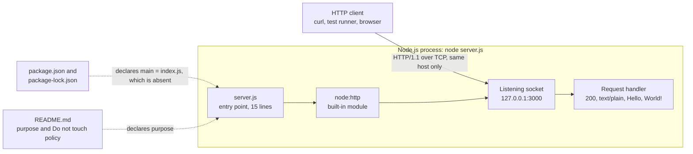

The request path is correspondingly short: the client connects to the loopback socket; Node parses the request line and headers; the handler ignores them, sets `200` and `text/plain`, and calls `res.end` with the constant string; the response is flushed and the connection stays open for reuse until the client or the keep-alive timer closes it. No request body is read, which is why `POST` with a body behaves exactly like `GET`.

### 1.2.3 Success Criteria

No goal framework, service-level objective, dashboard or telemetry exists in the repository, so success can only be judged by external observation of the running process. The measurable objectives below are the acceptance conditions of the artifact as built, each with the basis on which it can be checked.

| Objective | Measure | Basis | Status as found |
|---|---|---|---|
| Starts and serves | Process alive, exact startup line printed, request answered | `node server.js`; `curl` | Met |
| Binds loopback only | One listening socket on `127.0.0.1:3000`; off-host connect refused | socket table; connect to non-loopback address | Met |
| Byte-exact response | 14-byte body `Hello, World!\n`, `200`, `text/plain` | byte dump of response | Met |
| Method- and path-agnostic | Same response for `GET`, `POST`, `HEAD`, unknown paths, query strings | four request shapes exercised | Met |
| No runtime dependency footprint | Empty dependency set; nothing installed | `package.json`, `package-lock.json` | Met |
| Automated regression gate | A test command that passes | `npm test` | Not met — exits `1` by design |
| Correct declared entry point | `main` resolves to an existing file | `package.json` vs. tree | Not met — `index.js` absent |

**Critical success factors.** Each is a precondition that, if absent, prevents the fixture from fulfilling its role.

- **A Node.js runtime on the target host.** No `engines` field pins a version; behavior was verified on Node `v22.23.5`, and the API used (`http.createServer`, `res.statusCode`, `res.setHeader`, `res.end`) is long-stable across Node releases.
- **Port 3000 free on the loopback interface.** A conflicting listener is fatal — the process exits `1` with an uncaught `'error'` event and no retry, so only one instance can serve at a time.
- **Loopback networking available in the execution environment.** A client in a different network namespace, container or host cannot reach the service at all.
- **Invocation of the correct file.** Because `main` names a missing `index.js` and no `start` script exists, the harness must run `node server.js` explicitly.
- **Baseline immutability.** The readme's "Do not touch!" instruction is what keeps the expected output valid over time; any edit to `server.js` invalidates the known answer.

**Key performance indicators.** None are defined, instrumented or exposed by the system: it emits one startup line and nothing else, and it has no endpoint, counter or log that reports its own health. The quantities a reader might reasonably want — request latency, throughput, availability, error rate, uptime — are unmeasured here, and any such measurement must be taken by the external harness that drives the fixture. The only quantities the system itself fixes are deterministic and therefore trivially satisfied: a constant 14-byte payload, a constant status, and no work per request beyond parsing.


## 1.3 Scope

### 1.3.1 In-Scope

The scope of this system is exactly the behavior present in `server.js` and the metadata in the two package files. Anything an implementer would have to add does not exist, so the in-scope list is short and every row is verifiable against the tracked content.

**Core features and functionalities.**

| Feature | Behavior | Evidence |
|---|---|---|
| Fixed-response HTTP endpoint | Every request receives `200`, `Content-Type: text/plain`, body `Hello, World!\n` (14 bytes) | `server.js` handler; verified across methods and paths |
| Loopback listener on a fixed port | Binds `127.0.0.1:3000` and accepts requests only from the same host | `server.js`; single listening socket observed |
| Startup readiness signal | Prints `Server running at http://127.0.0.1:3000/` once the socket is accepting | `server.js` `listen` callback |
| Connection reuse | Keeps HTTP/1.1 connections alive between requests using Node's default policy | `Connection: keep-alive`, `Keep-Alive: timeout=5` in responses |
| npm package metadata | Name `hello_world`, version `1.0.0`, MIT license, description, author | `package.json`, `package-lock.json` |

**Primary user workflows.** All three complete workflows are machine-driven; the operator's participation is limited to starting and stopping the process.

| Workflow | Actor | Steps | Observed outcome |
|---|---|---|---|
| Launch | Operator or harness | Execute `node server.js` in the foreground | Process stays resident; URL line printed to stdout |
| Request and verify | Automated client on the same host | Send a request to `127.0.0.1:3000` on any path with any method; compare the reply | `200`, `text/plain`, `Hello, World!\n` |
| Stop | Operator or supervisor | Interrupt the process (for example `SIGINT`) | Process exits immediately with no drain or closing message |

**Essential integrations.** Only the runtime and the operating system are integrated; the third row is the seam the fixture exists to serve and has no code in this repository.

| Integration | Direction | Mechanism | Evidence |
|---|---|---|---|
| Node.js runtime | Inbound | `require('http')`, CommonJS execution | `server.js`; exercised on Node `v22.23.5` |
| Host TCP stack (loopback interface) | Inbound | `server.listen(3000, '127.0.0.1')` | `server.js`; listening socket |
| External integration harness ("backprop integration") | Inbound, out of process | HTTP requests to `127.0.0.1:3000` | `README.md` states the purpose; no harness code present |
| npm toolchain | Build-time only | `package.json` metadata and a version-3 lockfile | `package.json`, `package-lock.json` |

**Key technical requirements.**

| Requirement | Value or constraint | Evidence |
|---|---|---|
| Runtime and language | Node.js, CommonJS (no transpilation, no build step) | `server.js`; no build scripts |
| Network surface | TCP port `3000` on `127.0.0.1` only; HTTP/1.1 | `server.js`; socket inspection |
| Payload contract | ASCII/UTF-8 text, exactly `Hello, World!` plus `\n` | `server.js`; byte-level measurement |
| Dependency and privilege footprint | No third-party packages, no credentials, no elevated privileges; only the right to bind a loopback port | `package.json`; lockfile; `server.js` |
| Storage footprint | Four tracked files; no writable state or disk I/O at runtime | complete tracked file list |

**Implementation boundaries.**

| Boundary dimension | What is covered | Evidence |
|---|---|---|
| System boundary | One OS process running one file; the boundary ends at the listening socket — no outbound calls, no child processes, no file access | `server.js` |
| User groups covered | Automated HTTP clients executing on the same host; no human personas, accounts or roles | loopback bind; no identity code |
| Geographic and market coverage | Host-local only; no DNS name, no public ingress, no market segment | `server.js` constants |
| Data domains | One constant response string; request lines and headers are parsed and discarded, nothing is persisted, no personal or sensitive data is touched | `server.js` handler |

### 1.3.2 Out-of-Scope

The exclusions below are not omissions of this document; they are absent from the implementation, and no reader should plan around them.

| Excluded capability | Consequence | Evidence |
|---|---|---|
| Routing and REST semantics | Unknown paths return `200` instead of `404`; methods are not distinguished, so a misconfigured client cannot be detected from the response | `server.js` handler; observed identical replies |
| Request body handling | Bodies are never read; `POST` behaves exactly like `GET` | `server.js`; observed `POST` response |
| Dynamic or data-driven content | Response cannot vary by input, environment or data source | constant string literal |
| Authentication, authorization, sessions | No identity model of any kind | no such code in any tracked file |
| TLS/HTTPS and security headers | Traffic is plaintext and local; no CSP, HSTS or CORS headers are emitted | `server.js`; response headers |
| Persistence and state | No database, file store, cache or in-memory state | `server.js` |
| Observability | No metrics, tracing, structured logs, request logs or health endpoint; one startup line only | `server.js`; observed stdout |
| Resilience and scaling | No `'error'` handler, retry, fallback port, graceful shutdown, clustering or load balancing; a busy port exits `1` | observed second-instance failure |
| Configuration management | No environment variables, config files, secret handling or profiles; host and port are literals | `server.js` |
| Containerization, orchestration, CI/CD | No Dockerfile, compose file, workflow or pipeline definition in any branch | tracked file list across all refs |
| Automated tests | The only `test` script is the npm placeholder that exits `1` | `package.json`; `npm test` run |
| User interface | No HTML, static assets or front end; the response is plain text | `server.js` |
| Backpropagation or machine-learning logic | The name in `README.md` refers to the integration exercise, not to implemented computation | absence in all four tracked files |

**Future phase considerations.** No future phase is documented: the repository contains no roadmap, changelog, TODO marker, issue reference or version plan, and its single commit (`5313c12`, "Add files via upload") records no development sequence. The readme's "Do not touch!" instruction points the other way, at preserving the baseline rather than extending it. Any expansion would therefore be a new decision by the owner rather than a planned phase, so none is asserted here.

**Integration points not covered.** Several integrations a reader might assume are explicitly outside the boundary:

- The "backprop" system named in `README.md`: no endpoint, protocol, credential or client code for it appears in any tracked file, so its interface is unknown from this repository.
- The build, deployment and test pipeline that starts and probes this fixture; no CI configuration exists in any branch.
- Monitoring, log aggregation and alerting systems.
- Reverse proxies, public ingress, DNS and TLS termination — unreachable by design because the listener is bound to loopback.
- Any datastore, message broker or identity provider.

**Unsupported use cases.**

- Serving production or public traffic: the loopback bind and plaintext HTTP make external or multi-host access impossible.
- Running more than one instance on a host: the port is hardcoded and a conflict terminates the process.
- Health checking that depends on HTTP status semantics: a probe expecting `404` for an unknown path will receive `200` and may report a false positive.
- Deployment behind a load balancer, container network or service mesh, where a client cannot reach a loopback-bound socket.
- Any task requiring computation over input, storage, identity, or machine-learning backpropagation.
- Execution on a host with no Node.js runtime, since nothing is bundled or compiled.


## 1.4 References

- `README.md` — established the project title `hao-backprop-test`, the purpose statement "test project for backprop integration", and the "Do not touch!" modification policy; the repository's only statement of intent.
- `package.json` — established the package identity (`hello_world` @ `1.0.0`), description, author, MIT license, the `main` field naming an absent `index.js`, the always-failing placeholder `test` script, and the empty dependency set.
- `package-lock.json` — established lockfile version 3 with the root package as the sole entry, confirming no third-party packages are locked or installed.
- `server.js` — established the entire runtime behavior: hardcoded `127.0.0.1:3000`, the unconditional `200` / `text/plain` / `Hello, World!\n` handler, the startup log line, and the absence of routing, configuration, error handling and telemetry.
- `` (repository root) — confirmed the complete contents are four files with no subfolders, and that no `.blitzyignore` file exists.
- Git history and refs (`refs/heads/26_nov_2026`, `refs/heads/main`, `refs/remotes/origin/{main,26_nov_2026,23-Oct,27-Oct}`, commit `5313c12`) — established the single-commit history ("Add files via upload", 3 August 2026), the remote `https://github.com/Sandeep01Kumar/3-August.git`, and that every branch resolves to the identical tree `a650329703778bd216de08fdce13e4531003127c`.
- Runtime observation on Node.js `v22.23.5` with npm `11.21.3` — verified the live response for `GET /`, `GET /any/path?x=1`, `POST /` and `HEAD /` (14-byte body, no `Server` header), the loopback-only listening socket and the refused off-host connection, the `npm test` exit status `1`, the uncaught `'error'` exit on a busy port, and immediate termination on `SIGINT`.

No web sources were consulted; every statement in this section derives from the files and refs listed above.


# 2. Product Requirements

## 2.1 Feature Catalog

The catalog is exhaustive over the four tracked files (`server.js`, `package.json`, `package-lock.json`, `README.md`) and their runtime behavior; every branch in every ref contains exactly those four files, so no capability exists outside this list. The system offers one product capability — a known-answer HTTP endpoint — together with the packaging and operational behavior that surrounds it. Six features are recorded. Five are complete as built in `server.js` and the package files; F-006 is declared in `package.json` but unimplemented, and is therefore cataloged as **Proposed** rather than described as present. Capabilities a reader might expect from an HTTP service — routing, request parsing, authentication, persistence, configuration, telemetry, TLS, graceful shutdown — have no code in the repository and are excluded in §1.3.2; they are not cataloged here, because a catalog entry would imply an implementation that does not exist.

The IDs below are stable and are reused verbatim by the requirement tables in §2.2, the relationship map in §2.3 and the traceability matrix in §2.4.

### 2.1.1 Feature Index

| ID | Feature | Category | Priority |
|---|---|---|---|
| F-001 | Fixed-Response HTTP Endpoint | Core service — HTTP interface | Critical |
| F-002 | Loopback-Only Listener on a Fixed Port | Networking and exposure control | Critical |
| F-003 | Startup Readiness Signal | Operability and diagnostics | Medium |
| F-004 | HTTP/1.1 Connection Reuse | Transport behavior | Low |
| F-005 | Dependency-Free Package Manifest and Lockfile | Packaging and supply chain | High |
| F-006 | Automated Regression Test Command | Quality assurance | High |

Status as found: F-001 through F-005 are **Completed** (implemented and observed at runtime on Node.js `v22.23.5`); F-006 is **Proposed** (the `test` script exists as the npm placeholder that exits `1`, and no test code exists in any branch).

### 2.1.2 F-001 Fixed-Response HTTP Endpoint

**Feature metadata**

| Attribute | Value |
|---|---|
| Feature ID | F-001 |
| Feature name | Fixed-Response HTTP Endpoint |
| Category | Core service — HTTP interface |
| Priority | Critical |
| Status | Completed |

**Description**

| Aspect | Detail |
|---|---|
| Overview | Every HTTP request that reaches the listener — any method, any path, any query string, any body — receives status `200`, `Content-Type: text/plain`, and the body `Hello, World!` followed by a newline (14 bytes). The request handler in `server.js` receives the request object but never reads it. |
| Business value | It is the fixture's whole deliverable: a known-answer oracle whose correctness a single byte-exact assertion settles. Because the payload cannot vary, an integration failure can be attributed to the transport or pipeline under test rather than to application logic. |
| User benefits | A client needs no schema, parser, credential, cookie jar or retry policy. `curl http://127.0.0.1:3000/` prints the expected bytes, and the same assertion holds for every path and method a harness might use accidentally. |
| Technical context | `server.js:6-10` — `http.createServer((req, res) => {...})` with `res.statusCode = 200`, `res.setHeader('Content-Type', 'text/plain')`, `res.end('Hello, World!\n')`. No branching, no I/O, no state; a constant 14-byte payload makes `Content-Length: 14` deterministic for body-bearing methods, and `HEAD` returns headers with no body. |

**Dependencies**

| Dependency type | Item | Evidence and effect |
|---|---|---|
| Prerequisite features | None | The handler is a constant; it needs no other feature to produce its output. |
| System dependencies | Node.js runtime; built-in `node:http` module | `server.js:1` `require('http')`; the only import in the repository. Exercised on Node `v22.23.5`. |
| External dependencies | None | `package.json` declares no `dependencies` or `devDependencies`; `package-lock.json` locks only the root package. |
| Integration requirements | F-002 must have bound the socket, or no request can arrive | Verified: requests are answered only on `127.0.0.1:3000`. |

### 2.1.3 F-002 Loopback-Only Listener on a Fixed Port

**Feature metadata**

| Attribute | Value |
|---|---|
| Feature ID | F-002 |
| Feature name | Loopback-Only Listener on a Fixed Port |
| Category | Networking and exposure control |
| Priority | Critical |
| Status | Completed |

**Description**

| Aspect | Detail |
|---|---|
| Overview | The process binds TCP port `3000` on `127.0.0.1` and nowhere else. Both values are literals in `server.js`; no environment variable, argument or configuration file can change them. |
| Business value | Exposure is bounded by the socket rather than by authentication, which is why the service needs no identity model, no TLS and no secret handling. The fixture can run in a shared environment without becoming reachable from other hosts. |
| User benefits | An operator cannot misconfigure the service into an unreachable or exposed state; there is no port or host variable to get wrong. Only one thing can go wrong — the port being busy — and it fails loudly. |
| Technical context | `server.js:3-4` define `hostname = '127.0.0.1'` and `port = 3000`; `server.js:12` calls `server.listen(port, hostname, ...)`. Verified: listening socket `0100007F:0BB8` (state `0A`, LISTEN) in `/proc/net/tcp`; a connection to the host's non-loopback address `10.11.0.18:3000` was refused (curl exit `7`); `PORT=4000 HOST=0.0.0.0` had no effect and the process still attempted `127.0.0.1:3000`. |

**Dependencies**

| Dependency type | Item | Evidence and effect |
|---|---|---|
| Prerequisite features | None | Binding precedes every other behavior; it is the system's first act. |
| System dependencies | Node.js `net`/`http` bind; operating-system TCP stack and loopback interface | `server.listen` in `server.js:12`; the socket exists only on the loopback address. |
| External dependencies | Availability of port `3000` on the host | A conflicting listener makes the process exit `1`; only one instance can serve per host. |
| Integration requirements | Caller must execute from the same host or network namespace as the process | Off-host connections are refused; container or pod isolation makes the socket unreachable. |

### 2.1.4 F-003 Startup Readiness Signal

**Feature metadata**

| Attribute | Value |
|---|---|
| Feature ID | F-003 |
| Feature name | Startup Readiness Signal |
| Category | Operability and diagnostics |
| Priority | Medium |
| Status | Completed |

**Description**

| Aspect | Detail |
|---|---|
| Overview | Once the socket is accepting, the process prints the single line `Server running at http://127.0.0.1:3000/` on stdout. It prints nothing else at any later point. |
| Business value | It is the only readiness evidence the system emits, so a harness or supervisor can start the fixture and wait for bind completion instead of sleeping an arbitrary interval. |
| User benefits | One grep-able line, deterministic for the fixed host and port, and absent when startup fails — which distinguishes "serving" from "did not start" without inspecting sockets. |
| Technical context | `server.js:12-14` — the callback passed to `server.listen` calls ``console.log(`Server running at http://${hostname}:${port}/`)``, interpolating the same two constants. Verified: stdout held exactly this one line after dozens of requests, stderr stayed empty. |

**Dependencies**

| Dependency type | Item | Evidence and effect |
|---|---|---|
| Prerequisite features | F-002 | The callback fires only after a successful bind; on `EADDRINUSE` stdout stays empty. |
| System dependencies | Node.js `console` writing to stdout; a supervisor that captures the stream | Observed through shell redirection of stdout. |
| External dependencies | None | No log sink, agent or collector is configured. |
| Integration requirements | Consumers should treat the line as the readiness delimiter, and must not parse request traffic from it | No per-request output exists to parse. |

### 2.1.5 F-004 HTTP/1.1 Connection Reuse

**Feature metadata**

| Attribute | Value |
|---|---|
| Feature ID | F-004 |
| Feature name | HTTP/1.1 Connection Reuse |
| Category | Transport behavior |
| Priority | Low |
| Status | Completed |

**Description**

| Aspect | Detail |
|---|---|
| Overview | Responses advertise a persistent connection — `Connection: keep-alive` and `Keep-Alive: timeout=5` — so a client may send several requests on one TCP connection instead of reconnecting for each. |
| Business value | Repeated probes cost one TCP handshake rather than one per assertion, which keeps the fixture cheap to poll inside a longer integration run. |
| User benefits | Standard HTTP clients work without special handling: they keep the socket open and reuse it, so test code carries no connection-management logic. |
| Technical context | The behavior comes from Node's HTTP server defaults, not from code in `server.js`; the handler sets only status, content type and body. Verified with `curl -v` on two sequential requests: `Re-using existing connection with host 127.0.0.1`, two `HTTP/1.1 200 OK` responses and `Connection #0 ... left intact`. `HEAD` also carries the keep-alive headers but no `Content-Length`. |

**Dependencies**

| Dependency type | Item | Evidence and effect |
|---|---|---|
| Prerequisite features | F-001, F-002 | There is nothing to keep alive until the endpoint answers on a bound socket. |
| System dependencies | Node.js HTTP server keep-alive policy and its 5-second idle timeout | Response headers observed on every request; timeout value is a runtime default, not a repository setting. |
| External dependencies | None | No proxy, load balancer or TLS terminator exists to alter the policy. |
| Integration requirements | Client must be able to hold a connection open | Clients that close after each request still work; reuse is an option, not an obligation. |

### 2.1.6 F-005 Dependency-Free Package Manifest and Lockfile

**Feature metadata**

| Attribute | Value |
|---|---|
| Feature ID | F-005 |
| Feature name | Dependency-Free Package Manifest and Lockfile |
| Category | Packaging and supply chain |
| Priority | High |
| Status | Completed — one requirement, F-005-RQ-002, is unmet as found |

**Description**

| Aspect | Detail |
|---|---|
| Overview | `package.json` carries the package identity (`hello_world`, version `1.0.0`, description "Hello world in Node.js", author `hxu`, license `MIT`), an empty dependency set, one `test` script and `"main": "index.js"`. `package-lock.json` is lockfile version 3 whose only package record is the root package. No `node_modules` directory exists. |
| Business value | The supply-chain surface is eliminated at the application level: nothing is resolved from a registry at install, build or test time, so a pipeline failure cannot originate in a transitive package. The MIT license makes the artifact reusable without legal review. |
| User benefits | `npm install` is a no-op that cannot break; there are no advisories to triage and no version drift between runs. |
| Technical context | `npm ls --all` reports `(empty)`. Declaring `"main": "index.js"` is inconsistent with the shipped tree: no `index.js` exists in any branch, so `node -e "require('./')"` fails with `MODULE_NOT_FOUND` and the message "Please verify that the package.json has a valid \"main\" entry". `npm start` still serves because npm falls back to its default start script `node server.js`; `npm pack` includes `README.md`, `package.json` and `server.js` (3 files). The real entry point is `server.js`, and automation must invoke it explicitly. |

**Dependencies**

| Dependency type | Item | Evidence and effect |
|---|---|---|
| Prerequisite features | None | Metadata stands alone; it neither requires nor enables a running service. |
| System dependencies | npm toolchain for interpretation only (`npm test`, `npm start`, `npm pack`) | Verified with npm `11.21.3`; no package is installed. |
| External dependencies | Node.js runtime for the declared `test` script and default `start` script | Both resolve to shell/runtime commands with no downloads. |
| Integration requirements | Consumers must reference `server.js`, not the manifest's `main` field | `require('./')` fails; documented in §1.2 and §1.3. |

### 2.1.7 F-006 Automated Regression Test Command

**Feature metadata**

| Attribute | Value |
|---|---|
| Feature ID | F-006 |
| Feature name | Automated Regression Test Command |
| Category | Quality assurance |
| Priority | High |
| Status | Proposed |

**Description**

| Aspect | Detail |
|---|---|
| Overview | The manifest declares an npm `test` lifecycle script, which is the standard slot for the verification gate this fixture exists to serve. As found, the script is the npm placeholder `echo "Error: no test specified" && exit 1`: it runs successfully but always fails, and no test code or test dependency exists in any branch. |
| Business value | Implemented, the command would turn the known-answer contract into a one-step pass/fail gate (`npm test` exit status `0` or non-zero), which is what makes the fixture useful to an automated pipeline rather than to a human running `curl`. As found, that value is unrealized and the gate must be supplied by the external harness named in `README.md`. |
| User benefits | Today the placeholder fails loudly and explicitly ("Error: no test specified"), which prevents a false green build; it does not yet give a reviewer a single command that confirms the contract. |
| Technical context | `package.json:6-8`. `npm test` exits `1` with the placeholder text, and `npm run` lists `test` as the only lifecycle script. Because there is no test framework in the (empty) dependency set, an implementation would have to assert the contract with the Node runtime alone — for example by starting `server.js`, issuing a request, and comparing status, content type and the 14-byte body. |

**Dependencies**

| Dependency type | Item | Evidence and effect |
|---|---|---|
| Prerequisite features | F-001, F-002 | A meaningful assertion requires the endpoint and its listener to exist; that is the contract the test would pin. |
| System dependencies | npm lifecycle execution; Node.js runtime with built-in `http` for an assertion client | No test framework is installed, so the assertion must be written against the runtime. |
| External dependencies | None declared | `npm run` lists no other lifecycle scripts; no CI workflow exists in any branch. |
| Integration requirements | Whoever implements it must keep the fixture's response unchanged, per the readme's "Do not touch!" policy | `README.md` is the authority on the expected output. |


## 2.2 Functional Requirements Table

Requirements use the identifier `F-XXX-RQ-YYY`, where `F-XXX` is the owning feature from §2.1 and `YYY` is sequential within that feature. Every requirement is stated so that a single observable check settles it: an HTTP exchange, a process exit status, a file content comparison or a header inspection. Requirements are recorded at **version 1.0** against tree `a650329703778bd216de08fdce13e4531003127c` (commit `5313c12`); because the readme's "Do not touch!" policy fixes the expected output, any change to a requirement implies a change to the fixture's contract and a version increment.

Priority uses three values, and they are assigned by the fixture's own purpose rather than by product ambition. **Must-Have** requirements constitute the contract the external harness depends on — losing one breaks the known answer. **Should-Have** requirements are the properties that make the fixture operable and safe to automate. **Could-Have** requirements are inherited runtime conveniences whose loss would not change any assertion. Complexity is `Low`, `Medium` or `High` relative to the ~15-line `server.js` baseline: `Low` means a literal or a framework default, `Medium` means new code, `High` means new code plus new dependencies — no requirement in this system is `High`.

### 2.2.1 F-001 Requirements — Fixed-Response HTTP Endpoint

**Requirement details**

| Requirement ID | Description | Acceptance criteria | Priority / Complexity |
|---|---|---|---|
| F-001-RQ-001 | Every request that reaches the listener receives status `200`, `Content-Type: text/plain` and the body `Hello, World!` plus a newline. | `GET /` returns status line `HTTP/1.1 200 OK`, header `Content-Type: text/plain` with no charset parameter, and a body whose byte dump is exactly `Hello, World!\n`. | Must-Have / Low |
| F-001-RQ-002 | The response does not depend on method or path: no routing, no `404`, no method rejection. | `GET /`, `GET /any/path?x=1`, `POST /`, `PUT /nope`, `OPTIONS /` and `HEAD /` all return `200`; bodies are byte-identical wherever a body is permitted; there is no distinct reply for an unknown path. | Must-Have / Low |
| F-001-RQ-003 | The request body is never read, buffered or interpreted. | `POST /` with body `payload=123` returns the constant body immediately, without an error, timeout or echo. | Must-Have / Low |
| F-001-RQ-004 | The payload is exactly 14 bytes including the trailing newline, declared as `Content-Length: 14` on body-bearing responses. | `wc -c` on the response body reports `14`; the response carries `Content-Length: 14`; the final byte is `\n`. | Must-Have / Low |

**Technical specifications**

| Requirement ID | Input parameters | Output / response | Performance criteria and data requirements |
|---|---|---|---|
| F-001-RQ-001 | Any HTTP/1.1 request; `req` is accepted and ignored (`server.js:6`). | `200`, `text/plain`, `Hello, World!\n`; plus framework headers `Date`, `Connection`, `Keep-Alive`, `Content-Length`. | Constant work per request: no I/O, no allocation beyond header parsing. Measured 0.455–1.040 ms per request (avg 0.588 ms over 10), 50 concurrent requests in 35 ms. Holds one constant string; no state. |
| F-001-RQ-002 | Method, path, query string and headers — all ignored. | Same status, content type and body for every combination; `HEAD` returns headers only, with no body and no `Content-Length`. | No branching on the request, so latency is independent of path depth or query length. | 
| F-001-RQ-003 | Optional request body of any length. | Response is produced without reading the body; the connection is closed or reused per normal HTTP rules rather than left waiting. | Response time unaffected by body size; no buffering, so no memory growth with upload size — the body is discarded by the parser, not stored by the application. |
| F-001-RQ-004 | None. | Body bytes `Hello, World!` = 13 ASCII characters + `\n`; `Content-Length: 14`. | Byte-exactness is the assertion the harness relies on; the payload is a literal, so it cannot drift without an edit to `server.js:9`. |

**Validation rules**

| Requirement ID | Business rules and data validation | Security requirements | Compliance requirements |
|---|---|---|---|
| F-001-RQ-001 | The body must equal the literal in `server.js:9` exactly, including trailing newline; status must be `200` (not `204`, not `304`). | No authentication or authorization is applied; the loopback bind (F-002) is the only access control. No security headers (`CSP`, `HSTS`, `X-Frame-Options`, CORS) are emitted — accepted, because there is no browser client. | The MIT license in `package.json` is the only compliance artifact; no data-protection scope exists because no data is stored or transmitted beyond the constant string. |
| F-001-RQ-002 | An unknown path must **not** produce `404`; a `POST` must **not** be rejected. This is the intended contract, and it makes the service unsuitable as a health probe that relies on status semantics. | No method allow-list exists, so every verb is accepted; acceptable only because the socket is loopback-bound. | None applicable. |
| F-001-RQ-003 | A body-bearing request must not hang: the response is written without consuming the body. | Request content is never parsed, so no parser is exposed to hostile input; no request data is logged. | None applicable. |
| F-001-RQ-004 | Byte identity is the pass condition; substring or trimmed comparison is not sufficient to prove the newline is present. | N/A. | N/A. |

### 2.2.2 F-002 Requirements — Loopback-Only Listener on a Fixed Port

**Requirement details**

| Requirement ID | Description | Acceptance criteria | Priority / Complexity |
|---|---|---|---|
| F-002-RQ-001 | The process listens on TCP `3000` bound to `127.0.0.1` and no other address. | Exactly one listening socket exists for the process, shown as `0100007F:0BB8` in `/proc/net/tcp`; a connection to the host's non-loopback address (`10.11.0.18:3000`) is refused. | Must-Have / Low |
| F-002-RQ-002 | Host and port are not configurable at runtime. | With `PORT=4000 HOST=0.0.0.0` in the environment the process still attempts `127.0.0.1:3000`; no listener appears on `4000` or on any non-loopback address. | Must-Have / Low |
| F-002-RQ-003 | A port conflict terminates the process rather than retrying or selecting another port. | A second instance exits with status `1`, writes nothing to stdout, and writes an uncaught `'error'` trace naming `EADDRINUSE` for `127.0.0.1:3000` to stderr. | Should-Have / Low |
| F-002-RQ-004 | Transport is plaintext HTTP/1.1; no TLS is offered. | Responses are `HTTP/1.1` in clear text on the same socket; no TLS handshake completes on port `3000`. | Must-Have / Low |

**Technical specifications**

| Requirement ID | Input parameters | Output / response | Performance criteria and data requirements |
|---|---|---|---|
| F-002-RQ-001 | Constants `hostname = '127.0.0.1'`, `port = 3000` (`server.js:3-4`), passed to `server.listen` (`server.js:12`). | A single accepting socket on the loopback interface. | Bind completes before the readiness line; no measurable startup cost beyond Node's module load. Only one instance per host is possible. |
| F-002-RQ-002 | Environment variables, command-line arguments and config files are not consulted anywhere in `server.js`. | Behavior is identical regardless of the environment in which the process is started. | N/A — no configuration read, so no validation or defaulting logic exists to fail. |
| F-002-RQ-003 | A bind attempt against an occupied address. | Immediate `EADDRINUSE` uncaught event on stderr; process exit `1`. | Failure is immediate (no retry loop, no backoff). No state to clean up because the socket never opened. |
| F-002-RQ-004 | TCP connections on `127.0.0.1:3000`. | Plaintext HTTP/1.1 responses. | No encryption overhead; payload is a fixed 14 bytes. |

**Validation rules**

| Requirement ID | Business rules and data validation | Security requirements | Compliance requirements |
|---|---|---|---|
| F-002-RQ-001 | The listener must not bind `0.0.0.0` or a host name; the literal `127.0.0.1` is the requirement. | This bind is the system's sole security control: only processes in the same host or network namespace can connect. Reaching it from another container or host must be impossible. | Running as an unprivileged user with the right to bind a loopback port is sufficient; no elevated privilege is required or documented. |
| F-002-RQ-002 | Hardcoding is deliberate; introducing `process.env` reads would violate the fixture's determinism. | No secret or credential is read, stored or required — there is nothing to leak. | Operational restriction is host-local only; no geographic or market constraint applies because no external client is served. |
| F-002-RQ-003 | Retry, fallback port and clustering are explicitly excluded; a busy port is a hard failure. | The stack trace exposes local paths only; acceptable for an internal fixture. | N/A. |
| F-002-RQ-004 | TLS termination is out of scope; a proxy would be required and none exists. | Traffic on loopback is unencrypted; acceptable because it never leaves the host. | N/A. |

### 2.2.3 F-003 Requirements — Startup Readiness Signal

**Requirement details**

| Requirement ID | Description | Acceptance criteria | Priority / Complexity |
|---|---|---|---|
| F-003-RQ-001 | When the socket is accepting, print exactly one line: `Server running at http://127.0.0.1:3000/`, terminated by a newline. | Captured stdout equals that single line byte-for-byte; it appears only after a successful bind and is absent when the process fails to bind. | Must-Have / Low |
| F-003-RQ-002 | Emit nothing else on stdout or stderr during normal operation, including no per-request logging. | After 20 or more requests, stdout still holds exactly one line and stderr holds zero lines. | Should-Have / Low |

**Technical specifications**

| Requirement ID | Input parameters | Output / response | Performance criteria and data requirements |
|---|---|---|---|
| F-003-RQ-001 | Successful completion of `server.listen`'s callback (`server.js:12-14`). | `console.log` of the template literal interpolating `hostname` and `port`. | Emitted once per process lifetime; a supervisor may block on it instead of sleeping. No log sink, file or timestamp is involved, so the line is byte-stable. |
| F-003-RQ-002 | Requests served after startup. | No additional output. | Output volume is O(1) for any number of requests; nothing to rotate or truncate. |

**Validation rules**

| Requirement ID | Business rules and data validation | Security requirements | Compliance requirements |
|---|---|---|---|
| F-003-RQ-001 | The line must be emitted only after the socket accepts — treating it as emitted at process start would create a race. Because the host and port are literals, the URL in the line is deterministic. | The line discloses only the loopback address; no hostname, environment, build or version metadata is exposed. | N/A. |
| F-003-RQ-002 | Absence of request logging is a requirement here, not an oversight: request data must not reach any log. | No request line, header, path or query string is ever written out, so no client data can leak into logs. | N/A — no audit-trail requirement exists. |

### 2.2.4 F-004 Requirements — HTTP/1.1 Connection Reuse

**Requirement details**

| Requirement ID | Description | Acceptance criteria | Priority / Complexity |
|---|---|---|---|
| F-004-RQ-001 | Every response advertises a persistent connection. | Each response carries `Connection: keep-alive` and `Keep-Alive: timeout=5`. | Could-Have / Low |
| F-004-RQ-002 | A client may send repeated requests on one TCP connection. | `curl -v` against two URLs reports `Re-using existing connection with host 127.0.0.1`, two `HTTP/1.1 200 OK` responses and `Connection #0 ... left intact`. | Could-Have / Low |

**Technical specifications**

| Requirement ID | Input parameters | Output / response | Performance criteria and data requirements |
|---|---|---|---|
| F-004-RQ-001 | A request without `Connection: close`. | Response headers `Connection: keep-alive`, `Keep-Alive: timeout=5` — produced by Node's HTTP server default, not by `server.js`. | Idle connections are closed after 5 seconds of inactivity, bounding socket lifetime. |
| F-004-RQ-002 | Sequential requests on an established socket. | Multiple `200` responses on the same socket, each with the constant body. | One handshake amortized over many assertions; the 50-request concurrency check completed in 35 ms. |

**Validation rules**

| Requirement ID | Business rules and data validation | Security requirements | Compliance requirements |
|---|---|---|---|
| F-004-RQ-001 | The advertised values are runtime defaults; the repository must not be read as configuring them. | Persistent connections are bounded by the 5-second timeout, so abandoned sockets are reclaimed. | N/A. |
| F-004-RQ-002 | Reuse is optional: a client that closes after each request must still receive correct responses. | No connection pooling, proxy or multiplexing exists; each socket serves its own client only. | N/A. |

### 2.2.5 F-005 Requirements — Dependency-Free Package Manifest and Lockfile

**Requirement details**

| Requirement ID | Description | Acceptance criteria | Priority / Complexity |
|---|---|---|---|
| F-005-RQ-001 | Declare the package identity and license. | `package.json` carries `name` `hello_world`, `version` `1.0.0`, `license` `MIT`, `description` "Hello world in Node.js" and author `hxu`; `package-lock.json` repeats name, version and license in its root record. | Must-Have / Low |
| F-005-RQ-002 | The declared `main` entry must resolve to a file that exists. | `node -e "require('./')"` succeeds. **Not met as found:** it fails with `MODULE_NOT_FOUND` for `index.js`, which exists in no branch. | Must-Have / Low |
| F-005-RQ-003 | Declare and lock zero third-party dependencies. | `npm ls --all` reports only the root package; the lockfile's `packages` map contains the empty-string root key alone; no `node_modules` directory is created or required. | Must-Have / Low |
| F-005-RQ-004 | Provide a start command that runs the service without extra arguments. | `npm start` starts the process and prints the readiness line of F-003-RQ-001 while `npm run` lists no `start` script — the behavior comes from npm's default `node server.js`. | Should-Have / Low |

**Technical specifications**

| Requirement ID | Input parameters | Output / response | Performance criteria and data requirements |
|---|---|---|---|
| F-005-RQ-001 | `package.json`, `package-lock.json` contents. | Machine-readable identity consumed by npm commands. | No runtime effect; metadata only. Three identities coexist in the repository (readme title `hao-backprop-test`, package `hello_world`, remote `3-August`) and none is reconciled by any file. |
| F-005-RQ-002 | `npm`/`node` resolution of the `main` field. | Success expected; currently a `MODULE_NOT_FOUND` error. | Fails before any server code runs, so `require`-style consumption is impossible; execution must target `server.js` directly. |
| F-005-RQ-003 | `npm install`, `npm ls`, `npm pack`. | Empty dependency tree; tarball containing `README.md` (73 B), `package.json` (251 B) and `server.js` (342 B). | Install is a no-op with no network access; package size 553 B, unpacked 666 B. |
| F-005-RQ-004 | `npm start`. | Server serves on `127.0.0.1:3000` and prints the readiness line. | Same startup profile as direct invocation; npm adds process-wrapper overhead only. |

**Validation rules**

| Requirement ID | Business rules and data validation | Security requirements | Compliance requirements |
|---|---|---|---|
| F-005-RQ-001 | The license field must remain `MIT`; `lockfileVersion` must remain `3` so the lockfile stays consistent with npm's current format. | Metadata exposes no credentials, tokens or internal endpoints. | MIT license is the sole licensing declaration; no NOTICE, copyright header or third-party attribution exists because there is no third-party code. |
| F-005-RQ-002 | The manifest must not claim an entry point that does not exist; either `index.js` is added or `main` is corrected to `server.js`. This is the one open packaging defect. | N/A. | N/A. |
| F-005-RQ-003 | Any added dependency would break the fixture's zero-supply-chain property and must be treated as a contract change. | No dependency means no transitive advisory surface and no install-time script execution from packages. | No open-source attribution obligation arises. |
| F-005-RQ-004 | A `start` script, if added explicitly, must not alter the host, port or payload. | N/A. | N/A. |

### 2.2.6 F-006 Requirements — Automated Regression Test Command

**Requirement details**

| Requirement ID | Description | Acceptance criteria | Priority / Complexity |
|---|---|---|---|
| F-006-RQ-001 | The `test` script must exit `0` when the contract holds and non-zero when it does not. **As found** it exits `1` unconditionally with `Error: no test specified`. | Passing case: with `server.js` running, `npm test` exits `0`. Failing case: after altering any of status, content type or body, `npm test` exits non-zero. | Must-Have / Medium |
| F-006-RQ-002 | The test must require no package beyond the Node.js runtime, preserving F-005-RQ-003. | After implementation, `npm ls --all` still reports only the root package and no `node_modules` is required. | Should-Have / Medium |
| F-006-RQ-003 | The test must not change the fixture's observable contract. | `server.js` response literals remain `200` / `text/plain` / `Hello, World!\n`; the `test` script is the only edited manifest field. | Must-Have / Low |

**Technical specifications**

| Requirement ID | Input parameters | Output / response | Performance criteria and data requirements |
|---|---|---|---|
| F-006-RQ-001 | npm lifecycle invocation; a running instance on `127.0.0.1:3000`. | Exit status `0` on success, non-zero on failure, with the failing assertion on stdout/stderr. | Must start, probe and stop within a few seconds; the request itself costs under 1.1 ms. No result data is retained. |
| F-006-RQ-002 | Node built-ins only (`http`, `child_process`, `assert` or equivalents). | A self-contained script invoked by the `test` entry. | No install step, so the gate runs offline. |
| F-006-RQ-003 | The existing `package.json` `scripts` object. | Unchanged runtime behavior; `npm run` still lists `test` as the only lifecycle script. | N/A. |

**Validation rules**

| Requirement ID | Business rules and data validation | Security requirements | Compliance requirements |
|---|---|---|---|
| F-006-RQ-001 | The assertion must compare the full 14-byte body, the `200` status and `text/plain` — a check of status alone would pass against a wrong payload. It must also free port `3000` when finished, since a leftover listener makes the next run fail with `EADDRINUSE`. | The test must bind or probe only the loopback address; it must not widen the listener's exposure. | N/A. |
| F-006-RQ-002 | Introducing a framework such as Jest or Mocha would contradict F-005-RQ-003 and is therefore a requirement conflict to be resolved before implementation. | No network install; no third-party test code executes. | No new license obligations. |
| F-006-RQ-003 | The readme's "Do not touch!" policy constrains the test to observation, not modification, of the fixture. | N/A. | N/A. |


## 2.3 Feature Relationships

The relationships below are read directly from the code: `server.js` is a single module with no exports and no internal interfaces, so every connection between features is either a position in the startup sequence, a shared literal, or the surrounding Node/npm machinery. No relationship is inferred beyond what the file structure shows.

### 2.3.1 Feature Dependency Map

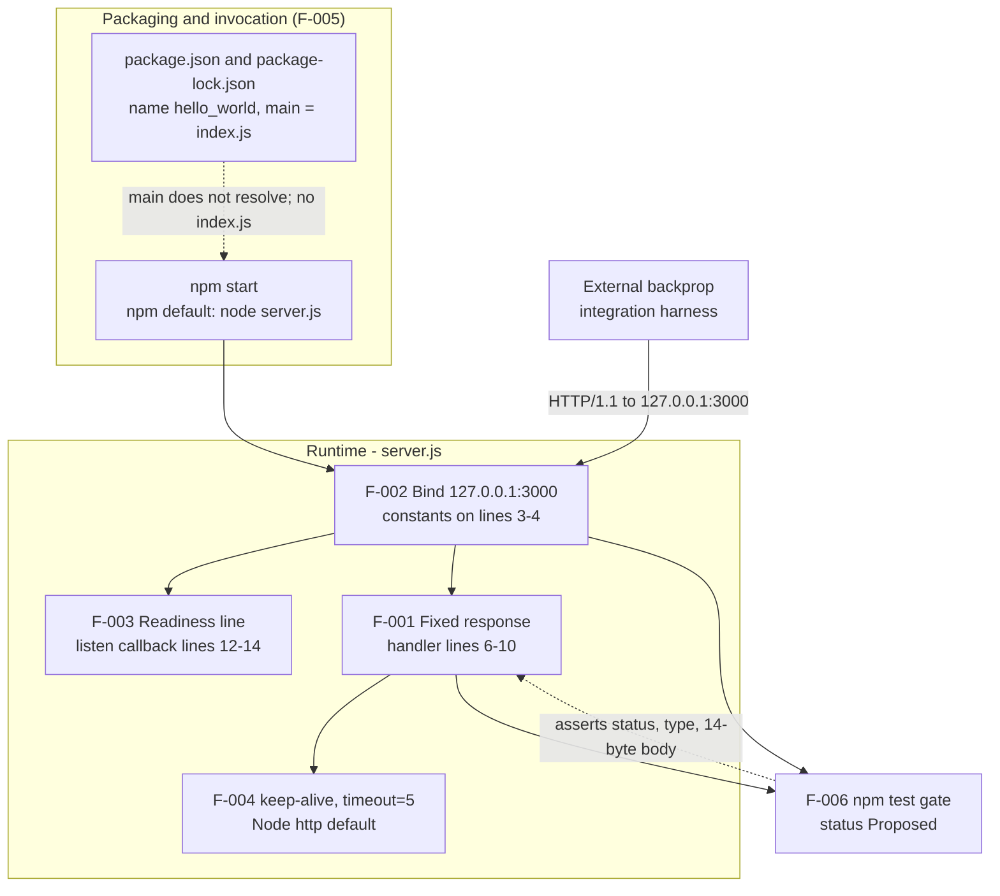

| Feature | Depends on | Nature of the dependency |
|---|---|---|
| F-001 Fixed-response endpoint | F-002 | The handler can only produce output once a socket is bound; there is no transport-independent path to the response. |
| F-002 Loopback listener | Nothing in this repository | Its only prerequisites are the Node.js runtime and a free loopback port `3000`; it is the root of the runtime graph. |
| F-003 Readiness signal | F-002 | `console.log` sits inside the `listen` callback, so the line is emitted only after a successful bind and never on `EADDRINUSE`. |
| F-004 Connection reuse | F-001, F-002 | Keep-alive is a property of responses the endpoint produces; with no handler there is no connection to keep alive. |
| F-005 Manifest and lockfile | Nothing | Metadata only; it neither requires nor is required by runtime code, but it governs how the process can be invoked (`npm start`) and how the package can be consumed (`main`). |
| F-006 Test command | F-001, F-002; constrained by F-005 | A meaningful assertion needs the endpoint plus a bound socket, and the zero-dependency rule in F-005 limits the assertion to Node built-ins. |

Two properties of this graph shape everything downstream. First, it is a tree with a single root (F-002) and no cycles, so no feature can be started or verified in isolation from the listener. Second, F-005 sits outside the runtime tree: a broken `main` field cannot stop the server, and that is precisely the state observed — `npm start` still serves because npm falls back to its default `node server.js` script, while `require('./')` fails. The dependency that the manifest *claims* (`main → index.js`) does not exist, and the dependency that *does* exist (`npm start → server.js`) is undeclared.

### 2.3.2 Integration Points

| Integration point | Direction | Mechanism |
|---|---|---|
| External integration harness ("backprop integration" in `README.md`) | Inbound, out of process | HTTP/1.1 requests to `127.0.0.1:3000`. The harness has no code, configuration or credential in this repository; only its existence is named. |
| Operating-system loopback interface | Inbound | One LISTEN socket `0100007F:0BB8`; no other interface is opened. Off-host connections are refused. |
| Node.js runtime | Inbound | `require('http')` (`server.js:1`), `http.createServer`, `res.statusCode`, `res.setHeader`, `res.end`, `server.listen`. No other module is loaded. |
| npm CLI | Build and invocation time | Interprets `package.json` identity, runs the `test` script, falls back to its default `start` script, and reads `main` when a consumer requires the package. Install is a no-op. |
| Process supervisor / operator | Out of process | Starts the process, reads the single stdout line for readiness, and terminates it (`SIGINT` ends the process immediately with no drain or closing message). |
| Source control remote | Out of band | `origin` = `https://github.com/Sandeep01Kumar/3-August.git`; not touched at runtime. |

Nothing else is integrated. There is no database, queue, cache, identity provider, log aggregator, metrics endpoint, proxy or DNS dependency in any branch.

### 2.3.3 Shared Components

| Shared component | Used by | How it is shared |
|---|---|---|
| `server.js` module scope | F-001, F-002, F-003 | One file holds the constants, the handler and the listen call; there are no exports, so no other feature or test can import the handler — it can only be exercised over HTTP. |
| `hostname` and `port` literals (`server.js:3-4`) | F-001, F-002, F-003 | The same two constants feed `server.listen` and the readiness template literal, which is why the logged URL always matches the bound address. |
| Node's `http` server object | F-001, F-004 | The same server instance parses requests, serializes the handler's output and applies the keep-alive policy; the two features are two views of one object. |
| `package.json` | F-005, F-006 | One manifest carries identity, the `test` script and the (unresolved) `main` field; the `scripts` object is the single extension point for automation. |
| `package-lock.json` | F-005 | Mirrors the manifest's root identity; it is the artifact that proves no third-party package is locked. |
| `README.md` | F-005, F-006 | States the fixture's purpose and the "Do not touch!" policy that fixes the expected output both features are judged against. |

There is no shared library, no utility module and no configuration object. The absence of exports is itself the reason F-006 cannot unit-test the handler in-process: any real test must start the process and speak HTTP.

### 2.3.4 Common Services

| Service | Consumed by | Provided by |
|---|---|---|
| HTTP/1.1 parsing and serialization | F-001, F-004 | Node's built-in `http` module — request line and header parsing, status-line and header emission, `Content-Length` handling. |
| TCP listening and accept loop | F-002 | Node's `net` layer inside `http.Server`, over the operating system's loopback interface. |
| Persistent-connection and idle-timeout management | F-004 | Node's HTTP server defaults (`Keep-Alive: timeout=5`), not repository code. |
| stdout console output | F-003 | Node's `console`, writing one line to process stdout; no logging framework, log level or sink exists. |
| Process lifecycle and exit status | F-002, F-003, F-006 | Node's default behavior — an uncaught `'error'` event exits `1`; `SIGINT` terminates without a handler. No graceful-shutdown service exists. |
| Lifecycle script execution | F-006 | The npm CLI running `package.json` scripts, plus npm's default `start` script. |

Not present as services: authentication, authorization, session management, caching, persistence, scheduling, metrics, tracing and alerting. Their absence is recorded in §1.3.2 and reflected in the catalog — no feature in §2.1 relies on them.


## 2.4 Implementation Considerations

All considerations below apply to the six features of §2.1 and are keyed by their IDs. Because the runtime is one 15-line file, the constraints are unusually sharp: there is nothing to tune, so each constraint is a hard property of the artifact rather than a design trade-off inside it.

### 2.4.1 Traceability Matrix

Every requirement in §2.2 is traced to the observation that settles it. Status is stated as found on Node.js `v22.23.5`, tree `a650329703778bd216de08fdce13e4531003127c`.

| Requirement ID | Feature | Acceptance evidence | Status |
|---|---|---|---|
| F-001-RQ-001 | F-001 | `GET /` → `HTTP/1.1 200 OK`, `Content-Type: text/plain`, 14-byte body `Hello, World!\n` | Met |
| F-001-RQ-002 | F-001 | Identical 200 responses for `GET /`, `GET /any/path?x=1`, `POST /`, `PUT /nope`, `OPTIONS /`, `HEAD /`, `GET /does-not-exist`; no `404` | Met |
| F-001-RQ-003 | F-001 | `POST /` with `payload=123` returned the constant body immediately; `server.js` never reads `req` | Met |
| F-001-RQ-004 | F-001 | Body measured at 14 bytes; `Content-Length: 14`; final byte `\n` | Met |
| F-002-RQ-001 | F-002 | LISTEN socket `0100007F:0BB8`; connect to `10.11.0.18:3000` refused (curl exit `7`) | Met |
| F-002-RQ-002 | F-002 | `PORT=4000 HOST=0.0.0.0` ignored; process attempted `127.0.0.1:3000`; no listener on `4000` | Met |
| F-002-RQ-003 | F-002 | Second instance exit `1`, empty stdout, stderr `EADDRINUSE ... 127.0.0.1:3000` | Met |
| F-002-RQ-004 | F-002 | Plaintext HTTP/1.1 replies on the same socket; no TLS module, certificate or key in any tracked file | Met |
| F-003-RQ-001 | F-003 | stdout exactly `Server running at http://127.0.0.1:3000/`; absent on `EADDRINUSE` | Met |
| F-003-RQ-002 | F-003 | stdout one line and stderr zero lines after 200+ requests and protocol probes | Met |
| F-004-RQ-001 | F-004 | Every response carried `Connection: keep-alive` and `Keep-Alive: timeout=5` | Met |
| F-004-RQ-002 | F-004 | `curl -v` two requests: `Re-using existing connection`, two 200s, `Connection #0 ... left intact` | Met |
| F-005-RQ-001 | F-005 | `package.json` name/version/description/author/license; lockfile root record repeats name, version, license | Met |
| F-005-RQ-002 | F-005 | `node -e "require('./')"` → `MODULE_NOT_FOUND` for absent `index.js` | Not met |
| F-005-RQ-003 | F-005 | `npm ls --all` → `(empty)`; lockfile `packages` holds only the `""` key; no `node_modules` | Met |
| F-005-RQ-004 | F-005 | `npm start` served and printed the readiness line; `npm run` lists no `start` script | Met |
| F-006-RQ-001 | F-006 | `npm test` exits `1` with `Error: no test specified`; no assertion exists | Not met — Proposed |
| F-006-RQ-002 | F-006 | No test framework or script exists, so the constraint is untested | Proposed |
| F-006-RQ-003 | F-006 | `server.js` literals unmodified; no test exists that could alter them | Met — vacuously |

**Feature-to-specification cross-reference**

| Feature | Requirements | Related specification sections | Related diagram or workflow |
|---|---|---|---|
| F-001 | F-001-RQ-001 … 004 | §1.2.2 primary capabilities and response contract; §1.3.1 core features | Request-path description and component/request flowchart in §1.2.2; "Request and verify" workflow in §1.3.1 |
| F-002 | F-002-RQ-001 … 004 | §1.2.1 limitations (loopback, hardcoded port); §1.3.1 essential integrations | Component diagram in §1.2.2; "Launch" workflow in §1.3.1 |
| F-003 | F-003-RQ-001 … 002 | §1.2.3 critical success factors; §1.3.1 startup readiness signal | "Launch" workflow in §1.3.1 |
| F-004 | F-004-RQ-001 … 002 | §1.3.1 connection reuse | Connection-handling narrative in §1.2.2 |
| F-005 | F-005-RQ-001 … 004 | §1.2.1 manifest limitation; §1.3.1 npm toolchain integration | Feature dependency map in §2.3.1 |
| F-006 | F-006-RQ-001 … 003 | §1.2.3 success criteria (unmet row); §1.3.2 automated tests excluded | Feature dependency map in §2.3.1 |

### 2.4.2 Technical Constraints

| Feature | Constraint | Consequence if changed or violated | Evidence |
|---|---|---|---|
| F-001 | The payload, status and content type are literals; the handler never inspects `req`. | Any edit to `server.js:7-9` invalidates the known answer the fixture exists to provide. | `server.js:6-10` |
| F-001 | The `200` contract holds only for requests Node parses as valid HTTP; the runtime answers protocol errors before the handler runs. | A harness that sends a malformed request or a header larger than Node's 16 KB default receives `400 Bad Request` or `431 Request Header Fields Too Large` with `Connection: close`, not the constant body — a failure that is the client's, not the application's. | Raw-socket probes: `GARBAGE-LINE` → `400`; 20 KB header → `431` |
| F-002 | Host and port are compile-time constants (`127.0.0.1`, `3000`); no environment, argument or config source is read. | Retargeting the service requires editing code, which contradicts the readme policy; two instances cannot coexist on one host. | `server.js:3-4`, `12`; env-override test |
| F-002 | There is no `'error'` handler on the server object. | A busy port raises an uncaught `'error'` event and the process exits `1` with a stack trace — no retry, no fallback port. | Second-instance run |
| F-002 | There is no `SIGINT`/`SIGTERM` handler and no drain logic. | Termination is immediate, potentially mid-response; no closing message is printed. | `kill -INT` on the owning pid: process gone, stdout unchanged |
| F-003 | The readiness line interpolates the same constants as the bind, and is emitted only inside the `listen` callback. | Parsing the line instead of probing the socket is safe only because the literals are fixed; changing one constant changes the other automatically. | `server.js:12-14` |
| F-004 | Keep-alive values come from Node's defaults, not from repository code. | Upgrading Node could change `Keep-Alive: timeout=5`; nothing in the repository pins that behavior. | Response headers; no `engines` field in `package.json` |
| F-005 | `"main": "index.js"` names a file that exists in no branch or commit. | `require('./')` and any `main`-based consumer fail before reaching the server; automation must invoke `server.js` or `npm start`. | `package.json:5`; `MODULE_NOT_FOUND` run; `git log --all --name-only` |
| F-005 | No `engines` field and no dependency pinning of the runtime. | Behavior depends on whichever Node version the host provides; verified on `v22.23.5`, and the APIs used are long-stable. | `package.json` |
| F-006 | The `test` script is the npm placeholder that always fails, and no test framework is available. | No automated gate exists; `npm test` cannot be used by a pipeline, and any implementation must be written against Node built-ins. | `package.json:6-8`; `npm test` exit `1`; `npm run` |

### 2.4.3 Performance Requirements

The repository defines no service-level objective, KPI or performance budget — there is no telemetry, no benchmark and no instrumentation in any tracked file. The values below are therefore measured baselines, not commitments, and any threshold a harness adopts must come from that harness.

| Metric | Observed value | Basis |
|---|---|---|
| Per-request latency (loopback) | min 0.455 ms, max 1.040 ms, avg 0.588 ms over 10 sequential requests | `curl -w %{time_total}` against `127.0.0.1:3000`; includes client process overhead |
| Sequential throughput | 200 requests in 1139 ms (≈5.7 ms per request) | 200 sequential `curl` invocations, dominated by client process startup |
| Concurrent handling | 50 parallel requests completed in 35 ms | 50 concurrent `curl` processes against one server |
| Response size | Constant 14 bytes; no variance | Byte measurement of every response |
| Startup | Readiness line printed within 1.2 s of launch in every run; exact startup time not measured | Launch attempts across this investigation |
| Output volume | 1 stdout line per process lifetime, 0 stderr lines | Captured streams after 200+ requests |

Per-request cost is constant in principle: the handler performs no I/O, no allocation beyond header parsing and holds no state, so latency does not vary with path, query length or body size. The practical ceiling is the single-threaded event loop, and nothing in the repository measures where that ceiling lies.

### 2.4.4 Scalability Considerations

| Dimension | Position as found | Limit and what governs it |
|---|---|---|
| Horizontal scale | Not supported: host and port are literals and the listener is loopback-only. | One instance per host; a second exits `1` on `EADDRINUSE`. Scaling out would require code changes that the readme policy forbids. |
| Vertical scale | Single process, single thread, no clustering or worker threads. | Concurrent connections are multiplexed by the event loop; 50 simultaneous requests were served in 35 ms, and the real ceiling was not measured. |
| Connection lifetime | Keep-alive with a 5-second idle timeout. | Idle sockets are reclaimed by the runtime default, so abandoned client connections do not accumulate indefinitely. |
| Request size | Bodies are never buffered by the application. | Upload size does not translate into application memory growth; header size is capped by Node's 16 KB default, beyond which `431` is returned. |
| State and data growth | No persistence, no cache, no session store, no metrics buffer. | Nothing grows over time, so there is no retention policy, no compaction and no state-migration concern. |
| Client reach | Loopback only. | Off-host scale is impossible by construction; clients must share the host or network namespace. |

### 2.4.5 Security Implications

| Aspect | Position as found | Implication |
|---|---|---|
| Access control | The loopback bind is the only control; no authentication or authorization exists. | Adequate for a host-local fixture; it fails closed for any remote client, and there is no mechanism to grant access selectively. |
| Transport security | Plaintext HTTP/1.1; no TLS module, certificate or key in any tracked file. | Traffic is unencrypted but never leaves the host; adding TLS termination would require a proxy that is out of scope. |
| Input handling | `req` is never inspected; no body is parsed, no query string is read, no path is routed. | No injection or deserialization surface exists in application code; the only parsing is Node's HTTP header parser, bounded by the 16 KB default. |
| Response headers | No `Server`, CORS, `CSP`, `HSTS`, caching or `X-Content-Type-Options` headers are emitted. | No browser-facing hardening is present, which is consistent with the absence of a browser client; a security scanner would flag these as missing. |
| Logging and data exposure | No request logging, no metrics, no tracing. | No client data can leak through logs, but there is no audit trail; the only output is the readiness line, which discloses just the loopback URL. |
| Error disclosure | A bind failure prints an uncaught `EADDRINUSE` stack trace containing local filesystem paths. | Acceptable for an internal fixture; the paths are environment-located, not repository secrets. |
| Secrets and supply chain | No credentials, tokens, keys or environment values are read; no third-party package is installed. | No secret to rotate and no transitive advisory surface — the strongest property the artifact has. |
| Availability | No rate limiting, no request timeout beyond keep-alive idle, no graceful shutdown. | A loopback-local client can occupy the single process; acceptable because the only possible clients are on the same host. |

### 2.4.6 Maintenance Requirements

| Task | Trigger | Note |
|---|---|---|
| Preserve the baseline | Any proposed change to `server.js` | `README.md` states "Do not touch!"; the response literals are the contract, and any change requires a requirement version increment per §2.2. |
| Correct the declared entry point | Whenever a consumer, `npm pack`-based distribution or `require`-style load is needed | F-005-RQ-002 is the single open packaging defect: either add `index.js` or change `main` to `server.js`. |
| Implement the regression gate | Whenever automated verification is required | F-006 is `Proposed`; the placeholder `test` script should be replaced with a Node-only assertion that starts the server, probes it and frees port `3000`. |
| Supply the surrounding pipeline externally | Every execution outside manual testing | No CI workflow, Dockerfile, compose file or orchestration manifest exists in any branch, so build, start and probe logic must live in the harness that owns this fixture. |
| Reconcile the three identities | When the artifact is published or referenced | `hao-backprop-test` (readme), `hello_world` (manifest) and `3-August` (git remote) disagree; no file reconciles them. |
| Runtime currency | When the host Node version changes | No `engines` field pins a version; behavior was verified on Node `v22.23.5`, and Node's default keep-alive values (F-004) are the only behavior not fixed by repository code. |
| Dependency maintenance | Never in the current state | The dependency set is empty and the lockfile records only the root package, so there is nothing to update or audit. |

### 2.4.7 Assumptions and Constraints

- **A1 — Runtime availability.** A Node.js runtime is present on the executing host. No version is pinned; the APIs used (`http.createServer`, `res.statusCode`, `res.setHeader`, `res.end`, `server.listen`) are long-stable, and behavior was verified on `v22.23.5` with npm `11.21.3`.
- **A2 — Port availability.** TCP `3000` on the loopback interface is free at start time. A conflict terminates the process (`F-002-RQ-003`), so the harness must sequence starts and ensure the previous instance has exited.
- **A3 — Same-host execution.** The client runs on the same host or in the same network namespace as the server; anything else cannot reach a loopback-bound socket.
- **A4 — Correct invocation.** The harness starts the service with `node server.js` (or `npm start`), not through the manifest's `main` field, which does not resolve.
- **A5 — Baseline immutability.** The tracked content stays unmodified, per the readme policy. This assumption is what keeps the expected response valid across runs.
- **A6 — Well-formed requests.** Assertions are made against requests that Node parses as valid HTTP/1.1. Protocol-level failures produce runtime-generated `400` or `431` responses before the handler runs, so they must not be interpreted as application failures (`§2.4.2`, F-001 rows).
- **A7 — Undefined harness contract.** The repository names a "backprop integration" but contains no client, protocol detail, assertion or credential for it. The catalog therefore assumes the harness consumes the HTTP exchange on `127.0.0.1:3000`; anything beyond that is unknown from this repository and is not asserted here.
- **C1 — No configuration surface.** Host, port, status, content type and body are fixed; no environment variable, argument, config file or secret input exists (`F-002-RQ-002`).
- **C2 — No dependency additions.** Any new package would break the zero-supply-chain property that justifies the fixture, and would also conflict with `F-006-RQ-002`.
- **C3 — Single process per host.** The fixed port forbids a second instance, and no clustering or load balancing exists.
- **C4 — No observability contract.** The system emits one startup line and nothing else, so health, latency and availability must be measured by the harness.

### 2.4.8 Related Diagrams and Specifications

- §1.1.1 for the four-file inventory and the operation commands; §1.1.2 for the known-answer rationale that F-001 and F-005 serve.
- §1.2.2 for the component/request flowchart and the response contract table that F-001, F-002 and F-004 realize.
- §1.2.3 for the success criteria against which F-003 (met) and F-006 (not met) are judged.
- §1.3.1 for the launch, request-and-verify and stop workflows that map one-to-one onto F-002, F-001 and process lifecycle.
- §1.3.2 for the capabilities deliberately excluded from this catalog.
- §2.3.1 for the feature dependency map showing F-002 as the single runtime root and F-005 outside the runtime tree.


## 2.5 References

- `server.js` — established the entire runtime contract: `require('http')` as the only import, the `hostname = '127.0.0.1'` and `port = 3000` constants (lines 3-4), the unconditional handler setting `res.statusCode = 200`, `Content-Type: text/plain` and the body `Hello, World!\n` (lines 6-10), and the `listen` callback that logs the readiness line (lines 12-14). Its line-level content is the basis for features F-001, F-002, F-003 and F-004 and for every requirement in §2.2.1-2.2.4.
- `package.json` — established the package identity (`hello_world` @ `1.0.0`, description "Hello world in Node.js", author `hxu`, MIT license), the `"main": "index.js"` field that resolves to no file, the always-failing placeholder `test` script (`echo "Error: no test specified" && exit 1`), the absent `start` script, and the empty dependency set — the basis for F-005 and F-006.
- `package-lock.json` — established `lockfileVersion` 3, `requires: true`, and a `packages` map containing only the root record, confirming no third-party package is locked (F-005-RQ-003).
- `README.md` — established the title `hao-backprop-test`, the purpose statement "test project for backprop integration" and the "Do not touch!" policy that fixes the expected output and constrains F-006.
- `` (repository root) — confirmed the complete tracked content is four files with no subfolders, and that no `.blitzyignore` file exists anywhere in the repository.
- `git log --all`, `git branch -a`, `git ls-tree -r` and `git remote -v` — established the single commit `5313c12` ("Add files via upload"), that every local and remote branch contains exactly the same four files, and the remote `https://github.com/Sandeep01Kumar/3-August.git`; used to support the claim that no test code or additional capability exists in any ref.
- Runtime observation on Node.js `v22.23.5` with npm `11.21.3` — verified the `200` / `text/plain` / 14-byte response for `GET /`, `GET /any/path?x=1`, `POST /` with a body, `PUT /nope`, `OPTIONS /`, `HEAD /` and an unknown path; the `Connection: keep-alive` and `Keep-Alive: timeout=5` headers and connection reuse via `curl -v`; the loopback-only LISTEN socket `0100007F:0BB8` in `/proc/net/tcp` and a refused off-host connection to `10.11.0.18:3000`; that `PORT`/`HOST` environment variables have no effect; the exit-`1` `EADDRINUSE` failure of a second instance; immediate exit on `SIGINT`; the single-line stdout behavior; `npm test` exiting `1`; `npm ls --all` reporting `(empty)`; `require('./')` failing with `MODULE_NOT_FOUND` for `index.js`; `npm start` serving via npm's default script; `npm pack` shipping `README.md`, `package.json` and `server.js`; raw-socket probes returning `400 Bad Request` for a malformed request line and `431 Request Header Fields Too Large` for a 20 KB header; and the latency, sequential and concurrent timings recorded in §2.4.3.

No web sources were consulted; every statement in this section derives from the files, refs and runtime observations listed above.


# 3. Technology Stack

## 3.1 Programming Languages

The repository implements one language and one dialect: JavaScript (ECMAScript) in CommonJS form, executed directly by a Node.js runtime. Every other language named in the default stack proposed for this project — Python, TypeScript, Swift, Kotlin, Objective-C — is absent from all four tracked files, and no build, transpilation or compilation step exists to produce the deployed artifact. The stack is therefore best described by what runs, not by a platform matrix.

| Platform / component | Language and dialect | Module system | Tracked evidence |
|---|---|---|---|
| HTTP server component (the entire application) | JavaScript, ES2015-level syntax (`const`, arrow function, template literal) | CommonJS (`require('http')`); `package.json` declares no `"type"` field, so Node resolves `.js` as CommonJS | `server.js:1-14` |
| Runtime host for that component | JavaScript executed by Node.js `v22.23.5` on the target host; not vendored in the repository | n/a — the script is handed to the runtime as a file argument | `server.js`; measured runtime version |
| Package manifest | JSON | n/a | `package.json` |
| Dependency lockfile | JSON, npm `lockfileVersion` `3` | n/a | `package-lock.json:4` |
| Project documentation and modification policy | Markdown | n/a | `README.md` |

**Justification of the selection criteria.** The language choice follows from the artifact's single requirement — answer every request with a fixed `200`/`text/plain`/`Hello, World!\n` — and from `README.md`'s statement that this is a test project for backprop integration that must not be touched. A dependency-free CommonJS script is the shortest path to that behavior: the runtime supplies HTTP parsing and serialization, so no package manager needs to run, no toolchain needs to be provisioned, and the diff surface stays one file. JavaScript also keeps the fixture portable to any host that already has Node.js, which is the only integration prerequisite §1.2.3 identifies as critical.

**Constraints and dependencies of the choice.**

| Constraint | Detail | Evidence |
|---|---|---|
| Node.js runtime is mandatory | Nothing is bundled, compiled or vendored; without a host `node` binary the system cannot start | `server.js`; four-file tree |
| Runtime version is unpinned | `package.json` has no `engines` field, so the host decides the version; behavior was verified on `v22.23.5` with V8 `12.4.254.21-node.57`, module ABI `127` and npm `11.21.3` | `package.json`; `process.versions` |
| Language level is effectively ES2015 | The highest constructs in use are `const`, an arrow function and a template literal, all supported since Node 4/6; the runtime APIs used (`http.createServer`, `res.statusCode`, `res.setHeader`, `res.end`, `server.listen`) are long-stable, so no newer language feature creates a lower bound | `server.js:1-14` |
| No static typing, linting or formatting gate | Nothing checks the source; a typo surfaces only as a runtime failure, and no editor, formatter or linter configuration exists in the tree | absent from all four refs |
| No transpilation target | There is no build output; the tracked `server.js` is the deployed artifact, so the source encoding (ASCII, UTF-8-compatible) is the wire-relevant encoding of the response body | `server.js:9`; response bytes |
| Single-threaded execution model | The handler is synchronous and never awaits, so language-level concurrency concerns (async I/O, promises, worker threads) do not arise | `server.js:6-10` |

Because the language surface is a 14-line CommonJS script over one core module, the stack carries no language-level supply chain, no compile-time configuration and no version-skew risk beyond the Node.js release that the host installs.


## 3.2 Frameworks & Libraries

The system uses no application framework. Its complete library surface is one Node.js core module, requested by name and shipped with the runtime rather than resolved from a registry.

| Surface | Module | Kind | Version basis | Role in the system |
|---|---|---|---|---|
| HTTP server | `http` (requested as `require('http')`; resolves to the built-in `http`) | Node.js core, not an npm package | Versioned with the runtime — Node.js `v22.23.5` | Creates the server object, parses HTTP/1.1 requests, serializes responses, manages keep-alive sockets |
| HTTP/1.1 parser | `llhttp` | Vendored inside the Node.js binary | `9.4.4` | Request-line and header parsing; enforces the 16 KB header cap |
| JavaScript engine | V8 | Vendored inside the Node.js binary | `12.4.254.21-node.57` | Executes `server.js` |
| TLS / crypto primitives | OpenSSL | Vendored inside the Node.js binary | `3.5.9` | Available to the runtime but never invoked — the server speaks plaintext HTTP |
| HTTP/2 | `nghttp2` | Vendored inside the Node.js binary | `1.69.0` | Present in the runtime, unused; only the HTTP/1.1 `http` module is required |

The rows below are the components a reader would expect in a web service and will not find here. Each absence is verified by a text search of all tracked files, not by inference.

| Framework or library category | Adopted? | Consequence |
|---|---|---|
| Web framework (Express, Koa, Fastify, Flask) | No | No routing, middleware, parameter parsing or error-handling layer; the single handler in `server.js:6-10` is the whole request pipeline |
| Front-end framework (React, React Native) or CSS framework (TailwindCSS) | No | No HTML, static assets or browser client; the response is `text/plain` |
| AI framework (Langchain) | No | Despite the "backprop integration" wording in `README.md`, no model, tensor or inference library appears in any tracked file |
| Test framework (Jest, Mocha, node:test) | No | The `test` script is the npm placeholder that exits `1`; no assertion library is installed |
| Build or transpile tooling (webpack, Babel, TypeScript compiler) | No | `server.js` runs as written |
| Lint/format tooling (ESLint, Prettier) | No | No style gate exists |
| Logging, metrics or resilience libraries | No | One `console.log` at startup is the only output; no `'error'` handler, no retry |

**Justification for each major choice.**

- **Core `http` module over a web framework.** The contract is a constant: status `200`, `Content-Type: text/plain`, a 14-byte body, for every method and path (§1.2.2). A framework would add a dependency graph to a fixture whose stated value is that it has none (§2.4.7, C2), and would introduce middleware-ordering behavior the contract does not need. Node's built-in server already provides what the contract requires — TCP accept, HTTP/1.1 parsing, keep-alive, response serialization — with no install step.
- **No compatibility shim or polyfill.** Every API used exists in the runtime that ships the module; there is nothing to bridge.

**Compatibility requirements.** Because repository code fixes only the handler's literals, several behaviors that a consumer observes come from the runtime's defaults. They are compatibility-relevant: an older or newer Node.js release may change them, and nothing in the repository pins them.

| Behavior | Value observed | Pinned by repository code? | Consequence of drift |
|---|---|---|---|
| `server.keepAliveTimeout` | `5000 ms` (`Keep-Alive: timeout=5`) | No — Node default | Idle-connection reuse timing in probe harnesses can shift |
| `server.headersTimeout` | `60000 ms` | No — Node default | Slow-header clients are cut at the runtime's discretion |
| `server.requestTimeout` | `300000 ms` | No — Node default | Slow-request handling is entirely runtime-governed |
| `http.maxHeaderSize` | `16384 bytes` | No — Node default | Oversized headers yield a runtime-generated `431`, before the handler runs |
| Response `Server` header | Absent | No — Node emits none by default | Header assertions must not require it |
| Protocol scope | HTTP/1.1 only | Effectively, via `require('http')` | A client requiring HTTP/2 or TLS finds no support; no certificate or key exists in the tree |
| Response content type | `text/plain` with no charset parameter | Yes — `server.js:8` | Any edit changes the contract |

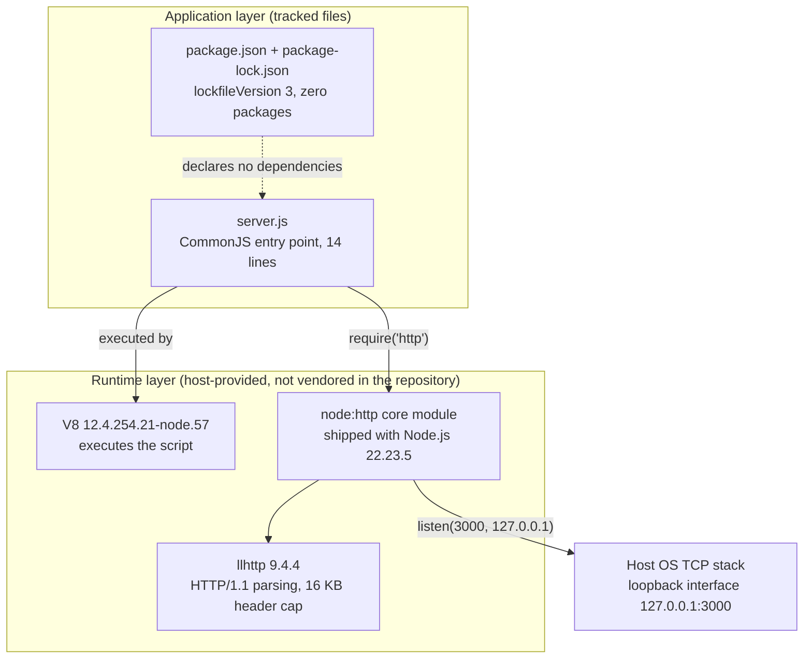


## 3.3 Open Source Dependencies

The project declares and installs no third-party or open-source packages. Its dependency graph is a single node — the root package — and the lockfile proves that nothing was ever fetched.

| Dependency fact | Observed state | Evidence |
|---|---|---|
| Declared dependencies | None. `package.json` contains no `dependencies` block, no `devDependencies` block, no `peerDependencies`, no `optionalDependencies` | `package.json:1-11` |
| Installed modules | None. No `node_modules` directory exists in the working tree | directory listing of the repository root |
| Resolved dependency tree | `npm ls --all` prints `hello_world@1.0.0` followed by `└── (empty)` | `npm ls --all` |
| Lockfile packages | Exactly one entry, the root package under the empty-string key, repeating name `hello_world`, version `1.0.0` and license `MIT` | `package-lock.json:6-12` |
| Registry artifacts in lockfile | Zero `resolved` and zero `integrity` records — no tarball URL, no checksum, so no package was ever downloaded | `package-lock.json` (searched, no matches) |
| Lockfile format | `"lockfileVersion": 3` with `"requires": true`; the npm 7-and-later format, written by the npm `11.21.3` observed alongside Node.js `v22.23.5` | `package-lock.json:4-5` |
| Registry configuration | The repository contains no `.npmrc`, no scoped-registry entry and no workspace definition, so no private or alternative registry is part of the project; the client toolchain's default registry is never contacted for this build | four-file tree |
| License posture | `"license": "MIT"` in the manifest, echoed in the lockfile root record; the project itself is the only licensor — there are no third-party notices to carry, because there is no third-party code | `package.json:10`; `package-lock.json:10` |

**Registry and version-pinning implications.** With an empty dependency set there is nothing to pin, nothing to deduplicate and nothing that can drift between a developer's tree and a CI checkout: `npm ci` against this lockfile would install zero packages and produce no `node_modules` content. The only version that affects behavior is the Node.js runtime itself, and `package.json` carries no `engines` field to constrain it (§2.4.2, F-005 rows), so the runtime version is a host property rather than a project dependency.

**The only open-source surface.** The runtime embeds its own open-source components. They are part of the Node.js distribution the host installs, not of this project's package graph, and they are upgraded by replacing the runtime rather than by a package manager.

| Bundled component | Version observed | Relevance to this project |
|---|---|---|
| V8 (JavaScript engine) | `12.4.254.21-node.57` | Executes `server.js`; determines the supported ECMAScript level |
| `llhttp` (HTTP parser) | `9.4.4` | Parses every request line and header set; enforces the 16 KB header cap |
| OpenSSL | `3.5.9` | Available but unused — the service serves plaintext HTTP only |
| `nghttp2` | `1.69.0` | Available but unused — the HTTP/2 module is never required |
| `undici` (HTTP client) | `6.29.1` | Available but unused — the server issues no outbound request |
| ICU | `78.3` | Character handling for the ASCII response body |
| `zlib` | `1.3.1-e00f703` | Available but unused — no compression, no `Content-Encoding` negotiation |
| `simdjson` / `simdutf` | `4.5.0` / `6.4.2` | Available but unused — the application parses no JSON |
| `node:sqlite` | `3.54.1` | Shipped with the runtime but never required; the project has no database |

**Security and constraint consequences.**

- **No advisory surface from the project's own dependencies.** There is no transitive tree to audit, no lockfile to patch and no dependency-confusion exposure. Vulnerability management reduces to tracking the host's Node.js release, which the project cannot pin.
- **A package addition would be a design change, not a maintenance task.** Installing anything would create `node_modules`, add `resolved`/`integrity` records to the lockfile and forfeit the zero-supply-chain property that §2.4.7 (C2) records as a constraint of the artifact.
- **No license-compliance work is required** for this repository: MIT is the only declared license, and no third-party attribution or notice file is needed because none was incorporated.


## 3.4 Third-Party Services

The system integrates with no third-party service. It makes no outbound network call, holds no credential, and reads no endpoint, key or account identifier from anywhere.

| Service category | Adopted? | What would be required to exist | Evidence of absence |
|---|---|---|---|
| External APIs / SaaS integrations | No | An HTTP client call, a base URL and usually a token | `server.js:1` requires only `http` and uses it to create a server; no `http.request`, `fetch` or client construction appears; no URL other than the loopback listener URL |
| Authentication / identity provider (Auth0 or equivalent) | No | Issuer, client ID, secret, token validation middleware | No credential, header check, session or token code in any tracked file; `README.md` names no provider |
| Monitoring, APM, metrics or log shipping | No | An agent, SDK or exporter plus an ingestion endpoint | No telemetry code; output is one `console.log` line at startup (`server.js:13`) |
| Cloud services (compute, object storage, queues, managed databases) | No | SDK dependency, region, resource identifiers, IAM credentials | No AWS or other cloud SDK string in any tracked file; no infrastructure definition of any kind |
| DNS, public ingress, CDN, TLS termination | No | A hostname, certificate and reachable bind address | The listener is hardcoded to `127.0.0.1:3000` (`server.js:3-4`), so the service is unreachable from off-host clients and needs no name resolution |
| Email, SMS, payment or messaging providers | No | Provider credentials and client code | Nothing of the kind appears in the tree; the response body is a constant string |

**The one external counterparty is inbound.** `README.md` describes the repository as a test project for backprop integration, which makes an external harness the consumer of this service. That harness lives outside the repository, and the only interface it can use is the HTTP exchange on `127.0.0.1:3000` (§2.4.7, A7): the repository contains no client, protocol definition, assertion or credential for it. Direction matters for the stack — the service is a passive provider, never a caller, so no outbound egress rule, API key rotation or vendor outage can affect it.

**Consequences for operations and security.**

- **No integration secrets to manage.** With no service credentials, there is no secret store, rotation schedule or least-privilege policy attached to the stack (§2.4.5).
- **No third-party availability dependency.** Availability is bounded only by the host process and the loopback interface; a vendor incident cannot degrade the fixture, and equally there is no vendor to observe its health.
- **No observability vendor seam.** Because nothing is instrumented and nothing is shipped, health, latency and availability must be measured by whatever harness owns the fixture (§1.2.3), which is why §2.4.3 presents measured baselines rather than committed targets.


## 3.5 Databases & Storage

The system has no database, no cache and no runtime storage of any kind. Everything it needs at request time is a string literal and two constants already resident in the process image, and it writes nothing.

| Storage category | Adopted? | Evidence |
|---|---|---|
| Primary database (relational or document, e.g. MongoDB) | No | No driver, ORM, connection string, host, port or credential in any tracked file; the only `require` is `http` (`server.js:1`) |
| Secondary or analytical database | No | Nothing in the tree references a second datastore, warehouse or index |
| Caching layer (Redis, Memcached, in-process cache) | No | No client, no cache module and no memoization; the handler recomputes nothing because the response is already a constant (`server.js:9`) |
| Object or blob storage | No | No SDK, bucket name or storage path appears in the tree |
| Local file I/O | No | `server.js` calls no `fs` function; it reads no config file, writes no log file and creates no temporary file |
| Session or state store | No | No cookie, session, token or per-client state exists; every request is answered identically (§1.2.2) |
| Persistent application data | No | The only runtime "data" are the constants `hostname`, `port` and the 14-byte response body, all defined in source (`server.js:3-4`, `9`) |

**Data persistence strategy.** There is none, by construction. The only durable artifacts are version-controlled source and metadata files — `README.md`, `server.js`, `package.json`, `package-lock.json` — which are inputs to the running process, not records it produces or reads at request time. Nothing distinguishes a first run from a thousandth: the process holds no history, so there is no state to warm, flush, replicate or restore.

**Caching.** No caching solution is present, and no HTTP caching directive is emitted either: responses carry `Content-Type`, `Date`, `Connection`, `Keep-Alive` and `Content-Length` only, with no `Cache-Control`, `ETag` or `Last-Modified` (§2.4.5). Responsiveness instead comes from constant-cost work per request — the handler performs no I/O and no allocation beyond header parsing.

**Storage services and filesystem expectations.**

- No managed storage service (bucket, volume, database-as-a-service) is referenced, and no container or orchestration manifest exists that would mount one.
- The runtime ships `node:sqlite` `3.54.1`, but no tracked file requires it; its presence is a property of Node.js `v22.23.5`, not of this project (§3.3).
- Because the process performs no filesystem write, the deployed tree can be mounted read-only and no disk-growth, cleanup or retention policy is required.

**Consequences for the stack.**

| Concern | Position as found |
|---|---|
| Schema, migration, seed data | None exist; there is no schema, no migration tooling and no fixture data to load |
| Backup, restore, disaster recovery | Not applicable — there is no stored record to protect |
| Data privacy and retention | No personal, sensitive or client-supplied data is stored, logged or echoed; request contents are discarded unread (`server.js:6-10`), so no retention obligation or data-protection surface arises (§2.4.5) |
| Consistency and concurrency | No shared state, so no locking, transaction or isolation concern; concurrent requests cannot influence one another |
| Adding persistence later | Any persistence would add a dependency, a credential and a writable filesystem requirement — each contradicting the zero-dependency, no-secret, fixed-baseline posture the artifact is kept for (§2.4.7, C2 and A5) |


## 3.6 Development & Deployment

Development of this project requires nothing beyond a Node.js runtime and its bundled npm client. There is no build, no bundler, no test framework, no linter, no container image and no pipeline definition in any branch — the four tracked files are both the source and the deployable artifact.

**Development tools.**

| Tool | Present? | Version / detail | Evidence |
|---|---|---|---|
| Node.js runtime | Yes — the sole prerequisite | `v22.23.5` on the inspection host; not pinned by the project | `server.js`; `process.versions` |
| npm CLI | Yes — implied by the manifest and lockfile | `11.21.3` observed | `package-lock.json:4` (`lockfileVersion` `3`); `npm --version` |
| npm scripts | Only `test`, which is a placeholder | `echo "Error: no test specified" && exit 1`; `npm test` exits `1` by design | `package.json:6-8`; `npm test` run |
| Test framework or assertion library | No | Nothing installed; no `node:test` usage | empty dependency set (§3.3) |
| Linter, formatter, type checker | No | No ESLint, Prettier or `tsconfig` in the tree | all four refs searched |
| Bundler, transpiler, minifier | No | Source runs unmodified | `server.js` |
| Runtime version manager (`engines`, `.nvmrc`) | No | The host chooses the version | `package.json`; tree |
| Editor or CI-specific configuration | No | No `.editorconfig`, no workflow directory | tree |

**Build system.** There is none, and the assertion is structural rather than a matter of policy: no `scripts` entry compiles, bundles or copies anything, there is no `dist`/`build` directory, and `server.js` is executed by the runtime exactly as tracked. Two manifest facts matter more than a build would:

- **The declared entry point does not exist.** `"main": "index.js"` names a file present in no branch, so `require('./')` and any `main`-based consumer fail before the server starts (§2.4.2, F-005). The supported invocation is to name the file explicitly.
- **`npm start` works through npm's implicit default.** Although `package.json` declares no `start` script, `npm start` runs `node server.js` and serves correctly — observed output `> hello_world@1.0.0 start` followed by `> node server.js` and the readiness line. Automation may use either `node server.js` or `npm start`, but not the `main` field.

**Containerization.** Not adopted: no `Dockerfile`, `.dockerignore`, compose file, Kubernetes manifest or Helm chart exists in any of the four refs. It is also not a drop-in addition — the listener is bound to `127.0.0.1` (`server.js:3-4`), so a containerized server is unreachable from a client in another network namespace unless the container shares the host's network, and the fixed port `3000` permits one instance per host (§1.2.1).

**Infrastructure as code.** None: no Terraform, CloudFormation, Pulumi, Ansible or shell provisioning script appears in the tree, which follows from the absence of any cloud resource to provision (§3.4).

**CI/CD.** No pipeline definition exists in any branch — no `.github` directory, workflow YAML, `Jenkinsfile`, `.gitlab-ci.yml` or deployment script; `git ls-tree -r` on `main`, `26_nov_2026`, `origin/23-Oct` and `origin/27-Oct` returns the same four files. A pipeline therefore has to be supplied by whatever system owns this fixture, and the capabilities it must provide are specific:

| Pipeline requirement | Why it is required | Evidence |
|---|---|---|
| Pin the Node.js version explicitly | `package.json` has no `engines` field, so nothing constrains the runtime a build image provides | `package.json` |
| Start the process with `node server.js` (or `npm start`) | The manifest's `main` points at a missing `index.js` | `package.json:5`; `require('./')` failure |
| Run it as a foreground/resident job and capture stdout | The readiness signal is the printed line `Server running at http://127.0.0.1:3000/`, emitted inside the `listen` callback | `server.js:12-14` |
| Guarantee port `3000` on loopback is free | A conflict raises an uncaught `'error'` event and the process exits `1` with no retry or fallback port | observed second-instance `EADDRINUSE` |
| Probe the socket rather than run `npm test` | The `test` script always exits `1`; no automated gate exists | `package.json:6-8`; `npm test` exit `1` |
| Stop the process by signal on its owning pid | No `SIGINT`/`SIGTERM` handler and no drain logic; termination is immediate and prints no closing message | observed termination behavior |
| Place the client in the same host or network namespace | The bind is loopback-only; off-host clients cannot connect | `server.js:3-4` |
| Mount the tree read-only if desired | The process performs no filesystem write | no `fs` usage in `server.js` |

**Deployment requirements as found.**

| Requirement | Value | Source |
|---|---|---|
| Runtime | Node.js supplying ES2015 syntax and the core `http` module; verified on `v22.23.5` | `server.js`; runtime measurement |
| Privilege | None beyond binding an unprivileged loopback port (`3000`) | `server.js:4` |
| Configuration surface | None — host, port, status, content type and body are literals; environment overrides are ignored | `server.js:3-4`, `7-9`; env-override test |
| Secrets | None | no credential in any tracked file |
| Instances per host | One; the fixed port forbids a second | `EADDRINUSE` observation |
| Deployment unit | A single OS process running one file from the working tree | `server.js` |
| Artifact distribution | Not defined — no packaging or publishing step exists; the repository tree itself is the artifact | absence of build scripts |

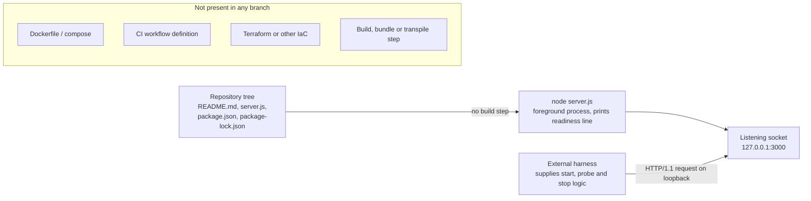


## 3.7 References

- `server.js` — the complete application: CommonJS `require('http')`, the `127.0.0.1`/`3000` constants, the constant `200`/`text/plain`/`Hello, World!\n` handler, and the startup readiness line; established the entire library surface, the language level and the absence of any framework, client, storage or credential.
- `package.json` — package identity (`hello_world` `1.0.0`, MIT), absent `dependencies`/`devDependencies`, absent `engines`, absent `type` field (CommonJS default), the always-failing `test` script, and `"main": "index.js"` that names a file absent from every ref.
- `package-lock.json` — `lockfileVersion` `3` with `requires: true`, a single root package record and zero `resolved`/`integrity` entries; established that no package was ever fetched from a registry.
- `README.md` — the project's only stated purpose ("test project for backprop integration") and its "Do not touch!" policy, which is the constraint that keeps the fixed baseline authoritative.
- repository root (`""`) — complete first-order contents: the four files above and no subfolders; the basis for stating that no build, container, CI, IaC, config or storage artifact exists.
- `git ls-tree -r` over `main`, `26_nov_2026`, `origin/23-Oct`, `origin/27-Oct` — every ref carries the identical four-file tree, so no branch adds a toolchain or dependency.
- Runtime measurements (`node --version`, `npm --version`, `process.versions`, `http` server defaults, `npm ls --all`, `npm start`, `npm test`, live request/response) — established Node.js `v22.23.5`, npm `11.21.3`, V8 `12.4.254.21-node.57`, `llhttp` `9.4.4`, OpenSSL `3.5.9`, ICU `78.3`, `nghttp2` `1.69.0`, `undici` `6.29.1`, `node:sqlite` `3.54.1`, module ABI `127`; `keepAliveTimeout` `5000`, `headersTimeout` `60000`, `requestTimeout` `300000`, `maxHeaderSize` `16384`; an empty dependency tree; npm's implicit `start` script; and `npm test` exiting `1`.
- Technical Specification §1.2 System Overview, §1.3 Scope, §2.4 Implementation Considerations — cross-referenced for the runtime-only integration surface, the excluded capabilities, and the constraints (C2 no dependency additions, A5 baseline immutability, A7 undefined harness contract) that this section's stack decisions rest on.
- No web sources were used; every version and capability reported here was read from the repository or measured on the host, so no external reference is cited.


# 4. Process Flowchart

## 4.1 Workflow Inventory and Diagram Conventions

The repository's entire executable surface is one 14-line CommonJS file, `server.js` (342 bytes), plus the metadata in `package.json` and `package-lock.json`. Every process that can be diagrammed here is therefore enumerable in full: there is no branch, loop, callback chain, `async`/`await`, timer or conditional in the tracked code (a text sweep of all four tracked files returns zero hits for `try`, `catch`, `await`, `Promise`, `setTimeout`, `setInterval`, `on('error')`, `process.env`, `route`, `404` and `middleware`). The workflows below are the complete set; nothing outside them exists to document.

### 4.1.1 Workflow Inventory

| ID | Workflow | Actors | Trigger | Terminal outcomes | Diagrammed in | Features |
|---|---|---|---|---|---|---|
| W-01 | Process startup and socket bind | Operator or harness; Node.js runtime; OS TCP stack | `node server.js` (or `npm start`) | Listening on `127.0.0.1:3000`, or exit `1` on `EADDRINUSE` | §4.2.1, §4.4.1, §4.5.1 | F-002, F-003 |
| W-02 | Single request and response | HTTP client on the same host; Node.js runtime; request handler | Any HTTP/1.1 request arriving on the loopback socket | `200` + `text/plain` + 14-byte body; or runtime `400 Bad Request` if the request line is not valid HTTP | §4.2.2, §4.3.1, §4.5.2 | F-001 |
| W-03 | Connection reuse and idle close | Same client; Node.js HTTP server keep-alive policy | A second request on an already-open socket | Repeated `200` responses on one socket; socket closed by the 5-second idle timer | §4.3.2 | F-004 |
| W-04 | Readiness detection | Supervisor or test harness reading the child process's stdout | Process starts | Match on `Server running at http://127.0.0.1:3000/`, then probe; no line means the bind failed | §4.2.1, §4.7 | F-003 |
| W-05 | Signal-driven termination | Operator, supervisor or OS | `SIGTERM` / `SIGINT` | Immediate process death with no drain, no closing message (exit `143` observed for `SIGTERM`) | §4.2.3 | — |
| W-06 | Bind failure | Operator or harness starting a second instance | Port `3000` already bound | Uncaught `'error'` event, `EADDRINUSE` stack trace on stderr, exit `1`, nothing on stdout | §4.5.1, §4.5.3 | F-002 |
| W-07 | Malformed-request rejection | Any client sending non-HTTP bytes | Bytes on the socket that the HTTP parser cannot parse | `HTTP/1.1 400 Bad Request` with `Connection: close`, emitted before the handler runs | §4.5.2 | — |
| W-08 | Install and inspect the package | Developer or pipeline | `npm install`, `npm ls --all` | No-op install; dependency tree reports `(empty)`; no `node_modules` created | §4.2.4 | F-005 |
| W-09 | Verification gate | Developer or pipeline | `npm test` | Exit `1` with `Error: no test specified` — the placeholder script, so no pass state exists | §4.2.4, §4.5.1 | F-006 (Proposed) |
| W-10 | Package and consume as a module | Developer or pipeline | `npm pack`, `node -e "require('./')"` | Tarball of 3 files (553 B packed, 666 B unpacked) succeeds; `require` fails with `MODULE_NOT_FOUND` for the absent `index.js` | §4.2.4 | F-005 |

The high-level map below places the three lanes every runtime workflow crosses — a client, the Node.js process, and the operating system — and shows the only seam that leaves the process other than the socket: the readiness line on stdout.

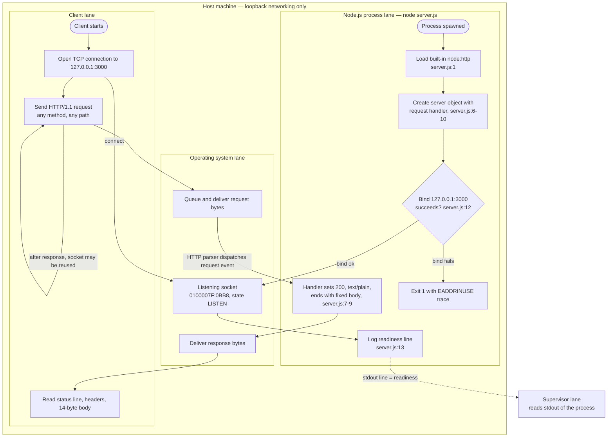

A dashed edge marks an event a consumer observes rather than a call in code; that is how the supervisor consumes the readiness line, which `server.js:13` only prints.

### 4.1.2 System Boundaries and Actors

| Lane | What it owns | Repository evidence | Behaviour the lane can change without editing the repository |
|---|---|---|---|
| Client | Opening connections, choosing method, path, query string and headers, deciding whether to reuse the socket, inspecting the reply | No client code exists in any branch | Everything about the request except that it must be syntactically valid HTTP/1.1 |
| Node.js process | Module load, server construction, the single request handler, the startup line | `server.js` in full | Nothing — the file is the whole program |
| Operating system | The bound TCP socket, packet delivery on the loopback interface, process creation and signal delivery | `server.listen(port, hostname, ...)` at `server.js:12`; listening socket row `0100007F:0BB8 ... 0A` in `/proc/net/tcp` | Source address of incoming connections (loopback only), scheduling and process lifetime |
| Supervisor / harness | Start command, readiness detection, probe assertions, restart policy | Only named in `README.md` as the "backprop integration" the fixture serves | Retry, timeout and gating policy — all of it lives outside this repository |
| npm toolchain | Package identity, lifecycle scripts, tarball contents | `package.json`, `package-lock.json` | Which script runs, not what the server does |

The process boundary ends at three edges: the listening socket, stdout (one line), and stderr (empty unless the bind fails). There is no file access, no outbound socket, no child process and no shared memory, so a workflow diagram that crossed any other boundary would be describing code this repository does not contain.

### 4.1.3 Diagram Conventions and Evidence Basis

| Convention | Meaning |
|---|---|
| Swim lanes (`subgraph`) | One lane per actor or system named in §4.1.2; edges crossing lanes are interactions, never internal calls |
| Stadium nodes `(["..."])` | Start and end points |
| Rectangles `["..."]` | Process steps |
| Diamonds `{"..."}` | Decision points; each outgoing edge is labelled with its condition |
| Node text with `server.js:N-M` | The step exists in code at those lines — the only kind of step the repository itself owns |
| Node text marked **runtime default** | Behaviour produced by Node.js or the HTTP parser with no corresponding line in `server.js`; it changes with the runtime, not with this repository |
| Dashed edges `-.->` | Observation of an out-of-band signal (a stdout line), not a call |
| Absence statements | Where a prompt-implied flow (batch, event, retry, persistence) has no code, the section says so once with the search evidence, rather than drawing a hypothetical diagram |

All timings quoted in this section were measured on Node.js `v22.23.5` with npm `11.21.3` in this checkout: ten sequential requests ranged 0.6 ms to 3.2 ms (mean 1.0 ms), and fifty concurrent requests all returned `200` in 41 ms of wall time. Node runtime defaults quoted alongside them (`keepAliveTimeout` 5000 ms, `headersTimeout` 60000 ms, `requestTimeout` 300000 ms, `timeout` 0, `maxRequestsPerSocket` 0) were read from a live `http.createServer()` instance on the same runtime; none of them is set anywhere in the repository.


## 4.2 Core Business Process Flows

The system has exactly one business process: answer a request with a fixed, known response, and let a client verify it byte for byte. Everything else in the running system is operability — starting the listener, announcing readiness, terminating. The four flows below cover the whole lifecycle in the order a reader will meet them.

### 4.2.1 Startup and Bind Sequence (W-01, W-04)

| Step | Actor | Action | Evidence |
|---|---|---|---|
| 1 | Operator or harness | Spawns `node server.js` (or `npm start`, which npm maps to the default `node server.js`) | `package.json` has no `start` script; `npm start` output shows the `> node server.js` line |
| 2 | Node.js runtime | Loads the built-in `http` module; no registry resolution occurs because the module is built in and the dependency set is empty | `server.js:1`; `npm ls --all` reports `(empty)` |
| 3 | Node.js runtime | Initializes the two literals that fix the whole network surface | `server.js:3-4`: `hostname = '127.0.0.1'`, `port = 3000` |
| 4 | Node.js runtime | Constructs the server object and registers the request handler; no socket is open yet and no request can arrive | `server.js:6-10` |
| 5 | Node.js runtime / OS | Calls `server.listen(port, hostname, callback)`; the call returns immediately and the bind is completed asynchronously by the runtime | `server.js:12` |
| 6a | OS | On success, the socket enters `LISTEN` on the loopback interface and the listen callback fires | `/proc/net/tcp` row `0100007F:0BB8 ... 0A` (local address `127.0.0.1`, port `0x0BB8` = 3000) |
| 6b | OS | On failure (`EADDRINUSE`), no callback fires; an uncaught `'error'` event is raised because `server.js` registers no `'error'` listener | Second instance exits `1` with `Error: listen EADDRINUSE: address already in use 127.0.0.1:3000` on stderr |
| 7 | Node.js runtime | Prints the readiness line, interpolating the same two constants | `server.js:13`; captured stdout is exactly `Server running at http://127.0.0.1:3000/` |
| 8 | Node.js runtime | Enters the event loop and stays in the foreground; nothing is scheduled, so the process idles on the single listening socket | no timers in `server.js`; process remained resident until signalled |

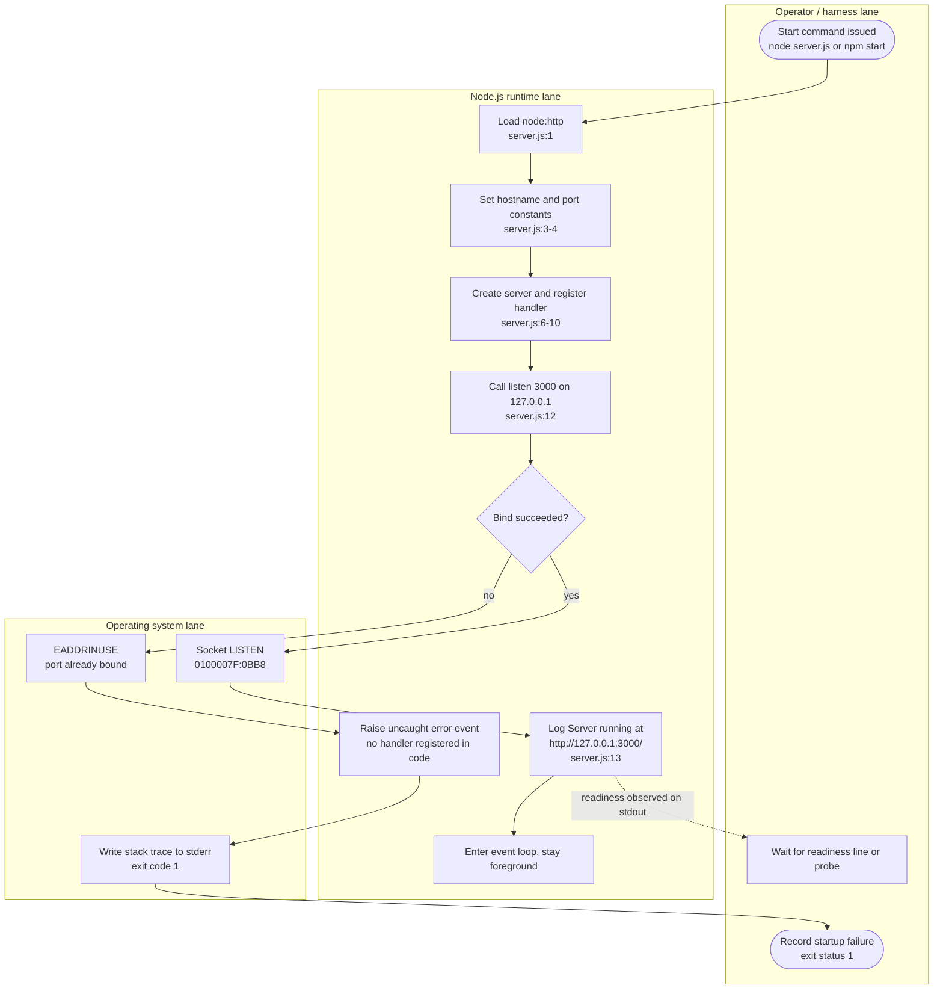

**Decision points.** There is exactly one: whether the bind succeeds. It has no retry branch, no alternate port and no fallback — a conflict is terminal (W-06, detailed in §4.5.1).

**Timing.** The readiness line is printed only from the `listen` callback, so its appearance strictly follows a successful bind; a supervisor may block on it instead of sleeping, which is the only ordering guarantee the system offers. Startup cost is module load plus one bind; no measured interval was material, and no startup timeout, health window or warm-up period is implemented.

### 4.2.2 Single Request Processing Flow (W-02, W-07)

| Step | Actor | Action | Evidence |
|---|---|---|---|
| 1 | OS / runtime | The listening socket accepts a TCP connection from the same host; there is no accept limit, backlog or TLS handshake to perform | `server.js:12`; plaintext HTTP/1.1 responses observed on port 3000 |
| 2 | Runtime HTTP parser | Parses the request line, headers and framing | Malformed input is answered before application code: `BOGUS` and `GET / HTTP/9.9` both yield `HTTP/1.1 400 Bad Request` + `Connection: close` |
| 3 | Runtime | Emits the `'request'` event and invokes the handler; the request object is passed but never read | `server.js:6` — `(req, res)` with `req` unused anywhere in the file |
| 4 | Handler | Sets the status code to `200` | `server.js:7` |
| 5 | Handler | Sets `Content-Type: text/plain`; no charset, no security, caching or CORS headers are added | `server.js:8`; observed headers are `Date`, `Connection`, `Keep-Alive`, `Content-Length` only |
| 6 | Handler | Ends the response with the 14-byte literal `Hello, World!\n` | `server.js:9`; byte dump `H e l l o ,   W o r l d ! \n` |
| 7 | Runtime | Serializes status line, headers and body; `Content-Length: 14` is computed by the runtime, not set in code, because the handler writes the whole body in one call | responses to `GET`/`POST` carry `Content-Length: 14`; `HEAD` carries none |
| 8 | Runtime | Decides connection fate from the keep-alive policy: socket retained for reuse unless the client sent `Connection: close` | `Connection: keep-alive`, `Keep-Alive: timeout=5` on every response |

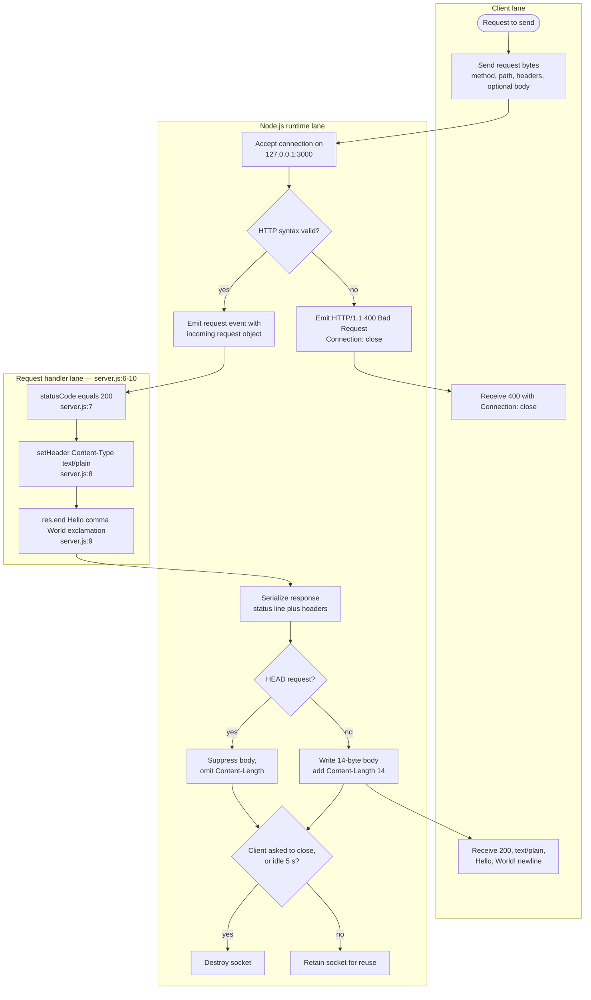

**Guarantees the flow produces.** The path, query string, method, headers and body have no influence on the response — no routing table exists, so an unknown path returns `200` rather than `404`, and a `POST` with a body returns the constant body immediately. A body-bearing request never blocks the handler: the bytes are discarded by the parser rather than read by the application, which is why upload size does not affect latency.

**Where the handler is not in the picture.** Anything the parser rejects (W-07) is answered with `400` and the connection closed, without the handler running and without any log line — the repository registers no diagnostic hook for parse errors.

### 4.2.3 Process Lifetime and Shutdown Flow (W-05)

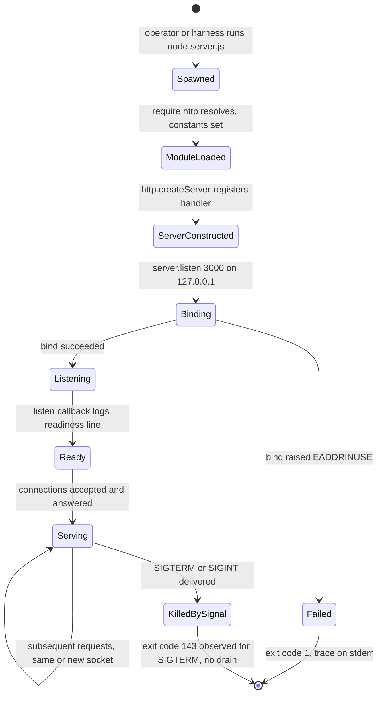

| Transition | Trigger | Guard | Action | Observed outcome |
|---|---|---|---|---|
| Spawned → ModuleLoaded | Process creation | `server.js` exists at the invoked path | Load built-in `http` | No output |
| ServerConstructed → Binding | `server.listen` call | none | Begin asynchronous bind | No output |
| Binding → Listening | OS grants the port | Port `3000` free on `127.0.0.1` | Open accepting socket | Socket row in `LISTEN` state |
| Binding → Failed | OS refuses the port | Port already bound | Uncaught `'error'` event | Exit `1`, `EADDRINUSE` trace |
| Listening → Ready | Bind callback | Callback fires once | `console.log` readiness line | Exactly one stdout line |
| Ready → Serving | First connection | none | Handler answers | `200` responses |
| Serving → KilledBySignal | `SIGTERM` / `SIGINT` | none | Default Node termination; the code registers no signal handler and never calls `server.close()` | Process gone; exit `143` for `SIGTERM`; no closing message on either stream |

**What the lifetime model lacks, and why it matters for orchestration.** There is no `SIGTERM` handler, no `server.close()`, no drain period and no exit-`0` path: a process either fails at bind (`1`) or dies from a signal (`130`/`143`). A supervisor therefore cannot distinguish a clean shutdown from an abrupt one by exit code, and in-flight responses are not completed deliberately — the loopback socket is closed by the OS when the process disappears. The repo likewise exposes no reload or restart mechanism, so every configuration-equivalent change (host, port, payload) requires an edit to `server.js` and a new process.

### 4.2.4 Build, Package and Verification Sequences (W-08, W-09, W-10)

| Command | Sequence | Observed result | Exit code |
|---|---|---|---|
| `npm install` | Reads `package.json` and lockfile v3; resolves nothing | No-op; no `node_modules` created; dependency tree `(empty)` | `0` |
| `npm ls --all` | Walks the (empty) tree | `hello_world@1.0.0` with `└── (empty)` | `0` |
| `npm start` | No `start` script exists, so npm runs its default `node server.js` | Readiness line printed; server serves | Running (killed externally) |
| `npm test` | Runs the single declared lifecycle script `echo "Error: no test specified" && exit 1` | `Error: no test specified` | `1` always — no pass state exists (F-006, Proposed) |
| `npm pack` | Collects the package contents | Tarball of 3 files: `README.md` (73 B), `package.json` (251 B), `server.js` (342 B); 553 B packed, 666 B unpacked | `0` |
| `node -e "require('./')"` | Resolves the manifest's `main` field, which names `index.js` | `Cannot find module .../index.js. Please verify that the package.json has a valid "main" entry` | non-zero |

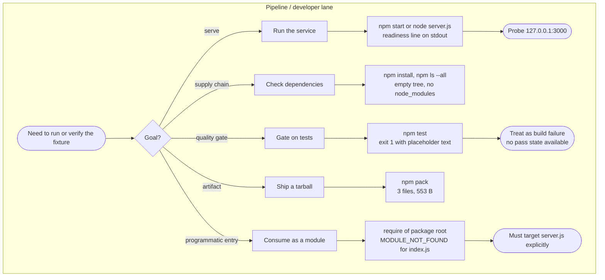

**Consequences for the pipeline.** Two of these sequences end where the prompt's notion of a build-and-test workflow would normally begin: the verification gate cannot pass (W-09), and the conventional module entry point does not resolve (W-10). A working verification sequence must therefore be supplied externally — start `server.js`, wait for the readiness line, request `127.0.0.1:3000`, compare status `200`, `Content-Type: text/plain` and the exact 14 bytes, then stop the process — because `npm test` exits `1` by design and no test framework is installed to replace it.


## 4.3 Integration Workflows

The system integrates with exactly two things it does not own: the host's loopback TCP stack and whatever consumes its stdout. Below are the two interaction flows that exist, followed by an explicit account of the integrations a reader might expect and will not find.

### 4.3.1 Client–Server Request/Response Sequence (W-02)

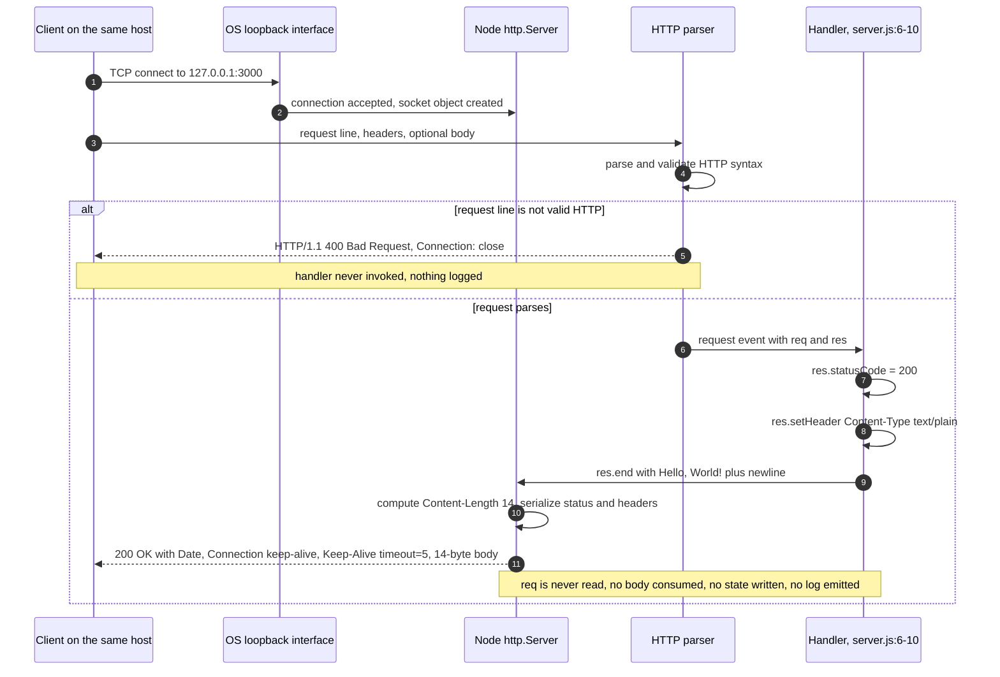

| Interaction | Direction | Payload | Repository source |
|---|---|---|---|
| TCP connect | Client → process | Source and destination `127.0.0.1:3000` | `server.js:12` bind |
| Request | Client → process | Any HTTP/1.1 request; method, path, query and headers are not inspected | `server.js:6` — handler takes `(req, res)` and reads only `res` |
| Response status and type | Process → client | `200`, `Content-Type: text/plain` | `server.js:7-8` |
| Response body | Process → client | `Hello, World!` + `\n`, exactly 14 bytes | `server.js:9` |
| Framework headers | Process → client | `Date`, `Connection: keep-alive`, `Keep-Alive: timeout=5`, `Content-Length: 14` — all runtime-generated, none set in code | observed on every response; `server.js` sets only the content type |
| Parse failure | Process → client | `HTTP/1.1 400 Bad Request` with `Connection: close` | runtime parser, no repository line |
| Readiness signal | Process → supervisor | One stdout line, then silence | `server.js:13` |

No correlation identifier, request ID, trace header, retry counter or acknowledgement exists on either side, so a flow cannot be traced through logs — there are no logs. The contract is the response bytes alone.

### 4.3.2 Connection Reuse and Idle Timeout Flow (W-03)

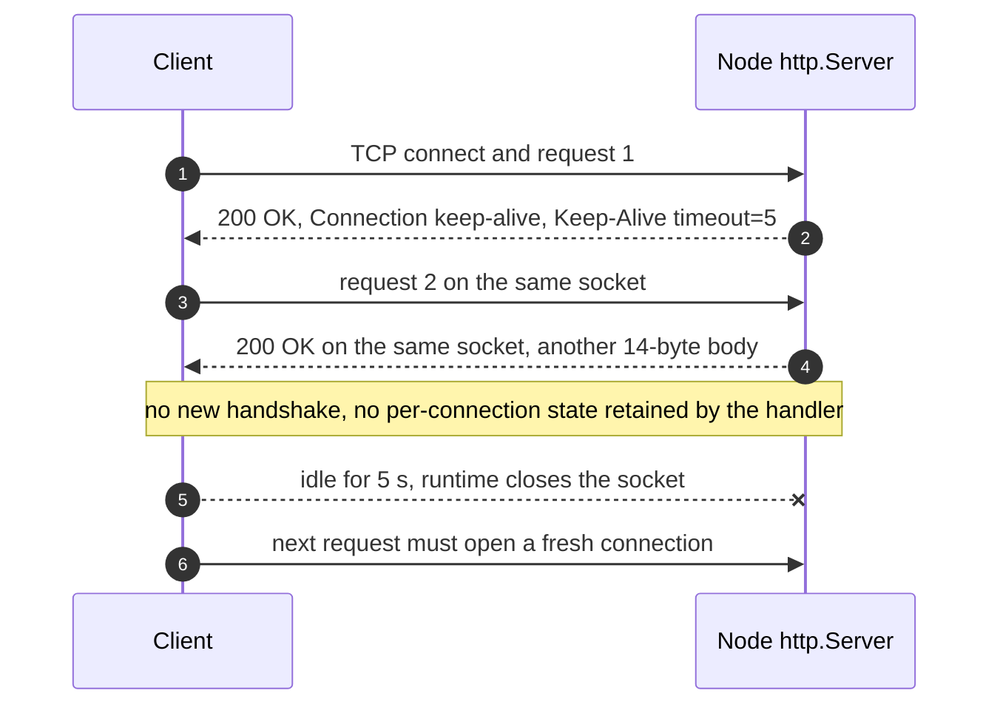

| Runtime parameter | Value measured on Node v22.23.5 | Set in this repository? | Effect on the flow |
|---|---|---|---|
| `keepAliveTimeout` | 5000 ms | No | An idle kept-alive socket is closed after 5 s; the client transparently reconnects, so no request fails because of it |
| `headersTimeout` | 60000 ms | No | Bounds how long a client may take to send the request head; the repository adds no behaviour here |
| `requestTimeout` | 300000 ms | No | Bounds the whole request; irrelevant in practice because the handler never waits on the body |
| `timeout` (socket inactivity) | `0` (disabled) | No | Nothing closes a socket for inactivity except `keepAliveTimeout` |
| `maxRequestsPerSocket` | `0` (unlimited) | No | A socket may serve unbounded requests until the client closes it or the idle timer fires |

Reuse is a transport convenience, not a stateful session: the handler keeps nothing between requests, so the second response on a socket is byte-identical to the first, and a client that closes after every request gets the same result with one extra handshake. Verified with `curl -v` against two URLs: `Re-using existing connection with host 127.0.0.1`, two `HTTP/1.1 200 OK` responses, and `Connection #0 ... left intact`.

### 4.3.3 Integration Boundaries With No Implementation

Every entry below was searched for in all four tracked files and across all four refs (`main`, `26_nov_2026`, `23-Oct`, `27-Oct`, which share one tree) and returns nothing. They are listed so that no reader expects a data-flow or batch diagram that the code cannot support.

| Integration type | Status | Search evidence |
|---|---|---|
| Relational or NoSQL database | Absent | no `database`, driver, connection string, query or migration in any tracked file; `package.json` declares no dependencies |
| Message broker, queue or event bus | Absent | no `queue`, producer, consumer, topic or subscription; the only event in play is the runtime's internal `'request'` event |
| Scheduled or batch jobs | Absent | no `setTimeout`, `setInterval`, cron entry or job script; the event loop holds only the listening socket |
| External HTTP or RPC calls | Absent | the only `require` is the built-in `http` module used to serve, never to call out; no URL other than the readiness line |
| Identity provider, SSO, tokens, sessions | Absent | the single hit for "auth" in the tracked files is the `"author"` field of `package.json` |
| Configuration or secret service | Absent | zero occurrences of `process.env`; host and port are literals at `server.js:3-4` |
| Telemetry, APM, metrics or log shipping | Absent | the only output statement in the repository is `console.log` at `server.js:13` |
| File system or object storage | Absent | no `fs`, `path` or stream usage; the process reads no file at runtime |
| Child processes or worker threads | Absent | no `child_process`, `worker_threads` or `cluster` |
| DNS, TLS termination, reverse proxy | Absent | the listener is the literal loopback address in plaintext HTTP/1.1 |
| The "backprop integration" named in `README.md` | Absent from this repository | `README.md` states the fixture's purpose; no client, endpoint, credential or protocol for that system exists in any branch |
| CI/CD pipeline | Absent | no workflow, pipeline, Dockerfile or compose file in any branch |


## 4.4 State Management

The application holds no state of its own. What changes over time belongs entirely to the runtime: the process (covered in §4.2.3) and the socket that serves a connection. The handler's three statements (`server.js:7-9`) write to a per-request response object that is discarded when the response ends, so no value produced by one request can be observed by another.

### 4.4.1 State Transition Model

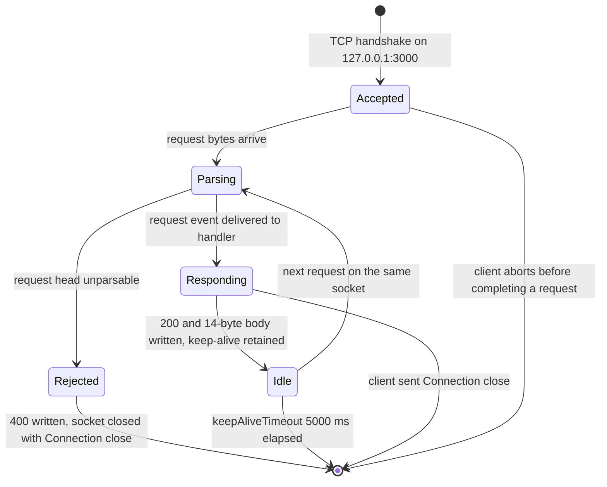

| State | Owner | Entered when | Left when | Data written by the application |
|---|---|---|---|---|
| Accepted | Runtime socket object | TCP handshake completes on the loopback address | Request bytes arrive, or the client aborts | None |
| Parsing | Runtime HTTP parser | Bytes accumulate on the socket | A complete request head is parsed, or a parse error is detected | None |
| Rejected | Runtime parser | Request head is not valid HTTP | The `400` and `Connection: close` response is written | None — the handler is never invoked |
| Responding | Handler, then runtime serializer | The `'request'` event fires | `res.end` completes and the bytes are flushed | `statusCode = 200`, `Content-Type: text/plain`, the 14-byte body |
| Idle | Runtime keep-alive timer | A response completes without `Connection: close` | The next request arrives, or 5000 ms pass | None; no session or cursor is retained between requests |

**Persistence points.** The only application-authored values in memory are the two module-level constants `hostname` and `port` (`server.js:3-4`) and the request-handler closure registered at `server.js:6-10`. Neither changes after startup. There is no counter, cache, session map or accumulator anywhere in the file, so the state model is acyclic across requests: the transition graph above restarts identically for every connection.

**State a supervisor can observe.** Because nothing is exposed, the only externally visible state is: the presence of a `LISTEN` socket on `127.0.0.1:3000`, the single readiness line on stdout, and the liveness of the process. No status endpoint, health path, readiness probe or internal metric exists.

### 4.4.2 Data Persistence and Transaction Boundaries

| Concern | Implementation | Evidence |
|---|---|---|
| Persistent storage | None — no database, no file writes, no object storage | zero occurrences of `fs`, `database` or any storage client in the tracked files; `package.json` has no dependencies |
| Read model | None — the response is a string literal compiled into the module | `server.js:9` |
| Write model | None — request bytes are parsed by the runtime and discarded | `req` is never read; a `POST` body returns the constant response without being consumed |
| Session or identity persistence | None — no cookie is set, no header inspected | response headers contain no `Set-Cookie`; no header reads in `server.js` |
| Configuration persistence | None — host and port are source literals, so the "configuration" is the file itself | `server.js:3-4` |

**Transaction boundary.** One HTTP response is the unit of work: status, content type and body are set in three statements and committed by a single `res.end` call at `server.js:9`. There is nothing to roll back, because nothing outside the response object is mutated and no resource is acquired. Concretely, the boundary has these properties:

- **Atomicity** is provided by the runtime, which serializes the response with a computed `Content-Length: 14`; a client either reads a complete 14-byte body or sees a failed connection.
- **Isolation** is trivial: concurrent requests touch only their own `res` object, so no locking, queueing or ordering exists.
- **Durability** is nil by design: restarting the process loses nothing, because the only "record" is the source literal.
- **Idempotence** is total: any number of repetitions of any request produces the same bytes, which is precisely why the fixture is usable as a known-answer oracle.

**Recovery point.** Because state is empty, a restart is a complete recovery: there is no replay, no reconciliation and no cleanup step, only a fresh bind — and, if the previous process has not yet released the port, the `EADDRINUSE` failure described in §4.5.

### 4.4.3 Caching Requirements

| Cache layer | Present? | Detail | Evidence |
|---|---|---|---|
| In-process application cache | None | There is nothing to cache: the payload is a constant in the module, costing no computation to reproduce | `server.js:9` |
| Memoization or computed values | None | No computation, no data source, no derived value anywhere in the file | whole-file inspection of `server.js` |
| HTTP response caching directives | None emitted | No `Cache-Control`, `Expires`, `ETag`, `Last-Modified` or `Vary` header is set, by code or by the runtime default | observed headers: `Date`, `Connection`, `Keep-Alive`, `Content-Length` only |
| Shared intermediary cache | Not reachable | A proxy or CDN cannot participate because the listener binds `127.0.0.1` only | `server.js:3`, `12`; connection to a non-loopback address refused |
| Connection reuse | Present — transport, not caching | `Connection: keep-alive` with `Keep-Alive: timeout=5` amortizes the TCP handshake across requests; no response body or header is reused | §4.3.2 |
| Client-side expectation cache | Outside the system | The known answer is held by the harness, which is the reason the response must stay byte-stable | `README.md` "Do not touch!" policy |

The absence of cache directives has one practical consequence for a harness: a response without validators may be served from an HTTP client's heuristic cache, so a verification client that must observe the wire should disable its own caching (for example `curl` does so by default, while a browser may not). The system itself neither requires nor supplies caching to meet any timing constraint — the request path performs no I/O, so latency is already at the floor measured in §4.7.


## 4.5 Error Handling and Recovery Flows

Error handling in this repository is the absence of error handling: `server.js` contains no `try`/`catch`, no `'error'` listener, no `'clientError'` hook, no timeout, no retry and no logging other than the startup line. Every failure therefore resolves at the level that produced it — the operating system, the HTTP parser, or the process default — and the section records what each of those levels actually does.

### 4.5.1 Failure Mode Map

| ID | Failure | Detected by | Observable result | Recovery present | Evidence |
|---|---|---|---|---|---|
| E-01 | Port `3000` already bound when the process starts | OS bind, surfaced as an uncaught `'error'` event | `Error: listen EADDRINUSE: address already in use 127.0.0.1:3000` on stderr, exit `1`, nothing on stdout | None — no retry, no alternate port, no backoff | Second instance executed against a live one |
| E-02 | Client connects while no process is listening | Client's TCP stack | Connection refused; `curl` exits `7` | None inside the system; the client must retry or wait for the readiness line | Observed when the probe ran before startup completed |
| E-03 | Request head is not valid HTTP | Runtime HTTP parser | `HTTP/1.1 400 Bad Request` + `Connection: close`; handler never runs; nothing logged | None; the connection is closed, the client must reopen | `BOGUS` request line sent to the socket |
| E-04 | Unsupported HTTP version | Runtime HTTP parser | Same `400` + `Connection: close` | None | `GET / HTTP/9.9` sent to the socket |
| E-05 | Client aborts or resets the connection mid-request | Runtime socket layer | Socket destroyed; no application-level consequence | None needed — no resource was acquired | No error listener and no output statement exists in `server.js` beyond line 13, so nothing can be logged |
| E-06 | Kept-alive connection goes idle | Runtime keep-alive timer (`keepAliveTimeout` 5000 ms) | Socket closed by the server; the next request transparently opens a new one | Handled by the client's connection pool | `Keep-Alive: timeout=5` advertised on every response |
| E-07 | Client sends a partial request head and stalls | Runtime `headersTimeout` (60000 ms) | The runtime ends that request; the handler is not involved | None in the repository | Measured runtime default; no timeout is configured in `server.js` |
| E-08 | Process receives `SIGTERM` or `SIGINT` | OS signal delivery | Immediate termination; exit `143` observed for `SIGTERM`; no closing message, no drain | None — no signal handler and no `server.close()` call | Signal test on a live process |
| E-09 | Off-host client attempts to connect | OS routing / socket binding | Connection refused, because the socket exists only on `127.0.0.1` | By design | Connection to the host's non-loopback address refused |
| E-10 | Consumer resolves the package root instead of `server.js` | Node module loader | `MODULE_NOT_FOUND` for `index.js`, before any server code runs | None — `main` names a file that does not exist in any branch | `node -e "require('./')"` |
| E-11 | Pipeline runs `npm test` as a quality gate | npm lifecycle | `Error: no test specified`, exit `1` | None — the placeholder always fails, and no test code exists | `npm test` executed; `npm run` lists `test` as the only script |

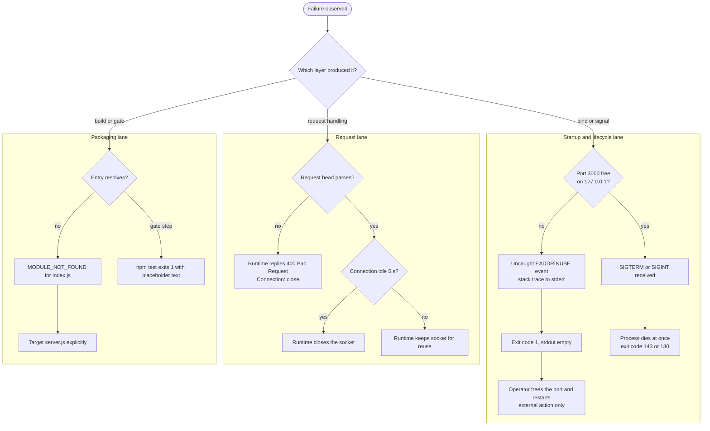

**What this map shows about recovery.** No failure has a recovery path inside the repository: E-01 and E-08 terminate the process, E-03/E-04 terminate the connection, E-06 reclaims a socket, and E-10/E-11 fail the caller. Every recovery action belongs to an operator or a supervisor outside the system, and each one is a whole-process action (free the port and restart; reopen a connection; invoke `server.js` by path).

### 4.5.2 Parser- and Transport-Level Response Paths

Failures that occur before the handler runs are answered by the runtime, not by this code, and they behave differently from a normal response:

| Path | Raw bytes written to the socket | Connection afterwards | Handler invoked | Logged |
|---|---|---|---|---|
| Valid request | `HTTP/1.1 200 OK`, framing headers, 14-byte body | Retained unless the client asked to close | Yes | No |
| Unparsable request head (E-03) | `HTTP/1.1 400 Bad Request\r\nConnection: close\r\n\r\n` — no body, no `Date`, no `Content-Type` | Closed | No | No |
| Unsupported HTTP version (E-04) | Same `400` + close | Closed | No | No |
| Socket reset by client (E-05) | Nothing | Destroyed | No further effect | No |

Because the repository registers no `'clientError'` listener, the `400` is the runtime's default text rather than a message the application chose; and because it registers no `'error'` listener on the server, a listen-time error becomes an uncaught exception that Node prints and turns into exit status `1`. A reader comparing a `400` reply with a `200` reply will notice the `400` lacks the `Date` and `Content-Type` headers entirely — a reliable way for a harness to tell a rejected request from a served one.

### 4.5.3 Retry, Fallback, Notification and Recovery Behaviour

| Mechanism a specification usually requires | Present in this system? | Detail | Evidence |
|---|---|---|---|
| Retry on bind failure | No | One `listen` call, no loop, no backoff; a busy port is terminal | `server.js:12`; exit `1` observed |
| Fallback port or host | No | No alternate value exists; the constants are literals | `server.js:3-4` |
| Retry of inbound requests | No | Not applicable — the handler performs no outbound call that could fail | whole-file inspection |
| Circuit breaker, bulkhead or queue | No | Single process, single thread, no admission control; concurrency is whatever the event loop can accept | `server.js:6-14` |
| Graceful shutdown or drain | No | No `SIGTERM`/`SIGINT` handler, no `server.close()`; in-flight sockets are closed by the OS | signal test |
| Supervised restart | No | Nothing restarts the process; `package.json` has no `start` script of its own and no process manager configuration | `package.json`; `npm start` falls back to the npm default |
| Error notification to an operator | Only for bind failure | An uncaught exception trace on stderr; every other failure is silent | stderr empty during normal operation, `EADDRINUSE` trace on conflict |
| Error notification to a client | Only for parse failure | The `400` response; failures after parsing cannot occur, because the handler has no failure path | §4.5.2 |
| Recovery procedure | External | Free the port if occupied; restart the process; wait for the readiness line; reconnect. Because the system holds no state, restart is a complete recovery | §4.4.2 |

**Consequences for a harness.** Two design implications follow directly from this table. First, an absent readiness line — rather than a log scan — is the correct signal that startup failed, since a failed bind writes nothing to stdout. Second, a connection attempt that races startup fails with `ECONNREFUSED` and has no server-side retry, so any retry policy (interval, attempt count, deadline) must be implemented by the client, and any tolerance for transient `400` responses must be as well, since a client that malforms a request gets no second chance from the server.


## 4.6 Validation Rules and Checkpoints

Because the system accepts nothing from the caller, the validation surface is almost entirely upstream of the application: the HTTP parser validates syntax, and the application validates nothing. The rules that do hold are structural — enforced by literals and by the order of statements rather than by checks with failure branches.

### 4.6.1 Business Rules at Each Step

| ID | Step (from §4.2) | Rule | Enforced by | Observable if violated |
|---|---|---|---|---|
| V-01 | Startup | The listener binds TCP `3000` on `127.0.0.1` and no other address | Literals at `server.js:3-4` passed to `listen` at `server.js:12`; no environment read exists in any tracked file | Binding a wider address, or a different port, would require editing the file; there is no variable to set |
| V-02 | Startup | Readiness is announced only after the socket accepts | The `console.log` sits in the `listen` callback, `server.js:12-14` | A line printed before bind would let a harness probe too early; not possible here |
| V-03 | Startup | Exactly one instance may serve per host | Single hardcoded port with no retry or fallback | A second instance exits `1` with `EADDRINUSE` |
| V-04 | Request | Every request, whatever its method, path, query or headers, receives `200` | No inspection of `req` anywhere in `server.js` | A `404` for an unknown path would break the contract; none can occur |
| V-05 | Request | The body is never read, echoed or validated | Handler ends the response without touching the request stream, `server.js:9` | A body-dependent response or hang would appear; neither does |
| V-06 | Response | The payload is exactly `Hello, World!` followed by one newline, 14 bytes in total | String literal at `server.js:9` | Byte dump would differ; measured as `H e l l o ,   W o r l d ! \n` |
| V-07 | Response | The content type is `text/plain` with no charset parameter | `setHeader` at `server.js:8` | A charset suffix would change the header bytes |
| V-08 | Response | The status is `200` for every reply the handler produces | Assignment at `server.js:7` | Any other status would mean the code changed |
| V-09 | Any step | No configuration, secret or environment input influences behaviour | Zero occurrences of `process.env`, no config file, no arguments parsed | Behaviour would differ between environments; it does not |
| V-10 | Any step | No state is carried from one request to the next | Handler allocates nothing outside the response object | A second request would see a different answer; it does not |

### 4.6.2 Data Validation Requirements

| Data class | Validated? | By whom | Detail | Evidence |
|---|---|---|---|---|
| Request line, headers, framing | Yes — syntax only | Node.js HTTP parser | A head that is not valid HTTP/1.1 is rejected with `400 Bad Request` and the connection closed before the handler runs; an unsupported version such as `HTTP/9.9` is rejected the same way | raw `400` observed for `BOGUS` and for `GET / HTTP/9.9` |
| Method, path, query string | No | Nobody | Accepted verbatim and ignored; no allow-list, no length limit, no normalisation | handler ignores `req` |
| Request headers | No | Nobody | Not read; `Host`, `Authorization`, `Content-Type` and `Content-Length` have no effect | no header access in `server.js` |
| Request body | No | Nobody | Discarded by the parser; never buffered by the application, so size does not affect the response | `POST` with a body returned the constant reply |
| Response payload | Yes — by the consumer, not the server | The harness or client | Byte equality of status, content type and the 14-byte body is the only acceptance test the system is designed for | `README.md` purpose; §2.2 requirement F-001-RQ-001 |
| Listener parameters | Only implicitly | The runtime's `listen` contract | The port argument is the integer literal `3000`, so it cannot be malformed; there is no validation branch to fail | `server.js:4`, `12` |
| Package manifest | No | Nobody at runtime | `main` names an absent `index.js` and nothing validates it; the failure appears only when a consumer resolves the package root | `node -e "require('./')"` fails |

**Implication for the flow design.** There is no validation checkpoint inside a request that can reject a well-formed request. A harness cannot test validation logic against this service, and any test that expects rejection behaviour (for example a `404`, a `405`, or a `400` for a bad body) will observe `200` instead.

### 4.6.3 Authorization and Compliance Checkpoints

| Checkpoint kind | Present? | Mechanism or gap | Evidence |
|---|---|---|---|
| Network access control | Yes — the only real checkpoint | The bind to `127.0.0.1` restricts reachability to processes in the same host or network namespace; there is no logical substitute | `server.js:3`, `12`; off-host connection refused |
| Authentication (identity of the caller) | No | No credential, token, certificate, cookie or header is read; every caller is anonymous | single "auth" hit in tracked files is the `"author"` field of `package.json` |
| Authorization (permission of the caller) | No | Every request is permitted equally; no path- or method-based policy exists | handler has no branch |
| Rate limiting or quota | No | No throttle, counter or rejection path | no state and no timing code in `server.js` |
| Input sanitisation | Not applicable | No input reaches a sink: nothing is stored, executed, reflected or logged | `server.js` whole file |
| Data protection in transit | No encryption | Plaintext HTTP/1.1 on loopback; acceptable because the traffic cannot leave the host | no TLS configuration in any tracked file |
| Audit trail or access log | None | The absence of request logging means no caller, path or timestamp is recorded — a privacy property and an audit gap at once | only output statement is the startup line, `server.js:13` |
| Data retention or privacy scope | None | No personal data is received, stored or transmitted; the payload is a constant | no storage code; no request reads |
| Licensing | MIT declared | `package.json` `license: MIT`; no third-party code exists, so no attribution obligation arises | `package.json`, `package-lock.json` |
| Regulatory scope | None identified | No regulated data class, no jurisdiction-specific control and no compliance artefact in the repository | complete tracked file list |

**Reading of this table.** Access control here is structural rather than logical: the socket, not a policy engine, decides who may reach the service. That has a concrete consequence for any future deployment — placing this process behind a proxy, a container port mapping or a service mesh would remove the only control that exists, since no authentication or authorization checkpoint would take its place.


## 4.7 Timing Constraints and Service-Level Considerations

The system declares no service level, no objective and no budget: no SLA statement, KPI, error-rate target or dashboard exists in the repository, and the process emits no measurement of itself. What can be stated are the deterministic timing properties of the flows above and the runtime bounds that apply to them.

### 4.7.1 Measured Timing and Concurrency

| Quantity | Measured | Basis |
|---|---|---|
| Spawn to readiness line | Well under one second; the only work is module load and one bind | Observed start followed by an immediate probe |
| Single request, sequential | 0.6 ms to 3.2 ms, mean 1.0 ms over ten requests | Loopback `curl`, Node v22.23.5, same host |
| Fifty concurrent requests | All 50 returned `200`; 41 ms of wall time | 50 parallel `curl` processes against the listener |
| Work per request | Constant: three assignments and one write, no I/O, no allocation of request-derived data | `server.js:7-9` |
| Concurrency model | Single-threaded event loop; responses are produced synchronously as each request is parsed, so no queue forms inside the application | `server.js` has no `async`, `await`, timer or callback in the request path |

Because the handler never waits on anything, latency is dominated by process scheduling and the client, not by the service. The measured values are illustrative of that floor, not a committed performance target: nothing in the repository asserts a latency or throughput requirement.

### 4.7.2 Bounded Waits, Timeouts and Absent Service Levels

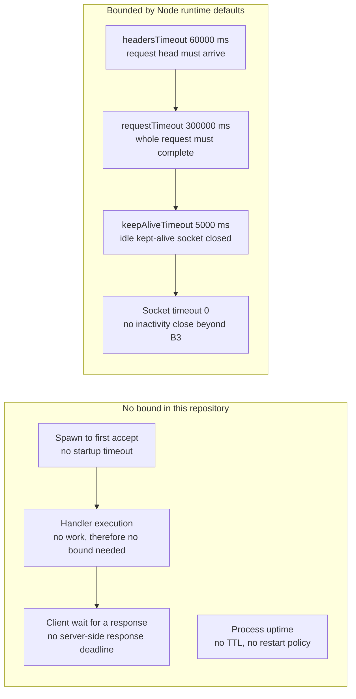

| Timing element | Value or statement | Owner | Consequence for a workflow |
|---|---|---|---|
| Readiness gate | The startup line, or a successful probe of `127.0.0.1:3000` | `server.js:13` | The only ordering guarantee; a supervisor should wait on it rather than sleep |
| Idle connection lifetime | 5000 ms advertised and enforced | Node runtime default | A harness that pauses longer than 5 s between probes pays one reconnect, and nothing else changes |
| Request-head deadline | 60000 ms | Node runtime default | A stalled client cannot hold a socket indefinitely |
| Whole-request deadline | 300000 ms | Node runtime default | Irrelevant in practice, since no body is read |
| Shutdown window | None | absent | No in-flight request is deliberately completed at termination; the OS closes the sockets |
| Retry or backoff interval | None | absent | All retry pacing is the caller's decision |
| Batch window or schedule | None | absent | There is no batch processing to schedule |
| Throughput ceiling, rate limit or quota | None | absent | Concurrency is limited only by the event loop and the OS listen backlog |

**Service-level conclusion.** Availability, latency and error-rate targets cannot be claimed for this system because it neither measures nor promises them, and because its single instance dies on a port conflict and on the first signal it receives. Any service level belongs to the harness that supervises it — which is consistent with the fixture's stated purpose in `README.md`: it is a subject for integration testing, not a service with commitments.

### 4.7.3 Traceability of the Diagrams to Features and Requirements

| Diagram | Workflows | Features | Primary requirements (§2.2) |
|---|---|---|---|
| High-level system workflow, §4.1.1 | W-01, W-02, W-04 | F-001, F-002, F-003 | F-001-RQ-001, F-002-RQ-001, F-003-RQ-001 |
| Startup and bind sequence, §4.2.1 | W-01, W-04, W-06 | F-002, F-003 | F-002-RQ-001, F-002-RQ-002, F-002-RQ-003, F-003-RQ-001 |
| Single request processing, §4.2.2 | W-02, W-07 | F-001 | F-001-RQ-001 through F-001-RQ-004 |
| Process lifetime and shutdown, §4.2.3 | W-01, W-05, W-06 | F-002, F-003 | F-002-RQ-003; explains the missing graceful-shutdown behaviour recorded in §1.2.1 |
| Build, package and verification, §4.2.4 | W-08, W-09, W-10 | F-005, F-006 | F-005-RQ-002, F-005-RQ-003, F-005-RQ-004, F-006-RQ-001 |
| Client–server sequence, §4.3.1 | W-02, W-07 | F-001 | F-001-RQ-001, F-001-RQ-002, F-001-RQ-004 |
| Connection reuse and idle timeout, §4.3.2 | W-03 | F-004 | F-004-RQ-001, F-004-RQ-002 |
| Connection state model, §4.4.1 | W-02, W-03, W-07 | F-001, F-004 | F-001-RQ-003, F-004-RQ-001 |
| Error handling flowchart, §4.5.1 | W-05, W-06, W-07, W-09 | F-002, F-006 | F-002-RQ-003, F-006-RQ-001 |
| Bounded waits, §4.7.2 | W-03, W-05 | F-004 | F-004-RQ-001 |


## 4.8 References

- `server.js` — the sole executable file (342 bytes, 14 lines); established every process step: `require('http')` at line 1, the `hostname`/`port` literals at lines 3-4, the request handler that sets `200`, `text/plain` and the 14-byte body at lines 6-10, and the `listen` callback that prints the readiness line at lines 12-14
- `package.json` — package identity `hello_world@1.0.0`, MIT license, empty dependency set, the placeholder `test` script that always exits `1`, no `start` script, and `"main": "index.js"` naming a file that does not exist
- `package-lock.json` — lockfile version 3 whose only package record is the root package, establishing that no dependency resolution occurs
- `README.md` — states the fixture's purpose ("test project for backprop integration") and the "Do not touch!" policy that fixes the expected output
- repository root (`""`) — confirmed the tracked tree contains exactly the four files above, with no configuration, test, container, CI or documentation artefacts
- git history and refs (`main`, `26_nov_2026`, `23-Oct`, `27-Oct`; commit `5313c12` "Add files via upload") — established that all refs share one tree, so no workflow exists on a branch that is absent from `main`
- `server.js` runtime execution on Node.js `v22.23.5` — established the observed behaviour cited throughout: readiness line on stdout with empty stderr, `LISTEN` socket `0100007F:0BB8`, identical `200`/`text/plain`/14-byte replies for `GET`, `POST` and `HEAD`, `Connection: keep-alive` with `Keep-Alive: timeout=5`, parser `400 Bad Request` for malformed and unsupported-version requests, `EADDRINUSE` exit `1` for a second instance, exit `143` on `SIGTERM`, 0.6–3.2 ms sequential latency and 50 concurrent requests in 41 ms
- Node.js `http` server introspection on `v22.23.5` — established the runtime defaults quoted in §4.3.2 and §4.7.2: `keepAliveTimeout` 5000, `headersTimeout` 60000, `requestTimeout` 300000, socket `timeout` 0, `maxRequestsPerSocket` 0
- npm `11.21.3` command execution — established `npm test` exit `1`, `npm run` listing `test` as the only script, `npm start` falling back to `node server.js`, `npm ls --all` reporting `(empty)`, `npm pack` producing a 3-file 553-byte tarball, and `require('./')` failing with `MODULE_NOT_FOUND`
- Cross-referenced sections of this specification: §1.2 System Overview (component model and known limitations), §1.3 Scope (out-of-scope capabilities), §2.1 Feature Catalog (F-001 to F-006 identifiers), §2.2 Functional Requirements Table (F-00X-RQ-00Y identifiers)
- No web sources were used; every statement in this section rests on the tracked files and on runtime observation of the code in this checkout


# 5. System Architecture

## 5.1 High-Level Architecture

The architecture is a single-process, single-tier Node.js HTTP endpoint whose entire implementation is the fourteen-line `server.js`. There is no application framework, no service layer, no data tier, no scheduled work and no outbound call. Everything a reader normally expects to find distributed across modules — bootstrap, configuration, routing, response generation and serialization — collapses into one handler closure over Node's built-in `http` module. The sub-sections below describe the architecture at the level it actually exists and state plainly where a conventional architectural element is absent.

### 5.1.1 System Overview

**Architecture style and rationale.** The repository implements a dependency-free monolithic script in the "constant-response HTTP endpoint" style: one file both bootstraps the process and answers every request with a byte-identical reply. The style is not recorded in any design document — the repository has a single commit (`5313c12` "Add files via upload") and no architecture note — so it is inferred from the artifact and from the only statement of intent it carries, `README.md`'s "test project for backprop integration. Do not touch!".

| Architectural dimension | Position as built | Evidence |
|---|---|---|
| Deployment unit | One Node.js process running one file | `server.js`; root folder holds four files and no subfolders |
| Tiering | Single tier — bootstrap, request handling and response production co-located | `server.js:1-14` |
| Internal structure | No modules, no layers, no exported interface | the only `require` in tracked code is `http` (`server.js:1`) |
| Communication | Synchronous HTTP/1.1 request-reply, inbound only | `server.js:6-14` |
| State | Stateless across requests; the `req` argument is never read | `server.js:6`; identical bytes for every method and path |
| Persistence | None — no database, cache, file I/O or session store | absence search over all four tracked files; §3.5 |
| Extension points | None — no router, middleware, plugin or configuration surface | absence search; no configuration read anywhere |

The rationale follows from what the fixture is valued for. Its role is to return a known answer so that a separate integration effort has something stable to verify against, so every architectural simplification removes a variable that could alter that answer: no third-party package can change the runtime's behavior, no configuration can change the bind address, no router can change the status code, and no data store can change the body. The costs are equally direct and are recorded throughout this section: the service cannot be retargeted, cannot run two instances on one host, cannot be observed, and cannot recover from a bind failure.

**Key architectural principles.** Each principle below is a property of the code as written, not an aspiration:

- **Zero supply-chain surface.** `package.json` declares no `dependencies` or `devDependencies`, and `package-lock.json` (`lockfileVersion` 3) records only the root package with no `resolved` or `integrity` entry — nothing was ever fetched from a registry.
- **One file, one responsibility.** `server.js` declares the bind constants, registers the handler, starts the listener and logs the URL; there is no second source file to hold anything else.
- **Configuration is source code.** `hostname = '127.0.0.1'` and `port = 3000` are literals at `server.js:3-4`; no environment variable, config file or CLI argument is read anywhere in the tree.
- **Stateless and idempotent request handling.** The handler writes status, header and body to a per-request response object and discards it; no value derived from one request can be observed by another.
- **Fail fast, recover nowhere.** There is no `'error'` listener, no `try`/`catch`, no retry, no fallback port and no signal handler; a bind conflict is a process exit, and `SIGTERM`/`SIGINT` ends the process immediately.
- **Silent operation.** The only application output is the startup line; more than three hundred requests produced no further stdout and zero bytes of stderr.
- **Immutability of the baseline.** `README.md`'s "Do not touch!" is the one requirement statement in the repository, and it is what keeps the known answer valid across runs.

**System boundaries and major interfaces.** The system boundary encloses exactly one operating-system process. Six interfaces cross it, five of them trivial; only one carries application traffic, and it is reachable only from the same host.

| Interface | Direction | Contract | Evidence |
|---|---|---|---|
| IF-1 Inbound HTTP | Client → process | Any method, any path, any query string over TCP on `127.0.0.1:3000`; every parsed request receives `200`, `Content-Type: text/plain`, body `Hello, World!` plus `\n` (14 bytes) | `server.js:6-14`; headers observed on the wire |
| IF-2 Readiness line | Process → operator or harness | Exactly one line on stdout: `Server running at http://127.0.0.1:3000/` | `server.js:12-14`; observed stdout |
| IF-3 Failure signal | Process → operator | Empty stdout plus a Node stack trace on stderr and exit code `1` when the port is busy; empty stderr otherwise | second-instance run; `EADDRINUSE` trace |
| IF-4 Process invocation | Operator → process | `node server.js` must name the file explicitly: `main` points at an absent `index.js` and no `start` script is declared | `package.json:5-8`; `MODULE_NOT_FOUND` on `require('./')` |
| IF-5 Operating-system signals | Operator → process | `SIGTERM` and `SIGINT` terminate at once, with no drain and no closing message | signal test on a live process; exit `143` for `SIGTERM` |
| IF-6 Package metadata | Manifest → npm tooling | Package name `hello_world` `1.0.0`, MIT licence, one `test` script that always exits `1` | `package.json`, `package-lock.json` |

Everything else stops at the boundary. There is no outbound socket, no filesystem write, no credential, no telemetry export and no administrative interface. The loopback bind is the boundary's enforcement point: a connection attempt to the host's own non-loopback address is refused, because the socket exists only on `127.0.0.1`.

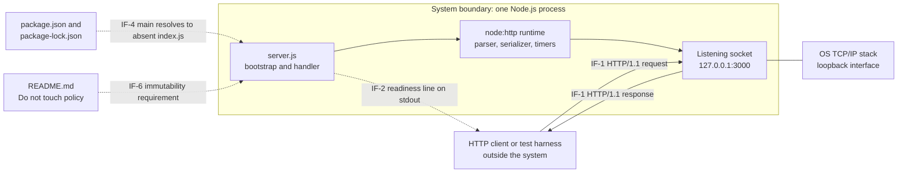

### 5.1.2 Core Components Table

The component model comprises five parts: three inside the process and two that are metadata consumed by tooling rather than at run time. Nothing else exists in the repository, in any of its seven refs, which all resolve to the identical tree `a650329703778bd216de08fdce13e4531003127c`.

| Component | Primary responsibility | Key dependencies | Critical considerations |
|---|---|---|---|
| C1 HTTP Application Entry Point (`server.js`) | Declare bind constants, register the request handler, start the listener, emit the readiness line | `node:http` (built-in) only | No exports and no exported API — it acts as a side effect of execution; host and port are literals; `main` in the manifest points elsewhere |
| C2 Node.js HTTP Runtime (`node:http`, `node:net`, `llhttp`) | Accept connections, parse request heads, serialize responses, manage keep-alive and request timeouts | Node.js runtime supplied by the host | Its defaults, not repository configuration, govern timeouts (keep-alive 5000 ms, headers 60000 ms, request 300000 ms) and protocol-error replies (`400`, `431`) |
| C3 Process and Event-Loop Host (V8 and libuv) | Execute the single JavaScript thread, own memory and the socket table | Operating-system process primitives | One process means one instance per host and port; observed seven threads and about 58 MB resident after 300 requests; the handler never uses the libuv thread pool because it performs no I/O |
| C4 Package Manifest and Lockfile (`package.json`, `package-lock.json`) | Package identity, entry declaration, script surface, dependency set (empty) | npm CLI, only at packaging time | `main` names an absent `index.js`; the sole script `test` always exits `1`; lockfile version 3 with no third-party records |
| C5 Readme and Governance Policy (`README.md`) | State the project's purpose and forbid modification | None — never executed | Two lines of prose with no technical content; the only requirement statement the repository contains |

| Component | Integration points | Interface or protocol | Notes |
|---|---|---|---|
| C1 HTTP Application Entry Point | C2 (runtime), OS stdout and stderr, inbound HTTP | JavaScript callbacks: `http.createServer` handler, `listen` callback | The handler receives `req` and `res` and touches only `res` |
| C2 Node.js HTTP Runtime | C1 (handler registration), C3 (event loop), OS sockets | HTTP/1.1 over TCP; `'request'`, `'listening'` and `'error'` events | Emits `400`/`431` itself when it cannot parse a request head, without consulting C1 |
| C3 Process and Event-Loop Host | C2 (sockets), OS process table | Process signals, exit status, `/proc` visibility | Holds the listening socket and all connection state; holds none of the application's |
| C4 Package Manifest and Lockfile | npm CLI and packaging tools | JSON | Consumed only when npm runs; the running server never reads them |
| C5 Readme and Governance Policy | Human maintainers | Markdown | Constrains change, not behavior |

### 5.1.3 Data Flow Description

Three flows exist, and all three are short and deterministic.

**Flow A — startup.** The operator or harness executes `node server.js`. The module requires `http` (`server.js:1`), creates a server object with the handler closure (`server.js:6-10`), and calls `server.listen(3000, '127.0.0.1', callback)` (`server.js:12`). The operating system binds the loopback address; when the bind succeeds, the callback appends one line to stdout via a template literal (`server.js:13`). No file, network resource or data store is read at any point in this flow.

**Flow B — request to response.** A client connects to `127.0.0.1:3000`. The runtime accumulates bytes and the `llhttp` parser produces an `IncomingMessage`; the runtime then emits `'request'` with a paired `ServerResponse`. The handler sets `res.statusCode = 200`, sets a single header `Content-Type: text/plain`, and calls `res.end('Hello, World!\n')` (`server.js:7-9`). The runtime serializer writes the status line, the headers it adds itself (`Date`, `Connection`, `Keep-Alive`, a computed `Content-Length: 14`) and the body. The request body is never consumed: a `POST` carrying a payload receives the same 14-byte reply as a `GET`, and the unread payload is discarded with the request object.

**Flow C — idle to close.** After a response completes, the socket stays open for reuse unless the client asked to close it. Two requests sent on one connection were observed reusing it, and the runtime closes an idle socket after `keepAliveTimeout` of 5000 ms, advertising `Keep-Alive: timeout=5` on every response.

```mermaid
flowchart TB
    subgraph FA["Flow A: startup"]
        A1["node server.js"] --> A2["require http built-in module"]
        A2 --> A3["http.createServer handler closure"]
        A3 --> A4["server.listen 3000 on 127.0.0.1"]
        A4 --> A5["listening callback fires"]
        A5 --> A6["stdout: Server running at http://127.0.0.1:3000/"]
    end
    subgraph FB["Flow B: request to response"]
        B1["TCP bytes on loopback socket"] --> B2["llhttp parses request line and headers"]
        B2 --> B3["request event carries req and res"]
        B3 --> B4["handler writes 200, text/plain, 14-byte body"]
        B4 --> B5["serializer writes status line, headers, computed Content-Length"]
        B5 --> B6["socket write, connection kept alive"]
    end
    subgraph FC["Flow C: idle to close"]
        C1["response complete"] --> C2{"client sent Connection close?"}
        C2 -->|"yes"| C3["socket closed"]
        C2 -->|"no"| C4["idle socket, keepAliveTimeout 5000 ms"]
        C4 --> C3
    end
```

**Integration patterns and protocols.** The only protocol is HTTP/1.1 over TCP on the loopback interface, used in a strict request-reply pattern with a fixed response contract. There is no publish-subscribe, no queue, no batch or file-transfer channel, no streaming body, no server-sent event and no webhook: the handler terminates the response on the same turn of the event loop on which the request arrived, so no asynchronous continuation exists. Protocol-level failures are answered by the runtime rather than by this code — an unparsable request head yields `400 Bad Request` with `Connection: close`, and a header block larger than 16 KB yields `431 Request Header Fields Too Large`. Neither path reaches the handler, and neither appears in application output.

**Data transformation points.** Every transformation is either runtime parsing or a constant write.

| Stage | Input | Output | Performed by |
|---|---|---|---|
| Parse | Raw request bytes | `IncomingMessage` with method, URL and headers | Node.js runtime (`llhttp`), `maxHeaderSize` 16384 |
| Handle | The paired `ServerResponse`, request ignored | Status `200`, one header, 14-byte body | Handler closure, `server.js:7-9` |
| Serialize | Status, headers and body | Wire bytes: status line, `Date`, `Connection`, `Keep-Alive`, `Content-Length: 14`, body | Node.js runtime serializer |
| Report | `hostname` and `port` constants | One stdout line at startup | Template literal, `server.js:13` |

**Key data stores and caches.** There are none, at any layer. The only values resident in the process are the two module-level constants `hostname` and `port` (`server.js:3-4`), the handler closure (`server.js:6-10`) and the string literal in `res.end` (`server.js:9`); none changes after startup and none is derived from a request. No `Cache-Control`, `ETag`, `Last-Modified` or `Vary` header is emitted, so no intermediary or client is given a cache directive by the system, and no in-process memoization exists because there is nothing to compute. The single form of reuse in the architecture is transport-level: a kept-alive socket amortizes the TCP handshake across requests without retaining any response content.

### 5.1.4 External Integration Points

Only one integration is exercised at run time, and it is a same-host client. The other rows record dependencies that are provisioned or consumed outside the process, distinguished so that a reader does not mistake them for runtime integrations.

| System | Integration type | Data exchange pattern | Protocol or format |
|---|---|---|---|
| HTTP client, probe or test harness on the same host | Runtime, inbound, synchronous | Request-reply; one 14-byte response per parsed request; connection reusable until 5 s idle | HTTP/1.1 over TCP on `127.0.0.1:3000` |
| Node.js runtime on the host | Provisioning dependency | None at run time beyond loading the script and built-in modules; no package installation | Node.js `v22.23.5` observed; no `engines` field pins a version |
| GitHub remote `origin` (`3-August`) | Source-control, build time only | Clone, fetch and push of the four tracked files | Git over HTTPS |
| npm CLI | Packaging, build time only | `npm test` (always exits `1`), `npm pack` (three files, 553 B) | npm 11.21.3 |
| npm registry, databases, queues, caches, identity providers, telemetry and cloud APIs | Absent | No client code, connection string, credential or SDK in any tracked file | Not applicable |

| System | Direction | Service-level expectation | Evidence |
|---|---|---|---|
| Same-host HTTP client | Inbound | No SLA is defined by the system. Behavior is deterministic: status `200`, `text/plain`, 14-byte body for every parsed request; observed single-request latency 0.6–3.2 ms and 200 requests at 50-way concurrency completing in 165 ms | `server.js`; measured runs |
| Off-host client | Not reachable | Connection refused, because the listener exists only on the loopback address | connection to the host's non-loopback address refused |
| Operator or supervisor | Out of band | Readiness must be detected from the stdout line; a failed bind produces no stdout and exit code `1` | startup and bind-failure runs |
| Downstream systems of any kind | Outbound | None — the process never opens an outbound connection | no `net`, `http.request`, `fetch`, `axios` or SDK call in the tracked files |

Because no integration contract is negotiated, versioned or authenticated, the entire external surface reduces to one address (`127.0.0.1:3000`), one protocol (HTTP/1.1), and one payload (14 bytes). Any consumer wanting a different address, protocol or payload must change `server.js`, which the readme's "Do not touch!" instruction forbids.


## 5.2 Component Details

This part details each of the five components identified in §5.1.2: what it does, the technology that implements it, the interfaces it exposes, what it persists, and how it could scale. The depth varies with the component — C1 and C2 carry all of the system's behavior, while C4 and C5 are inert files whose architectural effect is a constraint rather than an execution.

### 5.2.1 C1 HTTP Application Entry Point and Request Handler

**Purpose and responsibilities.** `server.js` is both the process bootstrap and the only request-processing code. Its responsibilities are exactly four, and the file discharges all of them in fourteen lines:

- Declare the bind target as two module-level constants, `hostname = '127.0.0.1'` and `port = 3000` (`server.js:3-4`).
- Construct the HTTP server, passing the request handler closure as the `requestListener` argument (`server.js:6-10`).
- Start the listener on that address and, on success, write one readiness line to stdout (`server.js:12-14`).
- Answer every delivered request with a fixed status, a fixed header and a fixed body (`server.js:7-9`).

It performs no validation, no routing, no authentication, no logging, no error handling and no resource cleanup, and it exports nothing: the module's effect is entirely the side effect of being executed.

| Lines | Element | Architectural role |
|---|---|---|
| 1 | `const http = require('http');` | The single dependency edge in the system, to a Node.js built-in module |
| 3-4 | `hostname`, `port` constants | The complete configuration surface; immutable for the life of the process |
| 6-10 | `http.createServer((req, res) => { ... })` | The request handler; `req` is never read, so the response cannot depend on the request |
| 12-14 | `server.listen(port, hostname, cb)` | Binds the loopback socket and emits the readiness line once listening |

**Technologies and frameworks.** No framework, library or transpiler is involved.

| Concern | Technology as used | Basis | Evidence |
|---|---|---|---|
| Language and module system | JavaScript with ES2015-level syntax (`const`, arrow function, template literal) in CommonJS | `package.json` declares no `"type"` field, so `.js` resolves as CommonJS | `server.js:1-14`; `package.json` |
| HTTP server | Node.js built-in `http` module; `http.createServer`, `server.listen` | Core module, no version pinning possible from the repository | `server.js:1`, `6`, `12` |
| Response construction | `res.statusCode`, `res.setHeader`, `res.end` | Core `ServerResponse` API, long stable across Node releases | `server.js:7-9` |
| Build or transpilation | None — the tracked file is the deployed artifact | No build output, no toolchain configuration in the tree | four-file tree; no `dist`, no bundler config |
| Test or lint tooling | None — the sole script is a placeholder that exits `1` | `npm test` observed exiting `1` | `package.json:6-8` |

**Key interfaces and APIs.** The component offers no programmatic interface to other code; its interfaces are the Node.js callbacks it supplies and the process-level channels it uses.

| Interface | Kind | Contract |
|---|---|---|
| `requestListener(req, res)` | Inbound callback registered with `http.createServer` | Always sets `200`, `Content-Type: text/plain`, and ends with the 14-byte constant; returns nothing; never throws |
| `listen` callback | Lifecycle callback | Writes exactly one line, `Server running at http://127.0.0.1:3000/`, to stdout |
| HTTP request/response | Network, IF-1 | Any method and path over `127.0.0.1:3000` receives the same fixed reply (§5.1.3, Flow B) |
| Process invocation | Operating system, IF-4 | Must be `node server.js`; `main` in `package.json` names an absent `index.js` |
| Signals and exit status | Operating system, IF-3 and IF-5 | `SIGINT` and `SIGTERM` terminate immediately; a bind conflict exits `1` with a stack trace on stderr |

Two consequences of this interface set are architecturally significant. First, because the module exports nothing, the server cannot be embedded in another process, started on a caller-supplied port, or shut down by a caller — the only control channel is the operating system's process interface. Second, because the handler takes no options object and reads no configuration, the bind address is not injectable; changing it is a source change.

**Data persistence requirements.** None. The component reads no file, opens no database connection, writes no log file and holds no state between requests; the response body is a literal compiled into the module (`server.js:9`). A restart therefore loses nothing, and the deployed tree can be mounted read-only.

**Scaling considerations.**

- **Vertical only, and only within one process.** The handler is synchronous and performs no I/O, so the event loop turns each request in microsecond time; the limit is the runtime's own socket and parsing capacity, not application work. Two hundred requests issued at 50-way concurrency all returned `200`, completing in 165 ms wall time, and a process that had served 300 requests held roughly 58 MB resident.
- **One instance per host and port.** The address is a literal, so a second instance on the same host exits `1` with `EADDRINUSE` rather than picking another port. No port-negotiation, cluster or worker-thread code exists.
- **No horizontal reach.** Because the bind is loopback-only, another host or container cannot reach the service; a second copy would need its own host and would have to be started explicitly with `node server.js`, since no `start` script or process-manager configuration is provided.
- **Scaling would require source change.** Varying the port, binding a wildcard address, adding a health endpoint or running multiple workers each contradict the readme's "Do not touch!" constraint, and none has an extension point in the current design.

### 5.2.2 C2 and C3 Node.js HTTP Runtime and Process Host

**Purpose and responsibilities.** The runtime components supply everything the application does not implement itself: TCP accept, HTTP/1.1 parsing with `llhttp`, response serialization, header and body framing, keep-alive management, protocol-level error replies and timeout enforcement. The process host supplies the single JavaScript thread, the memory space, the socket table and the exit semantics.

| Runtime subsystem | Role in this architecture | Observed value |
|---|---|---|
| `node:http` server | Owning object for the listener; emits `'request'`, `'listening'` and `'error'` | Defaults: `keepAliveTimeout` 5000 ms, `headersTimeout` 60000 ms, `requestTimeout` 300000 ms, `maxHeaderSize` 16384 bytes |
| `llhttp` parser | Converts request bytes into an `IncomingMessage`; rejects malformed heads | `llhttp` 9.4.4 in the runtime used |
| Response serializer | Writes status line, adds `Date`, `Connection`, `Keep-Alive`, computes `Content-Length` | `Content-Length: 14` and `Keep-Alive: timeout=5` observed on every reply |
| `node:net` socket layer | Loopback accept and write; closes idle sockets | One listening socket, `0100007F:0BB8` in the socket table |
| V8 engine | Executes the handler closure synchronously | V8 `12.4.254.21-node.57` |
| libuv thread pool | Present for asynchronous work; unused by this handler | Seven threads observed in the process; handler does no I/O |
| Bundled subsystems never reached | Present in the runtime but not required by the application | OpenSSL `3.5.9`, `undici` `6.29.1`, `node:sqlite` `3.54.1`, ICU `78.3` |

**Technologies and frameworks.** The runtime is Node.js `v22.23.5` as provisioned on the host; it is not vendored, not pinned by an `engines` field, and not containerized in the repository. Because the application uses only long-stable core APIs, no language or API feature sets a minimum version beyond the first release that supported `http.createServer` and `res.end`.

**Key interfaces and APIs.** The runtime's interfaces are the events and object properties the application either uses or leaves unused.

| Interface | Used by the application? | Effect |
|---|---|---|
| `'listening'` / `listen` callback | Yes | Emits the readiness line, the only success signal |
| `'request'` event | Yes | Delivers `req` and `res` to the handler |
| `'error'` event | No | A bind failure becomes an uncaught exception and exit code `1` |
| `'clientError'` event | No | Malformed request heads receive the runtime's default `400` with `Connection: close` |
| `req` (method, url, headers, body stream) | No | Request content cannot influence the response; bodies are discarded unread |
| Timeout properties | No | Defaults apply unchanged: 5 s keep-alive, 60 s headers, 300 s request |

**Data persistence requirements.** None. The runtime keeps connection state in memory only — accepted sockets, parser buffers and keep-alive timers — and every one of those is discarded on process exit. Nothing is written to disk, so there is no runtime artifact to clean up, retain or back up.

**Scaling considerations.** The process host determines the scaling envelope: one JavaScript thread means concurrency comes from event-loop multiplexing across sockets, not from parallelism in application code; the libuv pool's threads cannot help a handler that never awaits. Memory grows only with the number of simultaneously open connections, since no per-request record outlives its response. Beyond a single process the host would need `cluster`, worker threads or an external supervisor, none of which exists in the repository.

### 5.2.3 C4 Package Manifest and Lockfile

**Purpose and responsibilities.** `package.json` gives the project its npm identity and tooling surface; `package-lock.json` records that the dependency graph is empty. Neither file is read by the running server.

| Field | Value | Architectural effect |
|---|---|---|
| `name` / `version` | `hello_world` / `1.0.0` | Identity differs from the readme title `hao-backprop-test` and from the git remote name `3-August` |
| `main` | `index.js` | Names a file that exists in no ref; `require('./')` fails with `MODULE_NOT_FOUND`, so automation must target `server.js` |
| `scripts` | `test` only: `echo "Error: no test specified" && exit 1` | No automated gate can pass; no `start` script, so `npm start` falls back to npm's implicit `node server.js` |
| `dependencies` / `devDependencies` | Absent | The zero-dependency posture is deliberate as found, not merely unmaintained |
| `engines` / `type` | Absent | No Node.js version pin and no module-system override, so `.js` stays CommonJS |
| `package-lock.json` | `lockfileVersion` 3, `requires: true`, one root record | No package was ever resolved or fetched; the lockfile contributes nothing to the install graph |

**Technologies and frameworks.** Plain JSON consumed by npm 11.21.3. `npm ls --all` reports an empty tree, and `npm pack --dry-run` produces a three-file tarball (`README.md`, `package.json`, `server.js`, 553 B packed, 666 B unpacked) — the lockfile is not even included in the package.

**Key interfaces and APIs.** `npm test` (always exit `1`), `npm start` (unimplemented but working through npm's default), `npm pack`, and Node's module resolution of the package root (broken by the absent `main`).

**Data persistence requirements.** None at run time; the files are version-controlled inputs.

**Scaling considerations.** Not applicable — the manifest has no runtime footprint. Its practical scaling constraint is that adding any dependency would change the supply-chain surface from empty to non-empty, which §3.3 identifies as the property the fixture is kept for.

### 5.2.4 C5 Readme and Governance Policy

**Purpose and responsibilities.** `README.md` carries the project's only statement of intent: the heading `# hao-backprop-test`, the sentence "test project for backprop integration", and the instruction "Do not touch!". It has no runtime role and no executable content.

| Aspect | Position |
|---|---|
| Content | Two lines: a Markdown heading and one sentence with an imperative |
| Architectural effect | Establishes the immutability constraint that justifies the fixed response, the missing configuration surface and the absence of a test gate |
| Runtime role | None — never read by the process or by any script |
| Conflict with the code | The prohibition on modification coexists with a manifest whose `main` is absent and a `test` script that always fails; the defects are tolerated precisely because the baseline is frozen |
| Identity conflict | The heading (`hao-backprop-test`), the package name (`hello_world`) and the git remote (`3-August`) name the same artifact three different ways |

**Technologies and frameworks.** Markdown only. **Key interfaces.** Human readers and repository reviewers. **Data persistence requirements.** None. **Scaling considerations.** Not applicable; the relevant consideration is that the policy is unenforced by tooling, so nothing prevents a change — only convention does.

### 5.2.5 Component Interaction Diagram

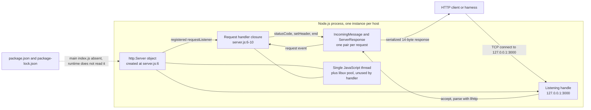

The graph shows the composition directly: `server.js` creates one `Server` object and hands it one handler; the object owns one listening handle; the runtime creates a request/response pair per connection-parsed request and drives the handler through the `'request'` event; the handler's only outbound edge is back into that same pair. There is no edge from the handler to any other component, which is why the architecture has no failure propagation path beyond the response itself.

### 5.2.6 State Transition Diagram

The application contributes no state of its own, so the only meaningful transition model is the lifecycle of the process and its listening socket. Per-connection states (accepted, parsing, rejected, responding, idle) are documented in §4.4.1 and are not repeated here.

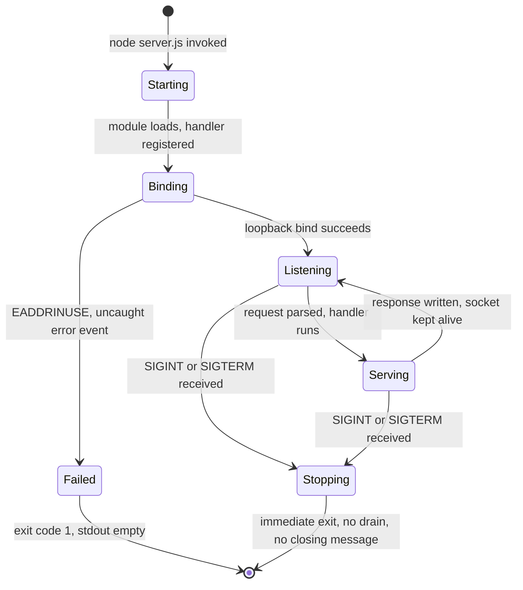

| State | Entered when | Observable evidence | Exit path |
|---|---|---|---|
| Starting | The operator runs `node server.js` | Process exists with no listener yet | Module load completes |
| Binding | `server.listen` is called | Attempted socket bind on `127.0.0.1:3000` | Bind success or `EADDRINUSE` |
| Failed | The address is already in use | Stack trace on stderr, nothing on stdout, exit `1` | Terminal |
| Listening | The bind succeeds | Readiness line on stdout; `LISTEN` row in the socket table | Request arrival, or a signal |
| Serving | A parsed request reaches the handler | `200` response on the wire; no log entry | Response completes |
| Stopping | A signal is delivered | Process terminates with no output change | Terminal |

The model is deliberately acyclic: there is no restart, retry or reconnection transition inside the system, because no code observes the `'error'` event or a signal. Every recovery is a fresh process, which is sound here only because no state would be lost.

### 5.2.7 Sequence Diagrams for Key Flows

**Startup and bind.**

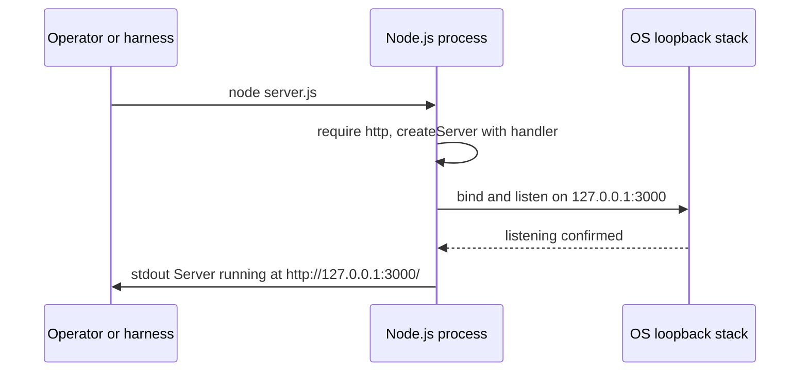

The readiness line is the only positive startup signal and it appears only after the bind succeeds, so a harness that waits for it cannot race the listener. Because nothing is written on failure, an absent line is the correct indicator that startup did not complete.

**Request and response on a reused connection.**

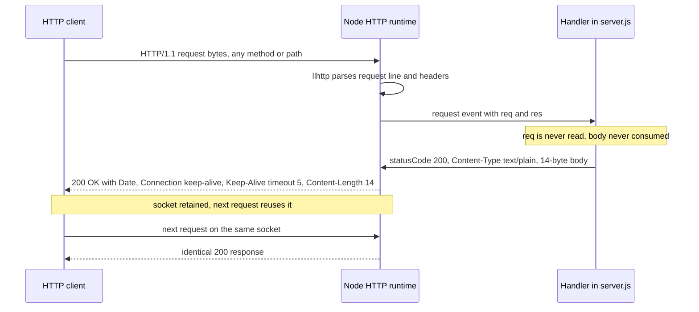

Every element of the response is either written by the handler (status, content type, body) or added by the serializer (`Date`, `Connection`, `Keep-Alive`, `Content-Length`); no header depends on the request, which is why responses for different methods and paths are byte-identical apart from the `Date` value.

**Bind failure when the port is occupied.**

```mermaid
sequenceDiagram
    participant Op as Operator
    participant N2 as Second node server.js
    participant OS as OS loopback stack
    Op->>N2: node server.js
    N2->>OS: bind 127.0.0.1:3000
    OS-->>N2: EADDRINUSE
    N2->>N2: emit error, no listener registered on the server object
    N2-->>Op: uncaught exception trace on stderr, exit code 1, stdout empty
```

The second instance never reaches `Listening`: the uncaught `'error'` event terminates it before the `listen` callback can run, which is why the readiness line is absent and why no retry or alternate-port behavior is observed.


## 5.3 Technical Decisions

The repository contains no architecture decision record, no design note and no commit beyond the initial upload, so the decisions below are reconstructed from the artifact: each is stated as the operative choice the code embodies, with the tradeoff it accepts and the evidence that fixes it. Where a reader might expect an alternative to have been weighed, the alternative is named as "not taken" rather than described as rejected — nothing in the repository records deliberation.

### 5.3.1 Architecture Style Decision and Tradeoffs

**Options and the position as built.**

| Option | Position | Basis in the repository | Consequence |
|---|---|---|---|
| Single-file, dependency-free script on the built-in `http` module | Adopted | `server.js:1-14`; empty dependency set; three-file package, 553 B packed | Zero supply-chain surface and trivial deployment; no framework affordances for routing, middleware or structured errors |
| Layered API service on a framework such as Express or Fastify | Not taken | no dependency, no router, no middleware in any ref | Nothing to configure per environment; adding a route would require a new dependency and a new file |
| Multi-tier service with a data store | Not taken | no driver, connection string or credential; §3.5 | No schema, migration, backup or consistency concern; no query or write path exists |
| Serverless function behind a managed gateway | Not taken | no handler export, no platform manifest | The process model is a long-lived listener with its own socket, not an invocable unit |
| Multi-process or clustered deployment | Not taken | no `cluster`, `worker_threads` or process-manager configuration | One instance per host and port; a second start fails with `EADDRINUSE` |

**Why the adopted style fits.** The artifact's role is to return a known answer for a separate integration effort, under an instruction (`README.md`: "Do not touch!") that the answer must not drift. Each simplification removes a way for the answer to drift: a third-party package would add a version that could change behavior, a configuration surface would add a value that could differ per environment, a router would add a code path that could answer differently, and a data store would add content that could change between runs. The style is therefore fit for purpose at the cost of nearly every other quality attribute.

| Quality attribute | Gain as built | Cost as built |
|---|---|---|
| Portability of the artifact | Four files, 553 B packed, no install step, no build output | Requires a host `node` binary; no version is pinned by `engines` |
| Behavioral stability | Status, content type and body are literals; responses byte-identical apart from `Date` | No endpoint can ever answer differently, so the service cannot serve a second purpose |
| Operability | Nobody must provision credentials, storage or network policy | No health endpoint, no metrics, no request log, no restart or drain behavior |
| Security posture | No secret exists to leak; no stored data exists to disclose; nothing can be reached off-host | No authentication, no TLS, no security headers; any local process may call it |
| Change safety | One file to read; `npm test` cannot silently pass | The same single script is also the whole product, and the one test gate always fails, so regressions would be caught only by external probes |
| Performance | No I/O on the request path; observed 0.6–3.2 ms per request, 200 requests at 50-way concurrency in 165 ms | A single process and a single JavaScript thread cap throughput at the runtime's socket capacity |

### 5.3.2 Communication Pattern Choices

| Decision | Choice as built | Rationale the choice satisfies | Evidence |
|---|---|---|---|
| Interaction style | Strict inbound request-reply; the handler finishes the response synchronously | No asynchronous continuation means no timeout, retry or partial-response path to design | `server.js:6-10`; handler contains no `await` and no callback beyond `res.end` |
| Protocol | HTTP/1.1 over plain TCP on the loopback interface | Universally available to any client or harness with no library, and the runtime already implements it | `server.js:6`, `12`; observed `HTTP/1.1 200 OK` |
| Connection lifecycle | Keep-alive retained; the runtime closes an idle socket after 5000 ms | Amortizes the handshake across repeated verification calls at no implementation cost | `Connection: keep-alive` and `Keep-Alive: timeout=5` on every response; connection reuse observed |
| Request inspection | None; method, URL, headers and body are ignored | The answer must not depend on the request, so reading it would add a path that could only break the contract | `req` never referenced in `server.js:6-10`; identical reply to `GET`, `POST`, `HEAD` and unknown paths |
| Outbound communication | None | Nothing external must be consulted to produce the answer, so no dependency, credential or latency is introduced | no `net`, `http.request`, `fetch` or SDK call in tracked code |
| Messaging or streaming | None | There is no producer, consumer, queue or event to transport | absence search over all four files |
| Protocol-error handling | Delegated to the runtime | The runtime already answers unparsable heads with `400` and oversized headers with `431`, so the application need not own that logic | raw-socket probes; §4.5.2 |

Because the handler ends the response on the event-loop turn that received the request, the architecture has no intermediate state in which a communication failure could occur: there is no pending write to a third party, no stream to drain and no acknowledgement to await.

### 5.3.3 Data Storage and Caching Decisions

| Decision | Choice as built | Reason | Consequence |
|---|---|---|---|
| Primary datastore | None | The response is a compile-time constant; nothing must be looked up | No schema, migration, seed, backup or retention policy; the tree can be mounted read-only |
| Secondary or analytical store | None | No second data domain exists | No reporting or export path |
| Session or identity store | None | No cookie is set and no identity is read | Statelessness is total: any request may be served by a fresh process |
| In-process cache or memoization | None | There is nothing to compute, so nothing to cache | No warm-up, invalidation or memory-growth concern |
| HTTP caching directives | None emitted | No `Cache-Control`, `ETag`, `Last-Modified` or `Vary` header is set by code or by default | A client or intermediary may apply heuristic caching; a wire-level verification client should disable its own cache |
| Connection reuse | Present, at transport level | Amortizes the TCP handshake without retaining content | A kept-alive socket is the only reuse in the architecture |
| Persistence of configuration | Source literals only | Host and port are constants, so the file is the configuration | Retargeting requires a source change and a redeploy |

Any persistence requirement would break the current posture three ways at once: it would add a dependency, add a credential or writable filesystem, and add state whose loss a restart could not recover — each contradicting the zero-dependency, secret-free, restart-is-recovery properties that §5.3.1 identifies as the reasons for the style.

### 5.3.4 Security Mechanism Selection

| Control | Present | Detail | Architectural effect |
|---|---|---|---|
| Network isolation | Yes — the only effective control | The listener binds `127.0.0.1:3000`, so the operating system permits only same-host clients | Acts as the whole security boundary; an off-host connect is refused |
| Transport encryption | No | Plain HTTP/1.1 with no TLS termination in the process; OpenSSL `3.5.9` exists in the runtime but is never engaged | Traffic is readable by any local process with socket access |
| Authentication | No | No credential, token, header or cookie is read or required | Any caller that can open the socket is served |
| Authorization | No | No principal exists, and every caller receives the same response | There is nothing to authorize, because there is no per-user behavior or data |
| Security headers | No | No HSTS, `X-Content-Type-Options`, CORS or CSP header is emitted | No browser-origin control is offered or needed for a non-browser probe |
| Input validation | No | The request is not inspected at all, so no input reaches a sink | No injection, traversal or deserialization surface exists |
| Secret management | Not applicable | No credential, key or token appears in any tracked file | Nothing to rotate, store or leak |
| Supply chain | Privileged by absence | No third-party package is resolved or installed | No dependency-vulnerability surface |

The selection is isolation in place of authentication, and it is coherent only while the boundary holds: the service trusts every local process and no remote one. Two assumptions must be stated because nothing in the repository enforces them. First, the bind address must remain `127.0.0.1`; changing it to a wildcard address would publish an unauthenticated, unencrypted endpoint to the network. Second, the host must be treated as single-tenant for this port, since any local user who can reach the socket receives the response. Neither assumption is documented, tested or enforced by configuration.

### 5.3.5 Decision Tree

The tree records the sequence of choices that produced the architecture, with the path not taken shown at each fork.

```mermaid
flowchart TB
    Q0{"What must the artifact guarantee?"}
    Q0 -->|"a byte-identical known answer"| Q1{"Is a third-party package acceptable?"}
    Q1 -->|"no"| D1["Adopt built-in http module only<br/>ADR-01"]
    Q1 -->|"yes"| X1["Not taken: framework router<br/>Express or Fastify"]
    D1 --> Q2{"Must the answer depend on the request?"}
    Q2 -->|"no"| D2["Adopt one unconditional handler<br/>ADR-03"]
    Q2 -->|"yes"| X2["Not taken: routing, validation, method dispatch"]
    D2 --> Q3{"Who must reach the service?"}
    Q3 -->|"only the same host"| D3["Adopt bind 127.0.0.1 port 3000<br/>ADR-02"]
    Q3 -->|"other hosts or containers"| X3["Not taken: wildcard bind and TLS"]
    D3 --> Q4{"Must any state survive a request?"}
    Q4 -->|"no"| D4["Adopt no store and no cache<br/>ADR-05"]
    Q4 -->|"yes"| X4["Not taken: database and session store"]
    D4 --> Q5{"Is a build or test gate required?"}
    Q5 -->|"no"| D5["Adopt CommonJS, no build, placeholder test<br/>ADR-04"]
    Q5 -->|"yes"| X5["Not taken: bundler and test framework"]
    D5 --> Q6{"May the baseline change?"}
    Q6 -->|"no, readme forbids it"| D6["Adopt no observability, no recovery, no app auth<br/>ADR-06, ADR-07, ADR-08"]
```

### 5.3.6 Architecture Decision Records

These records document the decisions the code embodies. Each carries the status "as built — reconstructed", because no ADR file exists in the repository and no commit message discusses design.

| ADR | Decision | Rationale | Consequences |
|---|---|---|---|
| ADR-01 | Use only the Node.js built-in `http` module; no framework or library | Keeps the supply chain empty and the deployed artifact a single file | No routing, middleware, structured errors or framework upgrades; behavior is bound to runtime defaults |
| ADR-02 | Bind `127.0.0.1:3000` with both values hardcoded | Restricts exposure to the same host and removes configuration as a drift source | One instance per host; not reachable from a container or another machine; retargeting is a source change |
| ADR-03 | Answer every request identically: `200`, `text/plain`, 14-byte body | The known answer is the fixture's value; a request-dependent response could differ and invalidate the oracle | No `404`, no method distinction, no query handling; bodies are discarded unread |
| ADR-04 | CommonJS, no build step, no transpilation; the tracked file is the artifact | Removes the toolchain from the trust and setup path | No static typing, linting or transformation; the source encoding is the wire encoding |
| ADR-05 | No persistence and no caching | Nothing must be stored or recomputed to answer; a restart is a complete recovery | No schema, backup, migration, retention or invalidation concern; no data can be read or written |
| ADR-06 | No error handling, no recovery, no logging beyond the startup line (fail-fast) | A fixture that restarts cleanly gains nothing from retry or drain logic, and silent operation keeps the output contract to one line | A busy port is fatal with exit `1`; no diagnostics beyond a runtime stack trace; no request log or metrics |
| ADR-07 | No application-level authentication or authorization; loopback binding is the sole control | With no state, no data and no per-user behavior there is nothing to authorize | Any local process is served; the endpoint must never be bound to a public address |
| ADR-08 | Freeze the baseline; the readme's "Do not touch!" governs change | A stable expected answer is what makes the artifact verifiable over time | Known defects are tolerated: `main` names an absent `index.js`, and `npm test` exits `1` by design |


## 5.4 Cross-Cutting Concerns

The cross-cutting concerns below are the ones an architecture section is normally expected to address. For this system each resolves to a single fact — the concern is either absent entirely or satisfied only by the operating system and the Node.js runtime — so the material documents the position and its consequences rather than describing mechanisms that do not exist.

### 5.4.1 Monitoring and Observability

No observability machinery exists in the repository: no metrics, no health or readiness endpoint, no status page, no dashboard definition, no alert rule, no trace exporter and no log aggregation configuration.

| Capability | Present | Detail | Evidence |
|---|---|---|---|
| Health or readiness endpoint | No | Every path returns the same fixed payload, so no path can report health specifically; a `200` proves only that the process is alive | `server.js:6-10`; identical responses for unknown paths |
| Metrics endpoint or counters | No | No counter, histogram or timer exists; no metrics library is installed | empty dependency set; absence search |
| Structured or request logs | No | The only output is one startup line; more than 300 requests added nothing to stdout and zero bytes to stderr | measured stdout and stderr during a 300-request run |
| Distributed tracing or correlation IDs | No | No trace header is read or written; there is no downstream call to propagate a context to | `req` never inspected |
| Dashboards and alert rules | No | No configuration for any observability platform appears in tree | absence search |
| Liveness signal | Indirectly | A `LISTEN` socket on `127.0.0.1:3000` plus a live process is the only health state that can be observed | socket table row `0100007F:0BB8`; process inspection |

What an operator can observe from outside is therefore limited but sufficient for a fixture:

| Signal | How to obtain it | What it establishes |
|---|---|---|
| Readiness | The single stdout line `Server running at http://127.0.0.1:3000/` | The bind succeeded and the socket is accepting |
| Absence of readiness | No stdout line plus exit code `1` and an `EADDRINUSE` trace on stderr | Startup failed; there is nothing to probe |
| Liveness | A completed request returning `200` with the 14-byte body | The event loop is turning and the handler is registered |
| Listening state | Socket table shows one listener on `0100007F:0BB8` | The bind address and port are as expected, and only one instance exists |
| Resource footprint | Resident set of the process, roughly 58 MB after 300 requests | No growth trend can be inferred from a single sample; there is no metric to compare against |
| Silence as health | Unchanged stdout and empty stderr | No request-level or error-level event has occurred |

The architectural consequence is that any monitoring must be built outside the system by the harness that drives it. Requests are the only probe surface, and because every path answers identically, a probe cannot distinguish a healthy application from one whose routing has been removed — both return `200`.

### 5.4.2 Logging and Tracing Strategy

The entire logging strategy is one `console.log` call in the `listen` callback (`server.js:13`), which writes the readiness line to stdout through the template literal `Server running at http://${hostname}:${port}/`.

| Aspect | Position as built | Evidence |
|---|---|---|
| Log destination | Process stdout and stderr only, inherited from the parent; no file, socket or collector | `server.js:13`; no logging library in the tree |
| Log levels, formats or structure | None — a single unstructured human-readable line | `server.js:13` |
| Request logging | None; the handler contains no output statement, and the runtime logs nothing by default | stdout unchanged after more than 300 requests |
| Error logging | Only an uncaught bind failure, written by the Node.js runtime rather than by application code | `EADDRINUSE` stack trace on stderr |
| Rotation, retention, redaction | Not applicable — nothing is written by the application, and no request content is ever captured | `req` never read |
| Tracing, spans, correlation | None; there is no downstream call over which to propagate a context | no outbound client in the code |

Two operational consequences follow. First, the readiness line is the only positive startup evidence, so a harness must treat its appearance as the signal to begin probing and its absence (with exit `1`) as the signal that the run failed. Second, because no request or error is ever logged, a verification failure produces no server-side evidence at all — the harness must record its own request and response traces, since the server retains none.

### 5.4.3 Error Handling Patterns

The pattern is layered delegation with no application-level handling: the process layer fails fast, the protocol layer answers from the runtime, and the handler has no failure path because it performs no I/O and inspects no input.

| Layer | Responsibility as found | Response to failure | Evidence |
|---|---|---|---|
| Process and bind | Nothing — no `'error'` listener, no `try`/`catch`, no retry, no fallback port | Uncaught `EADDRINUSE`, stack trace on stderr, exit code `1`, empty stdout | second instance run |
| HTTP parser and transport | Nothing — no `'clientError'` listener, no timeout tuning | Runtime replies `400 Bad Request` or `431 Request Header Fields Too Large` with `Connection: close`, without invoking the handler | raw-socket probes; §4.5.2 |
| Request handler | Three unconditional statements | Cannot fail: no parsing, no I/O, no branch, no throw | `server.js:7-9` |
| Connection lifecycle | Nothing — no drain, no `server.close()` | The operating-system socket layer and keep-alive timer close sockets | signal test; `Keep-Alive: timeout=5` |
| Shutdown | Nothing — no signal handler | `SIGINT` or `SIGTERM` ends the process immediately, exit `143` observed for `SIGTERM` | signal test |

```mermaid
flowchart TB
    Req["Inbound request bytes"] --> P{"Runtime parses request head?"}
    P -->|"no"| RT1["Runtime writes 400 and Connection close<br/>handler not invoked, nothing logged"]
    P -->|"header block over 16 KB"| RT2["Runtime writes 431 and Connection close"]
    P -->|"yes"| H["Handler writes 200, text/plain, 14-byte body"]
    H --> Res["Response flushed, socket retained or closed"]
    Boot["Process start"] --> B{"Port 3000 free on 127.0.0.1?"}
    B -->|"no"| U["Uncaught EADDRINUSE<br/>stderr trace, exit code 1"]
    B -->|"yes"| L["Listening state"]
    Sig["SIGTERM or SIGINT"] --> X["Immediate exit<br/>no drain, no closing message"]
    L --> Sig
    Res --> Sig
```

Every failure therefore ends a unit of work larger than the request: a parse failure ends the connection, a bind failure ends the process, and a signal ends the process. Nothing retries, nothing falls back and nothing notifies an operator beyond the runtime's own stderr output. The full failure catalogue and its observable results are in §4.5; the architectural point here is that no failure can leave the system in a partial state, because the system holds no state to leave partial.

### 5.4.4 Authentication and Authorization Framework

No authentication or authorization framework exists. There is no identity provider, no token issuance or validation, no session, no cookie, no API key, no role or permission model, and no credential of any kind in the repository.

| Aspect | Position as built | Evidence |
|---|---|---|
| Authentication mechanism | None — no credential, header or cookie is read | `req` is never inspected in `server.js:6-10` |
| Authorization model | None — every caller receives an identical response | fixed reply for every method and path |
| Session or token state | None — no `Set-Cookie` header is emitted and no state is retained | response headers observed |
| Transport security | Plain HTTP; no TLS listener and no reverse proxy configured in the repository | `server.js:6`, `12` |
| Security headers | None emitted | headers observed: `Content-Type`, `Date`, `Connection`, `Keep-Alive`, `Content-Length` |
| Credential material | None present, so none to rotate or leak | absence search across all four tracked files |

The trust boundary is the operating-system loopback interface, and it is the only control in force: the listener exists solely on `127.0.0.1`, so only processes on the same host can reach it, and every one of them is served without a check. This is coherent because there is nothing to protect — no stored record, no personal data and no per-user behavior — and because the artifact's purpose is to be probed by a local harness. Two conditions keep it coherent, and neither is enforced by code or configuration: the bind address must not be changed to a wildcard or routable address, and the host must not be shared with untrusted local users. Binding this server to a public interface would publish an unauthenticated, unencrypted endpoint whose only response is a constant, so the exposure would be of the process and its port rather than of data.

### 5.4.5 Performance Requirements and Service-Levels

No service-level objective, target latency, throughput goal or availability commitment is defined anywhere in the repository — there is no monitoring or contract to anchor one (§5.4.1). What can be stated is the measured envelope and the runtime constants that bound it.

| Metric | Observed | Conditions |
|---|---|---|
| Single-request latency | 0.6–3.2 ms, average about 1.0 ms, with one measurement of 0.456–1.040 ms over ten sequential requests | Loopback, `curl` client, one host, no load |
| Concurrent completion | 200 requests at 50-way concurrency all returned `200` in 165 ms wall time | Loopback, `curl` via `xargs -P 50` |
| Sequential throughput | 200 sequential `curl` invocations in about 1.14 s, dominated by client process start | Loopback, one request per client process |
| Resident memory | About 58 MB after 300 requests, 7 threads | Single sample; no trend established |
| Startup to readiness | Readiness line present within a 1.2 s wait in every run; precise startup time not measured | Local host, port free |
| Request work | Constant: three statements, no I/O, no allocation beyond parsing | `server.js:7-9` |

The runtime constants that bound behavior are not configured by the repository and cannot be changed without editing code or passing process options:

| Constant | Value | Effect |
|---|---|---|
| `keepAliveTimeout` | 5000 ms | An idle kept-alive socket is closed after 5 s; advertised as `Keep-Alive: timeout=5` |
| `headersTimeout` | 60000 ms | A client that stalls mid-header is disconnected by the runtime |
| `requestTimeout` | 300000 ms | Bounds the whole request on the socket |
| `maxHeaderSize` | 16384 bytes | A larger header block is answered with `431` and the connection closed |

The practical service-level statement is therefore qualitative: while the process is running and the port is free, every parsed request is answered in a few milliseconds with identical bytes, and the system provides no availability guarantee because nothing supervises or restarts it. Capacity is bounded by one process on one JavaScript thread, so throughput scales with the host's socket handling rather than with application work, and a second instance on the same port cannot start at all.

### 5.4.6 Disaster Recovery and Operational Recovery

The system holds no state, so recovery is entirely a matter of restoring the process. There is nothing to back up, nothing to reconcile and nothing to replay: the deployed artifact is the four files in version control, and the only runtime "data" is a string literal in memory.

| Recovery concern | Position as built | Procedure |
|---|---|---|
| Recovery point objective | No data is stored, so no recovery point exists | Not applicable — no record can be lost |
| Recovery time objective | Undefined; recovery equals one process start plus the bind | Restart `node server.js` on the host; wait for the readiness line |
| Backup and restore of application data | Not applicable | None required |
| Backup of configuration | The configuration is source (`server.js:3-4`) | Restore from the git ref; all seven refs hold the identical tree |
| Recovery from an unclean exit | Trivial — the next start binds afresh | Confirm no stale listener holds port 3000, then start |
| Recovery from a port conflict | Manual, outside the system | Identify and stop the other listener; there is no retry or alternate port |
| Failover or high availability | None | A second instance cannot start on the same host and port, and no supervisor, replica or load balancer exists in the repository |
| Health-based restart | None in the repository | Any supervision must be supplied by the operator, reusing the readiness line as the readiness oracle |
| Post-incident diagnostics | Almost none | The only artifacts are the runtime stack trace on a bind failure and the readiness line; the request that failed leaves no server-side trace |

The operational runbook implied by the artifact has four steps: verify no process already holds `127.0.0.1:3000`; start `node server.js` explicitly, because `main` names an absent `index.js`; wait for the readiness line rather than polling the port, since a failed bind writes nothing to stdout and exits `1`; and treat any unexpected silence in the process table as an outage requiring a restart. Because a restart loses nothing and a response is constant, this procedure is complete — the same property that makes the fixture easy to recover is the reason it needs no durability design at all.


## 5.5 References

- `server.js` — the entire application: bind constants (lines 3-4), the request handler that sets `200`, `Content-Type: text/plain` and the 14-byte body (lines 6-10), and the `listen` call with its readiness line (lines 12-14). Establishes the architecture style, the single dependency edge to `node:http`, and the absence of routing, configuration, error handling and logging.
- `package.json` — package identity `hello_world` `1.0.0`, MIT licence, `main` pointing at an absent `index.js`, the sole `test` script that exits `1`, and the absence of `dependencies`, `devDependencies`, `engines` and `type`.
- `package-lock.json` — `lockfileVersion` 3 with only the root package record and no `resolved` or `integrity` entries; establishes that no third-party package was ever fetched.
- `README.md` — the project's only statement of intent, heading `# hao-backprop-test` and the instruction "Do not touch!"; establishes the immutability constraint behind ADR-08.
- Repository root folder (`""`) — the complete tree: four files and no subfolders, which fixes the component inventory of §5.1.2 at five parts.
- Repository git metadata — single commit `5313c12` "Add files via upload"; seven refs (`26_nov_2026`, `main`, and remotes `origin/23-Oct`, `origin/26_nov_2026`, `origin/27-Oct`, `origin/main`, `origin/HEAD`) all resolving to tree `a650329703778bd216de08fdce13e4531003127c`, which establishes that no branch carries alternate architecture.
- Node.js runtime `v22.23.5` as provisioned on the execution host — supplies the measured `process.versions` values (`llhttp` 9.4.4, V8 `12.4.254.21-node.57`, OpenSSL `3.5.9`, ICU 78.3, `undici` 6.29.1, `node:sqlite` 3.54.1), the `http` module defaults cited in §5.4.5 (`keepAliveTimeout` 5000, `headersTimeout` 60000, `requestTimeout` 300000, `maxHeaderSize` 16384), and the runtime-generated reply headers and protocol-error responses described in §5.1.3 and §5.4.3.
- No external web source was consulted for this section; every statement about the runtime, the socket table and the wire behavior derives from the repository files and from observed behavior of the running artifact on the execution host.


# 6. SYSTEM COMPONENTS DESIGN

## 6.1 Core Services Architecture

### 6.1.1 Applicability Determination

**Core Services Architecture is not applicable for this system.**

The repository holds one deployable unit: `server.js`, a fourteen-line Node.js script that binds `127.0.0.1:3000` and answers every request with a constant payload (`server.js:1-14`). There is no second service, no internal service boundary, no outbound call and no remote dependency, so the vocabulary this section normally uses — service boundaries, inter-service contracts, discovery, load balancing, circuit breaking, autoscaling, failover — has nothing in the artifact to describe. The sub-sections below therefore do two things: they record the position the code actually takes on each required area, and they name the mechanism that supplies the closest equivalent, which in every case is the operating system or the Node.js runtime rather than application code.

**What would make the section applicable, and what was observed instead.** A core services architecture presupposes at least two independently deployable units that communicate over a network, or a single runtime partitioned into distinct service components. Neither condition holds, and each criterion below was tested against the whole tree rather than against `server.js` alone.

| Applicability criterion | Threshold | Position in this repository | Evidence |
|---|---|---|---|
| Independently deployable units | Two or more | One — a single script run by one process | `server.js:1-14`; `git ls-files` returns four files and no subfolder |
| Inter-service network edges | One or more outbound calls | Zero — nothing is ever called outward | the only `require` is the built-in `http` module (`server.js:1`); no `fetch`, `http.request`, `net` client or SDK in any tracked file |
| Distinct runtime service components | Two or more processes or worker threads | One process, one handler closure, one JavaScript thread; seven OS threads are V8 and libuv internals, unused by the handler | measured process inspection; no `cluster` or `worker_threads` reference |
| Discovery or orchestration substrate | Registry, proxy, scheduler or platform manifest | None | no container, compose, Kubernetes, process-manager or CI file in tree; §3.6 |
| Partitioned state or data tier | Datastore, broker, cache or queue | None — the response is a string literal compiled into the module | `server.js:9`; §3.5 |

**Why the verdict holds.** Three properties of the artifact decide it, and each is a decision recorded elsewhere in this specification rather than an accident of size.

- **There is no seam to split.** Bootstrap, configuration, routing, response construction and serialization all live in one closure over the built-in module (ADR-01, ADR-03, §5.1.1). Splitting a service out of a fourteen-line handler would mean writing the second service, not extracting one.
- **There is no network to distribute across.** The listener exists only on the loopback address, so no other host or container can reach the process at all (ADR-02, §5.4.4). A distributed architecture requires a reachable address per participant, and this system deliberately has none.
- **Distribution would defeat the artifact's purpose.** `README.md` states the project exists "for backprop integration" and adds "Do not touch!". The value of a fixed oracle is that its answer cannot drift, so every mechanism a service architecture adds — a second process with its own version, a proxy that can route differently, a registry that can resolve to a stale instance — is a way for the answer to drift (§5.3.1, ADR-08).

**Consequences.** The properties that a core services architecture is built to obtain are absent by construction, and so are the risks those properties mitigate. There is no independent deployability, no per-service isolation of failure domains, no independent scaling of a hot path and no rolling upgrade. What remains is a single point of failure that runs anywhere `node` runs, holds no state whose loss would matter, and can be replaced by restarting it (ADR-05, §5.4.6). The one resilience property the design gives away for free is retry safety: because every parsed request receives byte-identical content apart from the `Date` header, a client may repeat any request without side effects.

**Requirement coverage map.** Every area the section prompt enumerates is answered below at the level it exists; the verdict column states which.

| Required area | Documented in | Position as found |
|---|---|---|
| Service boundaries and responsibilities | §6.1.2.1 | Present — one boundary, the operating-system process, with one responsibility |
| Inter-service communication patterns | §6.1.2.2 | Not applicable — inbound HTTP/1.1 only, no inter-service edge |
| Service discovery mechanisms | §6.1.2.3 | Absent — the address is a source literal resolved at compile time |
| Load balancing strategy | §6.1.2.3 | Absent — only the kernel accept queue distributes connections to one socket |
| Circuit breaker patterns | §6.1.2.4 | Not applicable — no outbound dependency exists to guard |
| Retry and fallback mechanisms | §6.1.2.4 | Absent — a busy port exits `1`; no retry, alternate port or fallback |
| Horizontal and vertical scaling | §6.1.3.1 | Vertical only, inside one process; one instance per host and port |
| Auto-scaling triggers and rules | §6.1.3.2 | Absent — no health or metrics signal for an autoscaler to read |
| Resource allocation strategy | §6.1.3.3 | Runtime defaults only; no limit, reservation or tuning declared |
| Performance optimization techniques | §6.1.3.4 | Present in minimal form — constant body, no I/O, keep-alive reuse |
| Capacity planning guidelines | §6.1.3.5 | Derived here from measurement and host limits |
| Fault tolerance mechanisms | §6.1.4.1 | Absent at application level; statelessness makes restart safe |
| Disaster recovery procedures | §6.1.4.2 | Process restart from a four-file git tree; no data to recover |
| Data redundancy approach | §6.1.4.2 | Not applicable — nothing is persisted or replicated |
| Failover configurations | §6.1.4.3 | Absent — a standby cannot share the host and port |
| Service degradation policies | §6.1.4.3 | Absent — availability is binary: answered or connection refused |
| Service interaction diagram | Figure 6.1.2 | Single service, inbound edge only |
| Scalability architecture diagram | Figure 6.1.3 | One process, one thread, one listening socket |
| Resilience pattern diagram | Figure 6.1.4 | Fail-fast paths and the absence of retry, fallback and failover |


### 6.1.2 Service Components

Service components are the parts of a system that can be deployed, scaled and failed independently. This repository has exactly one such part, and it is the operating-system process running `server.js`. The four sub-sections below take each area the section prompt names and record the position the artifact takes, so that a reader can see both what exists and, where the mechanism is inapplicable, why it has no subject to act on.

#### 6.1.2.1 Service Boundaries and Responsibilities

The system boundary coincides with the process boundary. Inside it sit four responsibilities, all discharged by one closure and the runtime that calls it; outside it sits only the client that connects over loopback (§5.1.1, §5.2.1).

| Responsibility | Implementation locus | Externally observable as |
|---|---|---|
| Own the listening socket | `server.listen(port, hostname, cb)` with both values as literals (`server.js:3-4`, `12`) | A TCP listener on `127.0.0.1:3000`, reachable only from the same host |
| Parse inbound HTTP | Node.js runtime (`llhttp`), not application code | `400` for an unparsable request head, `431` for a header block over 16 KB, `408` when a request exceeds `requestTimeout` |
| Produce the reply | Three unconditional statements (`server.js:7-9`) | `200`, `Content-Type: text/plain`, body `Hello, World!` plus `\n`, 14 bytes |
| Announce readiness | The `listen` callback's single `console.log` (`server.js:12-14`) | One stdout line: `Server running at http://127.0.0.1:3000/` |

Boundary enforcement is a property of the address rather than of code: because the socket exists only on `127.0.0.1`, the operating system refuses connections aimed at any other interface of the host (ADR-02, §5.4.4). Nothing inside the process checks a caller, and nothing needs to — the loopback interface is the whole access-control mechanism.

The responsibilities the boundary deliberately does **not** contain are as consequential as the ones it does, and each is a decision rather than an omission:

| Concern | Position | Why it is coherent here |
|---|---|---|
| Routing and method semantics | Absent — every path and method reaches the same handler | The known answer must not depend on the request (ADR-03) |
| State and persistence | Absent — no store, cache, session or file access | Nothing must be looked up or remembered (ADR-05, §3.5) |
| Identity and authorization | Absent — no credential, token or cookie read | There is no data and no per-user behavior to protect (ADR-07) |
| Observability and lifecycle | Absent — one startup line, no signal handler, no drain | The process is meant to be started, probed and killed by an external harness (ADR-06, §5.4.1) |

The practical reading of the boundary is that a single deployable unit owns one fixed answer. Any second responsibility added at this layer would either change that answer or introduce a state the restart-based recovery model could not restore, which is why the boundary is drawn this way in §5.3.1 rather than being an artefact of the file's short length.

#### 6.1.2.2 Inter-Service Communication Patterns

There are no inter-service communication patterns, because there is no second service on either side of the boundary. The truth table below distinguishes the patterns a services architecture would enumerate from the single one that exists.

| Pattern | Present | Detail |
|---|---|---|
| Synchronous inbound request-reply | Yes | HTTP/1.1 over TCP on `127.0.0.1:3000`; the handler completes the response on the same event-loop turn that received the request |
| Outbound call to a dependency | No | The only `require` is the built-in `http` module used for `createServer` (`server.js:1`); no `fetch`, `http.request`, `net` client, gRPC or SDK anywhere in the tree |
| Asynchronous messaging or events | No | No producer, consumer, queue, topic or event emitter in tracked code |
| Streaming, webhook or callback | No | `res.end` writes a 14-byte body and terminates; nothing calls back into a third party |
| Batch or file transfer | No | No file is read or written at run time |

The resulting interaction model is deliberately degenerate, and its degenerate properties are what make the fixture dependable:

- **The response cannot depend on the request.** `req` is never referenced (`server.js:6-10`), so method, path, query string, headers and a body of any size are equally irrelevant. A `POST` carrying 200 KB to `/any/path` was answered with the same 14 bytes as a `GET` to `/`.
- **There is no intermediate state in which a communication failure could occur.** No pending write to a third party, no stream to drain and no acknowledgement to await means there is nothing for a timeout, retry or compensation to protect (§5.3.2).
- **Reuse happens at the transport layer only.** The runtime retains a socket and advertises `Keep-Alive: timeout=5`, so consecutive verification calls skip the handshake while retaining no response content (ADR-03, §5.1.3 Flow C).

**Figure 6.1.2 — Service interaction diagram.** The solid edges are the only ones that exist; the dashed edges name the service-to-service interactions the architecture lacks, drawn explicitly so the absence is visible rather than implied.

```mermaid
flowchart LR
    Client["HTTP client, probe or harness<br/>same host only"]
    subgraph Proc["Single deployable unit: one Node.js process bound to 127.0.0.1:3000"]
        Lis["Listening socket<br/>created at server.js:12"]
        Hnd["Request handler closure<br/>server.js:6-10"]
        Reply["Fixed reply: 200, text/plain, 14 bytes"]
    end
    AuthSvc["Auth service<br/>absent"]
    DataSvc["Data or query service<br/>absent"]
    Broker["Queue or event broker<br/>absent"]
    Upstream["Outbound dependency or API<br/>absent"]
    Client -->|"inbound HTTP/1.1 request, any method or path"| Lis
    Lis -->|"parsed request event"| Hnd
    Hnd --> Reply
    Reply -->|"response on the same connection"| Client
    Hnd -.->|"no call, no credential"| AuthSvc
    Hnd -.->|"no read or write"| DataSvc
    Hnd -.->|"no publish or consume"| Broker
    Hnd -.->|"no outbound socket"| Upstream
```

Every interaction in the graph terminates inside the process it started in. That single property is what makes the remaining areas of this section reduce to the operating system and the runtime: with no remote participant, there is nothing to discover, balance, circuit-break or fail over.

#### 6.1.2.3 Service Discovery and Load Balancing

**Service discovery.** No discovery mechanism exists at any layer. The address a client must use is a literal in the source, `hostname = '127.0.0.1'` and `port = 3000` (`server.js:3-4`), and it is fixed for the life of the process; no environment variable, configuration file or command-line argument is read, which an absence search over all four tracked files confirms.

| Discovery mechanism | Present | Consequence for a client |
|---|---|---|
| Static address from source or documentation | Yes — the only mechanism | The client is configured with `127.0.0.1:3000` out of band; the readiness stdout line is the cheapest way to learn the address and that it is live |
| DNS or service-name resolution | No | No hostname is bound or published; a name cannot resolve to a loopback-only listener |
| Registry or service mesh | No | No registration, heartbeat or sidecar configuration exists; a mesh proxy on another host could not reach the loopback socket at all |
| Environment or config injection | No | The bind address cannot vary between environments without a source change (ADR-02) |

**Load balancing.** There is no load balancer, no upstream pool, no proxy configuration and no client-side balancing in the repository, and adding one would not increase capacity: a second instance on the same host exits `1` with `EADDRINUSE`, and the loopback bind keeps any remote balancer from reaching the first.

| Balancing layer | Present | Effect |
|---|---|---|
| Kernel accept queue on the single listening socket | Yes — the only distributor of connections | Connections queue in arrival order and are serviced by one event loop; the queue length is the runtime default backlog of 511, bounded by the host's `net.core.somaxconn`, observed at 1024 |
| `SO_REUSEPORT` or multiple listeners | No | One socket owns the port, so no kernel-level fan-out across processes is possible |
| Cluster, worker threads or process manager | No | No `cluster`, `worker_threads`, `pm2` or supervisor configuration in tree (§5.3.1) |
| Reverse proxy or ingress | No | Nothing terminates, forwards or retries on the system's behalf |
| Client-side balancing across replicas | No | No second replica address exists to choose between |

The only concurrency the system actually exploits is the event loop: 200 requests issued at 50-way concurrency were all answered `200` in 164 ms, and 100 simultaneous connections requesting `Connection: close` were all answered `200`. That is multiplexing on one thread, not balancing across many.

#### 6.1.2.4 Circuit Breaker, Retry and Fallback Mechanisms

**Circuit breaker.** Not applicable: a circuit breaker guards a call to a dependency that can fail, and this process makes no such call. There is no upstream whose failures could trip a breaker, no half-open probe to schedule and no fallback response to substitute. The nearest protections are those the runtime applies to the *inbound* side of the connection, and they are preventative rather than stateful:

| Runtime protection | Default | Effect on a stalled or hostile client |
|---|---|---|
| `headersTimeout` | 60000 ms (minimum of `requestTimeout` and 60 s) | A client that stalls mid-header is disconnected |
| `requestTimeout` | 300000 ms | The server answers `408` itself, without invoking the handler, and closes the connection |
| `keepAliveTimeout` | 5000 ms | An idle kept-alive socket is destroyed; advertised as `Keep-Alive: timeout=5` |
| `maxHeaderSize` | 16384 bytes | An oversized header block receives `431` and the connection is closed |

**Retry.** No retry exists in the system, in either direction.

- **At startup:** a bind conflict is fatal. Starting a second instance while the first holds the port produced an uncaught `Error: listen EADDRINUSE: address already in use 127.0.0.1:3000`, exit code `1` and no stdout line. There is no `'error'` listener, no backoff, no alternate port and no supervisor in the repository to try again (ADR-06, §5.4.3).
- **Toward the client:** no `Retry-After`, `503` or other retry hint is ever emitted, because the only status the application writes is `200`.
- **Retry safety that the design does give away:** because every parsed request is answered with byte-identical content apart from the `Date` header, and nothing is written anywhere, a client may repeat any request indefinitely without side effects. That is the fixture's most valuable resilience property, and it follows from statelessness rather than from any retry mechanism.

**Fallback.** The system has no fallback path — no secondary port, no degraded payload, no cached answer, no static file — but it does have one unconditional fallback *behaviour*: the single handler is the fallback for every route, method and payload. An unknown path such as `/health` received `200` and the constant body, exactly as `/` did. Operationally this means a probe cannot distinguish a healthy application from one whose routing has been removed, and a client that expected `404` semantics will report a false positive (§5.4.1).

| Mechanism | Present | Evidence | Operational implication |
|---|---|---|---|
| Circuit breaker | No | No outbound dependency exists to guard | Failure of a dependency cannot cascade, because none is called |
| In-process retry or backoff | No | Bind failure exits `1` with no second attempt | Recovery is an operator or harness restarting the process |
| Fallback port or endpoint | No | Port is the literal `3000` (`server.js:4`) | A busy port stops the system entirely |
| Fallback route behaviour | Yes, unconditionally | `/health` answered `200` with `Hello, World!` | Every path degrades to the same known answer; no `404` signal exists |


### 6.1.3 Scalability Design

Scalability describes how a system adds capacity. This system adds none: it runs one process on one host, bound to one literal port, and the bind address confines every client to that host. What follows therefore separates the one axis that exists from the three that are blocked, states the measurements that bound each, and derives the capacity rules an operator can actually plan against. Figure 6.1.3 places the four axes beside the current capacity unit so the blocked ones are visible.

**Figure 6.1.3 — Scalability architecture.** The upper-left block is what exists; the other blocks record the scaling levers a service architecture would use and the specific evidence that blocks each.

```mermaid
flowchart TB
    subgraph Current["Current capacity unit — one process on one host"]
        C1["node server.js — one JavaScript thread"]
        C2["Listening socket 127.0.0.1:3000 — accept backlog 511"]
        C3["Handler — constant 14-byte reply, no I/O"]
        C1 --> C2
        C2 --> C3
    end
    subgraph Vertical["Vertical axis — available and bounded"]
        V1["More host CPU, memory or a faster core"]
        V2["Ceiling — single event loop, no handler parallelism"]
        V1 --> V2
    end
    subgraph SameHost["Horizontal within one host — blocked"]
        H1["Second node server.js on port 3000"]
        H2["Uncaught EADDRINUSE, exit code 1"]
        H1 --> H2
    end
    subgraph OtherHosts["Horizontal across hosts — blocked by the loopback bind"]
        X1["Second copy started on another host"]
        X2["Serves only that host's local clients until the bind address changes in source"]
        X1 --> X2
    end
    subgraph AutoScale["Auto-scaling — no trigger available"]
        A1["No metrics endpoint"]
        A2["No health endpoint — every path answers 200"]
        A3["No container or orchestrator manifest"]
        A1 --- A2
        A2 --- A3
    end
    C3 --> V1
    C3 --> H1
    C3 --> X1
    C3 -.->|"no load or health signal to scale on"| A1
```

#### 6.1.3.1 Horizontal and Vertical Scaling

| Scaling axis | Available | Bound as observed |
|---|---|---|
| Vertical (larger host) | Yes, and it is the only axis | One JavaScript thread executes every response; additional cores do not add request parallelism, only headroom for the runtime's own background work |
| Horizontal within one host | No | The port is the literal `3000` (`server.js:4`); a second process exits `1` with `EADDRINUSE`; no `cluster`, `worker_threads` or `SO_REUSEPORT` exists in the code (§5.3.1) |
| Horizontal across hosts | No, without a source change | The listener exists only on `127.0.0.1`, so a copy on a second host serves only that host's local clients; nothing routes work to it (ADR-02) |
| Horizontal by replica behind a balancer | No | No balancer, proxy or client-side balancing exists, and one could not reach a loopback socket |

**Vertical scaling** is where the system's headroom lies, and the headroom is large because the work is nearly free. The handler performs no I/O, holds no lock and allocates nothing beyond what the runtime's parser already created, so the event loop turns each request in microseconds: 200 requests issued at 50-way concurrency were all answered `200` in 164 ms in this specification's measurement (`165 ms` in §5.4.5), and 100 simultaneous connections requesting `Connection: close` were all answered `200`. Resident memory was 49,108 kB shortly after startup and 56,872 kB after a hundred requests — single samples that establish a small footprint, not a growth trend (§5.4.5).

**Horizontal scaling within a host is blocked by a design decision, not by load.** Because the bind target is a compile-time literal, the second instance dies during `listen`; there is no port negotiation and no worker process to hand the socket to. **Across hosts** it is blocked by the loopback address: even if a second copy were started on another machine, no client off that machine could reach it, so distributing requests would first require editing `server.js` and then providing a separate routing tier that does not exist. Both changes contradict `README.md`'s "Do not touch!", which is why §5.3.1 records multi-process and clustered deployment as "not taken" rather than as a future option.

#### 6.1.3.2 Auto-Scaling Triggers and Rules

No auto-scaling trigger, rule or policy exists, and none could be wired without adding a capability to the system first. An autoscaler needs a signal about load or health; this process exports neither.

| Candidate trigger source | Available | Why it cannot drive scaling as built |
|---|---|---|
| Metrics endpoint (CPU, request rate, latency) | No | No counter, timer or exporter exists; the only output is one startup line, which stayed at one line after 200 requests |
| Health or readiness endpoint | No | Every path returns `200` with the same body, so a probe learns only that the process is alive; an unknown path such as `/health` answered `200` (`Hello, World!`) |
| Structured logs or events | No | The handler writes nothing, so no external agent can derive a rate from output |
| Container or orchestrator resource signals | No | No Dockerfile, compose file, Kubernetes manifest, process-manager configuration or CI pipeline exists in the tree (§3.6) |
| Readiness line on stdout | Yes | It is binary — present means the bind succeeded — so at best it supports a restart policy, never a scale-out decision |

Two further constraints make scale-out rules moot even where a signal exists. First, a new instance needs its own host, because a second instance on the same host cannot bind the port. Second, capacity per instance is already near the floor of what a host offers, so the marginal gain from a replica is the whole of a very small, fixed answer rather than a share of a large workload. For a fixture of this shape, the correct rule is a restart policy keyed on the readiness line, and §5.4.6 sets out that runbook.

#### 6.1.3.3 Resource Allocation Strategy

Nothing is allocated, reserved or limited by the repository. There is no memory cap, no heap flag, no CPU affinity, no cgroup or container boundary and no `NODE_OPTIONS` or `--max-old-space-size` argument in any tracked file; the process inherits the host's resources and the runtime's defaults.

| Resource | Allocation as found | Observed or implied bound |
|---|---|---|
| Operating-system threads | Runtime defaults only | 7 threads observed for a running instance: V8's platform threads plus libuv's pool. The handler runs entirely on the main thread and never reaches the pool because it performs no I/O |
| Heap and resident memory | V8 default heap ceiling derived from host memory, since no flag is passed | 49,108 kB resident shortly after startup, 56,872 kB after 100 requests; no per-request record outlives its response, so memory tracks concurrent connections, not volume |
| Socket descriptors | Host limit | `ulimit -n` observed at 1,048,576, far beyond what one event loop can service; the descriptor limit is not the binding constraint |
| Accept backlog | Runtime default | `listen` is called with no backlog argument, so the Node.js default of 511 applies, bounded by the host's `net.core.somaxconn`, observed at 1024 (`tcp_max_syn_backlog` 4096) |
| Timeouts | Runtime defaults | `keepAliveTimeout` 5000 ms, `headersTimeout` min(`requestTimeout`, 60000 ms), `requestTimeout` 300000 ms, `maxHeaderSize` 16384 bytes |
| CPU share | None declared | The process competes with everything else on the host; no priority or affinity is requested |

The allocation strategy amounts to a single sentence: one process, default runtime limits, and no declared ceiling. That is defensible only because the workload is constant — with no I/O, no computation and no state, there is nothing whose growth would need a limit, and a limit that is never approached adds an operational variable without adding safety.

#### 6.1.3.4 Performance Optimization Techniques

| Technique | Present | Effect |
|---|---|---|
| Constant response compiled into the module | Yes | No computation, lookup or serialization decision per request; the body is a string literal (`server.js:9`) |
| No I/O on the request path | Yes | No file, socket, database or DNS operation; the event loop is never blocked and no libuv pool thread is used |
| Response completed on the receiving turn | Yes | No `await`, no callback chain and no streaming, so a response cannot be delayed by a later continuation |
| Transport-level connection reuse | Yes | `Connection: keep-alive` with `Keep-Alive: timeout=5` amortizes the TCP handshake across repeated probes |
| No framework or middleware layer | Yes | No per-request routing table, body parsing or hook chain (ADR-01) |
| No request logging | Yes | No write syscall per request, which also keeps stdout at one line for the life of the process |
| Compression, HTTP/2, TLS session reuse, caching headers | No | None emitted or negotiated; `Cache-Control`, `ETag` and `Vary` are absent, so no client or intermediary is given a directive |
| Clustering or worker parallelism | No | Throughput is bounded by one thread's socket handling |
| Backpressure management | No | Request bodies are discarded unread rather than flow-controlled; a 200 KB `POST` was answered in the same 14 bytes as a `GET` |

The measured envelope that results is recorded in §5.4.5: 0.6–3.2 ms per request on loopback, 200 requests at 50-way concurrency in 164–165 ms, and no output beyond the readiness line. The optimizations that are present are all subtractive — the design removes work rather than accelerating it — which is the only optimization strategy available to a system whose response is a constant.

#### 6.1.3.5 Capacity Planning Guidelines

Capacity planning for this system reduces to a small number of rules, each traceable to evidence above rather than to a target or an SLA, because no service-level objective is defined anywhere in the repository (§5.4.5).

| Capacity parameter | Observed value | Planning rule |
|---|---|---|
| Instances per host | 1 | One process owns `127.0.0.1:3000`; a second exits `1` with `EADDRINUSE`, so capacity on a host is a step function, not a curve |
| Instances per deployment | 1 per host that must serve its own clients | Each additional host needs its own `node server.js` start, because no `start` script, supervisor or orchestrator is provided |
| Concurrent connections | 50-way and 100-way concurrency both fully served | Treat those figures as demonstrated feasibility, not a ceiling: the measurements are client-bound, driven by `curl` process startup on the same host |
| Queue depth before refusal | 511 pending connections, capped by `somaxconn` 1024 | Beyond that backlog the kernel refuses or drops new connections; the process itself never rejects anything |
| Memory per instance | 49–57 MB resident in the samples taken | Plan one small instance per host; no per-request retention means volume does not raise it, only concurrent sockets do |
| Recovery time | One process start plus the bind, readiness line observed within a 1.2 s wait | Capacity loss is total for the host and is restored by restart, not by failover (§5.4.6) |
| Availability target | None defined | Plan for unavailability as a normal state: a stopped process refuses connections (`curl` exit `7`) with no degraded response in between |

The honest conclusion for a capacity reviewer is that throughput is not the constraint this system faces. Its constraint is topological: one process per host, reachable only from that host. Where the intended use is a same-host harness probing a known answer, that topology is sufficient and planning ends at "one host, a free loopback port, and a Node.js runtime present". Where the intended use is anything wider, capacity must be re-planned from the point where the bind address changes, since that single edit is what makes a second instance meaningful.


### 6.1.4 Resilience Patterns

Resilience is the set of mechanisms that keep a system serving, or return it to service quickly, when part of it fails. This system's entire resilience stance is one decision — fail fast, hold no state, and let a restart be the recovery (ADR-05, ADR-06) — and it works only because there is nothing to lose. Figure 6.1.4 lays out the failure paths that exist beside the mechanisms that do not.

**Figure 6.1.4 — Resilience pattern implementation.** Solid edges are implemented behaviour; the bottom block names the mechanisms the repository lacks, so the absence is stated rather than implied.

```mermaid
flowchart TB
    Bind{"Loopback bind on 127.0.0.1:3000 succeeds?"}
    subgraph FailFast["Fail-fast path — the only resilience behaviour in application code"]
        E1["Uncaught EADDRINUSE — stderr trace, exit code 1, stdout empty"]
        L1["Listening — one readiness line on stdout"]
    end
    subgraph Proto["Protocol tolerance — supplied by the Node.js runtime, not by this code"]
        P{"Request head parsable and within limits?"}
        R1["400 with Connection close — handler never invoked"]
        R2["431 for a header block over 16 KB"]
        R3["408 written by the runtime when requestTimeout expires"]
        R4["Handler answers 200 with the constant 14 bytes"]
    end
    subgraph Missing["Mechanisms absent from the repository"]
        M1["Circuit breaker — no outbound dependency exists to guard"]
        M2["Retry or backoff — a bind failure is terminal"]
        M3["Failover replica — one host and port cannot be shared"]
        M4["Degraded response, shedding or rate limit — availability is binary"]
    end
    Sig["SIGTERM or SIGINT delivered"]
    Exit["Immediate exit — no drain, no closing message"]
    Bind -->|"port occupied"| E1
    Bind -->|"bind succeeded"| L1
    L1 --> P
    P -->|"unparsable"| R1
    P -->|"header block too large"| R2
    P -->|"request timed out"| R3
    P -->|"parsed"| R4
    R4 --> Sig
    Sig --> Exit
    E1 -.->|"operator or harness restarts the process"| Bind
    R4 -.->|"no state to reconcile; restart is complete recovery"| Bind
    R4 -.->|"would require an outbound call"| M1
    R4 -.->|"would require outbound retry logic"| M2
```

#### 6.1.4.1 Fault Tolerance Mechanisms

Tolerance is layered by accident of where the code stops: the runtime absorbs protocol faults, the operating system ends the process on infrastructure faults, and the handler has no fault path because it reads no input and performs no I/O.

| Failure mode | System behaviour | Tolerance demonstrated | Evidence |
|---|---|---|---|
| Port already bound at startup | Uncaught `'error'` event, stack trace on stderr, exit `1`, stdout empty | None — the process ends | second-instance run: `Error: listen EADDRINUSE: address already in use 127.0.0.1:3000` |
| Unparsable request head | Runtime answers `400 Bad Request` with `Connection: close`; the handler is not invoked | Yes, at the protocol layer | §4.5.2, §5.4.3 |
| Header block larger than 16 KB | Runtime answers `431 Request Header Fields Too Large` | Yes, at the protocol layer | §5.4.3 |
| Client stalls mid-header or mid-request | `headersTimeout` (60 s) or `requestTimeout` (300 s) ends the connection; the server writes `408` itself | Yes, at the protocol layer | runtime defaults, Node.js v22 documentation |
| Client disconnects mid-response | The socket write fails inside the runtime; the process survives and continues serving | Yes, implicitly | no application write path to raise an error |
| Request body of any size | Discarded unread; a 200 KB `POST` was answered with the same 14 bytes | Yes — the body cannot influence anything | measured `POST` response |
| Handler exception | Cannot occur: three unconditional statements, no branch, no throw | Structural, not defensive | `server.js:7-9` |
| `SIGTERM` or `SIGINT` | Immediate exit; no drain, no closing message; `SIGTERM` observed as exit `143` | None, deliberately | signal test, §5.4.3 |
| Host loss or OOM kill | Total loss of the instance; nothing to recover from state | None in the repository | single point of failure, §6.1.4.3 |

The strategy's one genuine strength is that a restart is always safe. Because no request leaves a record and no response is cached, a crash mid-request cannot produce a partial write that a later request would observe — the worst case is the client seeing a closed connection and repeating a request that is idempotent by construction. Its one genuine weakness is that nothing inside the repository restarts the process: the readiness line on stdout is the only liveness signal an external supervisor could key on, and §5.4.6 sets out the runbook that does so.

#### 6.1.4.2 Disaster Recovery and Data Redundancy

**Data redundancy is not applicable**, because no data exists to replicate. The response is a string literal compiled into the module (`server.js:9`); the only other resident values are the two bind constants (`server.js:3-4`) and the handler closure. There is no database, file store, cache, session store or queue, so there is no replica, backup, snapshot, write-ahead log or consistency question (§3.5, ADR-05).

| Recovery concern | Position as built | Procedure |
|---|---|---|
| Recovery point objective | No recovery point exists — nothing is stored, so no record can be lost | Not applicable |
| Recovery time objective | Undefined; recovery equals one process start plus the bind | Restart `node server.js` and wait for the readiness line |
| Recovery artifact | The four tracked files in git, restorable to any ref | Clone or check out the tree on the host; no build, install or migration step exists |
| Configuration restore | Configuration is source (`server.js:3-4`), so it restores with the code | No environment, secret or profile to supply |
| Recovery from a port conflict | Manual and outside the system | Identify and stop the process holding `127.0.0.1:3000`; no retry or alternate port will help |
| Post-incident evidence | A stack trace on a bind failure; the readiness line on success; nothing per request | The harness must keep its own request and response traces |

DR posture follows directly: a lost host is replaced by provisioning any host with a Node.js runtime, checking out the repository and starting the process, with no data step in between. That is small enough to be a genuine strength for a fixture and is precisely the property that would evaporate the moment persistence were introduced, which §5.3.3 records as the reason the store was never added.

#### 6.1.4.3 Failover Configurations and Service Degradation Policies

**Failover is absent at every layer.** There is no replica, no standby, no leader election, no virtual address, no DNS failover and no health-check integration with any supervisor. The architecture actively prevents the cheapest form of it: an active-passive pair on one host cannot exist, because both members would bind the same literal port and the second would exit `1`. A standby on a second host would start only if a human or harness started it, and no mechanism exists to transfer traffic to it, since clients are programmed with `127.0.0.1:3000` and can reach only their own host's listener.

| Failover element | Present | Consequence |
|---|---|---|
| Redundant instance | No | The instance is a single point of failure; its loss is total for that host |
| Active-passive on one host | Not possible | One process owns `127.0.0.1:3000`; a second exits `1` with `EADDRINUSE` |
| Standby on a second host | Only by manual start | No traffic-shifting mechanism exists and no client address is routable off-host |
| Health check driving failover | No | Every path answers `200`, so an HTTP probe cannot even distinguish a healthy instance from a broken one |
| Automatic restart | No | No supervisor, restart policy or signal handler exists in the repository |

**Service degradation is not implemented; availability is binary.** There are exactly two client-visible states: a `200` carrying the constant body, or a refused connection. After the process was terminated, a request returned no HTTP status at all — `curl` exited `7` with "Failed to connect … Couldn't connect to server". No intermediate behaviour exists.

| Overload or fault scenario | System behaviour | Client-visible signal |
|---|---|---|
| Connections arrive faster than the event loop serves them | Kernel queues up to the accept backlog (511 by default, bounded by `somaxconn` 1024), then refuses further connections | Delay, then connection refusal |
| Client sends a large or slow body | Body is discarded unread; reply is written immediately, so no backpressure is signalled | Constant `200`, identical to any other request |
| Application is degraded or cannot serve correctly | No degraded mode exists; the handler has no branch that could take one | Constant `200` — indistinguishable from healthy |
| Process has exited | No listener exists | Connection refused; no `503`, no `Retry-After` |
| Repeated client requests | Answered identically every time | Safe to retry, but the retry has no effect on a dead process |

The absence of sheltering mechanisms is coherent with the artifact's purpose but worth stating for a resilience reviewer: the system cannot shed load, cannot answer `503`, cannot serve a static fallback, cannot rate-limit a noisy local client and cannot signal partial availability. Each of those would require the handler to branch, which contradicts the constant-answer contract (ADR-03) that gives the fixture its value. Shelter, in other words, would have to be provided by whatever runs the harness rather than by the service itself.


### 6.1.5 References

- `server.js` — the whole deployed artifact: the `http`-only `require` (line 1), the literal bind constants `127.0.0.1` and `3000` (lines 3-4), the single handler that never reads `req` and writes `200`, `Content-Type: text/plain` and the 14-byte body (lines 6-10), and the `listen` callback that prints the readiness line (lines 12-14). Established that there is one deployable unit, no outbound call and no state.
- `package.json` — package identity `hello_world` 1.0.0, `main` pointing at an absent `index.js`, the sole `test` script that exits `1`, and the absent `dependencies`, `devDependencies`, `engines`, `type` and `start` fields. Established the empty supply chain and the lack of any start, build or process-manager surface.
- `package-lock.json` — `lockfileVersion` 3 with a single root record and no resolved packages. Confirmed that no dependency was ever fetched and that the process cannot acquire a clustering, metrics or client library from what is installed.
- `README.md` — "# hao-backprop-test", "test project for backprop integration. Do not touch!". Established the artifact's purpose as a fixed known answer and the immutability constraint that keeps fail-fast, single-instance and constant-response behaviour intact.
- Repository root folder — four files and no subfolder, with no Dockerfile, compose file, Kubernetes manifest, CI workflow, supervisor configuration or test directory. Established the absence of any orchestration, autoscaling or health-check substrate.
- Git history — a single commit (`5313c12` "Add files via upload"). Established that no scaling, resilience or deployment design was ever recorded in the repository.
- [web] [Net | Node.js v22.x Documentation](https://nodejs.org/docs/latest-v22.x/api/net.html) — confirmed the `server.listen()` `backlog` default of 511 and that the effective queue length is set by the kernel through `somaxconn` and `tcp_max_syn_backlog`.
- [web] [HTTP | Node.js v22.x Documentation](https://nodejs.org/docs/latest-v22.x/api/http.html) — confirmed `server.keepAliveTimeout` default 5000 ms, `server.headersTimeout` default as the minimum of `requestTimeout` and 60000 ms, `server.requestTimeout` default 300000 ms, and that an expired request receives `408` from the runtime without reaching the request listener.
- [spec] §1.3 Scope — out-of-scope table already records resilience, scaling and containerization as absent, which the applicability verdict in §6.1.1 relies on.
- [spec] §3.5 Databases & Storage and §3.6 Development & Deployment — established that no datastore, schema, migration, pipeline or deployment topology exists, supporting §6.1.2.1 and §6.1.3.2.
- [spec] §4.5 Error Handling and Recovery Flows — the failure catalogue behind the tolerance table in §6.1.4.1, including the runtime's `400` and `431` replies.
- [spec] §5.1 High-Level Architecture, §5.2 Component Details — the component names C1-C5, interfaces IF-1..IF-6 and Flows A-C reused here, and the source of the single-instance and loopback-bound topology.
- [spec] §5.3 Technical Decisions — ADR-01 through ADR-08, including ADR-02 (hardcoded loopback bind), ADR-03 (identical answer for every request), ADR-05 (no persistence, restart is complete recovery) and ADR-06 (fail-fast, no recovery or logging), plus the "Multi-process or clustered deployment — not taken" row cited in §6.1.2.3 and §6.1.3.1.
- [spec] §5.4 Cross-Cutting Concerns — the observability, logging, error-handling, performance-envelope and disaster-recovery positions that §6.1.3.2, §6.1.3.5, §6.1.4.1 and §6.1.4.2 extend rather than restate.


## 6.2 Database Design

### 6.2.1 Applicability Determination

**Database Design is not applicable to this system.**

The repository holds no database, no schema, no migration, no cache and no persistent store of any kind. Its entire deployed surface is four tracked files totalling 39 lines and 913 bytes — `README.md`, `server.js`, `package.json`, `package-lock.json` — none of which opens, defines or references a datastore. The single `require` in the whole tree is the built-in `http` module (`server.js:1`), `package.json` declares no dependencies, and `package-lock.json` is a `lockfileVersion` 3 lock with a single root record and zero `resolved` or `integrity` entries, so no driver could be present transitively either (§3.3, §3.5). A persistence mechanism cannot be absent from the dependency graph and present at run time.

**Applicability criteria tested against the whole tree.** Each threshold below is the minimum a system must meet for this section's vocabulary to have a subject; each was tested by reading every tracked file rather than `server.js` alone.

| Criterion for a database-backed system | Threshold | Position in this repository | Evidence |
|---|---|---|---|
| Persistence client or ORM in the dependency graph | One or more drivers, models or query builders | None — no `dependencies` block exists, and the lockfile resolves zero packages | `package.json:1-11`; `package-lock.json:4-12` |
| Declared entity, table, collection or data dictionary | One schema, model or DDL artefact | None — the tree has no `schema.sql`, `migrations/`, `models/`, `db/` or seed file, because it has no subfolder at all | `git ls-files` returns four files; `get_source_folder_contents` on the root lists no folder |
| Connection configuration | A DSN, host, port, credential or pool setting | None — no config file, `.env`, `.npmrc` or environment read; the only host and port are source literals for the listener | `server.js:3-4`; no `process.env` reference in any tracked file |
| Durable write path at run time | At least one write to a file, store or broker | None — while serving 400+ requests the process held no regular data file open and performed zero disk reads | `/proc/<pid>/fd` (22 descriptors, all pipes, `anon_inode`, `/dev/null`, one socket, plus the captured stdout); `/proc/<pid>/io` `read_bytes 0` |
| Durable read path at run time | At least one read from a store | None — neither a store nor the request itself is read; `req` is never referenced in the handler | `server.js:6-10`; `/proc/<pid>/io` `read_bytes 0` |
| Cache or session tier | Any external cache, session model or cookie handling | None — searches for `cache`, `session`, `cookie`, `redis` and `memcached` return zero hits across all four files | keyword matrix over `README.md`, `server.js`, `package.json`, `package-lock.json` |
| Migration, seed, backup or restore tooling | A script, manifest or scheduled job | None — the `scripts` block contains only a `test` command that exits `1` by design | `package.json:6-8` |

**What the running process actually touches.** The verdict is confirmed at run time, not only by reading source, because a datastore could be reached through a built-in the source never names.

| Runtime resource | Observation while serving | Meaning for this section |
|---|---|---|
| Listening sockets | Exactly one, `/proc/net/tcp` row `0100007F:0BB8` in state `0A` — `127.0.0.1:3000`, the loopback-only bind (ADR-02) | There is no outbound socket to a database, cache or broker |
| Open regular files | None of the 22 descriptors points at a regular data file; the only writable regular file was the shell's stdout capture | No database file, log file, spill file or temporary store exists |
| Disk counters | `read_bytes 0`; `write_bytes 4096` — one filesystem block holding the single readiness line | No page was ever read from or written to storage on behalf of data |
| Standard output | Exactly one line for the life of the process, unchanged after 400+ requests | No per-request record is produced, so there is no audit or event store |
| Resident data | `VmRSS` 47,752 kB at startup, 59,496 kB after 400+ requests; 7 threads at both points | Memory tracks live sockets, not retained records |

**Why the verdict holds.** Three properties decide it, and each is a recorded design decision rather than an accident of the file's length.

- **There is no durable record to model.** The only application data is a 14-byte string literal compiled into the module (`server.js:9`); the only other resident values are the two bind constants (`server.js:3-4`). An entity-relationship model would have exactly one attribute and no identity, key or relation to describe — Figure 6.2.1 draws that model as it stands.
- **There is no I/O path to a store.** The handler references neither the request nor any filesystem or network client, and the process closed the question empirically: no data file open, no disk read, no outbound connection (§6.1.2.1).
- **Persistence would defeat the artefact's purpose.** `README.md` declares a "test project for backprop integration. Do not touch!", so the value of the endpoint is that its answer cannot drift (ADR-08). A store would introduce state whose content, lifetime and failure modes would make the answer depend on history — the exact property ADR-05 records as deliberately refused, and the reason recovery is a plain restart (§6.1.4.2).

**What would change the verdict.** Any one of the following would give this section a subject and require it to be rewritten: a persistence package appearing in `package.json` and resolved in the lockfile; a connection string, DSN or credential entering the tree; any `fs` write, log sink or file read at request time; or any value derived from a request being retained between requests. None is present, and each would also break the zero supply-chain surface and frozen baseline the specification records elsewhere (§2.4.7, ADR-05, ADR-08).

**Coverage map.** Each area the section prompt enumerates is answered below at the level it exists in this artefact, so that the absence is documented rather than merely declared.

| Required area | Documented in | Position as found |
|---|---|---|
| Entity relationships, data models, ERD | §6.2.2.1, Figure 6.2.1 | No persisted entity, attribute, key or relation; one constant response body and two bind constants |
| Indexing strategy, partitioning | §6.2.2.2 | No index, constraint, shard key, partition or tenant dimension exists |
| Replication configuration, backup architecture | §6.2.2.3, Figure 6.2.3 | No replica, standby, snapshot or backup job; git history is the only durable copy |
| Migration procedures, versioning | §6.2.3.1 | No migration tooling or schema version table; only the artefact's own `1.0.0` and commit `5313c12` |
| Archival policies, storage and retrieval | §6.2.3.2 | Nothing is archived, deleted or retrieved; the answer is read from the process image |
| Caching policies | §6.2.3.3 | No cache tier, no memoisation, and no HTTP cache directive emitted |
| Data retention, privacy, audit, access control | §6.2.4.1, §6.2.4.2 | No retained data, no personal data read, no audit trail, loopback bind as the sole access control |
| Query optimisation, caching strategy | §6.2.5.1 | No query exists to optimise; per-request cost measured at 0.57 ms p50 |
| Connection pooling, read/write splitting | §6.2.5.2 | No outbound connection and no replica, so neither concept has an object |
| Batch processing | §6.2.5.3 | None — each request is completed independently on the turn it arrives |
| Schema, data flow and replication diagrams | §6.2.2.1, §6.2.6 | Three figures: the data model as built, the data flow, and the replication architecture that does not exist |


### 6.2.2 Schema Design

A schema fixes what a system stores — entities, attributes, keys, relationships, physical layout and the number of copies kept — and the definition of each. This system stores nothing, so the schema is empty in every one of those dimensions. What can still be specified precisely is the small set of values the process does hold and the path they travel, and the sub-sections below record both that model and, attribute by attribute, the storage machinery that has no object to act on.

#### 6.2.2.1 Entity Relationships and Data Models

An entity has identity, attributes and a lifetime that outlives the operation which created it. Nothing in this process outlives a response: the handler's only durable values are compile-time constants, and the objects the runtime builds per request are unreachable the moment the response ends (`server.js:6-10`).

| Candidate entity class | Persisted | Nearest in-process counterpart | Evidence |
|---|---|---|---|
| Client, user or principal | No | None — no header, cookie or token is read; the loopback bind is the whole identity story (ADR-07) | `server.js:6-10`; `session`, `cookie`, `auth` searches return zero hits except `package.json:9`'s `"author"` field |
| Request event or access record | No | The `req` object the runtime constructs and the handler never references | `server.js:6-10`; stdout remained one line after 400+ requests |
| Response payload | No | The string literal `'Hello, World!\n'`, 14 bytes, compiled into the module | `server.js:9`; measured `Content-Length: 14` on every response |
| Configuration record | No | Two module-scope constants resolved at load, not read from any store or environment | `server.js:3-4`; no `process.env` in the tree |
| Session, cache entry or job record | No | None | `session`, `cache`, `cookie`, `queue` searches return zero hits |
| Audit, metric or telemetry record | No | A single startup `console.log` line | `server.js:13`; `wc -l` on the captured stdout returned `1` after the load test |

**Relationships: zero.** There is no 1:1, 1:N or M:N association, no key, no foreign key and no referential action (cascade, restrict, set-null) anywhere in the repository. The only mapping the system implements is a total function from request to response, and it is degenerate: every parsed request maps to the same 14 bytes whatever its method, path, headers or body, which is exactly the property ADR-03 records as the artefact's purpose.

| Relationship | Cardinality as built | Join key | Note |
|---|---|---|---|
| Request to response | N:1 into one constant body | None | Every parsed request yields identical bytes (`server.js:9`) |
| Principal to request | Not modelled | None | No identity is read, so no ownership relation exists |
| Record to record | Not modelled | None | No two stored values relate, because only constants exist |

**Figure 6.2.1 — Entity-relationship model as built.** A conventional `erDiagram` would render an empty canvas here, because Mermaid entities require attributes and relations and this model has neither; the figure therefore maps the three constants the process actually holds, the two per-request objects it discards, and the schema domains that are absent.

```mermaid
flowchart LR
    subgraph Lifecycle["Per-request objects — created by the runtime, then discarded"]
        L1["req object — never referenced by the handler"]
        L2["res object — three unconditional writes"]
    end
    subgraph Constants["In-process constants — the only stored values"]
        S1["hostname = '127.0.0.1'<br/>server.js:3"]
        S2["port = 3000<br/>server.js:4"]
        S3["response body — 14 bytes incl. trailing LF<br/>server.js:9"]
    end
    subgraph Absent["Persisted schema domain — absent in every dimension"]
        A1["No tables or collections"]
        A2["No attributes, primary keys or foreign keys"]
        A3["No constraints, indexes or statistics"]
        A4["No relations, cardinality or referential actions"]
    end
    L1 -->|"never read"| L2
    L2 -->|"writes the literal"| S3
    S1 --- L2
    S2 --- L2
    L2 -.->|"no insert, update or delete"| A1
    L2 -.-> A2
    L2 -.-> A3
    L2 -.-> A4
    S3 -->|"unreferenced when the response ends"| Gone["No durable record"]
```

**Data model structures.** Table and column definitions normally describe names, types, nullability, defaults and storage classes. The equivalent here is a four-entry inventory of resident values:

| Value | Type as written | Physical representation | Lifetime |
|---|---|---|---|
| Response body | String literal (`'Hello, World!\n'`) | Reference to an interned string in the V8 heap, held by the handler closure | Process lifetime, re-emitted per response |
| Bind hostname | String literal (`'127.0.0.1'`) | Same, module scope | Process lifetime |
| Bind port | Number literal (`3000`) | Integer in module scope | Process lifetime |
| Request and response objects | Runtime-constructed | Heap objects, garbage-collectable | One request |

#### 6.2.2.2 Indexing and Partitioning

**Indexing strategy: none.** An index is a structure that accelerates a lookup inside a persisted collection. There is no collection, so there is no access path to optimise, no selectivity to estimate, no covering index to design and no statistics for a planner to read.

| Index or constraint class | Present | Reason |
|---|---|---|
| Primary key, clustered or heap layout | No | No table exists; nothing has row identity (`server.js:1-14` contains no DDL) |
| Secondary or unique index | No | Nothing is ever searched; the only lookup is a socket accept |
| Check, not-null, default or referential constraint | No | No column exists to attach a constraint to |
| Query planner, statistics or plan cache | No | No query is ever issued, locally or remotely |

The constraints the system *does* enforce are protocol-level and applied by the Node.js runtime before the handler is reached: a header block over `maxHeaderSize` (16,384 bytes) is answered `431`, an unparsable request head `400`, and an expired request `408` — none of which involves application state (§6.1.2.4, §4.5.2).

**Partitioning approach: none.** There is no shard key, no range, hash or list partition, no tenant dimension and no time-based partition, because nothing accumulates for a partition boundary to divide.

| Partitioning dimension | Applied | Consequence |
|---|---|---|
| Horizontal by key, tenant or hash | No | There is no row set to divide and no second node to place it on |
| Time-based or retention partition | No | Nothing is retained, so nothing ages into a colder partition |
| Functional split (read versus write path) | No | There is one path and it writes nothing (§6.2.5.2) |
| Host-level copy | Yes, but independent | Each host that runs `node server.js` holds its own four files and never reconciles with another copy; the loopback bind keeps the copies apart (ADR-02) |

The one keyed lookup that does exist is the kernel's: the listening socket is registered in the TCP table as `0100007F:0BB8` in state `0A`, and the kernel matches each inbound connection's four-tuple against that entry. It is the closest thing to an index in the deployed system, and it indexes no data.

#### 6.2.2.3 Replication and Backup Architecture

**Replication configuration: none.** There is no primary, secondary, read replica, log shipper, quorum or consensus group, and no connection string exists in which a replica-set option could be expressed (§3.5).

| Replication element | Present | Constraint as built | Evidence |
|---|---|---|---|
| Primary serving instance | One process, but with no data to be primary of | Loopback-only bind | `server.js:12`; `/proc/net/tcp` row `0100007F:0BB8` |
| Secondary or standby | No | A second process on the same host exits `1` with an uncaught `EADDRINUSE` | second-instance run (§6.1.2.4, §6.1.4.3) |
| Read replica | No | No read path exists to route to it | §6.2.5.2 |
| Write-ahead log, oplog or change stream | No | No write is ever performed | `/proc/<pid>/io` `read_bytes 0`, `write_bytes 4096` for the stdout capture only |
| Cross-host or cross-region copy of state | No | The only reachable address is `127.0.0.1`; a request to the host's non-loopback address was refused | ADR-02; connect to `10.11.0.18:3000` returned curl exit `7` |
| Conflict resolution or last-writer-wins | Not applicable | No concurrent writer and no shared record | ADR-05 |

**Backup architecture.** The only durable copy of anything is the git repository: one commit, `5313c12` ("Add files via upload"), whose tree `a650329703778bd216de08fdce13e4531003127c` is identical on every local and remote ref (`main`, `26_nov_2026`, `origin/23-Oct`, `origin/26_nov_2026`, `origin/27-Oct`, `origin/main`). Those refs are lineage duplication of source, not replication of data — no ref carries a record the others lack.

| Backup property | Position as built |
|---|---|
| Backup target | The four tracked files, held in git |
| Backup cadence and retention | One commit on record; git history is unbounded, and nothing outside it is retained |
| Restore procedure | Clone or check out the tree, run `node server.js`, wait for the readiness line |
| Restore verification | None automated — the only script is `test`, which prints `Error: no test specified` and exits `1` (`package.json:6-8`) |

Recovery objectives follow from the same fact: there is no recovery point to lose, because no record is ever written, and the recovery time is one process start plus the bind — the readiness line appeared within the 1.2 s wait used in every verification run of this specification. A lost host is replaced by provisioning any host with Node.js, checking out the tree and starting the process, with no data step, no restore drill and no snapshot to validate (§5.4.6, §6.1.4.2).


### 6.2.3 Data Management

Data management covers how stored data is created, evolved, versioned, retired and served. No data is stored, so each procedure reduces to a statement of absence; the two surfaces that do exist — the artefact's own version identity and the path by which a response is produced — are recorded precisely, because they are what a reader would otherwise expect to find described as migration and retrieval.

#### 6.2.3.1 Migration and Versioning

**Migration procedures: none.** A migration transforms one schema version into another; with no schema, no store and no data volume, there is nothing to transform. The repository contains no migration directory, no DDL or schema file, no seed or fixture data, no ORM model and no database CLI wrapper — the complete tracked tree is four files at the root, and the only script it declares is a `test` command that fails by design.

| Migration artifact | Present | Evidence |
|---|---|---|
| Migration files or change sets | No | No subfolder exists; `git ls-files` returns `README.md`, `package.json`, `package-lock.json`, `server.js` |
| Migration runner or ORM (`knex`, `sequelize`, `typeorm`, `prisma`, `mongoose`) | No | Searches for each return zero hits; `package.json` declares no dependencies and the lockfile resolves none |
| Schema-version table (`schema_migrations` or equivalent) | No | No table or collection of any kind exists |
| Seed, fixture or reference-data loader | No | Nothing to seed; the single response body is a source literal (`server.js:9`) |

**Versioning strategy: versioning exists for the artefact, not for data.** Three independent version axes are recorded, and none of them describes stored content.

| Version axis | Value as found | Where recorded | Effect of changing it |
|---|---|---|---|
| Package version | `1.0.0` | `package.json:3`, echoed in the lockfile root record `package-lock.json:9` | Metadata only; the process reads neither field at run time |
| Lockfile format | `lockfileVersion: 3` (`requires: true`) | `package-lock.json:4-5` | Describes tooling compatibility, not a data schema; no package is locked |
| Source revision | Commit `5313c12`, tree `a650329703778bd216de08fdce13e4531003127c` | git, identical on all six refs | The only identity that determines behaviour, because behaviour is the source |

Changing the only "record" the system has is therefore a code change, not a migration: edit the string at `server.js:9`, commit, restart. There is no forward or backward data compatibility question because no consumer holds state the change must reconcile — but a consumer that asserts the exact 14 bytes would break, which is why `README.md`'s "Do not touch!" and ADR-08's frozen baseline govern this path. Upgrade and downgrade are the same operation, `git checkout <ref>` followed by a restart, and today they are indistinguishable in effect because every ref resolves to the same tree. Nothing gates such a change: `npm test` prints `Error: no test specified` and exits `1` (`package.json:6-8`), so no automated verification stands between an edit and a running process.

One naming inconsistency is worth recording here because it is the nearest thing to a versioning defect in the tree: `README.md` titles the project `hao-backprop-test`, `package.json` names the package `hello_world`, and `main` points at an absent `index.js` while the actual entry point is `server.js`. These disagree about identity, not about data, and none of them is read at run time.

#### 6.2.3.2 Archival Policies, Data Storage and Retrieval

**Archival: none.** There is no TTL, no lifecycle rule, no cold-storage tier, no partition drop, no legal hold and no log rotation — rotation would have nothing to rotate, because no file is written. The single readiness line the process emits (`server.js:13`) lives on stdout; if anyone retains it, that retention belongs to the shell, supervisor or harness that captured it, not to this system (§5.4.1).

**Storage and retrieval.** The retrieval path is the whole of the data path: a constant held in the process image is written to a socket.

| Retrieval step | Mechanism | Cost per request | Evidence |
|---|---|---|---|
| Load | V8 compiles `server.js` once and interns the body literal | One-time, at startup | `server.js:1-14`; readiness line printed after the bind |
| Request intake | Kernel accepts the connection; `llhttp` parses the request head | Proportional to header size only | runtime parser; `maxHeaderSize` 16,384 bytes |
| Produce | Three unconditional statements assign status, header and body | Constant time, no lookup, no allocation beyond the runtime's | `server.js:7-9` |
| Deliver | One socket write of 14 bytes; the connection stays available for reuse | Constant time; no serialisation step | measured `Content-Length: 14`; `Keep-Alive: timeout=5` |

Three properties of this path are worth stating explicitly, because each rules out a class of retrieval concern:

- **There is no serialisation boundary.** The body is a `string` handed to `res.end`, not an object encoded to JSON, XML or a binary format, so no encoder version, schema-evolution or field-mapping question arises.
- **Nothing is read from the request.** A 100 KB `POST` to `/any/path` was answered with the same 14 bytes as a `GET /`, so there is no input parsing, coercion, validation-against-stored-data or query construction anywhere in the path.
- **No read can be stale.** The value comes from the running image, not from a replica or a cache, so no read-your-writes, lag or snapshot-isolation question exists. In read/write terms the system performs one read (the constant, at load) and zero writes.

#### 6.2.3.3 Caching Policy

No caching policy exists at any layer, and none is needed: the cost of producing the response is lower than the cost of looking it up.

| Caching layer | Present | Note |
|---|---|---|
| External cache (`Redis`, `Memcached`) | No | No client library, host or port in the tree; `cache` and `redis` searches return zero hits |
| In-process cache or memoisation table | No | The handler has no lookup to memoise; the body is already a literal (`server.js:9`) |
| HTTP cache directives | No | Measured response headers are `Content-Type`, `Date`, `Connection`, `Keep-Alive` and `Content-Length` only — no `Cache-Control`, `ETag`, `Last-Modified`, `Expires` or `Vary` |
| CDN or reverse-proxy cache | No | None exists in the tree, and none could front the service: the listener is reachable only on loopback (ADR-02) |

Two consequences follow for a reader assessing cache behaviour. First, freshness is left entirely to the client: because no directive is emitted, the response carries no explicit lifetime and no validator, so the service expresses no caching intent at all. Second, no shared cache can be introduced without first changing the bind address — an intermediary would have to reach the service over the network, and today nothing off-host can.

The keep-alive behaviour is transport reuse, not caching: the runtime retains the TCP connection for up to five seconds (`Keep-Alive: timeout=5`) and stores no response content on it. Invalidation is consequently not applicable, and because the body is constant for the life of the process, any copy a client chose to keep would stay correct until the source changed and the process restarted — at which point the client's copy would age out on its own terms, not the service's.


### 6.2.4 Compliance Considerations

Compliance obligations attach to data — what is held, for how long, who may see it, how it is protected and what record proves it was handled correctly. This system holds no data, so most of those obligations have no subject. The controls it does have, and the obligations that would appear the moment persistence were added, are recorded below.

#### 6.2.4.1 Data Retention Rules and Privacy Controls

**Retention rules: none are required, and none are implemented.** No retention period, purge job, deletion endpoint, tombstone or legal-hold flag exists, because no record is created that could later need retaining or removing.

| Data category | Retained by the system | Retention period | Evidence |
|---|---|---|---|
| Personal data (identifiers, names, client address) | No | Not applicable | `req` is never referenced, so no header, query or address is read; no log records the client |
| Request content (headers, body, cookies) | No — discarded unread | Not applicable | A 100 KB `POST` was answered with the same 14 bytes as a `GET`; stdout stayed at one line |
| Credentials, secrets or tokens | No | Not applicable | No environment or config file is read; the lockfile has zero `resolved`/`integrity` records and no secret appears in any tracked file |
| Operational logs | No — a single startup line, owned by whoever captured it | Not applicable to the system | `server.js:13`; `wc -l` returned `1` after 400+ requests |
| Business or analytical records | No | Not applicable | No store, queue or export path exists (§6.2.1) |

**Privacy controls.** Data minimisation is total rather than configured: the handler reads no request field, so no personal data can enter the process, and nothing is written, so none can leave it. Exposure is bounded by the address, not by access rules — the listener exists only on `127.0.0.1`, and a request to the host's own non-loopback address `10.11.0.18:3000` was refused by the kernel (curl exit `7`), so no off-host party can reach the service at all (ADR-02, ADR-07).

Two consequences deserve to be stated rather than implied, because they are what an assessor would normally look for:

- **There is no confidentiality protection in transit.** The service speaks plaintext HTTP/1.1 on port `3000`; the runtime ships OpenSSL `3.5.9` but no TLS module is required (§3.3). That is not a privacy gap *today* because the wire is the loopback interface and the traffic never reaches a network, but it becomes one the moment the bind address is widened.
- **There is no erasure path to exercise.** A subject-access or erasure request has nothing to locate, produce or delete, and no request can create a record that would later need erasing. The only outbound artefact the process ever produces is the readiness line, which contains a host and a port and no request-derived value.

#### 6.2.4.2 Backup, Fault Tolerance, Audit and Access Controls

| Control | Implemented | Mechanism as found | Evidence |
|---|---|---|---|
| Backup policy | Source only, no data backup | One git commit; the four tracked files are the whole recoverable set | §6.2.2.3; commit `5313c12` |
| Fault tolerance | Restart-based only | Fail fast, hold no state, restart to recover (ADR-05, ADR-06); no replica, no standby, no drain | §6.1.4.1, §6.1.4.3 |
| Audit trail | None | No per-request log, counter or event; stdout holds one line for the process lifetime | `server.js:6-14`; stdout measured at 1 line after 400+ requests |
| Access control, network layer | Loopback bind | Source literal `127.0.0.1`; the kernel serves only same-host clients | `server.js:3`; `/proc/net/tcp` row `0100007F:0BB8` |
| Access control, application layer | None | No authentication, authorisation, role, token or rate limit (ADR-07) | zero hits for `auth`, `jwt`, `helmet`, `cors` in the tree |
| Access control, filesystem layer | Inherited from the host | The tree is ordinary files read at start; no dedicated service account, capability drop or sandbox is declared | four-file tree; no process-manager or container manifest (§3.6) |
| Encryption in transit and at rest | Neither | Plaintext HTTP; nothing is stored, so there is no at-rest surface | measured headers show no TLS; no store exists |

**Audit mechanisms: absent, with a concrete limit on accountability.** Nothing the process does is recorded beyond its one startup line, so a reviewer cannot reconstruct which requests arrived, when, from where or how many. Even if the harness captured responses, they would not discriminate between requests: apart from the `Date` header every response is byte-identical, so a captured response proves only that *some* request was served.

Accountability therefore has to come from outside the system — the harness that issues requests, the supervisor that captured stdout, and git itself. Git is in fact the only tamper-evident record in the repository: content addressing means any change to `server.js` or the manifests alters the tree hash, which is why the commit and tree identifiers (`5313c12`, `a650329703778bd216de08fdce13e4531003127c`) are the strongest compliance evidence available about this artefact.

**Fault tolerance as a compliance control.** Because no request leaves a record and no response is cached, an interruption cannot produce a partial write that a later request would observe, and a restart is always a complete recovery (§6.1.4.2). The corresponding weakness is that nothing inside the repository restarts the process: the readiness line on stdout is the only liveness signal an external supervisor can key on, so availability control is delegated to whatever runs the service, not to the service itself.


### 6.2.5 Performance Optimization

Performance optimisation normally tunes a datastore: how a query is planned, what is cached, how connections are pooled, where reads are routed and how writes are batched. Every one of those levers presumes stored data. This system's cost per request is one parser pass and one 14-byte socket write, so the tuning surface is empty and the measurements below describe a flat, constant cost rather than an optimised one.

#### 6.2.5.1 Query Optimization Patterns and Caching Strategy

**No query exists to optimise.** The handler issues no statement, no document lookup and no request to any dependency, so the optimisation techniques this area normally enumerates have no object.

| Optimisation technique | Applicable | Reason as found |
|---|---|---|
| Index selection, query planning, join strategy | No | No query, no planner and no index exists (§6.2.2.2) |
| Prepared statements, parameter binding, plan caching | No | No client connection exists in which to prepare a statement |
| Projection, pagination, result-set limiting | No | The response is a fixed 14-byte literal, independent of any request (§6.2.3.2) |
| Result caching or cache warming | No | Nothing is looked up, so nothing can be reused from a prior lookup (§6.2.3.3) |
| Read-replica routing for read scaling | No | There is no replica to route to (§6.2.5.2) |

What the code does instead is subtractive: the body is a literal compiled into the module, the handler performs no I/O, and the response completes on the same event-loop turn that received the request. Those choices are recorded as the performance techniques of the architecture in §5.4.5 and §6.1.3.4; here they are quantified.

| Measurement (this session, loopback, Node.js v22.23.5) | Result |
|---|---|
| 200 sequential requests, one at a time | Wall 131 ms; p50 0.57 ms, p95 0.89 ms, max 1.93 ms; every response `200` with a 14-byte body |
| 200 requests at 50-way concurrency | Wall 26 ms; p50 18.96 ms, p95 21.58 ms, max 21.97 ms; every response `200` |
| Resident memory | `VmRSS` 47,752 kB at startup, 59,496 kB after 400+ requests; 7 OS threads at both points |
| Output volume | stdout one line for the whole run — no per-request write syscall |

Both runs are client-bound: the load generator ran on the same host and its own process scheduling dominates the tail, so these figures establish that the service keeps pace with a same-host harness rather than a throughput ceiling. They are consistent with the 0.6–3.2 ms per-request envelope recorded in §5.4.5 and §6.1.3.4.

#### 6.2.5.2 Connection Pooling and Read/Write Splitting

**Connection pooling: no outbound pool exists, and none has a purpose.** A pool amortises the cost of opening connections to a datastore; this process opens none. The Node.js runtime's libuv thread pool is present — the seven OS threads observed are runtime internals — but the handler performs no file, DNS or socket-client work, so it never queues a task there.

| Pooling or routing concern | Position as built | Consequence |
|---|---|---|
| Outbound pool to a datastore or cache | None | No connection is opened, so no size, idle timeout or exhaustion setting exists |
| libuv thread pool | Present, unused by application code | No blocking I/O means no pool task is ever submitted |
| Inbound connection reuse | `Connection: keep-alive`, `Keep-Alive: timeout=5` | Repeated probes skip the TCP handshake; only the socket is retained, no response content |
| Inbound concurrency limit | Kernel accept backlog (default 511, bounded by `somaxconn` 1024) | Queueing happens in the kernel, not in a pool |
| Read replicas and write primary | Neither | There is no write path at all, and the single read happens once at module load |
| Read/write ratio | 1 read (the constant) to 0 writes | Splitting reads from writes has no two sides to split |

The connection-management behaviour that does exist is inbound and supplied by the runtime: `keepAliveTimeout` 5,000 ms for idle reuse, `headersTimeout` 60,000 ms and `requestTimeout` 300,000 ms for stalled clients, and `maxHeaderSize` 16,384 bytes (§6.1.2.4). None of these bounds a pool; they bound a single accepted socket.

#### 6.2.5.3 Batch Processing Approach

**Batch processing: none.** There is no scheduled job, queue consumer, bulk loader, transaction pipeline or coalescing layer; each request is answered individually on the turn it arrives, and successive requests share nothing.

| Batch mechanism | Present | Note |
|---|---|---|
| Scheduled or background job | No | No timer, cron entry or worker exists; the process does nothing between requests |
| Queue, consumer or producer | No | No broker client, topic or subscription in the tree |
| Bulk read or bulk write (insert-many, `COPY`, upsert batch) | No | No store to bulk-load, and no write of any kind |
| Request coalescing or write-behind | No | 200 concurrent requests were each answered independently in 26 ms wall; no response was shared or deferred |
| Log or metric flushing | No | There is no buffer to flush — the single startup line is written once (`server.js:13`) |

The one place where batching would normally appear — absorbing the cost of input — is handled in the opposite direction: a large payload is never read. A 100 KB `POST` to `/any/path` was answered with the same 14 bytes as a `GET`, so the work is avoided rather than deferred or amortised. Where a batch job would matter operationally, such as nightly backups or log rotation, there is nothing to batch: the recoverable set is four source files under git (§6.2.2.3) and the log is one line on stdout.


### 6.2.6 Data Flow and Persistence Diagrams

The prompt for this section requires a schema diagram, a data flow diagram and a replication architecture. All three are supplied: the schema diagram is Figure 6.2.1 in §6.2.2.1, which draws the model that exists and marks the schema domains that do not; the data flow diagram and the replication architecture follow here, drawn with the absent stages and copies shown explicitly so the gap is visible rather than implied.

| Figure | What it shows | What it proves |
|---|---|---|
| Figure 6.2.1 (§6.2.2.1) | Three in-process constants, two per-request objects, four absent schema domains | There is no entity, attribute, key or relation to diagram as a schema |
| Figure 6.2.2 | The request-to-response data path and the persistence stages it does not enter | Data moves from socket to socket and is never stored |
| Figure 6.2.3 | One instance per host, one durable copy of source, no replicas or sync | There is no replication topology because there is no state to replicate |

**Figure 6.2.2 — Data flow.** Solid edges carry the request and the response; dashed edges name the persistence stages a data flow diagram would normally include and where each one stops.

```mermaid
flowchart LR
    subgraph Client["Client — same host only"]
        C1["HTTP client, probe or harness"]
    end
    subgraph Runtime["Kernel and Node.js runtime — outside the application"]
        K1["Listening socket 127.0.0.1:3000<br/>accept queue 511"]
        K2["llhttp request parser<br/>maxHeaderSize 16384"]
        K3["400 or 431 written by the runtime<br/>handler never invoked"]
    end
    subgraph App["Application — server.js"]
        H1["Handler closure<br/>server.js:6-10"]
        H2["Constant body<br/>14 bytes incl. LF, server.js:9"]
        D1["Request body and headers<br/>discarded unread"]
    end
    subgraph Absent["Persistence stages that do not exist"]
        P1["Datastore read or write"]
        P2["Cache lookup or fill"]
        P3["Audit, log or event sink"]
        P4["File or object storage"]
        P5["Queue, stream or batch job"]
    end
    C1 -->|"request: any method, path, headers, body"| K1
    K1 -->|"accepted connection"| K2
    K2 -->|"parsed request event"| H1
    K2 -->|"unparsable head or oversized header block"| K3
    K3 -->|"status only, then connection close"| C1
    K2 -->|"body never read"| D1
    H1 -->|"uses no request value"| H2
    H2 -->|"200, text/plain, 14 bytes"| C1
    H1 -.->|"never opens a connection"| P1
    H1 -.-> P2
    H1 -.-> P3
    H1 -.-> P4
    H2 -.->|"no record to enqueue"| P5
```

The path has no branching point at which a store could sit: between the parsed request and the response there is only a closure that references no request field, so a data-flow audit finds exactly one source (the module literal) and one sink (the socket).

| Stage | What moves | Durable record left | Evidence |
|---|---|---|---|
| Intake | Bytes on a loopback TCP connection | None | `/proc/net/tcp` row `0100007F:0BB8`; no connection log |
| Parse | Request line and headers into runtime objects | None | handler never reads `req` (`server.js:6-10`) |
| Produce | A reference to a compiled-in string | None | `server.js:9`; measured `Content-Length: 14` |
| Discard | Request body, unread | None | 100 KB `POST` answered with 14 bytes |
| Deliver | 14 bytes plus headers to the client | None | measured headers; stdout unchanged |

**Figure 6.2.3 — Replication architecture.** The upper block is the only instance shape the system supports; the right block is the sole durable copy; the lower block names the replication elements that are absent, each with the reason it cannot exist as built.

```mermaid
flowchart TB
    subgraph HostA["Host A — one instance, reachable only from itself"]
        A0["Client on Host A"]
        A1["node server.js — one process<br/>bound to 127.0.0.1:3000"]
        A2["Resident constants — hostname, port, body<br/>no data store attached"]
        A0 -->|"loopback HTTP/1.1"| A1
        A1 --- A2
    end
    subgraph Durable["Durable copy — source only"]
        G1["commit 5313c12<br/>tree a650329703778bd216de08fdce13e4531003127c"]
        G2["refs main, 26_nov_2026, origin/23-Oct,<br/>origin/26_nov_2026, origin/27-Oct"]
        G1 --- G2
    end
    subgraph Absent["Replication that does not exist"]
        R1["Standby or secondary instance"]
        R2["Read replica"]
        R3["Snapshot, dump or backup job"]
        R4["Log shipping or change stream"]
        R5["Quorum, consensus or failover controller"]
    end
    G1 -->|"clone or checkout, then start the process"| A1
    A1 -.->|"a second process on this host exits 1 with EADDRINUSE"| R1
    A1 -.->|"no write path to replicate reads from"| R2
    A1 -.->|"no record to snapshot"| R3
    A1 -.->|"no change stream is produced"| R4
    A1 -.->|"one instance cannot form a quorum"| R5
```

Two properties of this diagram are the substance of the section's replication answer. First, the only arrow from durable storage into the running system is a checkout followed by a start — data never flows back from a copy, because the copy is source. Second, an off-host client cannot reach Host A's listener at all, so even a manually started second instance on Host B would serve only Host B's local clients; the system has no mechanism by which two instances could share or converge on a state, which is exactly why none is drawn.


### 6.2.7 References

- `server.js` — the whole deployed artefact. Established that the only `require` is the built-in `http` module (line 1), that the bind address is a source literal (`127.0.0.1`, `3000`, lines 3-4), that the handler references no request field and writes status `200`, `Content-Type: text/plain` and the 14-byte body (lines 6-10), and that the only output is one startup line (lines 12-14). Basis for every "no persistence" claim in §6.2.1 through §6.2.6.
- `package.json` — package identity `hello_world` `1.0.0`, `main` pointing at an absent `index.js`, the sole `test` script that exits `1`, and the absence of `dependencies`, `devDependencies`, `engines`, `type` and a `start` script. Established that no datastore client, ORM or migration runner is declared, and that no automated gate exists for a schema or data change (§6.2.3.1).
- `package-lock.json` — `lockfileVersion` 3, `requires: true`, one root record and zero `resolved` or `integrity` entries. Established that no persistence package was ever fetched, so none can be present transitively (§6.2.1, §6.2.2.2).
- `README.md` — `# hao-backprop-test` and "test project for backprop integration. Do not touch!". Established the artefact's purpose as a fixed known answer and the frozen-baseline constraint behind the "what would change the verdict" argument in §6.2.1.
- Repository root folder (path `""`) — four files and no subfolder; no schema, migration, fixture, config, Dockerfile, compose file or CI workflow. Established the absence of every storage-related artefact and of any deployment topology that could carry one.
- Git metadata — single commit `5313c12` ("Add files via upload"), tree `a650329703778bd216de08fdce13e4531003127c`, refs `main`, `26_nov_2026`, `origin/23-Oct`, `origin/26_nov_2026`, `origin/27-Oct`, `origin/main`, no tags. Established that git history is the only durable copy and that all refs are duplicates of the same tree (§6.2.2.3, §6.2.4.2).
- `/proc/net/tcp`, `/proc/<pid>/fd`, `/proc/<pid>/io`, `/proc/<pid>/status` of the running process — one `LISTEN` row `0100007F:0BB8` (127.0.0.1:3000), 22 descriptors with no regular data file, `read_bytes 0` / `write_bytes 4096` (the captured readiness line), `VmRSS` 47,752 kB rising to 59,496 kB after 400+ requests, 7 threads. Established the run-time absence of any store, log file or replication channel.
- Loopback and body-discard probes — 100 KB `POST` to `/any/path` answered `200` with 14 bytes; `GET /health` answered `200` with the same body; request to the host's non-loopback address `10.11.0.18:3000` refused (curl exit `7`); after termination curl exit `7`. Established that no request content is read or retained and that the service is unreachable off-host (§6.2.3.2, §6.2.4.1).
- Latency and concurrency measurements (this session, Node.js v22.23.5) — 200 sequential requests: p50 0.57 ms, p95 0.89 ms, max 1.93 ms, wall 131 ms; 200 requests at 50-way concurrency: wall 26 ms, p50 18.96 ms, p95 21.58 ms; stdout one line throughout. Established the constant per-request cost recorded in §6.2.5.1.
- [web] [HTTP | Node.js v22.x Documentation](https://nodejs.org/docs/latest-v22.x/api/http.html) — confirmed the runtime defaults relied on in §6.2.2.2, §6.2.5.2 and §6.2.6: `maxHeaderSize` 16,384 bytes, `keepAliveTimeout` 5,000 ms, `headersTimeout` 60,000 ms, `requestTimeout` 300,000 ms, and that an expired request is answered `408` by the runtime without reaching the request listener.
- [spec] §1.2 System Overview — the identity conflict between `README.md`, `package.json` and the absent `index.js`, and the loopback-only, stateless character of the endpoint reused throughout this section.
- [spec] §2.4 Implementation Considerations — constraint and assumption rows referenced for the frozen-baseline and zero supply-chain posture that decides the applicability verdict (§6.2.1).
- [spec] §3.3 Open Source Dependencies and §3.5 Databases & Storage — the empty dependency graph, the shipped-but-unused `node:sqlite` `3.54.1`, and the storage position this section details rather than restates.
- [spec] §3.6 Development & Deployment — absence of any build, container, migration or CI step, which fixes the restore procedure in §6.2.2.3 and the change gate in §6.2.3.1.
- [spec] §4.5 Error Handling and Recovery Flows — the runtime's `400` and `431` replies and the bind-failure path cited as the only constraints and failure modes in the data path.
- [spec] §5.3 Technical Decisions — ADR-01 through ADR-08, in particular ADR-02 (hardcoded loopback bind), ADR-03 (identical answer for every request), ADR-05 (no persistence or caching; restart is complete recovery), ADR-06 (fail-fast, no logging) and ADR-08 (frozen baseline).
- [spec] §5.4 Cross-Cutting Concerns — the observability, logging, performance-envelope (§5.4.5) and disaster-recovery (§5.4.6) positions that §6.2.4.2 and §6.2.5.1 extend.
- [spec] §6.1 Core Services Architecture — the single-instance and single-socket topology, the `EADDRINUSE` second-instance result, the runtime timeout defaults and the fault-tolerance catalogue that §6.2.2.3 and §6.2.5.2 rely on.


## 6.3 Integration Architecture

### 6.3.1 Integration Scope and Applicability

**Verdict.** The system publishes one integration surface and consumes none. Every caller-visible interaction arrives on a single cleartext HTTP/1.1 listener bound to `127.0.0.1:3000` (`server.js:3-4`, `12`), and every request the runtime parses successfully is answered with a byte-identical reply (`server.js:7-9`). The process never opens an outbound socket, never publishes a message, never enqueues work and never consults a credential or endpoint from outside the repository.

For the outbound half of this section — third-party integration, message processing, gateway federation and external service contracts — **Integration Architecture is not applicable for this system**, because there is no external system to integrate with and no code capable of calling one. The inbound half does exist, so it is documented here in full rather than dismissed. The remainder of §6.3 therefore does two jobs: it records the position the artifact takes on each required integration area, and it specifies the one contract that real consumers depend on — interface IF-1 of §5.1.1, restated at API precision.

| Integration dimension | Position as built | Evidence |
|---|---|---|
| Inbound synchronous API | Present — exactly one listener, one handler, one response shape | `server.js:6-14`; six response headers observed, body 14 bytes |
| Outbound HTTP, RPC or SDK client | Absent | the only `require` in tracked code is the built-in `http` module, used to create the server (`server.js:1`); no `http.request`, `fetch`, `axios`, `net` client or gRPC stub anywhere |
| Message broker, queue or event bus | Absent | no `kafka`, `amqp`, `sqs`, `pubsub`, producer, consumer or topic string in any tracked file |
| Webhook, callback or streaming channel | Absent | `res.end` terminates the response on the receiving event-loop turn (`server.js:9`); no chunked writer, SSE, WebSocket or callback URL |
| Batch or scheduled job | Absent | no `setTimeout`, `setInterval`, cron entry or job script; the only timer in play is the runtime's keep-alive |
| Third-party service or credential | Absent | no dependency, API key, token, connection string or endpoint; §3.4 |
| API gateway, ingress or proxy | Absent | no reverse-proxy, CORS, TLS or host-routing configuration in the tree |
| Service registry or discovery | Absent | the address is a source literal (`server.js:3-4`); §6.1.2.3 |
| Source-control remote | Build time only | `origin` is a Git remote; the running process never contacts it |

**Why the verdict holds.** Three properties of the artifact decide it, and each is an architectural decision recorded earlier in this specification rather than an accident of the file's length.

- **Nothing in the code can call outward.** The single dependency is the built-in `http` module, and it is used only for `createServer` (`server.js:1`, `6`). A grep over all four tracked files for client-side constructs (`http.request`, `fetch(`, `axios`, `net.`, `tls`, `grpc`) returns nothing, so no egress path exists even in principle (ADR-01, §5.3.1).
- **Nothing in the code can consume a message.** No consumer loop, subscription, poller or file watcher exists; the event loop holds one listening socket and nothing else (§4.4.2). The only events in play are the runtime's own `'request'`, `'listening'` and `'error'`.
- **The bind address forbids remote participants.** Because the listener exists only on `127.0.0.1`, an off-host system cannot reach the service at all; the observable result of an off-host connection attempt is refusal (§5.4.4, ADR-02). An integration architecture presupposes at least one reachable peer, and this system deliberately has none beyond the local host.

**Consequences for an integrator.** The practical reading is narrow and worth stating plainly, because it defines what a consumer of this fixture may assume: the entire external surface is one address, one protocol and one payload. Anything that would normally be negotiated at an integration boundary — content type, version, authentication, quota, error taxonomy, retry hint — is fixed by construction or simply absent, so a consumer either accepts the constant contract or must change `server.js`, which `README.md`'s "Do not touch!" forbids.

**Requirement coverage map.** Every area the section prompt enumerates is answered below at the level it actually exists.

| Required area | Documented in | Position as found |
|---|---|---|
| Protocol specifications | §6.3.2.1 | Present — HTTP/1.1 over TCP, cleartext, loopback only; HTTP/2, TLS and HTTP/0.9-style behaviour measured |
| Authentication methods | §6.3.2.3 | Absent — no credential is read; a bogus bearer token was answered `200` |
| Authorization framework | §6.3.2.3 | Absent in code; the loopback interface is the sole access control |
| Rate limiting strategy | §6.3.2.4 | Absent — 300 requests at 100-way concurrency all answered `200`; no `429` path exists |
| Versioning approach | §6.3.2.4 | Absent — no path, query or header version routing; `Accept-Version` was ignored |
| Documentation standards | §6.3.2.5 | Absent in the repository — no OpenAPI, schema or endpoint prose; this section is the contract of record |
| Event processing patterns | §6.3.3.1 | Not applicable — no producer, consumer or bus; only runtime-internal events |
| Message queue architecture | §6.3.3.2 | Not applicable — no broker client; the only queue is the kernel accept backlog |
| Stream processing design | §6.3.3.1 | Absent — response terminated on the receiving turn; request bodies discarded unread |
| Batch processing flows | §6.3.3.2 | Absent — no scheduler, job or file transfer |
| Error handling strategy | §6.3.3.3 | Split: runtime answers protocol faults (`400`, `431`, `408`); application code has no error path |
| Third-party integration patterns | §6.3.4.1 | Absent — zero dependencies, zero supply-chain surface |
| Legacy system interfaces | §6.3.4.2 | Present only as protocol floor: plaintext HTTP/1.1 accepts HTTP/1.0 clients |
| API gateway configuration | §6.3.4.3 | Absent — no gateway, proxy, ingress, TLS or CORS |
| External service contracts | §6.3.4.4 | One inbound contract, defined by the response bytes; no outbound contract exists |
| Integration flow diagram | Figure 6.3.1 | Inbound edge only, with the absent outbound edges drawn |
| API architecture diagram | Figure 6.3.2 | One handler behind the runtime parser and serializer |
| Message flow diagram | Figure 6.3.3 | Frame-level request/response exchange |
| Sequence diagrams for key flows | Figures 6.3.4, 6.3.5 | Single request; two pipelined requests on one socket |
| External dependency inventory | §6.3.7 | Six dependencies, none of them a network service at run time |


### 6.3.2 API Design

The API surface is a single endpoint that ignores its own request. `http.createServer` registers one handler closure (`server.js:6-10`); the closure never references `req`, writes a status, one header and a constant body, and returns. Every API-design question below therefore has one of two answers: it is fixed by that closure, or it is supplied by the Node.js HTTP runtime and not by this code. The sub-sections separate the two, because an integrator needs to know which behaviours are contractual and which are runtime defaults that a Node.js version change could alter.

#### 6.3.2.1 Protocol Specification

| Layer | Specification as implemented | Evidence |
|---|---|---|
| Transport | TCP on `127.0.0.1:3000`, cleartext, loopback interface only | `server.js:3-4`, `12`; listening socket `0100007F:0BB8` state `0A` |
| Application protocol | HTTP/1.1; the server emits an `HTTP/1.1` status line even in reply to an `HTTP/1.0` request line | measured `GET / HTTP/1.0` → `HTTP/1.1 200 OK` |
| TLS | Not offered; no certificate, no `https` module, no key material in the tree | `openssl s_client` → `ssl3_get_record:wrong version number`, "no peer certificate available" |
| HTTP/2 | Not offered; no ALPN and no h2 server | `curl --http2-prior-knowledge` → `curl: (56) Remote peer returned unexpected data while we expected SETTINGS frame` |
| Serialization | Plain text, ASCII, no charset parameter, no compression, no content negotiation | `Content-Type: text/plain` (`server.js:8`); `Accept`, `Accept-Language` and `Accept-Version` all ignored |
| Framing | Response length computed by the runtime (`Content-Length: 14`); no chunked response, no trailers; request bodies are read by nobody | measured headers; a 200 KB `POST` and a chunked `POST` were both answered with the same 14 bytes |
| Connection reuse | Persistent by default with `Keep-Alive: timeout=5`; `Connection: close` honoured; HTTP/1.1 pipelining works because the runtime processes requests in order | two pipelined keep-alive requests in one write returned two ordered `200` responses, 163 bytes each |

**Method handling.** Any request method the parser accepts reaches the same closure, and the method is never inspected. `GET`, `POST`, `PUT`, `DELETE`, `PATCH`, `HEAD`, `OPTIONS` and `TRACE` each returned `200` with the constant body; `TRACE /admin` and `DELETE /resource/1` were indistinguishable from `GET /`. Two exceptions exist, and both come from the parser rather than from this code: a lowercase token (`get`) and an unrecognised token (`FOOBAR`) are rejected with `400`, and `CONNECT` gets no HTTP response at all — the runtime routes it to a `'connect'` event that has no listener, so the socket is closed with zero bytes written.

**Protocol-derived replies.** The handler produces exactly one status, so every other status a client can observe is written by the Node.js runtime before or without the handler. These are protocol behaviour an integrator must plan for, but none of them is configurable in this repository.

| Condition | Reply observed | Emitted by |
|---|---|---|
| Request head unparsable, or a non-HTTP byte stream | `HTTP/1.1 400 Bad Request` + `Connection: close` | `llhttp` parser, handler never invoked |
| Lowercase or unknown method token | `HTTP/1.1 400 Bad Request` | `llhttp` parser |
| HTTP/1.1 request with no `Host` header | `HTTP/1.1 400 Bad Request` | `node:http` |
| Header block larger than 16384 bytes | `HTTP/1.1 431 Request Header Fields Too Large` | `node:http`, `maxHeaderSize` default |
| `Expect: 100-continue` | `HTTP/1.1 100 Continue`, then the constant `200` | `node:http` default `checkContinue` handling |
| Request exceeds `requestTimeout` (300000 ms) | `408`, handler never invoked, connection closed | `node:http` |
| `CONNECT` method | Connection closed with no bytes written | `node:http` `'connect'` event, no listener registered |

#### 6.3.2.2 Request and Response Contract

**API specification.** One row describes the entire application surface; the remaining rows record the paths that bypass it.

| Operation | Request as a client may send it | Response as observed |
|---|---|---|
| Any method, any path | `GET`/`POST`/`PUT`/`DELETE`/`PATCH`/`OPTIONS`/`TRACE` with any path, query string, headers and body | `200`, `Content-Type: text/plain`, body `Hello, World!` + `\n`, 14 bytes |
| `HEAD`, any path | Same as above; body ignored | `200` with `Content-Type`, `Date`, `Connection`, `Keep-Alive`; no `Content-Length`, no body |
| `CONNECT` | Any authority form | No HTTP response; connection closed |
| Unparsable head or bad method token | Malformed octets, lowercase or unknown method | `400 Bad Request` with `Connection: close` |

**Request contract.** Nothing is required of the caller beyond syntactic validity, and nothing the caller sends changes the outcome.

| Request element | Required by the server | Inspected by the handler | Effect on the response |
|---|---|---|---|
| Method | Only by the parser (valid token) | No | None — `DELETE` and `GET` are equivalent |
| Path and query string | No | No | None — `/`, `/api/v2/thing`, `/../../etc/passwd` and `?id=1' OR '1'='1` all returned the constant body |
| Headers | `Host` in HTTP/1.1, by parser rule | No | None — a bogus `Authorization: Bearer` header was answered `200` |
| Body | No | No | None — `Content-Length` and chunked bodies are discarded unread |
| Cookies | No | No | None — no cookie is parsed and no `Set-Cookie` is ever emitted |

**Response contract.** Six headers reach the wire, two of them set by this code.

| Response element | Value on the wire | Origin |
|---|---|---|
| Status line | `HTTP/1.1 200 OK` | `res.statusCode = 200` (`server.js:7`) |
| `Content-Type` | `text/plain` (no charset parameter) | `server.js:8` |
| `Content-Length` | `14` | runtime, computed from the body it was given |
| `Date` | Current UTC timestamp per response | runtime |
| `Connection`, `Keep-Alive` | `keep-alive`, `timeout=5` | runtime |
| Body | `Hello, World!` + `\n` — bytes `48 65 6c 6c 6f 2c 20 57 6f 72 6c 64 21 0a` | `server.js:9` |

The response deliberately omits everything an integration client typically reads for control: no `Server`, `Allow`, `Vary`, `ETag`, `Cache-Control`, `Last-Modified`, `Set-Cookie`, `Access-Control-Allow-Origin`, `WWW-Authenticate`, `Retry-After`, `X-RateLimit-*` or transport-security header is emitted, and only the `Date` header varies between responses.

```http
GET /api/v2/widgets?limit=5 HTTP/1.1
Host: 127.0.0.1:3000

HTTP/1.1 200 OK
Content-Type: text/plain
Content-Length: 14
Date: Thu, 26 Nov 2026 06:05:49 GMT
Connection: keep-alive
Keep-Alive: timeout=5

Hello, World!
```

#### 6.3.2.3 Authentication and Authorization

**Authentication is absent, not disabled.** No code path reads a credential: the handler touches only `res` (`server.js:6-10`), so there is no header parse, no signature check, no token validation, no session lookup and no TLS client identity to inspect.

| Mechanism a client might attempt | Present | Observed result |
|---|---|---|
| Bearer token | No | `Authorization: Bearer bogus-token` → `200` with the constant body |
| API key header or query parameter | No | No header or parameter is read; response unchanged |
| HTTP Basic | No | No `WWW-Authenticate` challenge is ever sent and no `Authorization` value is decoded |
| Session cookie | No | No cookie parsed; no `Set-Cookie` emitted |
| Mutual TLS | No | TLS is not offered on the port |
| Source-address allow list | No | Any process on the host may connect; no peer address is examined |

**_Authorization_ is a property of the bind address.** Under ADR-07, the loopback bind is the entire control: the socket exists only on `127.0.0.1` (`server.js:3-4`), so the operating system refuses connections aimed at any other interface, and nothing inside the process needs to make an access decision (§5.4.4). There are no roles, scopes, tenants or resource ownership, which is coherent because the response is a constant — there is no resource whose disclosure could be restricted. Statuses `401`, `403` and `407` are structurally unreachable: the only status the application writes is `200`.

| Threat | Mitigation as built | Residual exposure |
|---|---|---|
| Unauthorized invocation by another local process or user | None inside the process; relies on host-level user isolation and socket permissions | Any local principal that can reach `127.0.0.1:3000` gets the same answer |
| Remote invocation | Loopback-only bind refuses off-host connections | None on the network path as configured |
| Data disclosure or privilege escalation | No data, no state and no privileged operation exists to abuse | Effectively nil for this payload |
| Repudiation / missing audit | No request logging of any kind; stdout stays at one line | No per-caller evidence survives a request |

#### 6.3.2.4 Rate Limiting and Versioning

**Rate limiting.** No limiter, quota, concurrency cap, token bucket or per-client counter exists; a grep over the tracked files for `rate`, `limit`, `throttle` and `quota` returns nothing, and no `429` or `Retry-After` is reachable because the application writes only `200`. Under load the answer simply continues: 100 sequential requests all returned `200`, and 300 requests issued at 100-way concurrency also returned `300` × `200`.

| Backpressure mechanism | Present | Effect |
|---|---|---|
| Application rate limit or quota | No | No client is ever throttled or rejected by the application |
| Kernel accept queue | Yes — the only queue in the system | Pending connections wait in order; backlog default 511, bounded by the host's `net.core.somaxconn`, observed at 1024 |
| Runtime timeouts | Yes | `headersTimeout` 60000 ms and `requestTimeout` 300000 ms bound only a *slow* client, not a fast one |
| Connection cap or `maxConnections` | No | No ceiling is set; capacity is bounded by the event loop and the host's descriptor limit |
| Load shedding or `503` | No | No branch in the handler could produce one |

**Versioning.** The API is unversioned in every conventional sense: no `/v1` prefix is honoured, no version segment is parsed, no `Accept-Version` or custom version header is read, and no version is advertised in a response header. `GET /api/v2/thing` with `Accept-Version: 2` returned the same bytes as `GET /`. The `1.0.0` in `package.json` and `package-lock.json` is npm metadata that never reaches the wire. The de facto version of the contract is the git tree, which is identical (`a650329703778bd216de08fdce13e4531003127c`) on all seven refs — `main`, `26_nov_2026`, and remotes `23-Oct`, `27-Oct`, `26_nov_2026`, `main` — so consumers cannot select a different contract by branch either.

| Versioning mechanism | Present | Evidence |
|---|---|---|
| Path versioning (`/v1/...`) | No | Any path reaches the same handler; `/v1/widgets` and `/` are identical |
| Header or media-type versioning | No | `Accept-Version: 2` ignored; no `Vary` header emitted |
| Version in response body or header | No | Body is a constant; no `Server`, `X-Api-Version` or similar header |
| Deprecation signalling | No | No `Deprecation`, `Sunset` or `Link` header exists |
| Contract identity | Yes, implicitly | The tree hash and `README.md`'s "Do not touch!" fix the response bytes for every branch |

**Compatibility policy implied by the artifact.** The response bytes are the whole contract, so the only breaking change the system can express is a change to those bytes or to the bind address. There is no version negotiation that could let an old and a new client coexist, which is precisely why the immutability instruction in `README.md` is treated as the release policy (ADR-08).

#### 6.3.2.5 Documentation Standards

The repository documents no endpoint. `README.md` is two lines — the heading `hao-backprop-test` and the sentence "test project for backprop integration. Do not touch!" — and names no path, method, status, header or payload. No machine-readable description exists either: a search of all four tracked files for `openapi`, `swagger`, `asyncapi`, `raml`, `json-schema` and `postman` returns nothing, and there is no `docs/` directory to hold one.

| Documentation artifact | Present | Where the contract is actually recorded instead |
|---|---|---|
| OpenAPI / Swagger / AsyncAPI document | No | §6.3.2.2 states the single operation and the six response headers in full |
| Endpoint prose in `README.md` | No | `README.md` states purpose and immutability only |
| Request/response example in the repository | No | The example exchange in §6.3.2.2, reconstructed from measured traffic |
| Changelog, versioning notes or CONTRIBUTING guide | No | Git history: a single commit `5313c12` "Add files via upload" |
| Machine-readable schema or contract test | No | No test harness exists; the sole `test` script exits `1` by design |

**Effective standard.** The contract is small enough that the tables in §6.3.2.2 constitute a complete description — one operation, one success shape, six headers, three bypass paths. A consumer should treat those tables, together with the failure replies in §6.3.2.1 and the guarantees in §6.3.4.4, as the authoritative reference, and should not infer behaviour from the package metadata, which does not describe the service (`package.json` names `index.js` as its entry point and that file does not exist).


### 6.3.3 Message Processing

Message processing in the conventional sense — brokers, topics, partitions, consumer groups, stream operators, batch windows — has no counterpart in this system. What exists is one synchronous request/response exchange with no intermediate buffer, no acknowledgement, no retry and no dead-letter path, and what looks like a message flow is the TCP frame sequence of a single HTTP exchange (Figure 6.3.3, §6.3.6). The sub-sections below record the position taken on each required area, and where a mechanism is absent they name the runtime or kernel facility that supplies the closest equivalent.

#### 6.3.3.1 Event Processing and Stream Processing

| Pattern | Present | What exists instead |
|---|---|---|
| Producer/consumer, publish/subscribe, topics, partitions | No | No broker client, subscription, offset or consumer group; no such string appears in any tracked file |
| Application event emitter or custom event schema | No | No `EventEmitter`, `emit` or listener registration in application code; no event schema or registry |
| Asynchronous work queue inside the process | No | The handler completes the response on the event-loop turn that received the request (`server.js:7-9`), so no work is ever deferred |
| Streaming response (chunked, SSE, long poll) | No | `res.end` writes a fixed 14-byte body; measured `Accept: text/event-stream` returned an ordinary `200` and an idle kept-alive socket, not an event stream |
| WebSocket or protocol upgrade | No | A `GET` with `Upgrade: websocket` was answered with an ordinary `200` plus the constant body — no `101 Switching Protocols` — so the handshake cannot complete |
| Request-body streaming and backpressure | No | The body is never read; a 200 KB `Content-Length` body and a chunked body were both answered before being consumed |
| Windowed, stateful or exactly-once stream processing | No | No state, no checkpoint, no watermark and no offset store; nothing to make exactly-once about |

**Event inventory.** Every event in the process is emitted by the Node.js runtime; none is defined by this repository. The table is nevertheless the complete catalogue of asynchronous hooks, because a reader auditing "events" in this system needs to know that the application's only participation is a handler callback and a startup log.

| Event | Emitted by | Listener in this repository | Behaviour on firing |
|---|---|---|---|
| `'request'` | `node:http` after a head parses | The handler closure (`server.js:6-10`) | Writes `200`, `Content-Type: text/plain`, and the constant body |
| `'listening'` | `node:net` once the bind completes | The `listen` callback (`server.js:12-14`) | Appends one readiness line to stdout |
| `'error'` | `node:net` on bind failure | None registered | The event is unhandled: the process prints a stack trace and exits `1` with empty stdout |
| `'connection'`, `'close'`, `'timeout'` | `node:net` / `node:http` internals | None | Purely runtime bookkeeping; nothing in the repository observes them |
| `'upgrade'` | `node:http` for upgrade requests | None registered | The request falls through to the ordinary `'request'` path and receives a normal `200` |

#### 6.3.3.2 Message Queue Architecture and Batch Flows

| Queue or batch concern | Present | Position as built |
|---|---|---|
| Broker, topic, exchange or queue client | No | `package.json` declares no dependencies and `package-lock.json` records no resolved package; no AMQP, Kafka, SQS or Redis client exists |
| Application-level enqueue or dequeue | No | No buffer, spool or in-flight table; the response is written before the request object is discarded |
| Kernel accept queue | Yes — the only queue | Pending TCP connections wait in the listening socket's backlog; runtime default 511, bounded by the host's `net.core.somaxconn`, observed at 1024 |
| Scheduler, cron or periodic job | No | No `setTimeout`, `setInterval`, cron entry or job script; the only timer in play is the runtime's 5000 ms keep-alive |
| Async job submission (`202 Accepted`, job id, poll) | No | Every parsed request is answered `200` synchronously; no `202` path exists |
| Batch endpoint, file transfer or bulk payload | No | Request bodies of any size are discarded unread, so a bulk payload has no effect other than being transmitted |
| Delivery guarantee, acknowledgement, dead-letter queue | No | There is no message to acknowledge; the single response is written once and never retried |
| Pagination, cursoring or chunked result sets | No | The body is a constant 14 bytes; no collection is ever returned |

**Batch processing is a client-side concern only.** Because every request is cheap and idempotent, a caller that wants bulk verification loops over the endpoint; 200 requests issued at 50-way concurrency were all answered `200` in 164 ms (§6.1.3.5). The server offers no bulk form of the operation, no partial-success semantics and no batch identifier, so the client must aggregate results itself.

#### 6.3.3.3 Error Handling Strategy

Error handling is split between two parties that never coordinate: the runtime detects and answers every protocol fault before the application is involved, and the application has no error path at all because its three statements cannot fail.

| Failure class | Detected by | Client observes | Application code involvement |
|---|---|---|---|
| Unparsable request head or non-HTTP bytes | `llhttp` parser | `400 Bad Request` + `Connection: close` | None — handler not invoked |
| Lowercase or unknown method token | `llhttp` parser | `400 Bad Request` | None |
| HTTP/1.1 request without `Host` | `node:http` | `400 Bad Request` | None |
| Header block over 16384 bytes | `node:http` | `431 Request Header Fields Too Large` | None |
| Client stalls sending the head or the request | `node:http` timers | Disconnect at `headersTimeout` (60000 ms); `408` at `requestTimeout` (300000 ms) | None |
| `CONNECT` method | `node:http` | Connection closed, zero bytes | None |
| Port already bound at startup | `node:net` `'error'` event | Nothing on this port; no listener exists | None — no `'error'` listener, exit code `1`, stack trace on stderr |
| Client disconnects mid-response | `node:http` socket layer | Nothing; other requests continue | None |
| Handler exception | — | Cannot occur: three unconditional statements, no branch, no `throw` | Not applicable |
| `SIGTERM` / `SIGINT` | Operating system | Immediate process exit; later calls refused | None — no drain, no closing message (§6.1.4.1) |

**The client-visible error taxonomy is three-valued.** A caller can only ever see the constant `200`, a runtime-generated `4xx` from the table above, or a refused/closed connection. There is no error body, no machine-readable error code, no correlation identifier, no `Retry-After` and no `Problem+JSON` document, so an integrator cannot distinguish "the fixture is healthy" from "the fixture is misrouting", because an unknown path answers `200` exactly as `/` does (§6.1.2.4).

| Mechanism an error-handling strategy would include | Present | Consequence |
|---|---|---|
| Retry with backoff | No | A bind failure is terminal; the restart is an operator or harness action (§5.4.6) |
| Fallback response or degraded mode | No, beyond the constant answer itself | Availability is binary: answered or connection refused |
| Dead-letter, poison-message or quarantine path | No | No queued work exists that could be poisoned |
| Compensating transaction or saga | No | No state was changed that would need undoing |
| Alerting, error logging or metrics | No | stdout stays at one line and stderr at zero bytes across hundreds of requests; failures surface only as a bind stack trace |
| Retry safety for the caller | Yes, by construction | Any request may be repeated indefinitely without side effects, since nothing is stored and no response depends on the request |


### 6.3.4 External Systems

The system has one external counterparty — a client on the same host — and it is inbound. Nothing in the tree is configured to reach a third party, no gateway or proxy fronts the listener, and no contract with an outside system is negotiated, versioned or stored. The sub-sections record that position for each required area, including the one interface that can be described as legacy: the plaintext HTTP/1.1 protocol floor itself.

#### 6.3.4.1 Third-Party Integration Patterns

| Integration pattern | Adopted | What would otherwise be required |
|---|---|---|
| REST client with API key or bearer token | No | An HTTP client call, a base URL, a credential store and a rotation procedure — none exists; the only `http` usage is `createServer` (`server.js:1`, `6`) |
| SDK or vendor library | No | A dependency in `package.json`; the manifest declares none and the lockfile resolves none |
| Webhook receiver with signature verification | No | HMAC verification and a per-provider secret; any inbound request is answered with the constant `200` and no header or body is inspected |
| OAuth 2.0 or OIDC client | No | Issuer discovery, client registration and token exchange — no such code, and no outbound socket to perform them |
| Managed database, cache or queue | No | A client library and a connection string; §3.5 records that no datastore is referenced anywhere |
| Telemetry, APM or log-shipping agent | No | An SDK or exporter plus an ingestion endpoint; the only output statement is the startup `console.log` (`server.js:13`) |
| Cloud provider API, infrastructure SDK or secret manager | No | SDK, region, resource identifiers and credentials; nothing of the kind appears in any tracked file |

**Supply-chain surface, quantified.** The absence is not a matter of degree: the dependency graph is empty at every level.

| Supply-chain measure | Observed value |
|---|---|
| Declared `dependencies` and `devDependencies` | None — neither key exists in `package.json` |
| Resolved packages in `package-lock.json` | None — `lockfileVersion` 3 with a single `""` root record and no `resolved` or `integrity` entry |
| Installed packages | None — `npm ls --all` prints `(empty)` and no `node_modules` directory exists |
| Modules loaded at run time | One: the built-in `http` module (`server.js:1`) |
| Credentials, keys or tokens in the tree | None |

**Consequences.** No vendor outage, quota, deprecation or certificate expiry can affect the service, because no vendor is contacted; equally, no vendor can be blamed for a fault, and there is no upgrade path for a dependency because there is none to upgrade. The only licensing obligation attaching to the artifact is its own MIT declaration (`package.json`).

#### 6.3.4.2 Legacy System Interfaces

The only "legacy" interface the system offers is protocol-level, and it is a floor rather than an adapter: the listener speaks plaintext HTTP/1.1, so older HTTP/1.0 clients interoperate without a translation layer.

| Legacy interface | Supported | Evidence |
|---|---|---|
| HTTP/1.0 client requests | Yes | `GET / HTTP/1.0` was answered `HTTP/1.1 200 OK` with the constant body |
| Clients that require `Content-Length` | Yes | `Content-Length: 14` on every response except `HEAD` |
| Clients that close per request | Yes | `Connection: close` honoured; socket closed after the single response |
| TLS (any version) | No | `openssl s_client` reported `wrong version number` and no peer certificate |
| HTTP/2 or HTTP/3 | No | `--http2-prior-knowledge` failed with "Remote peer returned unexpected data while we expected SETTINGS frame" |
| SOAP, XML-RPC, EDI, fixed-width file exchange | No | The response is plain text; there is no parser for any of these formats and no file I/O |
| FTP, SFTP, SMTP or other host protocols | No | One listening socket on one port serves HTTP only |
| Import/export bridge to another system | No | The process opens no outbound connection and writes no file |

**The named external system.** `README.md` calls the repository a "test project for backprop integration", which makes an external backprop harness the intended consumer. No interface for it exists in the repository on either side of the boundary.

| Attribute | What the repository records | Source |
|---|---|---|
| Counterparty identity | "backprop integration" — a name only, no vendor, protocol or endpoint | `README.md:2` |
| Client code, credential or endpoint for it | None; no outbound call exists | absence search over all four tracked files |
| Protocol it consumes | Only what this service offers: plaintext HTTP/1.1 on `127.0.0.1:3000` | `server.js:3-4`, `12`; §3.4 |
| Change policy toward it | Frozen — "Do not touch!" fixes the expected answer | `README.md:2`; ADR-08 |

**No legacy variant survives in version control.** All seven refs — local `main` and `26_nov_2026`, remotes `origin/main`, `origin/23-Oct`, `origin/27-Oct`, `origin/26_nov_2026` and `origin/HEAD` — resolve to the identical tree `a650329703778bd216de08fdce13e4531003127c`. The branch names suggest dated revisions, but none differs, so there is no older interface a client could bind to and no migration path between versions.

#### 6.3.4.3 API Gateway and Network Configuration

| Network element | Present | Evidence |
|---|---|---|
| Listening socket | Yes — one | `/proc/net/tcp` row `0100007F:0BB8` state `0A`, i.e. `127.0.0.1:3000` in `LISTEN` |
| API gateway, ingress controller or API management layer | No | No configuration, dependency or deployment descriptor describes one |
| Reverse proxy or sidecar | No | Nothing terminates or forwards requests; the process answers directly |
| Load balancer | No | No upstream pool; a second instance on the host exits `1` with `EADDRINUSE` (§6.1.2.3) |
| DNS name or service registration | No | The address is a source literal; no hostname is bound or published |
| TLS termination or certificate | No | Plaintext HTTP; no certificate, key or ACME client in the tree |
| CORS policy | No | An `OPTIONS` preflight with `Origin` and `Access-Control-Request-Method` returned `200` and no `Access-Control-*` header |
| Firewall, WAF or IP allow list | No | No application-layer filtering; reachability is decided by the loopback bind alone |
| Service mesh | No | No proxy configuration and no reachable address for a mesh to route to |

**Effective network topology.** The service is reachable at exactly one address, from exactly one place. Measured on the running process: `curl` to `127.0.0.1:3000` returned `200`; `curl` to the host's own non-loopback address `10.11.0.18:3000` exited `7` (connection refused); `curl` to `[::1]:3000` also exited `7`, confirming the listener is IPv4 loopback only. The gateway role is therefore played by the operating system's loopback interface, which admits any local process and refuses every remote one (§5.4.4, ADR-02). An integrator who needs an ingress, TLS or a routable name must add that tier outside the repository; nothing inside it can be configured to provide one.

#### 6.3.4.4 External Service Contracts

One contract exists and it is inbound: what this service promises the caller. It is short enough to state exhaustively, and everything a normal contract would negotiate is either fixed by source or explicitly absent.

| Contract term | Value the system guarantees | Where it is enforced |
|---|---|---|
| Address and transport | `127.0.0.1:3000`, plaintext TCP, IPv4 loopback only | `server.js:3-4`, `12` |
| Protocol | HTTP/1.1; HTTP/1.0 clients also served | `node:http` |
| Success semantics | Any parsed request returns `200` with body `Hello, World!` + `\n`, 14 bytes | `server.js:7-9` |
| Response metadata | `Content-Type: text/plain`, `Content-Length: 14`, `Date`, `Connection`, `Keep-Alive`; nothing else | `server.js:8` plus runtime |
| Authentication and authorization | None required, none performed; loopback reachability is the only control | no code; ADR-07 |
| Quota, rate limit or concurrency cap | None | no code; §6.3.2.4 |
| Version and compatibility | Unversioned; the response bytes are the contract and the tree is frozen | ADR-08; `README.md:2` |
| Error contract | Runtime-generated `400`, `408` or `431` only; no error body or code | §6.3.3.3 |
| Availability and support | No SLA, no SLO, no support channel, no deprecation notice | no code; §6.1.3.5 |
| Latency expectation | Uncommitted; 0.6–3.2 ms per loopback request observed | §5.4.5 |

| A consumer may rely on | A consumer must not rely on |
|---|---|
| A `200` with the constant 14-byte body for every parsable request, on any path and any method | Request-specific behaviour of any kind: no routing, echo, validation or `404` semantics |
| `Content-Type: text/plain` with no charset parameter | JSON, XML or negotiated representations, whatever `Accept` says |
| Safe retry of any request at any time, since nothing is stored and no response depends on the request | Availability: the process may be absent, and then the connection is refused with no HTTP status |
| Reachability from every process on the same host | Reachability from any other host, over any interface, or over TLS |
| `Content-Length: 14` on non-`HEAD` responses | Caching, compression, CORS or security headers, or any identity of the server software |

There is no outbound contract to document: the system is never a client, so it holds no vendor URL, no service-level agreement, no callback registration and no credential whose rotation could break an integration (§3.4).


### 6.3.5 Integration and API Architecture Diagrams

Two diagrams describe the integration architecture at the level it exists. Figure 6.3.1 shows the only edge that carries traffic, together with the outbound edges the artifact does not have, drawn explicitly so their absence is visible rather than implied. Figure 6.3.2 opens the single handler into the layers that actually process a call, marking which layer owns each behaviour and where the API cross-cutting layers that would normally sit in the request path are missing.

**Figure 6.3.1 — Integration flow.** Solid edges are implemented; dashed edges either leave the process on a non-network channel (the readiness line on stdout) or terminate in a dependency the system never contacts.

```mermaid
flowchart LR
    subgraph Callers["Callers - same host only"]
        C1["Backprop harness or verification script"]
        C2["Any local process, curl or probe"]
    end
    subgraph Boundary["System boundary - one Node.js process"]
        Sock["Listening socket<br/>127.0.0.1:3000, IPv4 loopback"]
        Parser["llhttp request parser<br/>node:http"]
        Handler["Single handler closure<br/>server.js:6-10"]
        Serial["Response serializer<br/>node:http"]
    end
    Out["Stdout readiness line<br/>read by supervisor or harness"]
    subgraph Absent["Outbound edges absent from the repository"]
        A1["Third-party API"]
        A2["Message broker or queue"]
        A3["Database or cache"]
        A4["Identity provider"]
    end
    C1 -->|"HTTP/1.1 request, any method or path"| Sock
    C2 -->|"HTTP/1.1 request"| Sock
    Sock --> Parser
    Parser -->|"request event, req and res"| Handler
    Parser -.->|"400 or 431 before the handler runs"| C2
    Handler --> Serial
    Serial -->|"200, text/plain, 14-byte constant body"| C1
    Serial -->|"same response"| C2
    Handler -.->|"one startup line, then silence"| Out
    Handler -.->|"no outbound call"| A1
    Handler -.->|"no publish or consume"| A2
    Handler -.->|"no read or write"| A3
    Handler -.->|"no credential"| A4
```

Every solid edge in Figure 6.3.1 terminates inside the process that started it. That single property is what reduces the rest of this section to the operating system and the runtime: with no remote participant, there is nothing to authenticate to, nothing to version against, nothing to throttle for a third party and nothing to retry.

**Figure 6.3.2 — API architecture.** The request path crosses four layers, only one of which is application code. The bottom row names the cross-cutting API layers a conventional design places in that path and which this artifact omits, each with the evidence that it is missing.

```mermaid
flowchart TB
    subgraph Client["Client - outside the system"]
        Req["Request builder<br/>any method, path, headers, body"]
        Rcv["Response consumer<br/>status, headers, 14-byte body"]
    end
    subgraph Transport["Transport - operating system"]
        L4["TCP listen on 127.0.0.1:3000<br/>accept backlog 511 by default"]
    end
    subgraph Runtime["HTTP runtime - Node.js, not configured here"]
        Parse["Parse head with llhttp<br/>maxHeaderSize 16384"]
        Timers["keepAliveTimeout 5000 ms<br/>headersTimeout 60000 ms<br/>requestTimeout 300000 ms"]
        Ser["Serialize status line, headers, body"]
    end
    subgraph App["Application - server.js"]
        H["Single handler<br/>no routing, req never read"]
        St["res.statusCode = 200"]
        Hd["Content-Type text/plain"]
        Bd["res.end Hello, World! newline"]
    end
    subgraph Missing["Cross-cutting API layers absent"]
        M1["Authentication and authorization"]
        M2["Rate limiter, quota or concurrency cap"]
        M3["Version router or negotiation"]
        M4["API gateway, proxy or CORS layer"]
    end
    ErrH["Runtime reply<br/>400 Bad Request or 431 too large"]
    Req --> L4
    L4 --> Parse
    Parse -->|"head parsed"| H
    Parse -->|"head rejected"| ErrH
    ErrH --> Rcv
    Timers -.->|"bound a slow or stalled client"| Parse
    H --> St
    St --> Hd
    Hd --> Bd
    Bd --> Ser
    Ser --> Rcv
    H -.->|"no credential or role check"| M1
    H -.->|"no counter, no 429 path"| M2
    H -.->|"any path reaches the same branch"| M3
    L4 -.->|"nothing fronts the socket"| M4
```

| Figure element | What it establishes | Evidence |
|---|---|---|
| Single application node | One handler serves every request; there is no router, controller or service object to route through | `server.js:6-10`; every method and path answered identically |
| Runtime nodes | Parsing, serialization, timer bounds and transport-error replies belong to `node:http`, so they are version- and default-dependent rather than contractual | measured `400`, `431`, `100 Continue`, `408` behaviour; §6.3.2.1 |
| Absent cross-cutting nodes | No credential check, counter, version match or fronting proxy exists anywhere in the request path | absence search over all four tracked files; §6.3.2.3 to §6.3.4.3 |
| Side channel to stdout | The only application-emitted signal is the startup line, which a harness must use in place of a health check | `server.js:13`; one stdout line after hundreds of requests |


### 6.3.6 Message Flow and Sequence Diagrams

The message flow of this system is the frame sequence of a single HTTP exchange. Figure 6.3.3 shows its states and the two branches that leave it; Figures 6.3.4 and 6.3.5 show the same exchange as time-ordered interactions, once for a lone request and once for the reused-connection case that a verification harness exercises repeatedly.

**Figure 6.3.3 — Message flow.** One inbound message, one fixed reply, and a body that is never read.

```mermaid
flowchart TB
    F1["Request head arrives<br/>request line plus headers"]
    F1 --> F2{"Head parses, method token known,<br/>block within 16384 bytes?"}
    F2 -->|"no"| F3["Runtime reply<br/>400 Bad Request or 431, Connection close"]
    F2 -->|"yes"| F4["Body bytes, if any<br/>buffered and discarded unread"]
    F2 -->|"yes"| F5["Handler writes status 200<br/>and Content-Type text/plain"]
    F5 --> F6["Body written<br/>Hello, World! newline, 14 bytes"]
    F6 --> F7{"Client requested Connection close?"}
    F7 -->|"yes"| F8["Socket closed after the response"]
    F7 -->|"no"| F9["Socket kept alive<br/>idle limit 5000 ms"]
    F9 -->|"next request on the same socket"| F1
    F3 --> F8
```

| Message element | Content as sent | Produced by |
|---|---|---|
| Request line | Any method token the parser accepts plus any path and query string | Caller; never inspected |
| Request headers | Arbitrary, with `Host` mandatory under HTTP/1.1 | Caller; none is read by the handler |
| Request body | Optional, of any size, `Content-Length` or chunked | Caller; discarded unread |
| Status line | `HTTP/1.1 200 OK` | `server.js:7`, serialized by the runtime |
| Response headers | `Content-Type: text/plain`, `Content-Length: 14`, `Date`, `Connection`, `Keep-Alive` | `server.js:8` plus runtime; five headers, nothing else |
| Response body | `Hello, World!` plus `\n` — 14 bytes, 163 bytes total on the wire | `server.js:9` |

**Figure 6.3.4 — Sequence diagram, single request.** The alternation marks the only branch in the exchange, and it belongs to the parser rather than to the application.

```mermaid
sequenceDiagram
    autonumber
    participant C as Caller on the same host
    participant K as OS loopback stack
    participant P as llhttp parser
    participant H as Handler, server.js:6-10
    participant W as Response serializer
    C->>K: TCP connect to 127.0.0.1:3000
    K->>P: connection accepted, bytes delivered
    C->>P: request head, then optional body
    alt head unparsable, oversized or missing Host
        P-->>C: 400 Bad Request or 431, Connection close
        Note over P,C: the handler is never invoked and nothing is logged
    else head parsed
        P->>H: request event with req and res
        Note over H: req is never read; no path, method or header is examined
        H->>H: res.statusCode = 200
        H->>H: setHeader Content-Type text/plain
        H->>W: res.end Hello, World! with trailing newline
        W-->>C: 200 OK, Content-Type, Content-Length 14, Date, Connection keep-alive, Keep-Alive timeout=5
    end
    Note over C,W: no credential checked, no quota counted, no state written, no log line emitted
```

**Figure 6.3.5 — Sequence diagram, reused connection.** A harness that verifies repeatedly stays on one socket; the second response is byte-identical to the first because the handler retains nothing between requests.

```mermaid
sequenceDiagram
    autonumber
    participant C as Caller
    participant S as Listener and HTTP runtime
    C->>S: connect, then request A and request B in a single write
    S-->>C: 200 OK for A, then 200 OK for B, in order, 163 bytes each
    Note over C,S: HTTP/1.1 pipelining is handled by the runtime; the handler sees two independent requests
    C->>S: request C after an idle pause
    alt pause shorter than keepAliveTimeout of 5000 ms
        S-->>C: 200 OK on the same socket, no new handshake
    else pause longer than 5000 ms
        S--xC: runtime closes the idle socket, caller reconnects
    end
    Note over C,S: no session, cookie or correlation identifier survives between requests
```

| Flow observation | Behaviour measured | Integration consequence |
|---|---|---|
| Pipelining | Two keep-alive requests written in one segment produced two ordered `200` responses, 163 bytes each | A caller may batch probe traffic without waiting for the first reply, but must still parse responses in order |
| Idle reuse | Consecutive requests reported `Re-using existing connection with host 127.0.0.1`, and `Keep-Alive: timeout=5` was advertised | Repeated verification saves the handshake; nothing else is shared across requests |
| Body handling | A 200 KB `Content-Length` body and a chunked body were both answered with the same 14 bytes | The caller cannot push work into the server; the reply is written before the body is consumed |
| Silence | stdout stayed at one line and stderr at zero bytes after hundreds of requests | The caller's own trace is the only record of the exchange that will ever exist |


### 6.3.7 External Dependency Inventory

Six dependencies carry the system at run time, and none of them is a network service. This inventory is the complete set: every entry is either the host platform, an operating-system facility, or a consumer that lives outside the repository, and each is stated with the impact of losing it.

| Dependency | Type | Where it manifests | Impact if unavailable or changed |
|---|---|---|---|
| Node.js runtime (`node:http`, `node:net`, `llhttp`) | Runtime platform | `server.js:1`; observed `v22.23.5`; no `engines` field in `package.json` pins a version | The process cannot start at all. Because protocol replies (`400`, `408`, `431`, `100 Continue`) and timeout values are runtime defaults rather than repository configuration, an unpinned runtime upgrade can change integration-visible behaviour |
| Operating-system loopback TCP/IP stack | Network primitive | `server.listen(port, hostname)` with `hostname = '127.0.0.1'` (`server.js:3`, `12`); `/proc/net/tcp` row `0100007F:0BB8` in `LISTEN` | No reachable address exists; the service becomes unusable even though the process is running |
| Kernel accept queue and descriptor limit | Capacity primitive | `listen` called with no backlog argument, so the runtime default of 511 applies, bounded by `net.core.somaxconn` observed at 1024; `ulimit -n` observed at 1048576 | Saturation surfaces as connection refusal or connection reset at the transport layer; the application never emits an overload signal |
| Consumer of stdout | Observability consumer | `console.log` in the `listen` callback (`server.js:13`) | The only liveness signal is lost; readiness must then be inferred from a successful probe, and a bind failure becomes indistinguishable from a slow start |
| Git remote `origin` (`3-August`) | Build-time source of truth | Clone, fetch and push of the four tracked files; single commit `5313c12` | No runtime impact; loss of the remote leaves no recoverable source for a four-file artifact unless a local clone exists |
| npm CLI (observed 11.21.3) | Build-time tooling | `npm test` (always exits `1`), `npm start` (implicit `node server.js`), `npm pack` (three files, 553 B) | No runtime impact; the service is started directly with `node server.js` |

**Not dependencies.** The registry, third-party APIs, identity providers, databases, caches, brokers and cloud services are excluded from this inventory because no code path, connection string, credential or SDK references them (§3.4, §6.3.4.1). The backprop harness named in `README.md` is also excluded: it is an external consumer of interface IF-1, not something the process depends on, so its absence or failure changes nothing inside the process.

**Dependency risk profile.** Two risks are real and both are version-related rather than availability-related. First, the protocol behaviour documented in §6.3.2.1 is inherited from the installed Node.js version, since the repository configures no server options; a different major version is the one change that could alter what a caller observes without a single line of `server.js` changing. Second, the artifact has no way to declare its runtime requirement — `package.json` has no `engines` field — so a consumer cannot discover the tested runtime from the package metadata and must rely on the observed version recorded here.


### 6.3.8 References

- `server.js` — the entire deployed artifact and the source of every fixed value in this section: the single `require('http')` (line 1), the literal bind constants `127.0.0.1` and `3000` (lines 3-4), the handler that never reads `req` and writes `200`, `Content-Type: text/plain` and the 14-byte body (lines 6-10), and the `listen` callback that emits the readiness line (lines 12-14). Established the one inbound interface, the absence of any outbound call, and the constant request/response contract in §6.3.2.2.
- `package.json` — package identity `hello_world` 1.0.0, MIT licence, `main` pointing at an absent `index.js`, the sole `test` script that exits `1`, and the absent `dependencies`, `devDependencies`, `engines`, `type` and `start` fields. Established the empty supply chain in §6.3.4.1 and the unpinned runtime in §6.3.7.
- `package-lock.json` — `lockfileVersion` 3 with a single `""` root record and no `resolved` or `integrity` entry. Confirmed that no package was ever fetched and that no broker, client, gateway or auth library can be present.
- `README.md` — `# hao-backprop-test` and "test project for backprop integration. Do not touch!". Established the only named external counterparty (§6.3.4.2), the absence of any documented endpoint (§6.3.2.5), and the immutability rule that makes the response bytes the contract (§6.3.2.4).
- Repository root folder — four files and no subfolder, with no `docs/`, OpenAPI document, Dockerfile, compose file, Kubernetes manifest, proxy configuration or CI workflow. Established the absent gateway, ingress and documentation layers in §6.3.2.5 and §6.3.4.3.
- Git refs and history — a single commit `5313c12` "Add files via upload"; all seven refs (`main`, `26_nov_2026`, `origin/main`, `origin/23-Oct`, `origin/27-Oct`, `origin/26_nov_2026`, `origin/HEAD`) resolve to the identical tree `a650329703778bd216de08fdce13e4531003127c`. Established that no versioned or legacy variant of the interface exists in version control.
- [web] [HTTP | Node.js v22.x Documentation](https://nodejs.org/docs/latest-v22.x/api/http.html) — confirmed `server.keepAliveTimeout` default 5000 ms; `server.headersTimeout` default as the minimum of `requestTimeout` and 60000 ms; `server.requestTimeout` default 300000 ms with the runtime responding `408` without invoking the request listener; `http.maxHeaderSize` default 16384 bytes with `431 Request Header Fields Too Large` on `HPE_HEADER_OVERFLOW`; the `'connect'` event closing the connection when unlistened; and `requireHostHeader` defaulting to `true`, which produces the `400` for a HTTP/1.1 request without `Host`. These are the runtime-derived behaviours recorded in §6.3.2.1 and §6.3.3.3.
- [spec] §3.4 Third-Party Services — the absence of any external API, identity provider, cloud service or telemetry vendor, relied on in §6.3.1 and §6.3.4.1.
- [spec] §4.3 Integration Workflows — the client–server sequence W-02 and the connection-reuse flow W-03, extended here with the API contract, the frame-level message flow and the pipelining case.
- [spec] §5.1 High-Level Architecture — interfaces IF-1 to IF-6, components C1-C5 and Flows A-C, whose identifiers and terminology §6.3 reuses.
- [spec] §5.4 Cross-Cutting Concerns — the loopback-only bind, the performance envelope and the disaster-recovery position behind §6.3.2.3, §6.3.4.3 and §6.3.4.4.
- [spec] §6.1 Core Services Architecture — the single-deployable-unit verdict and the interaction diagram whose absent outbound edges Figure 6.3.1 restates at API level.


## 6.4 Security Architecture

### 6.4.1 Applicability Determination and Security Posture

**Verdict: Detailed Security Architecture is not applicable for this system.**

The deployed artifact is a fourteen-line CommonJS script that binds the IPv4 loopback address and answers every parsed request with a constant payload (`server.js:1-14`). No identity, credential, token, session, role, permission, key, certificate or stored record exists in any of the four tracked files. An exhaustive case-insensitive search of every tracked file for `auth`, `token`, `jwt`, `session`, `cookie`, `password`, `secret`, `key`, `encrypt`, `tls`, `https`, `cors`, `helmet`, `csrf`, `xss`, `sanitiz`, `role`, `permission`, `acl`, `audit` and `log` returns exactly two hits: the `"author"` metadata field at `package.json:9` and the readiness URL printed at `server.js:13`. There is consequently no identity to manage, no policy to evaluate, no credential to rotate, no transport to encrypt and no record to mask.

Security is not absent from this system; it is simply not application logic. It rests on two properties that no code in the repository enforces: the operating-system loopback interface, which is the sole access control (`server.js:3`, `12`; §5.4.4, ADR-07), and the absence of any asset worth attacking — no stored record, no personal data, no per-user behaviour and no privileged operation (§5.3.4, §5.3.3). Both are decisions rather than omissions, and §6.4.6 records the standard practices that take the place of an in-application control set.

**Applicability test.** Each criterion a security architecture normally presupposes was tested against the whole tree, not against `server.js` alone.

| Criterion a security architecture presupposes | Position in this repository | Evidence |
|---|---|---|
| Identities to authenticate | None — no credential, header or cookie is ever read | `req` is never referenced (`server.js:6-10`); Bearer, Basic, cookie and API-key attempts were all answered `200` |
| Resources worth restricting | None — the reply is a compile-time literal | `server.js:9`; no store, file or outbound call exists (§3.5, §5.3.3) |
| A trust boundary crossed by traffic | One, and it is the loopback interface rather than a code check | listener `0100007F:0BB8` state `0A`; off-host and IPv6 attempts refused (curl exit `7`) |
| Secrets or keys to manage | None | absence search over all four tracked files; `package.json` declares no dependency and no configuration |
| An audit obligation | None — no regulated data class, no record, no compliance artefact in the tree | one stdout line and zero stderr bytes after twenty credential-bearing requests |
| A transport that can be intercepted | None on any route — traffic cannot leave the host and the payload is constant | plaintext HTTP/1.1 on loopback; `openssl s_client` fails with `ssl3_get_record:wrong version number` |

**Why the verdict holds.** Three properties of the artifact decide it.

- **There is no principal to name.** The handler touches only `res` (`server.js:6-10`), so no header, cookie, source address or TLS identity is examined. Authentication has no subject to establish, and multi-factor authentication has nothing to factor.
- **There is no asset to protect.** The response is a string literal compiled into the module, and nothing is read, written or remembered (§5.3.3, ADR-05). Authorization has nothing to restrict, encryption has no data at rest to cover, and masking has no field to obscure.
- **Any control added would contradict the frozen baseline.** A credential check, a role table, a TLS listener or a request log would each introduce a dependency, a configuration value or a state that could change the answer, which `README.md`'s "Do not touch!" and ADR-08 forbid.

**Figure 6.4.1 — Trust boundary and control placement.** The solid region is the only enforced security zone; the dashed edges record the controls the repository does not contain, drawn so their absence is explicit.

```mermaid
flowchart TB
    subgraph Host["Host boundary - the only enforced security zone"]
        U1["Any local process or user<br/>same network namespace"]
        subgraph Loop["IPv4 loopback interface 127.0.0.1"]
            L1["Listening socket<br/>0100007F:0BB8 state 0A"]
            H1["Handler closure<br/>server.js:6-10"]
            R1["Constant reply<br/>200, text/plain, 14 bytes"]
            L1 -->|"request event"| H1
            H1 --> R1
        end
        U1 -->|"TCP connect, no credential presented"| L1
    end
    subgraph Outside["Outside the bind address - refused"]
        X1["Remote client to 10.11.0.18:3000<br/>curl exit 7"]
        X2["IPv6 client to [::1]:3000<br/>curl exit 7"]
    end
    subgraph Missing["Controls absent from the repository"]
        A1["Credential verification"]
        A2["Role or permission evaluation"]
        A3["TLS termination and certificate"]
        A4["Audit log or access record"]
    end
    X1 -.->|"connection refused by the kernel"| L1
    X2 -.->|"connection refused by the kernel"| L1
    H1 -.->|"no identity read"| A1
    H1 -.->|"no policy evaluated"| A2
    L1 -.->|"cleartext only, no handshake"| A3
    H1 -.->|"nothing written per request"| A4
```

**Standard practices followed instead.** The prompt's alternative is the operative one here: rather than a security architecture, the repository follows a small set of standard practices, each verifiable in the tree.

| Standard practice | How it is satisfied here | What enforces it |
|---|---|---|
| Least network exposure | The listener exists only on the IPv4 loopback address, so no network segment carries the service | `server.js:3`, `12`; `/proc/net/tcp` row `0100007F:0BB8` |
| No hardcoded secrets | No credential, key, token or connection string appears in any tracked file | absence search; `package-lock.json` resolves no package |
| Minimal runtime privilege and attack surface | One built-in dependency, one handler, no filesystem access, no child process, no dynamic code; the port is above 1024 so no elevated privilege is needed | `server.js:1-14`; grep for `fs`, `net`, `tls`, `https`, `child_process`, `eval`, `new Function` returns nothing |
| No data at rest to breach | Nothing is written and nothing is retained; the response is a literal | `server.js:9`; no filesystem call exists |
| Dependency-risk avoidance | The dependency graph is empty, so no vulnerable package and no upgrade path to manage | §6.3.4.1; `package.json` has neither `dependencies` nor `devDependencies` |
| Read-only operation | The process never writes, so the tree can be mounted read-only | no write call in tracked code |
| Untrusted-input isolation | No caller input reaches a sink: nothing is stored, reflected, executed or logged | traversal, SQL-injection and script-tag paths all returned `200` with the constant body |
| Plaintext confined to a non-routable path | Cleartext HTTP/1.1 exists only on loopback, where no remote observer can capture it | `server.js:3`; off-host refusal |
| Audit performed by the consumer | The harness records request and response; the server retains no trace | one stdout line after hundreds of requests (§5.4.2) |
| Change control | The baseline is frozen, so the security posture cannot drift without a visible source change | `README.md:2`; single commit `5313c12` (ADR-08) |

**Two conditions the repository does not enforce.** Both are load-bearing, and neither is documented, tested or configurable.

- **The bind address must stay `127.0.0.1`.** Changing it to a wildcard or routable address would publish an unauthenticated, unencrypted endpoint, since no credential check would take the place of the loopback restriction (ADR-02, §5.3.4).
- **The host must be treated as single-tenant for this port.** Any local user or process that can open a socket to `127.0.0.1:3000` receives the same answer, and no peer address is examined (§4.6.3).

A third consequence follows for any future deployment: placing this process behind a proxy, a container port mapping or a service mesh would remove the only control that exists without adding another, because there is no authentication or authorization checkpoint to fall back on.

**Requirement coverage map.** Every area the section prompt enumerates is answered below at the level it actually exists.

| Required area | Documented in | Position as found |
|---|---|---|
| Identity management | §6.4.2.1 | Absent — no principal is identified, and none is required |
| Multi-factor authentication | §6.4.2.2 | Not applicable — there is no first factor to strengthen |
| Session management | §6.4.2.3 | Absent — no cookie is set or parsed; the transport connection is the only continuity |
| Token handling | §6.4.2.4 | Absent — a bogus Bearer token was answered `200`; no token is read, issued or validated |
| Password policies | §6.4.2.5 | Not applicable — no password, hash or credential store exists |
| Role-based access control | §6.4.3.1 | Absent — no role, group, tenant or claim model exists |
| Permission management | §6.4.3.2 | Absent — every caller holds the same implicit permission |
| Resource authorization | §6.4.3.3 | Absent — `/secret/admin` and `/` return identical bytes; there is no resource to own |
| Policy enforcement points | §6.4.3.4 | One, and it is the socket bind rather than a policy engine |
| Audit logging | §6.4.3.5 | Absent — no request, caller or timestamp is recorded |
| Encryption standards | §6.4.4.1 | Absent in the process — no TLS, and no data at rest to encrypt |
| Key management | §6.4.4.2 | Not applicable — no key, certificate or secret exists to store or rotate |
| Data masking rules | §6.4.4.3 | Not applicable — the only payload is a public constant |
| Secure communication | §6.4.4.4 | Plaintext HTTP/1.1 on loopback only; no TLS offered or negotiated |
| Compliance controls | §6.4.4.5 | None identified — no regulated data class, and MIT is the sole declared obligation |
| Authentication flow diagram | §6.4.5.1 | Figure 6.4.2 — the flow terminates at a missing checkpoint |
| Authorization flow diagram | §6.4.5.2 | Figure 6.4.3 — one decision, taken by the kernel at accept time |
| Security zone diagram | §6.4.5.3 | Figure 6.4.4 — one host zone; the process is its own innermost zone |
| Security control matrix | §6.4.6 | Consolidated control, threat and residual-risk matrix with standard practices |


### 6.4.2 Authentication Framework

No authentication framework exists in this system. The handler closure touches only the response object (`server.js:6-10`), so there is no code path in which a caller could present a credential, no store in which a credential could be held and no library that could verify one — `package.json` declares no dependency and `package-lock.json` resolves none. What stands in its place is the loopback bind: the ability to open a socket to `127.0.0.1:3000` is the only thing that distinguishes a caller, and the operating system decides that, not the application (§5.4.4, ADR-07).

| Authentication aspect | Position as built | Evidence |
|---|---|---|
| Where a credential would be received | No entry point — the request object is never read | `req` is unreferenced in `server.js:6-10` |
| Where a credential would be verified | No verifier, no identity provider, no outbound call | only `require` is the built-in `http` module (`server.js:1`) |
| What a verified caller would become | Nothing — there is no request context to attach a principal to | handler holds no state between requests |
| What an unauthenticated call receives | The full response, byte-identical to any other | Bearer, Basic, cookie and API-key attempts all returned `200` |

**Why this is coherent rather than an oversight.** Authentication separates callers so that each may be given different treatment. Every caller here is given identical treatment — the same status, the same content type and the same fourteen-byte body — so a principal would have nothing to switch on. The five sub-sections below record the position on each required element of an authentication framework and, where the element is inapplicable, they name the mechanism that supplies the closest equivalent.

#### 6.4.2.1 Identity Management

No identity management exists at any layer: no user directory, no identity provider, no account, no tenant, no group membership and no provisioning or de-provisioning path appears in the four tracked files.

| Identity attribute | Captured by the process | Evidence |
|---|---|---|
| Authenticated subject or account | No | no field, store or claim exists; `req` is never read |
| Peer address or port | No — available from the socket, never read | handler does not reference `req.socket` |
| Operating-system user or group of the peer | No | loopback TCP carries no peer uid, and no lookup (`SO_PEERCRED`) is performed |
| Client certificate or TLS identity | No | TLS is not offered on the port |
| Tenant, workspace or request identifier | No | no header is parsed and no context is created |

**The implicit identity is host membership.** Two callers are distinguishable only in that one can reach `127.0.0.1:3000` and the other cannot. That identity cannot be enumerated, named, audited or revoked inside the application; it changes only when the operating system's socket reachability changes. Consequences a reviewer should note: there is no way to attribute a request to a caller, no way to disable one caller while serving another, and no way to widen the caller set without editing the source, since the bind address is a literal (`server.js:3`).

#### 6.4.2.2 Multi-Factor Authentication

Multi-factor authentication is **not applicable**, because there is no first factor for a second to strengthen. The repository contains no password field, no one-time-code generator, no hardware-key or WebAuthn integration, no push or SMS channel and no mutual-TLS handshake, and the empty dependency graph makes an MFA library impossible without a manifest change.

| Factor class | Mechanism present | Evidence |
|---|---|---|
| Knowledge (password, PIN, passphrase) | None | no password input, hash or comparison exists |
| Possession (OTP, hardware key, device certificate) | None | no OTP generation, no WebAuthn, no certificate store |
| Inherence (biometric) | None | no capture surface and no data of that kind anywhere |
| Transport-bound (mutual TLS) | None | `openssl s_client` to `127.0.0.1:3000` fails with `ssl3_get_record:wrong version number` |

The closest analogue to a possession factor is host membership itself — a process must already be running on the same host to reach the socket — and that factor is binary, unverified by the application and granted automatically by the operating system. No step-up, re-authentication or risk-based challenge exists, and no response status that could demand one (`401`, `403`, `407`) is reachable, because the only status the application writes is `200` (`server.js:7`).

#### 6.4.2.3 Session Management

There is no session management. No session is created, no identifier is issued, no cookie is set, no server-side session store exists and no login or logout endpoint exists. The response carries five headers — `Content-Type`, `Date`, `Connection`, `Keep-Alive`, `Content-Length` — and none of them is `Set-Cookie`.

| Session mechanism | Present | Position as built |
|---|---|---|
| Session creation on a credential exchange | No | there is no credential exchange and no endpoint that could host one |
| Session identifier or cookie | No | no `Set-Cookie` header is ever emitted; no `Cookie` header is parsed |
| Server-side session store | No | no store, cache or file access exists (§5.3.3) |
| Expiry, idle timeout or sliding renewal | No | nothing expires, because nothing is created |
| Logout, invalidation or revocation | No | no call could invalidate what was never issued |
| Session-fixation or CSRF protection | Not applicable | no session or cookie exists to fix or to forge |

**What exists instead is transport-level connection reuse, and it is not a session.** The runtime keeps an idle socket for `keepAliveTimeout` (5000 ms, advertised as `Keep-Alive: timeout=5`), so a harness that probes repeatedly skips the TCP handshake. That socket binds no identity, carries no state and grants no continuity of authorization: a request on a reused socket is answered identically to the first request on a fresh one, and closing the socket ends nothing but the socket. Because the handler retains no per-request value, a session-hijacking or fixation class of attack has no authenticated context to steal (§6.3.6, Figure 6.3.5).

#### 6.4.2.4 Token Handling

No token is issued, transmitted, parsed, validated, refreshed or revoked. There is no JWT library, signing key, symmetric secret, token endpoint or claim model in the tree, and no authorization header is read.

| Token concern | Position as built | Observed behaviour |
|---|---|---|
| Token issuance or endpoint | None | no route exists; every path reaches the same handler |
| Signature or expiry validation | None | `Authorization: Bearer bogus-token` was answered `200` with the constant body |
| Claim, scope or audience inspection | None | twenty requests carrying twenty distinct bearer tokens all returned `200` |
| Storage of a token in the process | None | the handler allocates nothing per request and retains nothing |
| Refresh, rotation or revocation | Not applicable | no token exists whose lifetime could be managed |
| Key or secret used to sign | None | absence search over all four tracked files; no configuration surface exists |

The practical reading for a reviewer is that the credential-bearing headers a conventional client sends — `Authorization`, `X-Api-Key`, `Cookie` — are parsed by the HTTP runtime as ordinary header bytes and then discarded with the rest of the request, since the application never inspects the request at all (§4.6.2). A client cannot fail a call by omitting a token, and cannot gain anything by supplying one.

#### 6.4.2.5 Password Policies

Password policies are **not applicable**: the system has no password field, no password hash, no credential store and no code that could compare a secret. The word `password` does not occur in any tracked file.

| Password control | Present | Reason it has no subject here |
|---|---|---|
| Composition, length and complexity rules | No | no password is accepted, so there is nothing to constrain |
| Hashing and salted storage | No | no credential store and no dependency that could hash |
| Rotation, expiry and reuse history | No | no credential exists whose age could be tracked |
| Lockout, throttling and breach checking | No | no authentication attempt is recorded, so no counter could rise |
| Reset, recovery and provisioning flow | No | no account and no channel through which to reset one |

Two related facts bound the question. The only occurrence of the string `author` in the repository is the package metadata field at `package.json:9`, which names an author and is not a credential. And because no request produces a log line — stdout stayed at one line and stderr at zero bytes across twenty credential-bearing requests — a credential presented here could not be captured by the server even if one were expected, which removes both the password-leak risk and the ability to detect an attempt.


### 6.4.3 Authorization System

No authorization system exists in this system. Exactly one access decision is taken in the life of a request — "may this peer reach `127.0.0.1:3000`?" — and the operating system takes it at accept time against a policy written as a source literal (`server.js:3`, `12`). No decision is taken per request, per path, per method or per caller, because nothing in the handler branches (`server.js:6-10`).

| Authorization aspect | Position as built | Evidence |
|---|---|---|
| Subject making a request | Implicit host membership only; never read | handler does not reference `req` |
| Permission evaluated | One: reachability of the listening socket | kernel accept against the bound address |
| Resource being protected | None — the reply is a compile-time constant | `server.js:9` |
| Enforcement location | Outside the process, in the socket layer | `/proc/net/tcp` row `0100007F:0BB8` |
| Denial signal to a caller | None inside HTTP; a refused connection at best | off-host attempt returned curl exit `7`, no status line |

Two properties make the absence coherent. Every caller is entitled to the same thing — the constant fourteen-byte body — so a permission model would have a single row. And denial happens before HTTP exists, so a rejected caller never receives a status such as `403`; the refusal is a kernel-level connection refusal, which is a stronger signal than a policy denial because no application code can be talked past it (§5.3.4).

#### 6.4.3.1 Role-Based Access Control

No role-based access control exists at any layer: no role definition, no group, no tenant, no scope, no claim and no role-to-permission mapping appears in the four tracked files, and no request carries a subject that could hold a role.

| RBAC element | Present | Evidence |
|---|---|---|
| Role catalogue or scope definitions | No | no policy document, configuration file or code constant defines a role |
| Subject-to-role assignment | No | no subject exists to assign; no credential, header or certificate is read |
| Permission sets per role | No | the only permission in the system is reachability of the socket |
| Role-conditional behaviour | No | the handler has no branch, so no role could change its output |

**The single implicit role.** Every caller holds the same one: a process able to open a socket to the loopback address. It carries exactly one permission — receive `200`, `Content-Type: text/plain` and the constant body — for every path and every method. A request to `/secret/admin` was answered with the same fourteen bytes as `/`, and `DELETE /resource/1` behaves identically to `GET /` (§6.3.2.2). The practical consequence for a reviewer is that there is nothing to escalate: no administrative surface, no privileged role, no separation of duties and no impersonation path exist, so the elevation and horizontal-movement threats that RBAC mitigates have no foothold.

#### 6.4.3.2 Permission Management

Permission management is absent, because there is no permission catalogue, no grant or revoke operation, no administrative interface, no ownership record and no review workflow. Nothing in the repository can grant a capability to a caller or withdraw one.

| Lifecycle stage | Present | Position as built |
|---|---|---|
| Define a permission | No | no permission object, enum, constant or table exists |
| Assign or grant it | No | no account, role or subject to which a grant could attach |
| Review it | No | no record of who holds what, so nothing to audit or reconcile |
| Revoke or delegate it | No | nothing was granted, so nothing can be withdrawn or passed on |

**The risk profile is inverted rather than absent.** A conventional deployment fears stale grants, over-broad roles and orphaned accounts; none of those failure modes can occur here, because no grant exists to become stale. What replaces them is a single irreducible permission fixed at load time by the bind address. Its management surface is the source file: widening the caller set means changing `'127.0.0.1'` at `server.js:3` and restarting the process, which no configuration, environment variable or administrative call can do (§5.3.4, ADR-02).

#### 6.4.3.3 Resource Authorization

There is no resource to authorize. The system holds no object, collection, record, identifier, owner or access-control list, and it performs no lookup of any kind, so no per-resource decision point could exist even in principle.

| Resource authorization element | Present | Evidence |
|---|---|---|
| Named resource or object identifier | None | the reply is a string literal (`server.js:9`); no store exists (§5.3.3) |
| Ownership or tenancy | None | no account or tenant concept appears in any tracked file |
| Path-based policy | None | `/`, `/secret/admin`, `/../../etc/passwd` and `?id=1' OR '1'='1` all returned `200` |
| Method-based policy | None | `DELETE`, `PUT` and `TRACE` reach the same handler as `GET` (§6.3.2.2) |

Because the request path and method are never read, the object-reference and function-level authorization classes of flaw — an identifier in the URL granting access to another principal's data, or a hidden administrative endpoint being reached directly — have no surface here: a caller cannot name a resource, and there is no administrative variant of the response to reach. The response is identical for every input, which is the strongest possible statement of uniform resource authorization and simultaneously the reason no such mechanism exists (§4.6.1, rule V-04).

#### 6.4.3.4 Policy Enforcement Points

The system has one policy enforcement point, and it is not in the application. It sits in the socket layer, is evaluated once per connection by the kernel, and its policy is the bind address resolved at startup.

| Enforcement point | Decision evaluated | Where it is enforced | When it is enforced |
|---|---|---|---|
| Loopback bind (`server.js:3`, `12`) | Is the destination address this host's `127.0.0.1:3000`? | Operating-system TCP stack, against the listening socket | Load time for the policy; accept time for each connection |
| Request handler (`server.js:6-10`) | None — no branch, no check, no condition | — | Never |
| Startup bind failure | Nothing to enforce | Node.js `node:net` raises an unmapped `'error'` event | Once, at `listen` |

**No per-request enforcement point exists.** The path from the runtime's parsed request to `res.end` (`server.js:9`) contains zero checkpoints: no middleware chain, no guard, no filter, no validator and no audit hook (§6.3.2.1, §4.6.2). The enforcement posture therefore splits along the two phases rather than along the request:

- **Fail-closed at startup.** If the port is already bound, the process exits `1` with an `EADDRINUSE` trace and serves nothing, so a misconfigured start cannot expose a half-open service (§5.4.3).
- **No check at request time.** Once listening, every parsable request is answered; the only refusals a caller can encounter are generated by the runtime for malformed protocol input — `400` and `431`, each with `Connection: close` and no disclosing headers.

**The only other policy in force is a governance one.** `README.md`'s "Do not touch!" fixes the baseline and is the real control that keeps the bind address and the response bytes from changing (ADR-08). It is enforced by review discipline, not by code: nothing in the repository detects an edit to `server.js:3`, and no test gate exists to catch one — the sole `test` script exits `1` by design (`package.json:7`).

#### 6.4.3.5 Audit Logging

No audit logging exists. The application emits one line in its entire lifetime — the readiness message in the `listen` callback (`server.js:13`) — and nothing per request, per caller or per error.

| Audit element | Present | Evidence |
|---|---|---|
| Event capture per request | No | after twenty credential-bearing requests to twenty distinct paths, stdout still held one line and stderr zero bytes |
| Subject, action, resource and outcome record | No | identity, path and method are never read, so none could be recorded |
| Timestamp or sequence identifier | No | the only timestamp a caller sees is the response `Date` header, generated per reply by the runtime |
| Retention, immutability or alerting | Not applicable | no record is produced to retain, protect or monitor |

**What exists is an operational signal, not an audit trail.** The readiness line proves the bind succeeded; an `EADDRINUSE` stack trace on stderr is the only security-relevant event the process ever emits, and it reports a port conflict rather than an access attempt (§5.4.2, §6.1.4.1). Everything else a reviewer might want — who called, from which process, on which path, with which credential, and with what result — is unavailable because the request object is never inspected.

**Consequences for the two parties who would read an audit log.**

- **For non-repudiation:** impossible. No caller can be shown to have made a call, and no call can be shown to have been refused, since refusals happen at the socket layer and are never counted.
- **For incident reconstruction:** the harness or client must keep its own request and response trace, because the server retains none. This is the same conclusion §5.4.2 reaches from the observability side; here its security meaning is that the evidence of record lives entirely outside the system under audit.

One privacy property follows from the same absence and is worth stating explicitly: because no request content, header or credential is ever written, the system cannot over-retain or leak caller data through a log. The gap and the protection are the same design fact.


### 6.4.4 Data Protection

Data protection addresses the confidentiality, integrity and availability of data in transit and at rest. This system stores no data and transmits one public constant, so the five areas below reduce to a single question per area: is there a data subject at all? For encryption, key management and masking the answer is no. For secure communication the answer is a qualified yes — one cleartext channel that cannot leave the host. For compliance the answer is a declared licence and nothing else.

| Data-protection area | Position as built | Evidence |
|---|---|---|
| Data at rest | None — nothing is written by the process | no filesystem call in tracked code; §5.3.3 |
| Data in transit | One constant, cleartext, on the loopback interface only | `server.js:3`, `9`; `/proc/net/tcp` row `0100007F:0BB8` |
| Data received from callers | Discarded unread, never stored, never logged | `req` unreferenced (`server.js:6-10`); stdout stayed at one line |
| Personal or regulated data | None received, stored or emitted | the payload is a string literal; no field or record type exists |

#### 6.4.4.1 Encryption Standards

No encryption standard is applied by this system, because there is no protected channel and no stored data to protect. The process requires only the built-in `http` module (`server.js:1`) and never loads `tls`, `https` or `crypto`; the runtime it executes on links OpenSSL 3.5.9 (`process.versions.openssl`), but no TLS server is ever created and no cipher suite is ever negotiated.

| Encryption domain | Standard applied | Evidence |
|---|---|---|
| Transport encryption (TLS, mTLS, IPsec) | None — plaintext HTTP/1.1 | `openssl s_client -connect 127.0.0.1:3000` fails with `ssl3_get_record:wrong version number`; `curl -k https://…` fails with curl error `35` |
| Data-at-rest encryption | Not applicable — no database, file store or backup exists | no store, no filesystem write (§3.5) |
| Secret or password hashing | Not applicable — no secret or password exists | `password` and `hash` absent from every tracked file |
| Cryptographic integrity or signatures | None — integrity is bounded by TCP checksums and HTTP framing | `Content-Length: 14` computed by the runtime; no `Digest`, `ETag` or signature header |
| Key-exchange or certificate lifecycle | None — no certificate, handshake or expiry exists | no certificate, keystore or ACME client in the tree |

**What the absence buys.** Several failure modes are structurally impossible: no weak-cipher or protocol-downgrade exposure, no expired or mis-issued certificate, no TLS misconfiguration, no mixed content and no handshake to attack, because no negotiation occurs at all. What it costs is confidentiality against a local observer: any process on the host with sufficient privilege to capture loopback traffic can read the requests and responses. That exposure is acceptable only because the payload is a public constant and nothing a caller sends is retained (§5.3.4).

#### 6.4.4.2 Key Management

No key management exists, because the system holds no key: no private key, certificate, symmetric secret, HMAC key, API token or connection string appears in any tracked file, and no keystore, vault, key-management service or environment variable supplies one — the code never reads `process.env`.

| Key-management function | Present | Evidence |
|---|---|---|
| Generation or provisioning | None | no key material and no configuration surface exists |
| Secure storage or access control on material | Not applicable | nothing to store; no `.env`, config or credential file in the tree |
| Distribution to a consumer | None | no outbound call, so no credential could be presented to a peer |
| Rotation, revocation or destruction | Not applicable | no artefact whose lifetime could be managed |

**The supply chain and history are clean by construction.** `package.json` declares no `dependencies` or `devDependencies`; `package-lock.json` records `lockfileVersion` 3 with a single root entry and no resolved package, so no package integrity hash exists to trust; and the repository's entire history is one commit (`5313c12`) containing four blobs, with no file ever deleted. A secret committed and later removed therefore cannot exist in this history — an assurance that is unusual for a repository that has any history at all. The one integrity assumption the design does require is outside the code: a host supplying the `node` binary and the four files must be trusted, since no signature, checksum or provenance attestation is published for either (§6.3.7).

#### 6.4.4.3 Data Masking Rules

Data masking is **not applicable**: there is no field, record, identifier or attribute in this system to mask, tokenize, redact or pseudonymize. The only payload is the literal `Hello, World!` plus a newline (`server.js:9`), which is public, identical for every caller and derived from nothing a caller supplies.

| Data class | Handled by the system | Masking requirement |
|---|---|---|
| Personal data (name, address, contact, device) | Not received, stored or emitted | None — no such field exists |
| Credentials or tokens sent by a caller | Received as opaque header bytes and discarded unread | None required in the response; none is ever logged or persisted |
| Request path, query, body | Discarded; never stored, reflected or logged | None — no sink exists to leak them |
| Response payload | Constant public string, 14 bytes | None — disclosure is the intended behaviour |

**No reflection or disclosure surface exists.** Because the handler never reads the request, a caller cannot cause its own input to appear in the response: a path containing `<script>alert(1)</script>`, a query of `?id=1' OR '1'='1` and `/../../etc/passwd` each returned the same constant body with status `200`. The `Content-Type: text/plain` header, emitted with no charset parameter (`server.js:8`), adds a second layer — a browser will not render the body as markup even if content were reflected. Error replies are equally terse: `400 Bad Request` and `431 Request Header Fields Too Large` carry only `Connection: close`, so no stack trace, file path, internal identifier or input echo reaches the caller (§6.3.3.3).

#### 6.4.4.4 Secure Communication

Communication is plaintext HTTP/1.1 over TCP, available only on the IPv4 loopback address `127.0.0.1:3000` (`server.js:3-4`, `12`). Confidentiality therefore rests on non-routability rather than on cryptography: the listening socket exists on `0100007F:0BB8` in state `0A`, a connection to the host's own non-loopback address `10.11.0.18:3000` is refused (curl exit `7`), and a connection to `[::1]:3000` is likewise refused.

| Communication control | Present | Position as built |
|---|---|---|
| Transport encryption or forward secrecy | No | no TLS listener; handshake fails immediately |
| Certificate validation or pinning (either direction) | No | no certificate exists and no peer identity is checked |
| CORS policy | No | an `OPTIONS` preflight with `Origin: http://evil.example` returned `200` with no `Access-Control-*` header |
| Security response headers (HSTS, CSP, `X-Frame-Options`, `X-Content-Type-Options`) | No | the reply carries only `Content-Type`, `Date`, `Connection`, `Keep-Alive` and `Content-Length` |
| Software fingerprint disclosure | Minimal | no `Server` header is emitted and error replies are bodyless |
| Input handling on the wire | None in application code | the runtime parser answers malformed heads with `400` and oversized headers with `431` before the handler runs |

**Threat reading for a reviewer.** Three exposures follow from cleartext-on-loopback, and all three are contained by the same facts:

- **A local eavesdropper** with the privilege to capture loopback traffic can read requests and responses. Nothing confidential traverses the channel, and caller-supplied data is never echoed, so the disclosure is of the protocol exchange alone.
- **A local forger** can send any request it likes and will receive the constant response. There is no privilege to gain, because there is no privileged operation and no state to alter.
- **A remote attacker** has no path at all while the bind remains `127.0.0.1`. Any proxy, port mapping or bind change would trade this for a plaintext, unauthenticated publicly reachable endpoint (§5.4.4, ADR-02).

#### 6.4.4.5 Compliance Controls

No compliance regime governs this system, because it processes no data and implements no regulated function. The assessment below is drawn from the tracked files; it is not a certification, and nothing in the repository records an audit, control matrix, data-processing agreement or retention policy.

| Framework or obligation | Applicable | Basis for the determination |
|---|---|---|
| GDPR / CCPA or similar privacy law | No | no personal data is collected, stored or transmitted; no data subject exists |
| PCI DSS | No | no cardholder data, payment flow or account data is handled |
| HIPAA or health-data regimes | No | no protected health information is received or emitted |
| SOX, financial-records or retention regimes | No | no financial record, ledger or audit trail is produced |
| ISO/IEC 27001 or SOC 2 control evidence | Not applicable | a single-host fixture with no control set, no logging and no policy artefact to evidence |
| MIT licence obligations (`package.json:10`) | Yes — the only declared obligation | MIT is declared for the package; the licence text itself is not vendored in the tree |
| Third-party attribution or copyleft | No | the dependency graph is empty, so no third-party licence attaches |
| Cryptographic export or notification duties | No | no cryptography is implemented or shipped by the code |

**Data minimisation is satisfied by construction rather than by policy.** The strongest compliance property the artifact has is that it cannot over-collect: no request content is read, stored, logged or forwarded, so principles such as purpose limitation, storage limitation and minimisation hold trivially. The corollary is equally important for anyone placing this fixture in a regulated environment: the two controls such an environment expects first — an audit trail and encryption in transit — are precisely the two the system lacks (§6.4.3.5, §6.4.4.1), so compliance would have to be supplied by the surrounding platform rather than by this process.


### 6.4.5 Security Architecture Diagrams

Three diagrams are required for this section, and each is drawn to show a boundary rather than a mechanism: the authentication flow records where a credential checkpoint would sit and that it is absent, the authorization flow records the single decision that does exist and the four enforcement points that do not, and the security zone diagram records how far the enforced perimeter actually extends.

#### 6.4.5.1 Authentication Flow

Figure 6.4.2 follows a request that presents a credential and one that presents none, through to the response. Both branches converge, which is the property the diagram exists to establish: the presence, absence or content of a credential has no effect on the outcome.

**Figure 6.4.2 — Authentication flow.** The checkpoint participant is drawn because the flow passes where it would be; no arrow ever reaches it from a credential source.

```mermaid
sequenceDiagram
    autonumber
    participant C as Caller on the same host
    participant K as OS loopback stack
    participant P as HTTP parser, node:http
    participant H as Handler, server.js:6-10
    participant A as Authentication checkpoint
    C->>K: TCP connect to 127.0.0.1:3000
    K-->>C: connection accepted; no credential is requested
    C->>P: request carrying Authorization, Cookie or X-Api-Key, or carrying none
    Note over C,P: credential-bearing headers are parsed as ordinary header bytes
    alt a credential was presented
        P->>H: request event
        H-->>A: no call is made
        Note over A: checkpoint absent, no verifier and no identity provider
    else no credential was presented
        P->>H: request event
        H-->>A: no call is made
    end
    H->>C: 200, Content-Type text/plain, Hello, World! plus newline
    Note over C,A: both branches return the same 14 bytes, with no Set-Cookie and no WWW-Authenticate
```

| Flow step | What the runtime or code does | Security consequence |
|---|---|---|
| Connect | Kernel accepts because the destination is the bound loopback socket | Reachability, not identity, is the admission test |
| Credential transport | Headers are parsed and retained only as long as the request object lives | A secret sent to this service is neither used nor recorded |
| Authentication decision | Never taken — no arrow reaches a verifier | `401` and `407` are structurally unreachable |
| Response | Five headers, constant body, no `Set-Cookie` | Nothing about the caller persists beyond the socket |

#### 6.4.5.2 Authorization Flow

Figure 6.4.3 traces the one decision the system makes and the four checks it skips. The decision is made by the kernel against a compile-time policy; the skipped checks are named individually so that the absence of a per-request enforcement point is visible rather than implied.

**Figure 6.4.3 — Authorization flow.** Solid edges are implemented behaviour; dashed edges terminate in enforcement points the repository does not contain.

```mermaid
flowchart TB
    Startup["Process start: node server.js"]
    Startup --> BindOK{"Port 3000 free on 127.0.0.1?"}
    BindOK -->|"no"| FailClosed["EADDRINUSE, stack trace on stderr, exit code 1<br/>fail-closed: no listener exists"]
    BindOK -->|"yes"| Listen["Listening socket 0100007F:0BB8<br/>readiness line on stdout"]
    Listen --> Inbound["Inbound request from any local process"]
    Inbound --> Decision{"Destination is the bound loopback socket?"}
    Decision -->|"no"| Refused["Kernel refuses the connection<br/>curl exit 7, no HTTP status returned"]
    Decision -->|"yes"| Parse{"Request head parses within 16384 bytes?"}
    Parse -->|"no"| Runtime4xx["Runtime replies 400 or 431 with Connection close<br/>caller identity never examined"]
    Parse -->|"yes"| NoPep["No per-request enforcement point exists"]
    NoPep --> Permit["Permit: 200, text/plain, 14-byte constant body"]
    subgraph Absent["Checks skipped on every permitted request"]
        E1["Role, group or claim evaluation"]
        E2["Permission or scope check"]
        E3["Resource ownership or tenancy check"]
        E4["Rate limit, quota or concurrency cap"]
    end
    NoPep -.->|"no policy consulted"| E1
    NoPep -.->|"no permission resolved"| E2
    NoPep -.->|"no resource named"| E3
    NoPep -.->|"no counter incremented"| E4
    Permit -.->|"no audit record written"| LogAbsent["Audit log absent: stdout stays at one line"]
    Refused -.->|"no event counted or alerted"| LogAbsent
```

| Authorization step | Decision maker | Recorded anywhere | Evidence |
|---|---|---|---|
| Bind-time policy | Source literal at `server.js:3`, applied by the kernel | No | `/proc/net/tcp` row `0100007F:0BB8` in state `0A` |
| Start-up conflict | Runtime `'error'` event, unmapped | stderr only | `EADDRINUSE`, exit code `1` |
| Per-request policy | None | No | handler has no branch (`server.js:6-10`) |
| Outcome | Written unconditionally | No | one stdout line after twenty credential-bearing requests |

#### 6.4.5.3 Security Zone Diagram

Figure 6.4.4 places three zones in order of trust and shows that only one boundary is enforced. The host zone is trusted by assumption and not by code; the process zone is where every request is answered; the persistence zone is empty, which is what makes the first two tolerable.

**Figure 6.4.4 — Security zones.** The dashed edges mark traffic the system refuses or a write it never performs.

```mermaid
flowchart TB
    subgraph Outside["Zone 0 - off host: no route to the service"]
        Z0A["Remote host or container network<br/>curl to 10.11.0.18:3000 exits 7"]
        Z0B["IPv6 client to [::1]:3000<br/>curl exits 7"]
    end
    subgraph HostZone["Zone 1 - host: trusted by assumption, not by code"]
        Z1A["Any local process or user<br/>no credential and no peer check"]
        subgraph ProcZone["Zone 2 - process: one Node.js runtime"]
            Z2A["Listening socket<br/>127.0.0.1:3000, IPv4 loopback"]
            Z2B["Handler closure with no branches<br/>server.js:6-10"]
            Z2C["Constant payload held in memory<br/>14 bytes, no derived value"]
            Z2A -->|"request event"| Z2B
            Z2B --> Z2C
        end
        subgraph DataZone["Zone 3 - persistence: empty"]
            Z3A["No database, file, cache, session store or log"]
        end
        Z1A -->|"cleartext TCP over loopback"| Z2A
        Z2B -.->|"never writes"| Z3A
    end
    Z0A -.->|"connection refused at the socket"| Z2A
    Z0B -.->|"connection refused at the socket"| Z2A
```

| Zone | Trust basis | Control that separates it from the next | Evidence |
|---|---|---|---|
| Zone 0 — off host | Untrusted; no path exists | The loopback bind, enforced by the kernel | off-host and IPv6 attempts both refused |
| Zone 1 — host | Trusted by assumption and single-tenant only | None inside the process; host user isolation is inherited | any local principal receives the same answer |
| Zone 2 — process | Holds no secret and no state | Not applicable — nothing of value to isolate | constant payload in memory, no store |
| Zone 3 — persistence | Empty | Not applicable — no store exists | no filesystem call in tracked code |

**What the three diagrams together establish.** The enforced perimeter is a single address, the process it protects holds nothing worth taking, and every checkpoint a security architecture would place between them — identity, permission, resource and record — is missing at exactly the points where it would sit. That is the shape of a fixture whose security depends on topology rather than on code, and it explains why the condition in §6.4.1 that must never change is the bind address at `server.js:3`.


### 6.4.6 Security Control Matrix and Compensating Practices

The matrices below consolidate the positions recorded in §6.4.2 to §6.4.5 into a single control inventory, a threat-by-threat residual-risk view, a coverage view across the standard security functions and an impact analysis for any change that would alter the posture. They are the artefact a reviewer should work from when deciding whether this fixture is acceptable in a given environment, because every row is traceable to a tracked file or a measurement.

**Control matrix by layer.** Five of the nine layers carry no control at all, and the one layer that does carry a control is outside the process.

| Layer | Control in force | Residual risk | Evidence |
|---|---|---|---|
| Network and transport | IPv4 loopback bind; kernel refuses every other destination | A local process with capture privilege can read the cleartext exchange | `0100007F:0BB8` state `0A`; off-host and IPv6 refused |
| Identity and authentication | None — reachability is the substitute | Any local principal is served identically | Bearer, Basic, cookie and API-key attempts all `200` |
| Authorization | None — one implicit permission | No caller can be distinguished or restricted | `/secret/admin` identical to `/` |
| Application input | Runtime parser limits only: `maxHeaderSize` 16384, `requestTimeout`, `headersTimeout` | None material — no input reaches a sink | `400` and `431` replies with `Connection: close` |
| Data at rest | None required — nothing is stored | None — there is no record to breach | no filesystem call in tracked code |
| Secrets and keys | None required — no secret exists | None — nothing to leak or rotate | absence search; single commit, no deleted file |
| Supply chain | Empty dependency graph; no resolved package | Trust in the host `node` binary and the file transfer path | `package.json`, `package-lock.json` |
| Audit and detection | None — one startup line only | No attribution, no alerting, no incident evidence | stdout 1 line and stderr 0 bytes after 20 requests |
| Availability of the port | Fail-fast bind, single instance per host | A local client can occupy the port or saturate the listener | `EADDRINUSE` exit `1`; backlog 511 (§6.1.3.5) |

**Threat matrix.** Each row pairs a threat class with the control that answers it here and the residual exposure that remains.

| Threat class | Control in force | Residual exposure |
|---|---|---|
| Remote unauthorized invocation | Loopback bind, enforced by the kernel | None on the network path while the bind holds; total if the address changes |
| Local unauthorized invocation | None inside the process; host user isolation inherited | Any local principal able to open the socket is served |
| Credential theft or replay | No credential is used, stored or issued | Nil for this system; equally, no caller can ever be established as trusted |
| Privilege escalation | No role, privilege, administrative surface or dynamic code | Nil — there is no higher privilege to reach |
| Injection (SQL, command, template, path traversal) | No parser, no sink, no filesystem or shell access | Nil; traversal, SQL-injection and script-tag paths returned `200` with the constant body |
| Cross-site scripting | No reflection, `Content-Type: text/plain`, no markup emitted | Nil — nothing a caller sends appears in the response |
| Disclosure of stored data | Nothing stored — no database, file, cache or session | Nil — there is no data to exfiltrate |
| Transport eavesdropping or interception | Cleartext confined to non-routable loopback | A privileged local process can read the exchange; the payload is public |
| Denial of service | None — no rate limit, quota or shedding; one thread per process | A local client can saturate the listener; availability is binary (§6.1.4.3) |
| Supply-chain compromise | Empty dependency graph and a single-commit history | Trust in the `node` binary and in how the four files reach the host |
| Baseline tampering | `README.md`'s "Do not touch!" as review discipline | Undetected by the repository: the `test` script exits `1` and no assertion exists |
| Repudiation | None — no request, caller or outcome is recorded | Complete; the consumer's own trace is the only evidence |

**Coverage across the standard security functions.** The pattern is a strong protective posture built from omission, and an empty detection and response capability.

| Function | Position as built | Evidence |
|---|---|---|
| Identify | No asset inventory, risk register or data map; the four-file tree is the entire estate | `git ls-files` returns four paths |
| Protect | Present in the only form available: least exposure, no secrets, empty supply chain, no data at rest | §6.4.1 standard-practice table |
| Detect | Absent — no log, metric, alert or anomaly signal exists | §6.4.3.5; stdout unchanged under load |
| Respond | Absent inside the repository; a restart by an external supervisor is the whole response | §5.4.6; no signal handler |
| Recover | Present and trivial — restart from a four-file tree binds afresh, losing nothing | §6.1.4.2; no state to restore |

**Impact of any change to the posture.** Each candidate change below is named with the security consequence it carries, because the current posture depends on remaining unchanged in a way that a conventional system's does not.

| Candidate change | Effect on the security posture | Governing decision |
|---|---|---|
| Bind a wildcard or routable address | Publishes an unauthenticated, unencrypted endpoint; the sole access control is lost | ADR-02, §5.3.4 |
| Place a proxy, port mapping or mesh in front | Removes the loopback restriction without adding an authentication checkpoint | §4.6.3, §5.4.4 |
| Add TLS termination | Encrypts a channel that cannot leave the host, and creates the first key material, certificate lifetime and rotation obligation | §6.4.4.1, §6.4.4.2 |
| Add persistence or caching | Creates data-protection, retention and backup obligations that no control in the tree could satisfy | ADR-05, §6.4.4.5 |
| Add any third-party package | Introduces a version that can drift the answer and the first dependency-vulnerability surface | ADR-01, ADR-08 |
| Add request logging | Supplies the missing audit trail but also a data-at-rest obligation and a place where a presented credential could be captured | §5.4.2, §6.4.3.5 |

**Control set in one statement.** Security here is one enforced boundary — the loopback address — around a process that holds no secret, stores no data and answers with a public constant, with the standard practices of least exposure, no hardcoded secrets, an empty supply chain, read-only operation, untrusted-input isolation and change control standing in for the authentication, authorization, encryption, masking and compliance controls that have no subject in this system. Environments that require attribution, encryption in transit or evidence of control operation must supply those from the surrounding platform, because nothing in the repository can be configured to provide them (§6.4.1).


### 6.4.7 References

- `server.js` — the whole deployed artifact and the source of every security-relevant fact in this section: the single `require('http')` with no `tls`, `https` or `crypto` module (line 1), the literal loopback bind constants `127.0.0.1` and `3000` (lines 3-4), the handler that never references `req` and writes `200`, `Content-Type: text/plain` and the 14-byte body (lines 6-10), and the readiness `console.log` in the `listen` callback (lines 12-14). Established the absence of any credential check, session, key, log statement or branch, and supplied the constants behind Figures 6.4.1 to 6.4.4.
- `package.json` — package identity `hello_world` 1.0.0, the `"author"` field at line 9 that is the only `auth`-prefixed string in the repository, the `license: MIT` declaration at line 10 that is the sole compliance obligation, the `test` script that exits `1` and so provides no security regression gate, and the absent `dependencies`, `devDependencies`, `engines` and `start` fields. Established the empty supply chain and the missing automated control gate.
- `package-lock.json` — `lockfileVersion` 3 with a single `""` root record and no `resolved` or `integrity` entry. Confirmed that no package was ever fetched, so no credential-bearing or cryptographic dependency can exist, and that no integrity hash is available to trust for third-party code.
- `README.md` — `# hao-backprop-test` and "test project for backprop integration. Do not touch!". Established the change-control policy that is the only governance control in force and the reason the security posture is frozen (ADR-08).
- Repository root folder — four tracked files and no subfolder; no `.env`, configuration file, keystore, certificate, Dockerfile, compose file, proxy configuration or CI workflow. Established that no secret material or deployment-time security configuration exists anywhere in the tree.
- Git history and refs — a single commit `5313c12` "Add files via upload" containing four blobs, with no file ever deleted in history. Established that no secret was committed and later removed, and that no historical variant of the bind address or payload exists.
- Running process under Node.js `v22.23.5` — direct measurement of the security behaviour quoted throughout: six-line response head with no `Server`, `Set-Cookie`, `WWW-Authenticate`, CORS, HSTS or CSP header; `200` for Bearer, Basic, cookie, API-key and twenty distinct-token requests; `200` for `OPTIONS` preflight, traversal, SQL-injection and script-tag paths; `400` and `431` replies with only `Connection: close`; listener row `0100007F:0BB8` in state `0A` with off-host and IPv6 connections refused (curl exit `7`); `ssl3_get_record:wrong version number` from `openssl s_client`; one stdout line and zero stderr bytes after twenty credential-bearing requests; runtime OpenSSL `3.5.9` linked but never engaged. Established the observed behaviour behind §6.4.2 to §6.4.6.
- [spec] §1.3 Scope — records authentication, authorization, sessions, TLS and security headers as out of scope, which §6.4.1 relies on rather than re-derives.
- [spec] §3.5 Databases & Storage — establishes that no datastore, schema or retained record exists, the basis for the not-applicable verdicts in §6.4.4.1 through §6.4.4.3.
- [spec] §4.6 Validation Rules and Checkpoints, in particular §4.6.3 — the authorization and compliance checkpoint inventory that §6.4.3.4 and §6.4.4.5 extend from the validation angle, including the note that a proxy or port mapping would remove the only control.
- [spec] §5.3 Technical Decisions, in particular §5.3.4 — ADR-01 (built-in `http` only), ADR-02 (hardcoded loopback bind), ADR-05 (no persistence), ADR-07 (no application-level authentication or authorization) and ADR-08 (frozen baseline), the decisions every control row in §6.4.6 traces back to.
- [spec] §5.4 Cross-Cutting Concerns, in particular §5.4.2, §5.4.3, §5.4.4 and §5.4.6 — the logging, error-handling, authentication-position and recovery material that §6.4.3.5, §6.4.4.4 and §6.4.6 consolidate rather than restate.
- [spec] §6.1 Core Services Architecture — the single-deployable-unit verdict, the fail-fast and no-degradation positions, and the capacity bounds (accept backlog 511) relied on in the availability rows of §6.4.6.
- [spec] §6.3 Integration Architecture, in particular §6.3.2.2, §6.3.2.3, §6.3.2.4 and §6.3.4.1 — the measured response-header set, the proof that credential attempts are ignored, the absence of rate limiting and the empty supply-chain inventory that §6.4.2 and §6.4.4 reference.


## 6.5 Monitoring and Observability

### 6.5.1 Applicability Determination

**Detailed Monitoring Architecture is not applicable for this system.**

The repository contains no telemetry of any kind. There is no metrics client or endpoint, no logging library, no request log, no trace export, no alert rule, no dashboard definition and no health path: `server.js` is fourteen lines whose only output statement is the startup line at `server.js:13`, and an absence search over all four tracked files for `prometheus`, `opentelemetry`, `datadog`, `statsv`, `winston`, `pino`, `bunyan`, `morgan`, `log4js`, `sentry`, `metrics`, `telemetry`, `trace`, `span`, `health`, `healthz`, `readiness`, `liveness`, `dashboard`, `alert`, `monitor`, `sla`, `slo`, `latency`, `histogram`, `counter` and `observab` returns zero matches. The dependency set is empty (`package.json` declares no `dependencies` or `devDependencies`; `package-lock.json` at `lockfileVersion` 3 records only the root package), so no third-party agent could be loading telemetry implicitly.

What the system does provide is a very small, fully deterministic observable surface: one readiness line on stdout, an empty stderr, a process exit status, a socket on `127.0.0.1:3000`, and a byte-identical HTTP response. Monitoring is therefore performed entirely from outside the process, by the harness that drives it, and the practices in §6.5.4 define that baseline. This section documents the position as built, the signals that exist, and the incident procedure those signals support. It is consistent with §5.4.1 (cross-cutting monitoring view) and §6.1 (no distributed service to instrument).

| Determination criterion | Finding | Evidence |
|---|---|---|
| Metrics collection code | None — no counter, gauge, histogram or timer exists | `server.js:1-14`; absence search zero matches |
| Metrics exposure endpoint | None — `/metrics`, `/health`, `/healthz`, `/status`, `/ready`, `/live`, `/-/health`, `/actuator/health` and `/debug/vars` each returned `200`, `14` bytes, body `Hello, World!` | probe matrix against the running process |
| Structured or request logging | None — stdout stayed at exactly one line and stderr at zero bytes after 300 requests | `server.js:13` only output statement; measured stream sizes |
| Distributed tracing | Not applicable — the process makes no outbound call, so there is no context to propagate and no second span to join | only `require` in tracked code is `http` (`server.js:1`) |
| Alert rules and routing | None — no rule file, no notification client, no webhook, no pager integration | absence search; no configuration file in the tree |
| Dashboard definitions | None — no JSON, YAML or code artefact describing a panel | four tracked files only |
| Service-level commitments | None declared — no SLA, SLO, KPI or error-budget statement anywhere | `README.md`, `package.json`, `server.js`; §4.7.2 |
| Health semantics distinct from traffic | Impossible — every path and method receives the same fixed reply, so no path can report state that another path does not also report | `server.js:7-9`; probe matrix |

| Prompt area | Where addressed | Position as built |
|---|---|---|
| Metrics collection | §6.5.2.1 | Absent in-process; derived by external probes only |
| Log aggregation | §6.5.2.2 | One unstructured startup line to inherited stdout; no collector, rotation or retention |
| Distributed tracing | §6.5.2.3 | Not applicable; single process, no outbound call, no correlation IDs |
| Alert management | §6.5.2.4 | No rules or transport; classification is manual (§6.5.5, Figure 6.5.2) |
| Dashboard design | §6.5.2.5, §6.5.4 | No definition; a harness-side layout is specified in §6.5.5 |
| Health checks | §6.5.3.1 | Readiness from stdout, liveness from a probe; no dedicated endpoint |
| Performance metrics | §6.5.3.2 | Measured client-side envelope only (§6.5.4, M-03) |
| Business metrics | §6.5.3.3 | One event exists — a served request — and it is not counted by the system |
| SLA monitoring | §6.5.3.4, §6.5.4 | No SLA declared; reference envelope only |
| Capacity tracking | §6.5.3.5 | One process, one thread, one instance per host and port |
| Incident response | §6.5.6 | Manual, operator-driven, five runbooks |

**Basic practices followed instead.** Because the artifact's contract is a constant, basic monitoring covers it completely — a probe can verify correctness, not merely reachability, which is unusual for a black-box check.

- **Readiness from the stream, not the socket.** The single stdout line `Server running at http://127.0.0.1:3000/` (`server.js:13`, interface IF-2 in §5.1.1) is the only positive startup evidence; its absence together with exit code `1` is the failure signal (IF-3).
- **Liveness from a completed request.** Any `200` proves the process is running, the socket is bound and the handler is registered.
- **Correctness from the body.** Every response must be exactly `14` bytes of `Hello, World!\n` with `Content-Type: text/plain`; a body check turns the liveness probe into a functional oracle.
- **Failure detail from stderr and exit status.** A bind conflict writes a `626`-byte Node stack trace to stderr and exits `1` (E-01 in §4.5.1); `SIGTERM` exits `143` and `SIGINT` exits `130`, both silently (E-08).
- **Footprint from the operating system.** `/proc/<pid>` supplies the process facts the application never exports: `7` threads, `22` file descriptors, `VmRSS` `47,664` kB at startup and `58,764` kB after 300 requests.


### 6.5.2 Monitoring Infrastructure

No monitoring infrastructure exists inside the process, and three of the five infrastructure areas the specification normally requires — metrics collection, tracing and alert management — have no counterpart at all that could be configured. The two that do have a substrate, log aggregation and dashboarding, have a substrate containing exactly one line of text. The four telemetry channels below are the complete inventory; everything a monitor can know about this system passes through one of them.

| Channel | Content as built | Volume observed | Consumer |
|---|---|---|---|
| stdout | One line at startup: `Server running at http://127.0.0.1:3000/` (`server.js:13`) | Exactly 1 line, unchanged after 300 requests | The shell, supervisor or CI job that spawned the process |
| stderr | Nothing during operation; a `626`-byte Node stack trace on a bind conflict | 0 bytes normally; 626 bytes on E-01 | Same consumer; the only failure detail the system emits |
| Process metadata | Exit status, thread count, descriptors, resident memory | `7` threads, `22` fds, `VmRSS` `47,664` kB → `58,764` kB over 300 requests | The operating system, readable from `/proc/<pid>` |
| HTTP responses | Status `200`, `Content-Type: text/plain`, `Content-Length: 14`, 14-byte body | One per parsed request, byte-identical apart from `Date` | The client or probe; the only per-request signal in existence |

#### 6.5.2.1 Metrics Collection

No metric is defined, computed, stored or exported by the application. There is no counter increment in the request path — the handler's three statements (`server.js:7-9`) are assignments to `res` only — no interval timer, and no metrics library, since the dependency set is empty. The Node.js runtime exposes no Prometheus-format endpoint by default, and the process does not add one: a request to `/metrics` was answered by the ordinary handler with `200` and body `Hello, World!`, identical to `/`.

Collection is therefore possible only from outside, and only against the response surface. The measurements a probe can derive are listed in §6.5.4 (M-01 through M-09). Two limits bound them. First, no request is attributable: the system logs nothing, so an external collector attributes all traffic it observes to the only endpoint that exists, which is correct here because every path is that endpoint. Second, requests the runtime rejects before the handler runs — `400` for an unparsable request head, `431` for a header block above `16384` bytes — produce no application-side evidence at all, so they are countable only from the client's side of the connection, and are distinguishable there because the runtime's error replies omit the `Date` and `Content-Type` headers that a served response carries (§4.5.2).

#### 6.5.2.2 Log Aggregation

There is no aggregation layer in the repository: no fluent-bit, Vector, Filebeat, Logstash or OpenTelemetry collector configuration, no log file path, no rotation policy and no retention statement. Logging consists of one `console.log` call (`server.js:13`) writing through the inherited stdout file descriptor to wherever the parent directed it.

| Aggregation aspect | Position as built | Consequence |
|---|---|---|
| Destination | Inherited process stdout and stderr; no file, socket or collector is opened by the code | Aggregation is whatever the parent shell, supervisor or container runtime does with the stream |
| Format and structure | One unstructured human-readable sentence from a template literal; no JSON, no key-value pairs, no level tag | No field can be filtered or aggregated without a regex on the literal text |
| Level taxonomy | None — one informational line, and a runtime stack trace that is not the application's own output | Severity cannot be assigned from the stream; exit status must carry it |
| Request and error logging | None — the handler contains no output statement, and it is the only code that runs per request | A request-level failure leaves zero server-side evidence (§5.4.2) |
| Rotation, retention, redaction | Not applicable — nothing is written by the application and no request content is ever captured | No PII or credential can reach a log, because none is read (`req` is never inspected) |

Aggregation that requires no change to the frozen baseline (ADR-08) is available and is the recommended practice: redirect both streams to a file (`node server.js >> server.log 2>> server.err`), capture them through a process supervisor, or run under `systemd` and let the journal hold the two descriptors. In every case the same two rules apply — the presence of the stdout line is the readiness gate, and any bytes on stderr indicate a startup bind failure, because nothing else in the code can write there.

#### 6.5.2.3 Distributed Tracing

Distributed tracing has no subject here. The process opens no outbound connection of any kind: the sole `require` is the built-in `http` module (`server.js:1`), there is no `http.request`, `fetch`, SDK or database driver, and therefore no downstream call over which a trace context could be propagated. Any trace would consist of a single span whose entire duration is the three statements at `server.js:7-9`, measured at `0.6`–`3.2` ms end to end.

| Tracing element | Position as built | Evidence |
|---|---|---|
| Instrumentation SDK or agent | None — no dependency, no auto-instrumentation hook | empty dependency set; zero absence-search matches |
| Span creation in the request path | None | `server.js:6-10` contains no timing, no context extraction |
| Trace-context propagation | None — inbound `traceparent`, `b3` or `x-request-id` headers are ignored, since `req` is never read | `req` unused in the handler; arbitrary headers returned identical responses |
| Sampling configuration | Not applicable | nothing to sample |
| Trace backend | None | no exporter, endpoint or credential in the tree |

A harness can approximate correlation without touching code by attaching its own request identifier at the client and recording it alongside the response it received; that identifier will never appear in any server-side record, so it correlates probe results only. The practical conclusion recorded in §5.4.2 applies unchanged: since the server retains no trace of a request, the verification record must be produced by the client.

#### 6.5.2.4 Alert Management

No alert rule, severity model, deduplication rule, silence window, notification transport, webhook, e-mail or pager integration exists in the repository, and no configuration file exists in which such a rule could live — the repository holds four files, none of them configuration.

| Alerting element | Position as built | Where it would have to live instead |
|---|---|---|
| Rule definition | None | The harness or test pipeline that drives the probe |
| Threshold evaluation | None — the system never evaluates its own state | Probe client, comparing responses to the fixed contract |
| Notification transport | None | Supervisor, CI system or operator console; nothing in the tree can page anyone |
| Deduplication, silence, inhibition | None | Not needed at this scale: one process, one port, one endpoint |
| Runbook linkage | None in the repository | §6.5.6 supplies RB-01 to RB-05 for the operator to attach |

The consequence is that every alert is an assertion in the consuming harness. Because the response contract is constant, such an assertion is unusually strong: a probe that checks status, `Content-Type`, `Content-Length` and the exact body detects not only an outage but any behavioural drift in the fixture — which is precisely what the "Do not touch!" instruction in `README.md` (ADR-08) exists to prevent. The alert threshold matrix in §6.5.4 turns that assertion into candidate rules, and Figure 6.5.2 in §6.5.5 shows the flow from probe result to operator action.

#### 6.5.2.5 Dashboard Design

No dashboard artefact exists — no Grafana JSON, no dashboard-as-code, no HTML status page, no terminal UI. Nothing can be scraped from the process to populate one, since no metrics endpoint exists and `/metrics` returns the fixed greeting.

A dashboard for this system is therefore assembled entirely from data the harness already holds: its own probe log (status codes, latencies, body hashes), the captured stdout and stderr streams, and process samples from `/proc`. §6.5.5 (Figure 6.5.3) specifies the panel layout those signals support, and §6.5.4 lists each panel's source. Three constraints shape it: panels can show only what a probe can measure, so there is no error-rate panel independent of the probe's own failures; there is no history unless the harness stores it, because the process keeps none; and there is no per-request dimension to break down, because every request is the same request.


### 6.5.3 Observability Patterns

The observability patterns below are the ones a specification normally requires a service to implement. Four of the five exist only as external practice, and the fifth — business metrics — has no subject, because the system transacts no business. Each pattern is stated with the instrument that does exist after the fact rather than described as if it existed in the code.

#### 6.5.3.1 Health Checks

There is no health, readiness or liveness endpoint. Every path is served by the same unconditional handler (`server.js:6-10`), so a probe of `/health` is not a health check: it is the application answering a request. The full matrix below was measured against the running process, including the conventional names used by Kubernetes-style probes, Spring Boot Actuator, and debugging conventions.

| Probed path | Status | Bytes | Body |
|---|---|---|---|
| `/health`, `/healthz`, `/status`, `/ready`, `/live` | `200` | 14 | `Hello, World!` |
| `/metrics` | `200` | 14 | `Hello, World!` |
| `/-/health`, `/actuator/health`, `/debug/vars` | `200` | 14 | `Hello, World!` |
| `/` and any unmapped path | `200` | 14 | `Hello, World!` |

Because the answer never varies, a health check must be composed from the three signals that do vary or that can be interpreted: the readiness line, the response contract, and the process exit status.

| Check | Method as built | Pass criterion |
|---|---|---|
| Readiness | Capture stdout from the spawned process | The line `Server running at http://127.0.0.1:3000/` appears (interface IF-2) |
| Startup failure | Read stdout, stderr and exit status together | Empty stdout, a `626`-byte `EADDRINUSE` trace on stderr, exit `1` (E-01) |
| Liveness | TCP connect to `127.0.0.1:3000` and issue `GET /` | `200` received within the probe timeout |
| Functional health | Inspect the reply | Status `200`, `Content-Type: text/plain`, `Content-Length: 14`, body exactly `Hello, World!\n` |
| Handler integrity | Compare a known path with an unmapped path | Both replies byte-identical; any difference means the handler was changed (ADR-03 drift) |
| Runtime-level rejection | Send a malformed request line deliberately | `400 Bad Request` plus `Connection: close`, with no `Date` or `Content-Type` header (§4.5.2) |

Two properties of the contract make these checks stronger than the absence of an endpoint suggests, and one makes them weaker. Stronger: the constant body is a functional oracle, so a passing probe proves the handler is both registered and correct, not merely that a socket is open. Stronger again: the runtime's `400` reply is unmistakable, because it lacks the headers a served reply always carries. Weaker: no path reports a state of its own, so there is no signal that distinguishes "the service is healthy" from "the service answers everything the same way", and no dependency check exists to fail — there is no dependency to check.

#### 6.5.3.2 Performance Metrics

No performance metric is produced by the system. Every figure below is client-observed, and the variation between runs reflects client process startup and host load rather than any change in the server, whose request work is three constant statements.

| Quantity | Observed | Conditions |
|---|---|---|
| Single-request latency | `0.6`–`3.2` ms, mean `1.0` ms over 10 sequential requests | Loopback `curl`, Node v22.23.5 |
| Sequential distribution, 200 requests | Wall `131` ms; p50 `0.57` ms, p95 `0.89` ms, max `1.93` ms | One request per client process |
| Concurrent distribution, 200 requests at 50-way parallelism | Wall `26` ms; p50 `18.96` ms, p95 `21.58` ms, max `21.97` ms | Parallel `curl` clients, all `200` |
| Earlier concurrent run, identical shape | Wall `165` ms for 200 requests at 50-way parallelism; `41` ms for 50 requests | Different session, same host class (§5.1.4, §4.7.1) |
| Resident memory | `47,664` kB at startup, `58,764` kB after 300 requests | Single sample pair; no trend established |
| Threads and descriptors | `7` threads, `22` file descriptors at startup | `/proc/<pid>/task`, `/proc/<pid>/fd` |

The runtime's own timers bound behaviour that no application metric would show, and they are defaults rather than configuration: `keepAliveTimeout` `5000` ms (advertised as `Keep-Alive: timeout=5` on every response), `headersTimeout` `60000` ms, `requestTimeout` `300000` ms, `maxHeaderSize` `16384` bytes (§5.4.5). A latency monitor must therefore expect an occasional reconnect after `5` s of probe idleness and must not read it as an incident (E-06).

#### 6.5.3.3 Business Metrics

Exactly one business event exists: a request is served with the known answer. The system does not count it, does not identify the caller that caused it, and cannot attribute it to anything, because `req` is never read — method, path, query, headers and body are all discarded unread (`server.js:6-10`).

| Business event | Definition | Counted by the system | Derivable by a probe |
|---|---|---|---|
| Sweep completed | A probe received the exact 14-byte answer to a request | No | Yes — body and status assertion |
| Consumer activity | Some client called the endpoint | No — no client identity is available | Only for the probe's own calls; other local callers are invisible |
| Contract conformance | The reply matched the frozen contract | No | Yes — header, length and body comparison |
| Usage volume, conversion, revenue | No such domain exists — the system has no data, no user and no transaction | No | No |

Consequently the business-level health of this fixture is binary per probe: either the known answer was returned or it was not. There is no rate, no funnel and no cohort to report, and adding one would require changing the frozen baseline, which `README.md` and ADR-08 forbid.

#### 6.5.3.4 SLA Monitoring

No SLA, SLO, KPI, error budget or availability commitment is declared in the repository, and no instrument inside the process could measure one (§4.7.2). SLA monitoring therefore has no in-system counterpart; what exists is a service-level indicator set the harness can compute from its own probe data.

| Indicator | Definition | Instrument as built | Declaration status |
|---|---|---|---|
| Probe availability | Successful probes ÷ probes attempted | Harness probe results | Undeclared; measured per run |
| Response latency | Client-observed time to complete a `GET /` | Harness timings | Undeclared; envelope in §6.5.3.2 |
| Readiness time | Spawn to the stdout readiness line | Supervisor stream capture | Undeclared; observed under one second |
| Contract conformance | Probes whose reply matched status, type, length and body | Harness assertion | Undeclared; deterministic when the process runs |
| Unplanned downtime | Interval during which probes fail | Probe log | Undeclared; nothing supervises or restarts the process |

The system's single instance cannot support an availability claim: nothing in the repository supervises, restarts or replicates it, it refuses to start a second instance on the same port (E-01), and it terminates immediately on the first signal it receives (E-08, exit `143` for `SIGTERM`). Any service level belongs to the harness that owns the fixture, and §6.5.4 records the requirement set as "none declared" rather than inventing one.

#### 6.5.3.5 Capacity Tracking

Capacity is bounded by structure rather than by resource consumption: one operating-system process, one JavaScript thread executing the handler, one listening socket on `127.0.0.1:3000`, and one instance per host and port because a second bind fails fatally.

| Resource | Bound as built | Source | Scaling action available in the repository |
|---|---|---|---|
| Application concurrency | Single-threaded event loop; the handler performs no I/O, so no queue forms | `server.js:6-14` | None — no `cluster`, no `worker_threads` (ADR-02 record in §5.3.1) |
| Instances per host | One; a second `node server.js` exits `1` with `EADDRINUSE` | E-01; observed twice | None — the port is a literal (`server.js:4`) |
| Reachable clients | Same host only; off-host connections are refused | loopback bind (`server.js:3`); §6.4 measurement | None without a source change, which ADR-08 forbids |
| Sockets and descriptors | `22` descriptors at startup; host `ulimit -n` `1048576` | `/proc/<pid>/fd`; host limits | None needed at observed load |
| Connection backlog | Runtime default `511`, constrained by host `net.core.somaxconn` `1024` and `tcp_max_syn_backlog` `4096` | recorded in §6.1 capacity notes | None configurable without changing the `listen` call |
| Memory | `47,664` kB at startup, `58,764` kB after 300 requests; no per-request retention exists to grow it | measured VmRSS pair | None — one process, no pool to size |

Tracking practice follows from the table: sample `VmRSS`, thread count and descriptor count from `/proc/<pid>` at a slow interval (60 s is ample for a fixture whose workload does not change its steady state), and treat the sample as a regression indicator rather than a saturation signal. The one capacity condition that matters operationally is not a resource threshold but the disappearance of the process, or a second listener appearing on the port — the latter being the only way two instances can coexist on different hosts, and never on one.


### 6.5.4 Monitoring Baseline: Metrics, Thresholds and Service Levels

This sub-section converts the signals documented above into the monitoring artefacts a specification requires, in the only form this system permits: definitions, thresholds and service-level statements that live in the harness, none of which the repository declares. Every metric below is computable from a probe, a captured stream or `/proc`; none is exported by the process.

**Metric definitions.**

| ID | Metric definition | Unit | Collection point |
|---|---|---|---|
| M-01 | Probe availability: successful probes ÷ probes attempted over the window | ratio | Harness probe log |
| M-02 | Readiness latency: elapsed time from spawn to the stdout readiness line | ms | Supervisor stream capture |
| M-03 | Response latency: client-observed time from request to last body byte for `GET /` | ms | Probe client |
| M-04 | Contract conformance: probes whose reply was `200`, `text/plain`, `Content-Length: 14`, body `Hello, World!\n` | ratio | Probe client |
| M-05 | Handler-integrity equivalence: replies to a mapped path and an unmapped path are byte-identical | boolean | Probe client |
| M-06 | Stream cleanliness: bytes written to stderr since process start | bytes | Supervisor stream capture |
| M-07 | Termination status: last exit code (`1` bind failure, `143` `SIGTERM`, `130` `SIGINT`) | code | Supervisor `wait()` |
| M-08 | Resident memory: `VmRSS` of the Node.js process | kB | `/proc/<pid>/status` |
| M-09 | Thread count: operating-system threads in the process | count | `/proc/<pid>/task` |
| M-10 | Listener count: `LISTEN` sockets on `0100007F:0BB8` (`127.0.0.1:3000`) | count | `/proc/net/tcp` |
| M-11 | Protocol rejection: malformed request head yields `400` + `Connection: close` with no `Date` header | boolean | Probe client |

**Probe catalogue.** These six probes cover the whole observable surface; running them together satisfies the health, performance and conformance requirements at once.

| Probe | Method | Cadence | Pass criterion |
|---|---|---|---|
| P-1 Readiness | Spawn `node server.js`, capture stdout | Once per start, wait up to 10 s | Readiness line present; process still alive |
| P-2 Liveness | `GET /` on `127.0.0.1:3000` | 5 s | `200` within the probe timeout |
| P-3 Contract | Inspect the P-2 reply in full | Every probe | `text/plain`, `Content-Length: 14`, body exactly `Hello, World!\n` |
| P-4 Equivalence | `GET /unmapped-path` and compare with P-3 | Per run | Byte-identical reply, `Date` excepted |
| P-5 Rejection | Send `GARBAGE\r\n\r\n` on a raw socket | Per run | `HTTP/1.1 400 Bad Request` + `Connection: close`, no `Date` |
| P-6 Footprint | Read `/proc/<pid>/status`, `/proc/<pid>/task`, `/proc/net/tcp` | 60 s | M-08/M-09 stable; exactly one listener |

**Alert threshold matrix.** Severity follows the harness-side convention recorded after the table, because the system has no severity model of its own (§6.5.2.4).

| Condition | Threshold | Severity | Action |
|---|---|---|---|
| TCP connect refused (E-02) | 3 consecutive P-2 cycles | Critical | RB-02 |
| Readiness line absent with exit `1` (E-01) | Within 10 s of spawn | Critical | RB-01 |
| No listener on `0100007F:0BB8` while a process is expected | 1 sample of M-10 | Critical | RB-01 |
| Reply differs from contract (M-04) | 1 occurrence | Warning | RB-03 |
| Mapped and unmapped replies differ (M-05) | 1 occurrence | Warning | RB-03 |
| Stderr non-empty during normal operation (M-06) | 1 byte | Warning | Capture the trace, then RB-01 |
| Two listeners on port `3000` (M-10) | 1 sample | Warning | Identify and stop the duplicate process |
| Exit status `143` or `130` during a monitored run (E-08) | 1 event | Warning | Confirm the stop was deliberate, then RB-02 |
| P-5 rejection returns `200` instead of `400` | 1 occurrence | Informational | Inspect probe construction; the runtime owns this path |
| p95 latency above `10` ms (M-03) | Window of 100 probes | Informational | No action; baseline p95 is `0.89` ms sequential, `21.58` ms at 50-way concurrency |
| `VmRSS` at or above twice the startup baseline (`≥ 95` MB) (M-08) | 1 sample | Informational | Resample; nothing in the code retains per-request state |

Severity convention for the harness, since nothing in the repository defines one: **Critical** means the contract is unavailable and a restart or port action is required; **Warning** means the contract is present but suspect, or the process ended abnormally; **Informational** means record the sample and take no immediate action. All thresholds are harness policy — the system itself has no threshold, no rule and no recipient.

**SLA requirements.** The requirement set as built contains no committed service level, so each row records the absence and the reference envelope an operator or harness should expect instead.

| Service-level element | Declared in repository | Operational reference | Consequence |
|---|---|---|---|
| Availability target | None | Single unsupervised instance; terminates on the first signal; one instance per host and port | No availability can be claimed, only observed per run |
| Latency objective | None | `0.6`–`3.2` ms single request; p95 `0.89` ms sequential, `21.58` ms at 50-way concurrency | Latency is an observation, not a commitment |
| Error-rate objective | None | `200` for every parsed request; `400`/`431` only for protocol violations the runtime answers | No error budget exists; conformance is deterministic |
| Readiness objective | None | Readiness line observed within a `1.2` s wait in every run | The startup deadline is the harness's, not the system's |
| Throughput target | None | One process, one JavaScript thread; 200 requests at 50-way concurrency in `26`–`165` ms across runs | Capacity is a property of the host and the client |
| Recovery objective | None | No state to lose (RPO not applicable); a restart is complete recovery (§5.4.6) | RTO equals one process start plus the bind |
| Measurement instrument | None | Harness probes, captured streams and `/proc` samples | Every indicator above is computed outside the system |


### 6.5.5 Monitoring, Alert Flow and Dashboard Diagrams

The three diagrams below show the monitoring arrangement as it actually is: a process that emits one line and a response, and a set of external observers. They are drawn so that the absent components are visible inside the picture rather than only in prose.

**Figure 6.5.1 — Monitoring architecture.** The system boundary contains no telemetry producer beyond the two streams and the response itself. Everything that observes, samples, records or decides sits outside it, in the harness.

```mermaid
flowchart LR
    subgraph Proc["Inside the system: one Node.js process"]
        Entry["server.js bootstrap<br/>binds 127.0.0.1:3000"]
        Handler["Request handler<br/>server.js:7-9"]
        Out["stdout<br/>1 readiness line, nothing per request"]
        Err["stderr<br/>0 bytes unless the bind fails"]
    end
    subgraph Outside["Outside the system: supplied by the harness"]
        Probe["Black-box HTTP probe"]
        Capture["Stream capture<br/>stdout, stderr, exit status"]
        Sampler["Process sampler<br/>threads, descriptors, VmRSS"]
        Console["Operator console<br/>manual triage"]
    end
    subgraph Absent["Absent from the repository"]
        NoMetrics["Metrics registry and exporter"]
        NoLogs["Request and error logging"]
        NoTrace["Trace export and correlation IDs"]
        NoRules["Alert rules and routing"]
        NoDash["Dashboard definitions"]
    end
    Entry --> Handler
    Entry --> Out
    Entry --> Err
    Probe -->|"GET any path"| Handler
    Handler -->|"200 text/plain, 14 bytes"| Probe
    Out --> Capture
    Err --> Capture
    Probe --> Capture
    Entry -.->|"/proc pid samples"| Sampler
    Capture --> Console
    Sampler --> Console
```

**Figure 6.5.2 — Alert flow.** There is no rule engine to make the classification in the middle of this diagram; the harness assertion plays that role, and a human plays the last step. Failure classes map to the identifiers recorded in §4.5.1.

```mermaid
flowchart TB
    P["Probe cycle<br/>GET / on 127.0.0.1:3000"]
    Q1{"TCP connect accepted?"}
    Q2{"200 with 14-byte body?"}
    F1["Class: unreachable<br/>E-02 refused, or process gone"]
    F2["Class: contract drift<br/>answered, but status or body differs"]
    OK["Class: pass<br/>record latency and body digest"]
    Manual["Manual classification<br/>no rule engine exists in the system"]
    Lane1["Startup lane evidence<br/>empty stdout, exit 1, stderr trace, E-01"]
    Lane2["Runtime lane evidence<br/>readiness line seen earlier, then refusals"]
    Act1["Runbook RB-01<br/>free port 3000 and restart the process"]
    Act2["Runbook RB-02<br/>restart, then diff the tree against the git ref"]
    P --> Q1
    Q1 -->|"no"| F1
    Q1 -->|"yes"| Q2
    Q2 -->|"no"| F2
    Q2 -->|"yes"| OK
    F1 --> Manual
    F2 --> Manual
    Manual --> Lane1
    Manual --> Lane2
    Lane1 --> Act1
    Lane2 --> Act2
```

**Figure 6.5.3 — Dashboard layout.** No dashboard exists; this is the layout the available signals support, arranged in three rows. Each panel's source is a metric from §6.5.4, so a panel that has no source has no place in the grid.

```mermaid
flowchart TB
    subgraph Row1["Row 1: availability and latency"]
        PanelA["Panel A — probe availability M-01<br/>source: harness probe log<br/>no in-system counter"]
        PanelB["Panel B — latency p50 and p95, M-03<br/>baseline 0.57 and 0.89 ms sequential"]
    end
    subgraph Row2["Row 2: streams and process state"]
        PanelC["Panel C — stdout and stderr tail, M-06<br/>expected 1 line and 0 stderr bytes"]
        PanelD["Panel D — threads M-09, descriptors, VmRSS M-08<br/>7 threads, 22 fds, 47 to 59 MB"]
    end
    subgraph Row3["Row 3: contract and lifecycle"]
        PanelE["Panel E — contract conformance M-04<br/>200, text/plain, Content-Length 14, 14-byte body"]
        PanelF["Panel F — termination status M-07<br/>1 on bind failure, 143 SIGTERM, 130 SIGINT"]
    end
    PanelA --- PanelB
    PanelC --- PanelD
    PanelE --- PanelF
```

| Figure | Purpose | Signals depicted |
|---|---|---|
| 6.5.1 Monitoring architecture | Show that every observer is external and name the five absent in-process components | stdout line, stderr, HTTP response, `/proc` samples |
| 6.5.2 Alert flow | Show that classification and action are manual, and which evidence distinguishes each failure lane | probe result, exit status, stderr trace (E-01, E-02, E-08) |
| 6.5.3 Dashboard layout | Fix a panel grid that cannot display a signal the system does not produce | M-01, M-03, M-04, M-06, M-07, M-08, M-09 |


### 6.5.6 Incident Response

Incident response for this system is entirely manual and entirely external. The repository defines no route, no escalation path, no runbook file, no post-mortem template and no improvement tracker; what follows is the procedure the available evidence actually supports, written so that an operator can act on it without inventing signals that do not exist.

#### 6.5.6.1 Alert Routing

Nothing routes an alert. The four routes below are the physical paths a signal takes once it exists, and each terminates in a person or a log rather than in a notification service.

| Signal | Route as built | Recipient |
|---|---|---|
| Startup and failure text | Inherited stdout and stderr, captured by whoever spawned the process | The shell, CI job or supervisor that ran `node server.js` |
| Probe assertion failure | Exception or non-zero exit inside the harness's test or probe script | The harness report; a person must read it |
| Termination status | Process exit code observed by the parent (`1`, `143`, `130`) | The supervisor; no policy acts on it |
| Resource samples | `/proc/<pid>` reads by an external sampler | Whatever the sampler writes to; nothing is written by the server |

There is no pager, no webhook, no e-mail, no chat integration, no ticket creation and no incident channel in the tree, and no configuration file in which such a route could be declared. The structural risk follows directly: a run that nobody watches produces an incident that routes to nobody, because silence is this system's normal output and an empty stream looks identical to a healthy one.

#### 6.5.6.2 Escalation Procedures

No escalation policy, on-call rotation, contact list or timing commitment exists in the repository, and no owner of the running service is named — `README.md` names the project's intent ("test project for backprop integration. Do not touch!") but not a responsible party, and `package.json` records only an author field.

| Level | Trigger | Owner | Target response |
|---|---|---|---|
| L0 Detection | P-2 probe fails or the readiness line is absent | Harness, CI job or observing operator | Next probe cycle (5 s while running) |
| L1 Restart | Readiness absent with exit `1`, or connections refused | Whoever started the process | One restart attempt after freeing port `3000` (RB-01, RB-02) |
| L2 Investigation | Failure repeats after a restart, or the reply differs from the contract | Maintainer of the fixture or harness | Same working session; compare the tree to the git ref (RB-03) |
| L3 Baseline change | The defect can only be removed by editing `server.js` | Owner of the "Do not touch!" rule in `README.md` | Deliberate decision, not routine escalation; the change invalidates the known answer (ADR-08) |

The ceiling is deliberate rather than an omission: the artifact is a frozen oracle, so an incident that would require editing the oracle escalates to a decision about the fixture's purpose, not to a duty engineer.

#### 6.5.6.3 Runbooks

These five runbooks cover every failure class recorded in §4.5.1. Each is written against the observable evidence actually produced, and each expects a specific observation after every step.

**RB-01 — Startup bind failure (E-01).** Symptom: no stdout output, a `626`-byte stderr trace beginning `throw er; // Unhandled 'error' event`, exit code `1`.
1. Read stderr and confirm it names `EADDRINUSE` for `127.0.0.1:3000`.
2. Identify the holder of the port from the socket table (`0100007F:0BB8` in `/proc/net/tcp`) or from the process table.
3. Stop the duplicate process by its own pid; the server has no mechanism to share the port and no fallback port exists.
4. Restart with `node server.js` — name the file explicitly, because `main` points at an absent `index.js` (E-10).
5. Confirm success by the readiness line, not by polling the port: a failed start prints nothing.

**RB-02 — Liveness loss during a run (E-02, E-08).** Symptom: the readiness line was seen earlier, then probes fail to connect.
1. Confirm the process is absent from the process table; if it is present but not listening, record that fact before acting.
2. If the run ended because the harness sent a signal, expect exit `143` (`SIGTERM`) or `130` (`SIGINT`) and no closing message; that is normal behaviour (E-08).
3. Restart `node server.js` and wait for the readiness line.
4. Re-run P-3 and P-4 to confirm the reply is still the frozen contract. Because the process holds no state, no recovery step beyond the restart exists (§5.4.6).

**RB-03 — Contract drift (ADR-03, ADR-08).** Symptom: the process answers `200` but the body, `Content-Type` or `Content-Length` differs, or a mapped and an unmapped path answer differently.
1. Capture the full response headers and a byte digest of the body.
2. Compare the working tree against the git ref `a650329703778bd216de08fdce13e4531003127c`; all seven refs carry the identical tree, so any difference is a modification.
3. If the tree is unchanged, check the runtime version: nothing in `package.json` pins Node.js (`engines` is absent), so a different runtime is the remaining explanation.
4. Restore the tree and restart; do not adjust the harness's expected answer to match the drift.

**RB-04 — Protocol rejection mismatch (E-03, E-04).** Symptom: P-5 or a deliberate malformed request receives `200` instead of the expected `400`.
1. Re-inspect the bytes the probe sent; the handler cannot produce a `400`, so a `200` means the request parsed as valid HTTP.
2. Expect `HTTP/1.1 400 Bad Request` plus `Connection: close` with no `Date` header from the runtime when the request head is genuinely unparsable, and `431` for a header block above `16384` bytes.
3. Record that nothing was logged for the rejection; server-side silence is the correct outcome, so the probe must retain the raw reply.

**RB-05 — Duplicate instance or port conflict across parallel runs.** Symptom: two jobs must verify the fixture at the same time and the second fails to bind.
1. Accept that one process per host and port is the design (`server.js:3-4`); there is no alternate port to choose.
2. Serialize the runs, or run each on its own host or network namespace.
3. Do not edit the literal port to work around the conflict; that is a baseline change under ADR-08.

#### 6.5.6.4 Post-Mortem Process

No post-mortem process, template or incident record exists in the repository: there is one commit, no issue tracker content, no `docs` folder and no retrospective artefact. A post-mortem for this system must therefore be reconstructed from evidence the harness captured, because the system retains none.

| Evidence | Where it survives | Retention |
|---|---|---|
| Readiness line and any stderr trace | The captured stream or CI log; the line itself carries no timestamp, so the capture must add one | Whatever the parent keeps; nothing exists in the repository |
| Exit status | Recorded by the supervisor or shell at wait time | Same as the job log |
| Per-request outcome | Only in the client's history; the server logs nothing per request | Must be stored by the probe, which is its own retention decision |
| Response `Date` header | Every served reply; a served reply carries it, a runtime `400` does not | Client-side only |
| Repository state | The git ref; all seven refs hold tree `a650329703778bd216de08fdce13e4531003127c` | Indefinite — the ref is the baseline |

A workable reconstruction sequence is: establish the last successful probe from the harness log; establish the first failed probe; read the captured streams to classify the lane (startup or runtime, per Figure 6.5.2); confirm the repository state and runtime version; then record the failure class using the identifiers in §4.5.1 so the same incident is recognised next time. The limit must be stated in the record itself: a request-level incident leaves no server-side evidence, so the timeline is only as precise as the probe cadence.

#### 6.5.6.5 Improvement Tracking

There is no issue tracker, no backlog and no roadmap in the repository, and the single commit `5313c12` "Add files via upload" means no change has been tracked after the initial upload. Known defects are recorded in this specification rather than in the project: `main` names an absent `index.js` (E-10) and `npm test` exits `1` by design (E-11), both tolerated under ADR-08 rather than fixed.

| Improvement category | Position for this system | Constraint |
|---|---|---|
| Monitoring and probing | The only category with room to improve, and it lives entirely in the harness: more probes, richer assertions, stored history | Requires no change to the fixture |
| Fixture behaviour | Frozen; the answer must not drift, or the oracle is lost | `README.md` "Do not touch!" (ADR-08) |
| Diagnostics inside the process | Not present and not permissible without a baseline change | Would change the artifact the harness verifies against |
| Known defects (E-10, E-11) | Documented, deliberately unfixed | Fixing changes the artifact's metadata or script surface |

The improvement rule the artifact implies is therefore narrow and unambiguous: add observation outside, never inside. Any proposal that edits `server.js`, `package.json` or `package-lock.json` is a re-baselining decision that invalidates every recorded expected answer and must clear the fixture's owner before it is made.


### 6.5.7 References

**Repository files.**

- `server.js` — the entire system (14 lines): the single `require('http')` at line 1, the literal bind constants at lines 3-4, the unconditional handler at lines 6-10 that sets `statusCode = 200`, `Content-Type: text/plain` and the 14-byte body, and the `listen` callback whose `console.log` at line 13 is the system's only output statement; establishes that no metric, health path, log, span or counter exists.
- `package.json` — package identity `hello_world` `1.0.0`, `main` pointing at an absent `index.js`, the single always-failing `test` script, and the absence of `dependencies`, `devDependencies` and `engines`; establishes that no observability library can be loaded and no runtime version is pinned.
- `package-lock.json` — `lockfileVersion` 3 with only the root package record; confirms the dependency set is empty and nothing was ever fetched from a registry.
- `README.md` — the two-line project statement, including "test project for backprop integration. Do not touch!", which is the source of the frozen-baseline constraint on any monitoring change.
- Repository root (`""`) — the complete tree: four files and zero subfolders, so no configuration, dashboard, alert-rule or pipeline artefact exists anywhere in the project.

**Runtime evidence gathered for this section** (recorded in the observations above and consistent with §4.5, §4.7, §5.4): the probe matrix over `/health`, `/healthz`, `/metrics`, `/status`, `/ready`, `/live`, `/-/health`, `/actuator/health` and `/debug/vars`, each returning `200` with a 14-byte body; the exact response header set; stdout at one line and stderr at zero bytes after 300 requests; the `626`-byte `EADDRINUSE` trace with exit `1`; exit codes `143` and `130` for `SIGTERM` and `SIGINT`; and `7` threads, `22` descriptors and `VmRSS` `47,664` kB rising to `58,764` kB.

**Specification sections cross-referenced.**

- §4.5 Error Handling and Recovery Flows — failure identifiers E-01 to E-11, the runtime `400`/`431` reply shape, and the absence of retry, drain or notification.
- §4.7 Timing Constraints and Service-Level Considerations — measured timings, runtime timeout defaults, and the statement that no availability or latency target is declared.
- §5.1 High-Level Architecture — interfaces IF-1 to IF-6 (notably IF-2 the readiness line and IF-3 the failure signal) and components C1 to C5.
- §5.3 Technical Decisions — ADR-01 to ADR-08, including ADR-06 (fail-fast, no logging beyond the startup line) and ADR-08 (frozen baseline).
- §5.4 Cross-Cutting Concerns — §5.4.1 monitoring capability table, §5.4.2 logging strategy, §5.4.5 performance envelope, §5.4.6 recovery position.
- §6.1 Core Services Architecture — the "not applicable" determination for distributed architecture and the single-instance capacity notes.

**Web sources.** No external web source was consulted for this section; every figure is a measurement of the running process in this repository or a cross-reference to an earlier section that recorded its own measurement.


## 6.6 Testing Strategy

### 6.6.1 Applicability Determination and Current Testing State

**Detailed Testing Strategy is not applicable for this system.**

The repository is a frozen known-answer fixture: one 14-line CommonJS file (`server.js`) that binds `127.0.0.1:3000` and answers every parsed request with `200`, `Content-Type: text/plain` and the constant body `Hello, World!\n`, plus `package.json`, `package-lock.json` and a two-line `README.md` that says "test project for backprop integration. Do not touch!". The apparatus a full testing strategy describes has no subject here, for reasons that are structural rather than a matter of incomplete implementation.

| Reason | Finding | Evidence |
|---|---|---|
| No unit exists to isolate | `require('./server.js')` returns an empty exports object and starts the listener as a side effect (measured: the module returned `{}`, printed the readiness line and kept the process alive until killed) | `server.js:1-14`; `node -e "require('./server.js')"` |
| No logic to branch on | The handler reads none of the request: `req` is never referenced, so method, path, query, headers and body cannot change the outcome | `server.js:6-10` |
| No collaborators to mock | The only import is the built-in `http` module; there is no datastore, cache, queue, identity provider or outbound client anywhere in the tree | `server.js:1`; zero-match searches recorded in §3.3, §6.2, §6.4 |
| No dependency surface | `package.json` declares no `dependencies` and no `devDependencies`; `package-lock.json` at `lockfileVersion` 3 holds only the root record, so no transitive package can fail, drift or carry an advisory | `package.json`, `package-lock.json`; §3.3 |
| No interfaces to integrate against | One process, one socket, no second deployable unit and no outbound edge, so service-integration, message-broker and external-contract testing have nothing to exercise | §6.1 determination, §6.3.1 |
| No persistence to verify | The process performs no filesystem write and opens no data file; `/proc/<pid>/io` recorded `read_bytes 0` and `write_bytes 4096` (a single shell redirect) after load | §6.2 |
| No presentational layer | No HTML, template, asset, browser bundle or UI framework exists, so UI automation and cross-browser testing are inapplicable rather than deferred | `package.json`; four-file tree |
| The contract is four constants | Status `200`, `text/plain`, `Content-Length: 14`, body `Hello, World!\n`, plus the readiness line and the exit codes — a handful of assertions covers the observable surface exhaustively | §6.5.4 metrics M-01 to M-11 |
| The baseline is frozen | `README.md` forbids modification and ADR-08 records the frozen baseline, so no test file, dependency, config or script may be added to the tracked tree; F-006 (Automated Regression Test Command) remains **Proposed**, and F-005-RQ-002 records the `test` script as unmet | `README.md:1-2`; `package.json:7`; §2.1.7 |

What *is* applicable, and what this section therefore specifies in full, is a small black-box contract and lifecycle suite that runs the artifact as a child process and asserts its observable behaviour. That suite is not a lesser version of a strategy; for a constant-output oracle it is the complete one, because the assertion **is** the specification. The remainder of this subsection records what exists today and what each normally-required testing area resolves to.

**Current testing state as found.**

| Aspect | Position as built | Evidence |
|---|---|---|
| Test framework installed | None — no test library in the dependency set | `package.json`; `npm ls --all` reports `(empty)` |
| Test code in any branch | None — no test directory, no `*.test.js`, no fixture file | `git rev-list --all --objects` lists only the four files on every ref |
| `npm test` | npm placeholder that always fails: prints `Error: no test specified`, exits `1` | `package.json:6-8`; measured exit `1` |
| Other npm scripts | Only `test`; `npm start` works solely through npm's implicit default `node server.js` | `npm run` output; §3.6 |
| Coverage tooling | None in the repository; the runtime's built-in `--experimental-test-coverage` is present but cannot measure the artifact (see 6.6.2.1) | measured, §6.6.2.1 |
| CI pipeline or trigger | None — no workflow file, `Jenkinsfile` or pipeline definition on any ref | §3.6 |
| Test data or fixtures | None — the expected values are literals in `server.js`, and nothing else is required | `server.js:7-9` |
| Regression gate | None inside the repository; the gate is whatever external harness drives the fixture | `README.md`; §2.1.7 |

**Coverage of the areas this section's prompt enumerates.**

| Area | Where addressed | Position for this system |
|---|---|---|
| Unit testing (frameworks, structure, mocking, coverage, naming, data) | 6.6.2.1 | Applicable in reduced form: source, manifest and lifecycle assertions; no in-process unit |
| Integration testing (service, API, database, external mocks, environment) | 6.6.2.2 | API and process-boundary testing applicable; database and external-service testing inapplicable |
| End-to-end testing (scenarios, UI, data, performance, browsers) | 6.6.2.3 | Scenarios and performance applicable; UI and browser testing inapplicable |
| Test automation (CI/CD, triggers, parallelism, reporting, failures, flakiness) | 6.6.3 | Fully applicable, and the area with the most constraints — the fixed port forbids default parallelism |
| Quality metrics (coverage, success rate, performance, gates, documentation) | 6.6.4 | Applicable, with coverage replaced by contract-surface coverage because line coverage is unmeasurable |
| Required diagrams | 6.6.5 | Execution flow, environment architecture and data flow, all drawn against the real one-process topology |
| Security testing | 6.6.6 | Applicable — loopback-only exposure, absent TLS, ignored credentials and parser rejection are all assertable |
| Test environment needs and resource requirements | 6.6.2.2, 6.6.3 | Node runtime, free port `3000` on loopback, one instance per host; measured startup, teardown and suite durations |


### 6.6.2 Testing Approach

Testing this system means testing a process from the outside. Because the artifact exposes no importable unit, the boundary between "unit" and "integration" is the child process: everything a test can observe arrives either as text on the artifact's source files and manifest, or as a byte sequence on a TCP connection, or as an exit status. The strategy matrix below fixes that division.

| Level | Subject exercised | Tool (all runtime built-ins) | Applies |
|---|---|---|---|
| Static / unit | `server.js` source literals, `package.json`, `package-lock.json` | `node:test`, `node:assert/strict`, `node:fs` | Yes, in reduced form |
| Integration | Process lifecycle and the HTTP surface on `127.0.0.1:3000` | `node:child_process`, `node:http`, `node:net` | Yes — the core of the suite |
| End-to-end | Cold start to served response, teardown, packaging and reachability | `node:child_process`, `node:http`, `npm` CLI, `curl` | Yes, seven scenarios |
| Component / service integration | Two or more services exchanging messages | — | No — one deployable unit, no outbound edge (§6.1) |
| Database integration | Datastore, migration, transaction | — | No — no datastore (§6.2) |
| External service mocking | Third-party API, broker, identity provider | — | No — no outbound call (§6.3.7) |
| UI / browser automation | DOM, browser, visual rendering | — | No — no presentational layer |

Two properties of the artifact shape every level. First, the response is constant, so an assertion is an oracle rather than a snapshot: a green test proves the handler is registered **and** correct, not merely that a socket opened. Second, the listening port is the literal `3000` and the bind address the literal `127.0.0.1` (`server.js:3-4`), so test isolation cannot use a random port; it must serialise or use separate hosts. Both consequences are quantified in the subsections that follow.

#### 6.6.2.1 Unit Testing

**Frameworks and tools.** The repository ships no test framework and cannot gain one without changing the frozen baseline (ADR-08) or the zero-dependency package surface (F-005). The toolchain is therefore the Node.js runtime itself, which supplies everything the suite needs at zero install cost.

| Tool | Version observed | Role in the suite | Status in repository |
|---|---|---|---|
| Node.js runtime | `v22.23.5`; unpinned — `package.json` declares no `engines` field | Runtime under test and runner host | Required; the harness must pin it |
| `node:test` | Built in; exports `test`, `describe`, `it`, `before`, `after`, `beforeEach`, `afterEach`, `suite`, `mock`, `snapshot`, `run` | Runner, hooks, per-test `timeout` option | Available, unused |
| `node:assert/strict` | Built in | Byte-exact and header assertions | Available; used by the patterns below |
| `node:child_process` | Built in | Spawns and stops the artifact | Required |
| `node:http`, `node:net` | Built in | HTTP client and raw-socket protocol probes | Required |
| `--test-reporter=junit` | Built in | CI-consumable XML (`<testsuites>`/`<testcase>`, verified) | Recommended for pipelines |
| `--test-timeout`, `--test-name-pattern`, `--test-concurrency`, `--test-force-exit` | Built in | Guard, selection, serialisation, leak containment | See 6.6.3 |
| Jest, Mocha, Vitest, Ava, Tape | Not installed, not permitted | Would introduce the repository's first dependency | Rejected — conflicts with F-005 and ADR-01 |

**Test organization structure.** The suite lives outside the tracked tree, because a test file inside it changes `git status` and therefore the artifact under verification. Measured: with all scratch tests under `/tmp`, `git status --porcelain` stayed empty and the tree hash remained `a650329703778bd216de08fdce13e4531003127c`. The recommended layout mirrors the evidence categories, one file per concern so a failure names its subject:

```text
harness/                 # sibling of the repository, never inside it
  lib/probe.js           # spawn, readiness-line wait, request, SIGTERM teardown
  lib/expected.js        # the four contract constants, single source of truth
  unit-manifest.test.js  # package.json and package-lock.json facts
  unit-source.test.js    # server.js literal and structure assertions
  integration-api.test.js    # request matrix on a running instance
  integration-lifecycle.test.js  # readiness, bind conflict, signals, exit codes
  security.test.js       # exposure, TLS, credential and header probes
```

**What a unit test can actually assert.** Since `require('./server.js')` yields `{}` and binds the port as a side effect, an in-process unit test would test nothing and would also seize port `3000`. The candidates below are the assertions that remain meaningful without running the server.

| Assertion target | Method | Failure it catches |
|---|---|---|
| Source literals: `'127.0.0.1'`, `3000`, `'text/plain'`, `'Hello, World!\n'`, `statusCode = 200` | Read `server.js` text and match each literal | Any edit to the contract, including an invisible one (ADR-03, ADR-08 drift) |
| Absent capabilities: no `process.env`, `fs`, `https`, `cluster`, `SIGTERM` handler | Same text scan, negative assertions | A capability or configuration path appearing where none is documented |
| Module shape: exports are empty | `require.resolve` plus a text assertion that `module.exports` is absent | Anyone turning the file into a library without updating the strategy |
| Manifest identity: `name`, `version`, `main`, scripts | `JSON.parse` of `package.json` | Silent metadata change; `main` drifting away from the known-absent `index.js` |
| Dependency freedom: no `dependencies`/`devDependencies`; lockfile `packages` keys equal `[""]` | `JSON.parse` of both files | The first supply-chain introduction (F-005) |
| Script surface: `test` is still the failing placeholder | `JSON.parse` of `scripts` | An accidental passing gate that hides F-006's gap |

**Mocking strategy.** Nothing inside the artifact needs a mock, because nothing inside it collaborates: no clock read, no random source, no filesystem access, no outbound call, no datastore. Where a conventional suite would mock, this one deliberately uses the real thing, because the real thing is the subject.

| Seam | Real or mocked | Rationale |
|---|---|---|
| Child process and event loop | Real `spawn` of `node server.js` | The process boundary is the unit under test; a stub would pass even if the artifact could not bind |
| Listening socket | Real `127.0.0.1:3000`, never remapped | The port and host are literals (`server.js:3-4`); a remapped port would test a different program |
| HTTP parser | Real `llhttp` inside the artifact | `400`/`431` replies come from the runtime before the handler, so a mock client cannot produce them |
| Clock and timers | Not needed — the handler reads no clock, sets no timer | Only the runtime's `Date` header varies, and it is excluded from comparison |
| Filesystem | Not needed — no `fs` usage in the tracked code | There is no file to stub and no write to intercept |
| `node:test` `mock` API | Available (`mock.fn`, `mock.method`, `mock.getter`, `mock.setter`, `mock.timers` — the timers API emits an `ExperimentalWarning`) | Reserved for a refactored artifact only; under ADR-08 no refactor is planned |
| Network client | Not needed — the artifact makes no outbound call | There is no egress to intercept |

**Code coverage requirements.** Line coverage is specified here as **not measurable**, and that is a measured finding rather than a decision. Node's built-in collector exports `NODE_V8_COVERAGE` to child processes only when `--experimental-test-coverage` is used (verified: a child sees `null` without the flag and a `/tmp/node-coverage-*` path with it), but a child stopped by `SIGTERM` or `SIGINT` flushes no coverage, and `server.js` installs no signal handler to give it a graceful exit path.

| Measurement | Result | Consequence for a coverage gate |
|---|---|---|
| Passing suite, child stopped with `SIGTERM` | Report listed only the test files (`all files` 100% line); `server.js` absent | The artifact is invisible to coverage on the recommended teardown |
| Same suite, child stopped with `SIGINT` | Identical: `server.js` absent | Not a signal-specific artefact |
| Child that exits through Node's normal path (failed with `EADDRINUSE`) | `server.js` reported at 71.43% line, 100% branch, 0.00% functions, uncovered lines `7-9` and `13` | Coverage data appears only for children that exit normally — i.e. only for failing runs |
| `--test-coverage-include='**/server.js'` on a clean passing run | Empty table, `all files 100.00 / 100.00 / 100.00`, exit `0` | A forced-include gate passes while measuring nothing |
| `--test-coverage-lines=90 --test-coverage-functions=90` on a clean passing run | Exit `0` | Numeric thresholds cannot fail, so they cannot gate |

Coverage is therefore replaced by **contract-surface coverage**: every observable attribute and lifecycle outcome must be pinned by an explicit assertion, and the suite fails if an attribute is unasserted. A numeric line-coverage target becomes meaningful only if `server.js` is ever refactored into an importable module, which ADR-08 forbids; until then it should be recorded as "not measurable" rather than reported as 0% or 100%.

| Contract-surface item | Assertion | Source of truth |
|---|---|---|
| Status | `200` on every parsed request | `server.js:7` |
| Content type | Exactly `text/plain` (no charset) | `server.js:8` |
| Body | Exactly 14 bytes, `Hello, World!\n` | `server.js:9`; `Content-Length: 14` |
| Path and method independence | Mapped and unmapped paths, and any method, return a byte-identical body | ADR-03; measured matrix |
| Keep-alive | `Connection: keep-alive`, `Keep-Alive: timeout=5`, two requests on one connection | Runtime default; measured |
| `HEAD` | Headers only, no body, no `Content-Length` | Measured |
| Readiness | Exactly one stdout line, `Server running at http://127.0.0.1:3000/` | `server.js:13` |
| Startup failure | Empty stdout, `EADDRINUSE` on stderr, exit `1` | Measured (E-01) |
| Termination | Exit `143` on `SIGTERM`, `130` on `SIGINT`, no output | Measured (E-08) |
| Rejection | `400` plus `Connection: close` and no `Date` header for an unparsable request head | Measured (E-03) |

**Test naming conventions.** Names carry the specification identifier so a failure report reads as a requirement regression. Files are named by concern (`integration-api.test.js`); a suite names the feature, a case names the requirement or scenario identifier, and the assertion phrase states the expected observation.

```js
describe('F-001 Fixed-Response HTTP Endpoint', () => {
  test('F-001-RQ-001 GET / answers 200 text/plain with 14 bytes', async () => { /* ... */ });
});
```

Rules the convention enforces: no `test.only` in a committed suite (`--test-only` exists and would silently skip the rest); no name that omits the subject feature when the case is traceable; a stable scenario ID (`IT-07`, `E2E-03`, `SEC-04`) where no requirement ID applies; and no test name that asserts two outcomes, since one name must identify one failure.

**Test data management.** There is no fixture, seed, generator or cleanup because the system holds no data. Inputs are a constant request matrix; expected values are the four literals in `server.js` plus the runtime headers observed in §6.5.4.

| Data category | Source | Rule |
|---|---|---|
| Expected status, content type, body | `server.js:7-9` | Duplicated once in `lib/expected.js`; byte comparison against `'Hello, World!\n'` (14 bytes), never a trimmed or `startsWith` comparison |
| Expected headers | `server.js:8` plus runtime defaults | `Content-Type` and `Content-Length` asserted exactly; `Date` excluded; `Connection`/`Keep-Alive` asserted where reuse is under test |
| Request inputs | Harness constants (method, path, headers, optional body) | Hand-written, never randomised; a 200 KB body case exists to prove the body is never read |
| Runtime version | Harness configuration | Pinned explicitly because `package.json` has no `engines` field; a version change is a recorded variable, not a silent one |
| Secrets, PII, credentials | None exist — the artifact reads no request field | Nothing to redact, mask or dispose of |

#### 6.6.2.2 Integration Testing

**Service integration approach.** There is no second service to integrate with, so integration testing exercises the process boundary: the six interfaces recorded in §5.1.1. Each is asserted from outside the process, which is the only place it can be observed.

| Interface | What is asserted | Expected observation |
|---|---|---|
| IF-1 inbound HTTP | `GET`, `POST`, `HEAD`, `PUT`, `OPTIONS`, `DELETE` on mapped and unmapped paths | `200`, `text/plain`, `Content-Length: 14`, body `Hello, World!\n` |
| IF-2 readiness line on stdout | Spawn, capture stdout until the line appears | Line within tens of milliseconds; measured 28.5–34.3 ms over five runs |
| IF-3 failure signal | Occupy port `3000`, then spawn | Empty stdout, `EADDRINUSE` trace on stderr (~626 bytes), exit `1` |
| IF-4 process invocation | `node server.js` explicitly, and `npm start` via npm's default | Both serve; `require('./')` and `main` fail because `index.js` is absent |
| IF-5 OS signals | `SIGTERM`, `SIGINT` on the owning pid | Exit `143` / `130`, no output, port released in 0.2–5.4 ms |
| IF-6 package metadata | `package.json` and `package-lock.json` parsed | No dependencies; `lockfileVersion` 3; `test` script still the failing placeholder |

**API testing strategy.** The suite drives one running instance through a fixed request matrix, then drives a second instance through failure and termination paths. Scenario IDs are stable and are the ones to cite in a failure report; the matrix is exhaustive over the response surface because that surface has four constants.

| ID | Action | Expected observation | Feature |
|---|---|---|---|
| IT-01 | `GET /` | `200`, `text/plain`, `Content-Length: 14`, body `Hello, World!\n` | F-001 |
| IT-02 | `GET /unmapped/path?x=1` | Byte-identical body to IT-01 | F-001 (ADR-03) |
| IT-03 | `POST /anything` with a 200 KB JSON body | Identical reply; body never read | F-001 |
| IT-04 | `HEAD /` | Headers `Content-Type`, `Date`, `Connection`, `Keep-Alive`; no body; no `Content-Length` | F-001 |
| IT-05 | Raw socket: `GARBAGE-LINE\r\n\r\n` | `HTTP/1.1 400 Bad Request` + `Connection: close`, no `Date` | E-03 |
| IT-06 | Header block of ~17 KB | `HTTP/1.1 431 Request Header Fields Too Large` + `Connection: close` | E-04 |
| IT-07 | Two requests on one kept-alive connection | Two `200`s, connection left intact, client reuses the socket | F-004 |
| IT-08 | Two pipelined requests in one write | Two ordered `200` responses (measured 163 bytes each on the wire) | F-004 |
| IT-09 | `GET / HTTP/1.0` | `200` with the constant body | F-004 |
| IT-10 | Request with `Expect: 100-continue` | `HTTP/1.1 100 Continue` then the `200` | F-004 |
| IT-11 | Request without a `Host` header | `400 Bad Request` from the runtime | E-03 |
| IT-12 | Second `node server.js` while the first runs | Exit `1`, empty stdout, `EADDRINUSE` on stderr | F-002, E-01 |
| IT-13 | `SIGTERM` to the owning pid, then a probe | Exit `143`, no output, subsequent connect refused | F-002, E-08 |
| IT-14 | 300 requests at 50-way concurrency | 300 `200` responses, zero failures | F-001 |
| IT-15 | Idle a kept-alive connection beyond 5 s | Server closes it (`keepAliveTimeout` 5000 ms); the client reconnects | F-004 |
| IT-16 | Raw socket: `CONNECT example.com:443` | Socket closed with zero bytes (no `'connect'` listener) | E-03 |

**Database integration testing.** Not applicable. The process opens no datastore client and writes no file: exhaustive searches over all four tracked files for `sql`, `mongo`, `redis`, `sqlite`, `postgres`, `sequelize`, `prisma`, `mongoose`, `fs.`, `writeFile` and `cookie` return zero matches, and `/proc/<pid>/io` after load recorded `read_bytes 0` with `write_bytes 4096` accounted for by a shell redirection. A test that asserted database state would assert state the system never creates.

**External service mocking.** Not applicable, and deliberately not simulated. There is no outbound call to mock — the sole import is the built-in `http` module (`server.js:1`), with no `http.request`, `fetch`, SDK or broker client — and standing up a stub counterparty would add a component the artifact never contacts. The listed collaborators below are the complete set of what integration testing has to stand in for, and every one of them is either the runtime, the operating system, or the test client itself.

| Collaborator class | Real substitute in tests | Why no mock is used |
|---|---|---|
| Node.js HTTP server and parser | The runtime inside the artifact | The parser owns the `400`/`431` paths under test |
| TCP stack and loopback interface | The host's own loopback | Exposure assertions would be meaningless against a simulated network |
| Process supervisor | The test's own `spawn` and `wait` | Exit codes and stream content are the telemetry under test |
| Client | `node:http`, `node:net` and `curl` | Real clients expose the real header set and connection reuse |
| Registry / package source | None needed | The dependency set is empty, so nothing is resolved at install or test time |

**Test environment management.** The environment is a single host with a free loopback port, and the constraints below come from the artifact rather than from preference.

| Requirement | Value | Consequence if unmet |
|---|---|---|
| Node.js version | Pin explicitly (verified on `v22.23.5`); `package.json` has no `engines` field | Header and parser behaviour is runtime-defined, so an unpinned upgrade silently changes what is asserted |
| Port `3000` on `127.0.0.1` | Must be free; never remapped (the value is a literal) | `EADDRINUSE`, exit `1`, empty stdout — every test in that file fails |
| Instances per host | Exactly one at a time | One host cannot serve two concurrent suites |
| Network position | Client on the same host or network namespace | The bind is loopback-only; off-host and `[::1]` connects are refused |
| Filesystem | Read-only tree is sufficient | Nothing is written by the artifact |
| Isolation mechanism | Process restart, per test file | There is no state to reset and no database to roll back |
| Teardown discipline | `SIGTERM`, await `exit`, confirm the port is free before the next spawn | A leaked child keeps the port and poisons every later run (measured: a child left behind by a killed runner went on holding port `3000` until its pid was killed) |

Measured lifecycle cost per the table above, over five clean cycles on the inspection host: spawn to readiness line **28.5–34.3 ms**, `SIGTERM` to process exit **1.4–3.3 ms**, exit to port bindable again **0.2–5.4 ms**. A three-test file that spawns, asserts and tears down completed in **92.6 ms** of runner time (`real 0.126 s`), and each instance costs roughly **47.6 MB** `VmRSS`, **7** threads and **22** file descriptors at startup (§6.5.3.5). Those figures bound the resource envelope: a suite of twenty scenarios that spawns one instance per file costs well under two seconds of wall time and one process footprint at a time, so the limiting resource is the single loopback port, not CPU or memory.

#### 6.6.2.3 End-to-End Testing

**E2E scenarios.** End-to-end here means from the invocation an operator or pipeline would use, to the observation a consumer would make, including the failure lanes. Five of the seven scenarios below are pass-path or lifecycle; two are defect scenarios that must keep reproducing, because they document known gaps (E-10, E-11) that ADR-08 tolerates rather than fixes.

| ID | Scenario | Pass criterion |
|---|---|---|
| E2E-01 | Cold start: `node server.js` on a free host, then one client request | Readiness line, then `200` with the 14-byte body; process still alive |
| E2E-02 | Bind conflict: a listener already holds `127.0.0.1:3000`, then start the artifact | Empty stdout, `EADDRINUSE` trace, exit `1`, no listener created by the new process |
| E2E-03 | Lifecycle: serve a request, `SIGTERM`, then attempt a connection | Exit `143`, no closing output, connection refused afterwards |
| E2E-04 | Packaging: `npm start`, `require('./')`, and `npm pack --dry-run` | `npm start` serves; `require('./')` fails `MODULE_NOT_FOUND` for `index.js`; pack contains exactly `README.md`, `package.json`, `server.js` |
| E2E-05 | Exposure: connect to the host's non-loopback address and to `[::1]` | Both refused — the socket exists only on `127.0.0.1:3000` |
| E2E-06 | Protocol: unparsable request head and an oversized header block | `400` and `431` respectively, each with `Connection: close` |
| E2E-07 | Gate: `npm test` | Exit `1` with `Error: no test specified` — the documented F-006 gap, asserted so it cannot regress silently into a false green |

**UI automation approach.** Not applicable: the artifact returns a fixed text body, has no HTML, template, asset or client bundle, and no browser-renderable surface exists. The nearest equivalent, and the one this strategy specifies, is a **client-compatibility matrix** — the same assertions issued by three independent clients, which catches any dependence on a single client's header handling.

| Client | Use in the suite | What it uniquely proves |
|---|---|---|
| `node:http` | Primary assertion client for the request matrix | Header set and connection reuse as seen by a Node client |
| `node:net` (raw socket) | Protocol-lane probes: `400`, `431`, `CONNECT`, pipelining | Behaviour below the client abstraction, where the runtime answers |
| `curl` | Manual and pipeline smoke check, `-v` for connection reuse | That a standard external tool sees the documented bytes |

**Cross-browser testing strategy.** Not applicable, for the same reason: there is no browser-executed code. HTTP-version coverage replaces it — HTTP/1.1 keep-alive, HTTP/1.0 (`200` with the constant body), pipelined requests, and the absence of HTTP/2 (a prior-knowledge request is rejected because the peer sends no `SETTINGS` frame, §6.3.2.1).

**Test data setup and teardown.** Setup is process start; teardown is process death. Both are asserted, not assumed.

| Phase | Action | Assertion that ends the phase |
|---|---|---|
| Setup | `spawn(process.execPath, ['server.js'])` with piped stdout/stderr | The readiness line `Server running at http://127.0.0.1:3000/` appears, or the child exits (failure) |
| Setup guard | None needed — no seed, no migration, no warm-up | Readiness is the only precondition the artifact has |
| Exercise | Request matrix, lifecycle probes, client-matrix runs | Per-scenario expected observation |
| Teardown | `SIGTERM` to the child, await `exit`, then bind port `3000` once to prove release | Exit `143` and a successful bind attempt |
| Teardown fallback | If the port is still held after exit, fail the teardown rather than proceeding | A held port would otherwise surface as an opaque `EADDRINUSE` in a later file |
| Residue | None — no temp files, no fixtures, no records | `git status --porcelain` empty and the tree hash unchanged after the run |

**Performance testing requirements.** No service level is declared (§4.7.2, §6.5.4), so every threshold below is harness policy recorded against a measured baseline. The baselines are single-host loopback figures and are illustrative floors, not commitments of the artifact.

| Quantity | Threshold (harness policy) | Measured baseline |
|---|---|---|
| Single-request latency, sequential | p95 ≤ 10 ms; investigate above it, do not fail the build | p50 0.57 ms, p95 0.89 ms, max 1.93 ms over 200 requests; 0.6–3.2 ms over 10 |
| Concurrent burst | All responses `200`; no partial replies or resets | 200 requests at 50-way parallelism in 26 ms (earlier session 165 ms); 300 requests at 100-way all `200` |
| Throughput ceiling | None asserted — capacity is a host property | 200 sequential requests in 131 ms of client wall time |
| Memory | Fail only if `VmRSS` at least doubles the startup baseline (≥ ~95 MB) | 47,664 kB at startup, 58,764 kB after 300 requests |
| Readiness | Spawn to the readiness line within 10 s | 28.5–34.3 ms over five runs |
| Lease on the port | Teardown releases `127.0.0.1:3000` within 50 ms of exit | 0.2–5.4 ms measured |

A performance assertion belongs in the suite only where it can distinguish the artifact from the host. The two that qualify are readiness latency (a stalled spawn is a real defect signal) and port release after `SIGTERM` (a held port breaks the next test run); both are records with generous ceilings rather than tight gates, and neither may fail a pipeline on the basis of a single sample on a shared host.


### 6.6.3 Test Automation

Automation is the only mode that fits this artifact: a human `curl` proves nothing repeatable, and the repository's own `npm test` slot always fails. Because no pipeline exists in any branch (§3.6), every stage below is supplied by the harness that owns the fixture, and three of its steps exist solely because of measured hazards — the empty-suite green, the fixed port, and the leaked child.

**CI/CD integration.** The pipeline owns the runner, the Node version, the port and the evidence, since the repository owns none of them.

| Stage | Command | Pass criterion |
|---|---|---|
| Runtime pin | Install Node `22.23.5` (or the intended version explicitly) | Version recorded in the run log; the manifest pins nothing |
| Artifact integrity | `git rev-parse HEAD^{tree}`; `git status --porcelain` | Tree equals `a650329703778bd216de08fdce13e4531003127c`; working tree clean |
| Suite | `node --test --test-concurrency=1 --test-reporter=junit --test-reporter-destination=report.xml harness/` | Exit `0` **and** at least one reported test case |
| Contract gate | Assert `# tests` in TAP, or count `<testcase>` in the JUnit report | Count > 0 — a zero-test run exits `0` and would otherwise pass |
| Exposure smoke | `curl --fail http://127.0.0.1:3000/` from the host, plus an off-host attempt expected to fail | `curl` exit `0` with 14 bytes; off-host connect refused |
| Cleanup assertion | After the suite, confirm no `LISTEN` socket on `0100007F:0BB8` and no surviving `server.js` process | Zero listeners, zero orphan processes |

Two pipeline rules follow from the artifact rather than from convention. **Never gate on `npm test`**: the script is the placeholder `echo "Error: no test specified" && exit 1` (`package.json:7`), so it fails every build and cannot be repaired without editing the frozen baseline. **Never treat a bare exit code as the gate**: measured, `node --test` with no test files reports `1..0` and exits `0`, and even `--test-coverage-lines=90` exits `0` while measuring nothing, so the pipeline must additionally assert the test count and the presence of the expected scenario IDs.

**Automated test triggers.**

| Trigger | Scope | Rationale |
|---|---|---|
| Every commit and pull request against the four tracked files | Full matrix plus lifecycle | The only changes possible are edits to the contract, the manifest or the readme, and each is a baseline event (ADR-08) |
| Scheduled run (daily or nightly) | Full matrix | Detects environment drift: a different runtime patch version, a foreign listener on port `3000`, or a host change that breaks loopback expectations |
| Node.js runtime upgrade | Full matrix plus header comparison | The contract's headers and parser replies are runtime-defined and nothing pins the version (`engines` absent) |
| Harness or dependency change in the test client | Full matrix | The oracle is constant, so a change in the client is a change in the measurement |
| Manual, before consuming the fixture | Smoke: E2E-01, E2E-05 | Confirms the fixture is usable on this host before an integration run depends on it |

There is deliberately no trigger on a dependency change: the dependency set is empty, `npm ls --all` reports `(empty)`, and `package-lock.json` locks only the root package, so no advisory, upgrade or transitive drift can occur.

**Parallel test execution.** Parallelism is the single largest source of false failures here, and it is measurable rather than theoretical. Two otherwise-identical test files, each spawning its own instance, produced **3 passed and 3 failed** under the runner's default file concurrency, every failure being `Error: listen EADDRINUSE: address already in use 127.0.0.1:3000` and the run exiting `1`. The same two files with `--test-concurrency=1` produced **6 passed, 0 failed** and exited `0`.

| Dimension | Rule | Reason |
|---|---|---|
| Test files | Serialise with `--test-concurrency=1` | One artifact instance per host; measured 3/6 failures without it |
| Tests inside a file | May run in parallel only against the shared instance, since the handler keeps no state | No request mutates anything, so concurrent requests are safe |
| Sharding across machines | Allowed — shard by host, never by port | The port is the literal `3000`; there is no alternate port to assign |
| Isolated network namespaces | Allowed, one namespace per shard | Each namespace gets its own loopback, so each can bind `3000` |
| Per-test spawn | Optional; costs 30–38 ms per cycle (measured) | Useful when a case must own the whole lifecycle, e.g. E2E-02 |
| Foreign listener on `3000` | Fail fast with a clear message before spawning | Otherwise the failure surfaces as an opaque `EADDRINUSE` inside an unrelated test |

**Test reporting requirements.** The runner supplies TAP by default and JUnit XML on request; the harness must add the evidence the runtime cannot, because the artifact emits one line and no per-request record (§6.5.2.2). Verified: `--test-reporter=junit` emits `<testsuites>` with one `<testcase name="..." time="..."/>` per case.

| Report element | Source | Why it is required |
|---|---|---|
| Per-case status and duration | TAP or JUnit output | Identifies which contract attribute regressed, by scenario ID |
| Expected versus actual headers and body digest | Harness assertion message | The body is 14 bytes; a digest or byte listing makes drift unambiguous (RB-03) |
| Child stdout and stderr, plus exit code | Captured pipes and `wait` status | The readiness line and the `EADDRINUSE` trace are the only failure telemetry that exists |
| Runtime version and tree hash | `process.versions.node`, `git rev-parse` | Both are unpinned or preconditions; a change in either explains otherwise inexplicable results |
| Leaked-process and listener check | `ps`/`/proc` inspection after the suite | A leftover listener poisons subsequent runs and must be reported, not discovered later |

**Failed test handling.** Failure classes are distinguishable, and each has a different correct response, so the pipeline must classify rather than merely fail.

| Failure signature | Class | Handling |
|---|---|---|
| `EADDRINUSE` with empty stdout and exit `1` | Environment, not artifact (E-01) | Identify the pid holding port `3000`, kill that pid, rerun once; if it recurs, fail and report the owner |
| Assertion mismatch on status, content type or body | Contract drift (ADR-03) | Fail immediately, no retry; capture headers and body digest; compare the tree to the pinned hash |
| Connection refused after the readiness line was seen | Liveness loss (E-02) | Fail, no retry; confirm the process is gone and record the exit code |
| `not ok` with a duration at the per-test timeout | Hang — usually a missing teardown | Fail; the `{ timeout: 200 }` option on a never-resolving test produced `not ok 1 - never resolves` |
| Suite exits `0` with zero test cases | Empty-suite green | Fail the gate; assert the test count |
| Stray `LISTEN` socket or orphan process after the suite | Cleanup defect | Fail the run: the next run inherits the port |

Retries are therefore limited to the one environment class with an identifiable external cause (a foreign listener), and that class is retried only after the conflicting pid is stopped. Retrying a contract assertion would hide exactly the drift the fixture exists to detect.

**Flaky test management.** Every flake mechanism in this suite was reproduced, and each has a structural control.

| Flake signature | Root cause (measured) | Control |
|---|---|---|
| A whole file fails with `EADDRINUSE` | Two files spawned instances concurrently | `--test-concurrency=1`; treat the port as a global mutex |
| A later run fails where an earlier one passed | A leaked child survived the runner's death and kept holding `3000` (observed: pid still listening after a `timeout`-killed run) | Teardown must await exit and verify port release; add `--test-force-exit` as a safety net (verified: a leaked child made the runner hang and exit `124`, while the same run with `--test-force-exit` exited `0`) |
| Intermittent first-request failure | Request issued before the readiness line | Wait for the stdout line, never for a fixed sleep; readiness is the only startup ordering guarantee (§4.7.2) |
| Spurious "two listeners" detection | A naive count of rows for port `0BB8` in `/proc/net/tcp` included `TIME_WAIT` sockets (18 matching rows while zero were `LISTEN`) | Filter on state `0A` (LISTEN) when counting listeners |
| Latency assertion flickers on a shared host | Client process startup dominates; single-request latency ranged 0.6–3.2 ms | Record latency as data with a generous ceiling, never as a hard gate |
| A previously green suite reports odd coverage | Child processes contribute coverage only when they exit normally, so a failing child's numbers differ from a passing run's | Do not gate on coverage (6.6.2.1); treat coverage output as diagnostic only |

Quarantine policy: a case that fails intermittently is never marked skipped, because a skip hides a contract attribute from the suite. It is either fixed by adding the missing control above, or converted into a recorded observation with an explicit non-gating status stated in the report.


### 6.6.4 Quality Metrics

Five metrics are meaningful for this artifact and one widely-used metric — line coverage — is not. Each metric below states the target, the instrument that produces it, and whether it may block a pipeline.

| Metric | Target | Instrument | Blocking |
|---|---|---|---|
| Contract conformance | 100% of asserted attributes on every run | Harness assertions over IT-01 to IT-16 | Yes |
| Test success rate | 100% pass; zero retries on contract assertions | Runner exit status plus per-case results | Yes |
| Lifecycle correctness | Readiness line present; exit codes `1`, `143`, `130` as specified; port released | Stream capture, `wait` status, bind probe | Yes |
| Artifact integrity | Tree hash equals `a650329703778bd216de08fdce13e4531003127c`; `git status` clean | `git rev-parse HEAD^{tree}` | Yes |
| Readiness and port-release latency | Readiness ≤ 10 s; port released ≤ 50 ms after exit | Harness timings | No — recorded, fails only on repeated breach |
| Line coverage | Not measurable; recorded, not targeted | Built-in collector (see below) | No |

**Code coverage targets.** The target is *not a percentage*, and the reason is measured rather than argued. With a passing suite that stops the artifact with `SIGTERM` — the only teardown it supports, since it installs no signal handler — the built-in collector reports only the test files and omits `server.js` entirely. `server.js` appears only when a child exits through Node's normal path: a child that failed with `EADDRINUSE` was reported at 71.43% line coverage, 100% branch, 0.00% functions, with lines `7-9` and `13` uncovered. Forcing the file into the report with `--test-coverage-include='**/server.js'` yields an empty table, `all files 100.00 / 100.00 / 100.00` and exit `0` — a gate that passes while measuring nothing.

| Coverage artefact | Measured result | Who may rely on it |
|---|---|---|
| `server.js` line coverage, passing run | Absent from the report | Nobody — it is not collected |
| `server.js` line coverage, failing run | 71.43%, uncovered `7-9`, `13` | Diagnostics only |
| Forced include (`**/server.js`) | Empty table, aggregate 100%, exit `0` | Nobody — false positive |
| `--test-coverage-lines=90 --test-coverage-functions=90` | Exit `0` on a clean run | Nobody — thresholds cannot fail here |
| Contract-surface coverage (this strategy's replacement) | 100% of the ten items in 6.6.2.1 | The gate that is actually enforced |

A numeric line-coverage target becomes meaningful the moment `server.js` is refactored into an importable module with a signal handler that lets coverage flush — at which point `--test-coverage-lines=90` can be adopted without changing this strategy's intent. Until then, reporting "not measurable" is the accurate statement, and reporting 0% or 100% would be a falsehood either way.

**Test success rate requirements.** The pass target is absolute because the assertions are deterministic: the handler reads nothing, so there is no input space to sample and no reason for a legitimate intermittent failure.

| Requirement | Value | Basis |
|---|---|---|
| Pass rate per run | 100% of cases | The response is constant; a failure is drift, a leak or an environment conflict |
| Consecutive green runs before a fixture is trusted for an integration run | 3 | Catches the leaked-child and foreign-listener classes that appear only after a prior run |
| Permitted retries | One, environment class only, after the conflicting pid is stopped | Verified cause of the only reproducible class: `EADDRINUSE` |
| Skipped or quarantined cases | Zero | A skip removes a contract attribute from the suite |
| Test count floor | Greater than zero, asserted from the report | `node --test` with no files exits `0`; an empty suite must not read as a pass |

**Performance test thresholds.** No service level is declared anywhere in the repository (§4.7.2, §6.5.4), so these are harness policy values anchored to measured baselines on a single loopback host. They are recorded as trend data and block a pipeline only when a threshold is breached repeatedly.

| Quantity | Threshold | Baseline observed |
|---|---|---|
| Readiness (spawn to readiness line) | ≤ 10 s hard; investigate above 1 s | 28.5–34.3 ms over five runs |
| Port release after `SIGTERM` | ≤ 50 ms | 0.2–5.4 ms |
| Single-request latency, sequential | p95 ≤ 10 ms recorded | p50 0.57 ms, p95 0.89 ms, max 1.93 ms |
| Concurrent burst integrity | 100% `200`, zero resets | 200 requests at 50-way in 26 ms; 300 at 100-way all `200` |
| Resident memory | Fail only at ≥ 2× startup baseline (≈ 95 MB) | 47,664 kB at startup, 58,764 kB after 300 requests |
| Suite wall time | ≤ 30 s for the full matrix | 3-case file: 92.6 ms runner time, 0.126 s real |

**Quality gates.** A build for this fixture is green only when all five gates pass; the fourth and fifth exist because each of the first three can pass while measuring nothing or leaving damage behind.

| Gate | Criterion | Evidence of the hazard it closes |
|---|---|---|
| Contract | Every IT and E2E case passed | Contract drift is the primary regression class (ADR-03) |
| Suite substance | Reported case count matches the expected inventory of scenario IDs | Zero-test run reported `1..0` and exited `0` |
| Artifact integrity | Tree hash unchanged; `git status --porcelain` empty | Tests placed inside the tree would otherwise alter the artifact under test |
| Environment hygiene | Zero `LISTEN` sockets on `0100007F:0BB8`; zero orphan `server.js` processes after the suite | A leaked child held port `3000` and failed every later run |
| Telemetry capture | Child stdout, stderr and exit code attached to the report | The readiness line and `EADDRINUSE` trace are the only failure evidence the system emits |

**Documentation requirements.** The repository can hold no test documentation — `README.md` forbids changes and the baseline is frozen — so the record lives with the harness and in this specification.

| Document | Owner | Required content |
|---|---|---|
| Harness README | Harness repository | How to run the suite (`node --test --test-concurrency=1`), the pinned Node version, the port precondition, teardown discipline |
| Expected-values module (`lib/expected.js`) | Harness | The four contract constants and the header expectations, each annotated with its `server.js` line |
| Run report | CI job | Runtime version, tree hash, per-case results, captured streams, exit codes, listener and orphan checks |
| Traceability matrix | This specification (6.6.2.2, 6.6.2.3) | Scenario ID to feature ID: `IT-01`–`IT-04` to F-001, `IT-12`–`IT-13` to F-002, `IT-07`–`IT-10` to F-004, F-005 manifest cases to E2E-04, F-006 placeholder assertion to E2E-07 |
| Known-gap register | This specification | E-10 (`main` names an absent `index.js`), E-11 (`npm test` exits `1`), and the coverage limitation, each with the scenario that keeps it visible |


### 6.6.5 Test Execution, Environment and Data Flow Diagrams

The three diagrams below show the suite as specified: a serialised runner outside the repository, one artifact process holding the only socket, and expected values derived from the source literals rather than from a fixture store. They also make the absent components visible inside the picture — the datastore, registry, browser and off-host client that have no part in testing this system.

**Figure 6.6.1 — Test execution flow.** Every decision node corresponds to a measured failure class: baseline drift, a foreign listener, absent readiness, contract mismatch, a leaked child, and the empty-suite green that an exit code alone cannot catch.

```mermaid
flowchart TB
    StartRun["Runner start<br/>node --test --test-concurrency=1"]
    HashCheck["Compute tree hash<br/>and git status"]
    HashOK{"Tree equals<br/>a6503297... and clean?"}
    Abort["Abort: baseline violation<br/>report hash difference"]
    PortScan["Count LISTEN sockets<br/>on 0100007F:0BB8 state 0A"]
    PortBusyQ{"Listener already<br/>present?"}
    StopPid["Stop the owning pid<br/>by its numeric pid"]
    Spawn["spawn node server.js<br/>pipe stdout and stderr"]
    ReadyQ{"Readiness line within<br/>10 s?"}
    StartupFail["Classify startup failure<br/>empty stdout, stderr trace, exit 1"]
    Cases["Execute IT and E2E matrix<br/>against the live instance"]
    AssertQ{"All assertions equal<br/>the contract?"}
    Drift["Record headers and body digest<br/>fail, no retry"]
    Terminate["SIGTERM, await exit<br/>expect 143 and no output"]
    FreeQ{"Port bindable<br/>within 50 ms?"}
    Leak["Report leaked child<br/>kill its numeric pid"]
    GateQ{"Case count above zero,<br/>no listener, no orphan?"}
    Green["Green gate<br/>attach JUnit and streams"]
    Red["Red gate<br/>attach evidence"]
    StartRun --> HashCheck --> HashOK
    HashOK -->|"no"| Abort
    HashOK -->|"yes"| PortScan
    PortScan --> PortBusyQ
    PortBusyQ -->|"yes"| StopPid --> Spawn
    PortBusyQ -->|"no"| Spawn
    Spawn --> ReadyQ
    ReadyQ -->|"no"| StartupFail
    ReadyQ -->|"yes"| Cases
    Cases --> AssertQ
    AssertQ -->|"no"| Drift
    AssertQ -->|"yes"| Terminate
    Terminate --> FreeQ
    FreeQ -->|"no"| Leak
    FreeQ -->|"yes"| GateQ
    Leak --> GateQ
    GateQ -->|"yes"| Green
    GateQ -->|"no"| Red
    StartupFail --> Red
    Drift --> Red
```

**Figure 6.6.2 — Test environment architecture.** One host, one loopback namespace, one artifact process at a time. Nothing crosses the host boundary, and nothing is installed: the client, the runner and the capture are all runtime built-ins.

```mermaid
flowchart LR
    subgraph HostZone["Single host, loopback namespace"]
        subgraph HarnessZone["Harness process, outside the repository"]
            Runner["node --test runner<br/>--test-concurrency=1"]
            ExpectedValues["lib/expected.js<br/>four contract constants"]
            ProbeLib["lib/probe.js<br/>spawn, readiness wait, teardown"]
            TestClient["node:http and node:net client"]
        end
        subgraph ArtifactZone["Artifact process, frozen baseline"]
            ServerEntry["server.js<br/>binds literal 127.0.0.1:3000"]
            HandlerNode["Handler<br/>200, text/plain, 14-byte body"]
            StreamNode["stdout: one readiness line<br/>stderr: empty unless bind fails"]
        end
        LoopSocket["TCP loopback socket<br/>0100007F:0BB8"]
    end
    subgraph AbsentZone["Absent or out of reach"]
        OffHostClient["Client on another host<br/>connection refused"]
        RegistryNode["Package registry<br/>nothing to install"]
        StoreNode["Datastore, broker, cache<br/>none exist"]
        BrowserNode["Browser or UI surface<br/>none exist"]
    end
    ExpectedValues --> Runner
    Runner --> ProbeLib
    ProbeLib -->|"spawn and SIGTERM"| ServerEntry
    ServerEntry --> HandlerNode
    HandlerNode --> LoopSocket
    TestClient -->|"HTTP request"| LoopSocket
    LoopSocket -->|"200, 14 bytes"| TestClient
    StreamNode -->|"capped pipe capture"| Runner
    OffHostClient -.->|"refused"| LoopSocket
    RegistryNode -.->|"no dependency"| Runner
    StoreNode -.->|"not used"| HandlerNode
    BrowserNode -.->|"not applicable"| HandlerNode
```

**Figure 6.6.3 — Test data flow.** Expected values travel from the source literals into one constants module and then into assertions; observed values travel from the reply bytes, the streams and the exit status into the same recorder. No fixture file, seed or generated data exists at any point in the flow.

```mermaid
flowchart LR
    subgraph ExpectedSide["Expected values"]
        LitStatus["server.js line 7<br/>status 200"]
        LitType["server.js line 8<br/>text/plain"]
        LitBody["server.js line 9<br/>body 14 bytes"]
        LitLine["server.js line 13<br/>readiness line"]
        ExpectedModule["lib/expected.js<br/>single source of truth"]
    end
    subgraph HarnessSide["Harness inputs"]
        MatrixNode["Request matrix<br/>method, path, headers, body"]
        Recorder["Result recorder<br/>status, headers, digest, timings"]
    end
    subgraph ObservedSide["Observed values"]
        ReplyBytes["HTTP reply bytes"]
        ReadyLine["stdout readiness line"]
        ExitInfo["exit status and stderr"]
    end
    RunReport["JUnit and TAP report<br/>attached to the run"]
    LitStatus --> ExpectedModule
    LitType --> ExpectedModule
    LitBody --> ExpectedModule
    LitLine --> ExpectedModule
    ExpectedModule --> Recorder
    MatrixNode -->|"request issued"| ReplyBytes
    ReplyBytes --> Recorder
    ReadyLine --> Recorder
    ExitInfo --> Recorder
    Recorder --> RunReport
```

| Figure | Purpose | Signals depicted |
|---|---|---|
| 6.6.1 Test execution flow | Fix the order of checks and name every decision that has a measured failure mode behind it | Tree hash, listener count, readiness line, assertion outcome, exit code, port release |
| 6.6.2 Test environment architecture | Show the one-host, one-process topology and the four absent components | Loopback socket, spawn/teardown edges, stream capture, refused off-host client |
| 6.6.3 Test data flow | Show that expected values derive from the artifact's own literals and that no fixture store exists | Four literals, request matrix, reply bytes, streams, exit status, report |


### 6.6.6 Security Testing Requirements and Test Execution Resources

Security testing for this fixture is entirely negative: the system implements no authentication, no authorization, no TLS, no session and no secret handling (ADR-07, §6.4), so every security case asserts an **absence**. That makes these cases unusually valuable as regression guards, because the failure they detect is a capability appearing where the specification says none exists — and it is exactly the change the frozen baseline forbids.

| ID | Test | Expected observation |
|---|---|---|
| SEC-01 | `openssl s_client -connect 127.0.0.1:3000` and `curl -k https://127.0.0.1:3000/` | Plaintext only: `ssl3_get_record:wrong version number`, no peer certificate, curl exit `35` |
| SEC-02 | Connect to the host's non-loopback address and to `[::1]`, both on port `3000` | Both refused (curl exit `7`); the socket exists only on `127.0.0.1` |
| SEC-03 | Inspect `.0BB8` rows in `/proc/net/tcp` and `/proc/net/tcp6` | Exactly one `LISTEN` (state `0A`) entry on `0100007F:0BB8`; none on `00000000` or `::` |
| SEC-04 | Send `Authorization: Bearer …`, `Authorization: Basic …`, `Cookie: session=…`, `X-Api-Key: …` | `200` with the constant body; no `WWW-Authenticate`, no `Set-Cookie`, no challenge |
| SEC-05 | `OPTIONS` with `Origin` and `Access-Control-Request-Method` | `200` with the constant body; no `Access-Control-*` header, no preflight handling |
| SEC-06 | `GET /../../etc/passwd`, `GET /x?id=1' OR '1'='1`, `GET /<script>alert(1)</script>` | `200` with the constant body; nothing reflected, no filesystem access |
| SEC-07 | Malformed request line on a raw socket | `400 Bad Request` and `Connection: close` only — no `Server`, `Date` or `Content-Type` header that would disclose the stack |
| SEC-08 | Header block above 16 KB (`maxHeaderSize` 16384) | `431 Request Header Fields Too Large` and `Connection: close`; the handler never runs |
| SEC-09 | Scan all four tracked files for `secret`, `key`, `token`, `password`, `credential`, `cert` | Zero matches — no secret exists to leak or rotate |
| SEC-10 | Parse `package.json` and `package-lock.json` | No `dependencies`, no `devDependencies`, no `resolved`/`integrity` entries; nothing for a dependency scanner to examine |
| SEC-11 | Read the process environment and privilege facts | No `process.env` or `process.argv` read; port `3000` is unprivileged, so no elevated capability is required |
| SEC-12 | Issue 20 credential-bearing requests over 20 distinct paths, then inspect the streams | stdout remains one line and stderr zero bytes — no request content is captured, so no PII can reach a log (and no audit trail exists either, §6.5.6) |

Three rules govern these cases. They assert the **bind literals and header set**, so any change to `server.js:3-4` or to the emitted headers is a security-event failure, not a cosmetic one. They are **not** a penetration test: with no perimeter, no identity model and no data, there is no attack surface to assess beyond exposure and disclosure. And they must remain **deterministic absence checks** — a case that starts accepting credentials or issuing `Set-Cookie` must fail loudly, because each such header would mark a capability the specification records as absent.

**Test execution resources.** The suite's footprint is small and fixed, and the binding constraint is the loopback port rather than CPU or memory. All figures are measured on the inspection host (Node `v22.23.5`).

| Resource | Requirement per run | Measured basis |
|---|---|---|
| Node.js runtime | One pinned version, `v22.23.5` verified; no network egress needed | `package.json` declares no `engines`; empty dependency set |
| Process count | One artifact instance at a time, plus the runner | One instance per host and port (E-01) |
| Memory | ≈ 48 MB resident for the artifact, rising to ≈ 59 MB after several hundred requests | `VmRSS` 47,664 kB → 58,764 kB |
| Threads and descriptors | 7 threads, 22 file descriptors at startup | `/proc/<pid>/task`, `/proc/<pid>/fd` |
| Network | Loopback port `3000` free on `127.0.0.1`; no outbound connectivity required | Literal bind (`server.js:3-4`); no outbound client exists |
| Wall time | Full 16-case matrix well under 30 s; a 3-case file took 92.6 ms | Runner `duration_ms`; `real 0.126 s` |
| Per-cycle cost | 30–38 ms per spawn-and-stop (28.5–34.3 ms startup, 1.4–3.3 ms exit) | Five measured cycles |
| Disk | Read-only checkout only; no temp files, fixtures or generated data | `git status --porcelain` empty after every run |
| Hosts for parallel shards | One host or network namespace per shard | Port `3000` cannot be shared on one host |


### 6.6.7 References

**Repository files.**

- `server.js` — the entire system in 14 lines: the single `require('http')` at line 1, the literal bind constants `'127.0.0.1'` and `3000` at lines 3-4, the unconditional handler at lines 6-10 (`res.statusCode = 200`, `Content-Type: text/plain`, `res.end('Hello, World!\n')` with `req` never read), and the `listen` callback whose `console.log` at line 13 is the readiness line the suite waits on. Establishes every expected value in the contract-surface table, and that no test hook, export, signal handler or coverage flush point exists.
- `package.json` — package identity `hello_world` `1.0.0`, `main` pointing at an absent `index.js`, the `test` script `echo "Error: no test specified" && exit 1` at lines 6-8, and the absence of `dependencies`, `devDependencies` and `engines`. Establishes that no test framework can be installed without a baseline change, that `npm test` cannot gate a build, and that the runtime version must be pinned by the harness.
- `package-lock.json` — `lockfileVersion` 3, `requires: true`, and a single root package record with no resolved or integrity entries; establishes that the supply-chain surface is empty and no dependency-scanning case has a subject.
- `README.md` — the two-line statement `# hao-backprop-test` and "test project for backprop integration. Do not touch!", which is the authority for keeping the suite outside the tracked tree and for treating any contract change as a re-baselining decision.
- Repository root (`""`) — the complete tree: four files, zero subfolders, one commit `5313c12`, identical tree `a650329703778bd216de08fdce13e4531003127c` on all seven refs; establishes that no test, fixture, CI or coverage artefact exists in any branch.

**Runtime and harness evidence measured for this section** (Node.js `v22.23.5`, npm `11.21.3`, `availableParallelism` 8). `npm test` exits `1`; `npm run` lists only `test`; `node --test` with no test files reports `1..0` and exits `0`. `require('./server.js')` returns `{}` and starts the listener as a side effect. `node:test` exposes `test`, `describe`, `it`, `before`, `after`, hooks, `mock` and `snapshot`; `mock.fn`, `mock.method`, `mock.getter`, `mock.setter`, `mock.reset`, `mock.restoreAll` and the experimental `mock.timers` are available. `--test-reporter=junit` emits `<testsuites>` with `<testcase>` entries. Two test files run at default concurrency produced 3 passes and 3 `EADDRINUSE` failures with exit `1`; the same files with `--test-concurrency=1` produced 6 passes and exit `0`. A suite that leaked its child made the runner hang until killed (exit `124`), while the same run with `--test-force-exit` exited `0`; a leaked child then held port `3000` and failed every subsequent run until its pid was killed. A per-test `{ timeout: 200 }` on a never-resolving test yielded `not ok`. Coverage with `--experimental-test-coverage` listed only the test files on a passing `SIGTERM` or `SIGINT` teardown, reported `server.js` at 71.43% only for a child that exited through Node's normal path, produced an empty table with a 100% aggregate under `--test-coverage-include='**/server.js'`, and exited `0` with `--test-coverage-lines=90 --test-coverage-functions=90`. Lifecycle timings over five cycles: 28.5–34.3 ms spawn to readiness, 1.4–3.3 ms `SIGTERM` to exit, 0.2–5.4 ms to a bindable port; a three-case suite took 92.6 ms. `git status --porcelain` remained empty and the tree hash unchanged throughout, with all scratch suites written outside the checkout.

**Specification sections cross-referenced.**

- §2.1 Feature Catalog — feature IDs F-001 to F-006 and their status, notably F-006 **Proposed** (Automated Regression Test Command) and the unmet F-005-RQ-002.
- §3.3 Open Source Dependencies and §3.6 Development & Deployment — empty dependency set, no build step, no CI pipeline, and the pipeline capabilities this strategy requires.
- §4.5 Error Handling and Recovery Flows — failure identifiers E-01 to E-11 and the runtime `400`/`431` reply shape asserted by IT-05, IT-06 and IT-11.
- §4.7 Timing Constraints and Service-Level Considerations — measured latencies, runtime timeout defaults, and the statement that no service level is declared.
- §5.1.1 and §5.3 Technical Decisions — interfaces IF-1 to IF-6, ADR-01 (built-in `http` only), ADR-02 (literal loopback bind), ADR-03 (identical answer for every request) and ADR-08 (frozen baseline).
- §6.2 Database Design, §6.3 Integration Architecture and §6.4 Security Architecture — the determinations that make database, external-service and identity testing inapplicable, and the security measurements reused as SEC-01 to SEC-12.
- §6.5 Monitoring and Observability — metrics M-01 to M-11, probe catalogue P-1 to P-6, and the measured footprint, headers, streams and exit codes this suite asserts.

**Web sources.** None were consulted for this section; every figure is a measurement of the running process in this repository or a cross-reference to an earlier section that recorded its own measurement.


# 7. User Interface Design

## 7.1 No User Interface Required

**No user interface required.**

The repository defines no user interface of any kind. Its complete contents are four files at the root — `README.md`, `server.js`, `package.json` and `package-lock.json` — with no subfolder at any depth. There is no markup, no stylesheet, no browser-executed script, no templating engine, no static-asset directory, no client-side router and no form. The only thing the system emits is a fixed plain-text HTTP response produced by a single handler (`server.js:6-10`): status `200`, `Content-Type: text/plain`, and the 14-byte body `Hello, World!` followed by a newline (`server.js:7-9`). A browser pointed at `http://127.0.0.1:3000/` renders that string as a document headline of raw text and offers nothing to click, type into or navigate to — a protocol response, not a designed interface.

Consequently, the UI concerns this section would otherwise document — core UI technologies, UI use cases, UI/backend interaction boundaries, UI schemas, required screens, user interactions, and visual design — are all absent rather than undocumented. The table below states the disposition of each against the evidence.

| Requested UI concern | Disposition | Evidence |
|---|---|---|
| Core UI technologies | None adopted. No front-end framework, CSS framework, component library, bundler, transpiler or template engine is present | `package.json` declares no `dependencies` or `devDependencies`; `package-lock.json` (lockfileVersion 3) records only the root package |
| UI use cases | None. No user task is modelled; the system has exactly one behaviour, an identical reply to every request | `server.js:6-10`; `req` is never read |
| UI/backend interaction boundary | Not applicable — there is no client tier. The only boundary is the inbound HTTP/1.1 request-reply at `127.0.0.1:3000`, consumed by external clients and test harnesses rather than by first-party UI code | `server.js:3-4`, `server.js:12-14` |
| UI schemas | None. No component props, view models, form or validation schemas, or client state exist. The only data contract is the constant string written at `server.js:9` | `server.js:9`; no other literal is emitted |
| Screens required | None. Zero views, pages, templates or components exist to route to; every method and path resolves to the same response | `server.js:6-10`; repository-wide file search |
| User interactions | None. No event handlers, inputs, navigation or client state transitions exist; the request object is discarded unread, so no user-supplied value can influence output | `server.js:6` |
| Visual design considerations | None. No layout, typography, colour, spacing, iconography, responsive breakpoint, theme token or accessibility markup is defined. The sole presentation decision in the codebase is the `text/plain` content type | `server.js:8` |

**Verification of absence.** The determination rests on a repository-wide search, not on inference. Every file outside `.git` was enumerated, and the set of files with extensions `*.html`, `*.htm`, `*.css`, `*.scss`, `*.sass`, `*.less`, `*.jsx`, `*.tsx`, `*.ts`, `*.vue`, `*.svelte`, `*.ejs`, `*.hbs`, `*.pug`, `*.svg`, `*.png`, `*.jpg` and `*.ico` is empty. A text search of all four tracked files for markup and browser-DOM indicators (`text/html`, `<!doctype`, `<html`, `render`, `template`, `react`, `vue`, `angular`, `svelte`, `express`, `static`, `public/`, `css`, `frontend`, `browser`, `window.`, `document.`, `addEventListener`) returns no matches. This is consistent with §3.2, which records no front-end or CSS framework, and with §5.1, which records a single-tier process whose only interface is inbound HTTP/1.1.

**The sole human-visible output.** What a person can see of this system is one line of plain text per request. `server.js:8` sets `Content-Type: text/plain` with no charset parameter and `server.js:9` ends the response with the literal `Hello, World!\n`; the runtime adds `Date`, `Connection`, `Keep-Alive` and a computed `Content-Length: 14`. The handler neither branches on the request nor reads its body, so this output is identical for `GET`, `POST`, `HEAD` and every path and query string. Nothing in the response carries markup, style, script or a link, leaving no surface on which a UI could be layered without editing `server.js` — an edit the repository's only stated requirement, `README.md`'s "Do not touch!", forbids.

```mermaid
flowchart LR
    subgraph Outside["Outside the system boundary"]
        ClientNode["Browser or HTTP client<br/>no repository code executes here"]
    end
    subgraph Inside["System boundary: one Node.js process, server.js"]
        HandlerNode["Request handler, server.js:6-10<br/>writes status 200, Content-Type text/plain, 14-byte body"]
    end
    ClientNode -->|"HTTP/1.1 request: any method, any path"| HandlerNode
    HandlerNode -->|"response: Hello, World! with no markup, style or script"| ClientNode
```

The diagram marks the whole of the interface boundary: a generic client on one side, one handler on the other, and no first-party presentation layer between them. Any visual, interactive or navigational capability would have to be introduced as new code first.


## 7.2 References

- `README.md` - States the project identity `hao-backprop-test`, its purpose as "test project for backprop integration", and the "Do not touch!" constraint that bears on adding any presentation layer.
- `server.js` - The complete application: bind constants `127.0.0.1` and `3000` (lines 3-4), the single request handler writing `statusCode = 200`, `Content-Type: text/plain` and the `Hello, World!\n` body (lines 6-10), and the `listen` call with its startup line (lines 12-14); establishes that the `req` object is never read and that no markup, style or script is emitted.
- `package.json` - Establishes the absence of UI technologies: no `dependencies` or `devDependencies`, no build, dev-server or lint script, and only the placeholder `test` script.
- `package-lock.json` - Confirms at lockfileVersion 3 that no package was ever resolved, so no front-end framework or CSS framework can be present.
- `/` (repository root) - Four files and no subfolders at any depth, establishing that no views, pages, components, templates or static-asset directories exist.

No web sources were consulted; every statement in this section derives from the files above.


# 8. Infrastructure

## 8.1 Applicability Determination

**Detailed Infrastructure Architecture is not applicable for this system.**

The repository is a self-contained Node.js fixture whose entire deployable unit is one 342-byte CommonJS script, `server.js`, with no dependency beyond the Node.js runtime itself. It holds no deployment artifact of any kind: the root folder contains four files totalling 913 bytes (`README.md` 73 B, `package.json` 251 B, `package-lock.json` 247 B, `server.js` 342 B) and zero subfolders, and `git grep` across every commit reachable from all seven refs (`main`, `26_nov_2026`, `origin/23-Oct`, `origin/26_nov_2026`, `origin/27-Oct`, `origin/main`, `origin/HEAD` — all at commit `5313c12`, tree `a650329703778bd216de08fdce13e4531003127c`) for `docker`, `kubernetes`, `helm`, `terraform`, `cloudformation`, `serverless`, `jenkins`, `github-actions`, `ansible`, `puppet` and `vagrant` returns no match. The same search over the four tracked files for `process.env`, `dotenv`, `config`, `aws`, `azure` and `gcp` also returns nothing.

Consequently every question this section normally answers has one structural answer: one operating-system process, on one host, holding one listening socket on `127.0.0.1:3000`, with no state, no configuration and no credential. There is no cloud account to provision, no image to build, no cluster to schedule onto, no environment to promote between, and no data to back up. The sections below record that determination area by area, with the evidence that fixes it, and then document the only infrastructure obligations the artifact does impose: a Node.js runtime on the host, the file to execute, a free loopback port, and the integrity of the tree that produces the known answer.

| Artefact class searched for | Concrete names looked for | Found | What the repository holds instead |
|---|---|---|---|
| Container definition | `Dockerfile`, `.dockerignore`, `docker-compose.yml`, `compose.yaml` | None | `server.js` executed directly by the host runtime |
| Orchestrator or scheduler manifest | Kubernetes YAML, Helm chart, Nomad job, ECS task definition | None | A `server.listen` call in `server.js` |
| Infrastructure as code | Terraform, CloudFormation, Pulumi, Ansible, provisioning shell script | None | `README.md` prose describing the project's purpose |
| Pipeline definition | `.github/workflows/`, `Jenkinsfile`, `.gitlab-ci.yml`, deployment script | None | A single `test` script that always exits `1` |
| Runtime configuration | `.env`, `config/`, `engines`, `.nvmrc`, CLI argument parsing | None | Literals `hostname = '127.0.0.1'` and `port = 3000` at `server.js:3-4` |
| Monitoring or observability config | Agent config, metrics endpoint, log shipping, alert rules | None | One `console.log` readiness line at `server.js:13` |

| Section area | Determination | Basis in the repository |
|---|---|---|
| Deployment Environment (§8.2) | Applicable only in minimal form: a host, a runtime and a loopback port | `server.js:3-4`, `12`; no configuration surface; measured on Node `v22.23.5` |
| Cloud Services (§8.3) | Not applicable — no cloud provider, SDK, credential, region or managed resource | no cloud string in any tracked file; §3.4 records the same finding |
| Containerization (§8.4) | Not applicable — no image, and the loopback bind makes a default container network unreachable | absence of `Dockerfile`; bind to `127.0.0.1` at `server.js:3` |
| Orchestration (§8.5) | Not applicable — no cluster, no replica capability, one instance per host and port | fixed port `3000`; second instance exits `1` with `EADDRINUSE` |
| CI/CD Pipeline (§8.6) | Not applicable as defined; the obligations a pipeline would satisfy are enumerated instead | `npm test` exits `1`; no workflow file in any ref |
| Infrastructure Monitoring (§8.7) | Not applicable in-process; external probe and `/proc` sampling is the only substrate | no telemetry code; empty dependency set |

Two boundaries of this determination must be stated plainly. First, the fixture is a *runtime* application, not a library: it must be started somewhere, so §8.2 documents the host requirements the code actually imposes rather than declaring the whole area void. Second, the determination is a property of the code as it stands under ADR-08 ("Do not touch!" in `README.md`); a wildcard bind, an injected port, a second file or a build step would each create real infrastructure questions — and each would also change the artifact the external harness verifies against, so none can be introduced without re-baselining the fixture.


## 8.2 Deployment Environment

The deployment environment is defined entirely by what `server.js` demands of a host: a Node.js runtime, one free unprivileged TCP port on the loopback interface, and read access to the script. Because nothing else is configurable, nothing else can vary between deployments — there is no environment-specific value to supply, no package to install, and no artifact to build. This sub-section records the host requirements the code actually imposes and the management practices that follow from having no configuration surface at all.

### 8.2.1 Target Environment Assessment

**Environment type.** A single self-managed host running one operating-system process. "On-premises" applies only in the literal sense that the machine is supplied by whoever consumes the fixture; the repository names no provider, no region and no platform. There is no hybrid or multi-cloud arrangement to describe because there is no cloud resource of any kind (§8.3), and there is no environment segmentation because no input to the process can differ between environments.

| Environment dimension | Position as built | Evidence |
|---|---|---|
| Environment type | Single host, single process, single tier | `server.js:1-14`; root folder holds four files and no subfolders |
| Cloud, on-premises or hybrid | Undefined by the repository; the host is whatever machine the harness runs on | no cloud SDK, credential, region string or IaC file in any ref |
| Environment segmentation | None — nothing in the process can differ per environment | `hostname` and `port` are literals (`server.js:3-4`); `PORT`/`HOST` overrides are ignored |
| Hosts per instance | One; a second instance on the same host cannot bind | second `node server.js` exits `1` with `EADDRINUSE` |
| Host prerequisites beyond Node.js | None — no package, service, socket, database or credential | empty dependency set; the only `require` is `http` (`server.js:1`) |
| Process supervision | Not provided by the repository | no unit file, supervisor config, `start` script or restart policy in any ref |

**Geographic distribution requirements.** There are none, and the constraint is structural rather than a design preference: the listener binds `127.0.0.1` (`server.js:3`), so no client outside the process's own network namespace can connect. A request to the host's non-loopback address `10.11.0.18:3000` was refused while the process was serving loopback traffic normally.

| Distribution element | Present | Consequence |
|---|---|---|
| Region or availability zone | No | Placement is whatever host the harness occupies |
| Replication or read replica | No | One process, one socket; a second instance on the host fails to bind |
| DNS name, CDN or edge cache | No | Clients address `127.0.0.1` literally; no name resolution is involved |
| Load balancer or reverse proxy | No | No ingress exists to balance; a proxy on another host could not reach a loopback-only socket |
| TLS terminator or certificate | No | Plain HTTP/1.1 on the loopback interface; no certificate to distribute or renew |
| Latency-based routing | No | Client and server are the same machine, so inter-node latency does not arise |

The single geographic requirement is therefore: the consuming client must run in the same network namespace as the process. That is what the fixture's purpose in `README.md` ("test project for backprop integration") implies — the harness and the service are co-located by construction.

**Resource requirements.** Every figure below was measured against the running process rather than sized from a specification.

| Resource | Requirement as measured | Basis |
|---|---|---|
| Runtime | Any Node.js build supplying the core `http` module; verified on `v22.23.5`; not pinned by the project | `server.js:1`; `package.json` has no `engines` field |
| CPU | A small fraction of one core; the request path is three assignments and one socket write, with no I/O | `server.js:7-9`; no `await`, timer or callback in the handler |
| Memory | `47,328`–`47,640` kB RSS at startup, `58,564` kB after 300 requests; allow 64–96 MB of headroom per instance | `/proc/<pid>/status` `VmRSS` samples across two runs |
| Storage | 913 B of source in four files; 666 B unpacked in an npm tarball (553 B packed) | `stat` of the four files; `npm pack --dry-run` |
| Network | One listening TCP socket on `127.0.0.1:3000`; no outbound connection; no off-host ingress | `/proc/net/tcp` entry `0100007F:0BB8`; §3.4 records no egress |
| File descriptors | 22 open at startup; host `ulimit -n` `1048576` | `/proc/<pid>/fd`; shell `ulimit -n` |
| Threads | 7 operating-system threads — one JavaScript thread plus runtime helpers | `/proc/<pid>/task` |
| Privileges | None beyond binding an unprivileged port on loopback; no root, no capability, no writable path needed | port `3000` is above 1024 (`server.js:4`); no `fs` usage in the code |
| Operating system | Any OS with a Node.js build and a loopback interface; verified on Linux `6.12.105+` | runtime measurement |

The resident-memory pair deserves one qualification: RSS rose by roughly 11 MB between the startup sample and the sample taken after 300 requests, and the handler retains nothing per request, so the rise is consistent with V8 heap warm-up rather than growth driven by traffic. It is the same signal monitored as M-08 in §6.5.4, where a doubling of the startup baseline is treated as an informational sample rather than a saturation alert.

**Compliance and regulatory requirements.** None apply — not by exemption but because the system has no subject matter to regulate. The process reads no request field (`req` is never referenced in `server.js:6-10`), writes no file, opens no outbound connection, stores nothing and holds no credential, so there is no personal data, no financial data, no protected health data and no audit trail to govern.

| Compliance domain | Position | Evidence |
|---|---|---|
| Data residency and sovereignty | Not applicable — no data leaves the process, because none enters it | `req` unused in the handler; no store, no egress |
| Encryption in transit | Absent — plain HTTP/1.1 on loopback, no TLS engaged | `server.js:6`; observed `HTTP/1.1 200 OK` with no TLS handshake |
| Encryption at rest | Not applicable — nothing is written or persisted | no `fs`, no database driver, no credential in any tracked file |
| Audit logging and retention | Absent — one startup line, no request log | `server.js:13` is the only output statement |
| Secret management and rotation | Not applicable — no credential exists to store or rotate | absence search finds no key, token or password |
| Host tenancy and isolation | The only effective control: any local process that can open the socket is served | loopback bind (`server.js:3`); ADR-07 in §5.3.6 |

The practical compliance consequence is that the host's own posture is the entire posture. The loopback bind is the sole control (ADR-07), so the fixture inherits whatever isolation the host provides and adds none of its own; a change of the bind address to a wildcard address would publish an unauthenticated, unencrypted endpoint to the network and would be the one change that creates real compliance obligations.

### 8.2.2 Environment Management

**Infrastructure as Code.** No IaC exists: no Terraform, CloudFormation, Pulumi, Ansible, Vagrant or provisioning shell script appears in any of the seven refs. Provisioning is not even expressed as a procedure in the repository — the README says only what the project is, not how to run it. What remains is a two-step manual act: ensure `node` is on the host, then start `server.js`.

| IaC capability | Position as built | Substitute in practice |
|---|---|---|
| Declarative resource definition | None | The four tracked files are the whole declaration: a script, a manifest, a lockfile and a readme |
| State file and locking | None | No remote state, no lock, therefore no state drift or lock contention |
| Plan and apply workflow | None | Copy the tree (or check out the commit) and start the process (§8.6.2) |
| Drift detection | None automated | Tree hash comparison — all seven refs hold `a650329703778bd216de08fdce13e4531003127c`; `git status` and `git diff` show any change |
| Module or template reuse | None | The same four files serve every environment, since environments do not differ |
| Idempotency guarantees | Not applicable | Starting a second instance on a busy port fails fatally instead of converging (E-01) |

**Configuration management.** There is no configuration surface at any layer. `hostname` and `port` are module-level constants (`server.js:3-4`); the response is a literal; no environment variable, config file, CLI flag or defaults object is consulted anywhere in the tree. The measurement confirms it: `PORT=4000 HOST=0.0.0.0 node server.js` printed the ordinary readiness line and bound `127.0.0.1:3000`, so the conventionally named overrides had no effect.

| Configuration mechanism | Supported | Evidence |
|---|---|---|
| Environment variables | No | `PORT` and `HOST` overrides ignored at run time |
| Configuration file (`.env`, JSON, YAML, INI) | No — no such file exists in any ref | four tracked files, none of them configuration |
| Command-line arguments | No — `argv` is never read | `server.js:1-14` |
| Runtime version pin (`engines`, `.nvmrc`) | No | `package.json` declares no `engines`; no version file in the tree |
| Feature flags or profiles | No | no branching exists in the handler to flag |
| Secrets or credential injection | Not applicable | nothing consumes a secret |

Two consequences follow and both matter operationally. The positive one is that the artifact cannot drift by configuration: the bytes that produce the known answer are the same bytes on every host, which is precisely what makes it usable as an integration oracle. The negative one is that no per-environment tuning is possible — a host that cannot offer port `3000` on loopback cannot run the fixture at all, and no supported way exists to move it.

**Environment promotion strategy.** The conventional dev → staging → production ladder has no referent in this system, because none of the things promotion normally varies can vary here.

| Aspect normally varied by promotion | How it varies here |
|---|---|
| Build artifact or image tag | No artifact: source is executed as tracked (ADR-04) |
| Configuration and secrets | None exist, so nothing is promoted alongside the code |
| Replica count and host sizing | One process per host and port; sizing is any host with Node.js |
| Schema migration or seed data | None — no datastore (§5.3.3) |
| Feature flags or traffic weights | None — every caller receives the same reply |
| Environment identity | The git commit and tree hash, which are identical across all seven refs |

Promotion therefore degenerates to repetition: the same commit is placed on the next host and started in the foreground. The only meaningful promotion gates are the ones an external harness can evaluate — the readiness line (IF-2), a contract probe asserting `200` with a 14-byte `Hello, World!\n` body (§6.5.4, P-3), and equivalence between a mapped and an unmapped path (P-4). Because all refs resolve to one tree, there is also no branch-based promotion path: `main`, `26_nov_2026`, `origin/23-Oct` and `origin/27-Oct` carry byte-identical content, so no "staging branch" exists to promote from.

**Backup and disaster recovery plans.** Recovery is trivial for a precise reason: the system holds no state, so there is nothing to back up and nothing to reconcile after a restart. The four files live in git, and every ref points at the same tree.

| Backup or DR element | Position as built | Basis |
|---|---|---|
| Recovery point objective (RPO) | Not applicable — no mutable state exists to lose | no datastore, no file write, no cache (§5.3.3) |
| Recovery time objective (RTO) | One process start; readiness observed well under one second | `server.js:12-14`; measured startup |
| Backup mechanism | Git — the only persistence of the artifact | seven refs at commit `5313c12`, tree `a6503297...` |
| Backup schedule and retention | Not defined by the repository; the git host's policy governs | single commit, no tags, no release artefacts |
| Restore procedure | Check out the commit, run `node server.js`, confirm the readiness line and a 14-byte reply | IF-2 and IF-1 in §5.1.1; RB-02 in §6.5.6 |
| Disaster scenarios that lose data | None — host loss, disk loss and process death all restore to the identical state | statelessness (§5.3.3) |
| Failover or standby | None, and none is possible on one host and port | a standby instance on the same host fails to bind (E-01) |

The recovery procedure is worth stating in full because it is the complete DR plan: obtain the tree at commit `5313c12` (any of the seven refs), place it on a host with a Node.js runtime, start the process with `node server.js` — not through the manifest's `main`, which names an absent `index.js` (E-10) — wait for the stdout line, and verify one response byte-for-byte. No data restore, no migration, no cache warm-up and no dependency reconciliation step exists, because none of those resources is used.


## 8.3 Cloud Services

**The system uses no cloud service, and no cloud provider can be identified from the repository.** There is no SDK dependency (`package.json` declares none), no region or account identifier, no endpoint URL, no IAM role or access key, and no infrastructure definition in any of the seven refs — `git grep` for `aws`, `azure`, `gcp`, `cloudformation` and `serverless` returns no match in any commit. §3.4 reaches the same finding for third-party services generally, and the empty dependency set in `package-lock.json` (`lockfileVersion` 3, root package record only) confirms nothing could reach a provider API at run time.

| Cloud capability | Adopted | Evidence of absence |
|---|---|---|
| Compute (VM, container service, PaaS, FaaS) | No | no platform manifest, task definition or handler export; the process is a long-lived listener with its own socket |
| Managed database or cache | No | no driver, connection string or credential; no data to store (§5.3.3) |
| Object storage or file service | No | the process performs no filesystem write and opens no outbound connection |
| Message queue or event bus | No | no producer, consumer or subscription exists in the code |
| Managed ingress, load balancer, API gateway | No | the listener is loopback-only, so no managed ingress could reach it without a source change |
| DNS, TLS certificates, CDN | No | clients address `127.0.0.1` literally; plain HTTP/1.1 is served without TLS |
| Secrets manager or key service | No | nothing consumes a credential, so nothing needs to be retrieved |
| Identity provider or IAM integration | No | no token, header or session is read; ADR-07 |
| Observability or APM SaaS | No | no agent, exporter or ingestion endpoint; §6.5.1 |

**Why the absence is structural rather than an unmade choice.** Three properties of the code make every cloud service irrelevant or unusable. The response is a compile-time constant, so no managed data service could inform it. The listener is bound to `127.0.0.1` (`server.js:3`), so no managed ingress, load balancer or API gateway could forward traffic to it — the only client that can connect is a process in the same network namespace. And the fixture's value depends on producing a byte-identical answer under `README.md`'s "Do not touch!" rule, so each cloud dependency would add a credential to manage, a vendor availability dependency and a version that could change behaviour — exactly the drift sources ADR-01, ADR-06 and ADR-08 exist to exclude (§5.3.6).

**If the fixture is placed on cloud compute by its consumer**, the shape is forced and narrow, and this paragraph is an observation of the constraints rather than a design present in the repository:

| Concern | Consequence of the code as built |
|---|---|
| Compute shape | One small Linux VM is sufficient; the measured footprint is 47–59 MB RSS and a near-idle CPU (§8.9 sizes it) |
| Storage | The root volume must hold 913 bytes of source plus a Node.js runtime; no data volume is needed |
| Network exposure | No inbound security-group rule is required, because nothing listens on the network interface; an instance-level firewall cannot even see the socket |
| Load balancing and auto-scaling groups | Not usable: a load balancer health check would fail against a loopback-only listener, and additional instances cannot share the host's port |
| High availability | Unachievable within one host and port; a second instance must run on a second host, and even then it shares no state and serves no distinct traffic |
| Credentials and IAM | No instance profile, role or key is needed — the process never calls a provider API and never reads instance metadata |
| Cost monitoring | No billing-relevant resource is created by the application itself; tagging is a host-level concern only (§8.9) |

The honest summary is that "cloud services" for this system means "a host that someone else bills for". The fixture contributes no managed-resource decisions, and any that are made belong to the harness that owns it.


## 8.4 Containerization

**The system does not use containers, and the repository contains no container artefact.** No `Dockerfile`, `.dockerignore`, `docker-compose.yml` or `compose.yaml` exists in any of the seven refs, and no build target, registry reference or image tag appears anywhere in the tree. The host used for this inspection has no container runtime installed, so no image could be built or measured here either.

| Containerization element | Position as built | Evidence or obstacle |
|---|---|---|
| Image definition | None | no `Dockerfile` in any ref |
| Build context filtering | None | no `.dockerignore` |
| Multi-service composition | None | no compose file; there is one process and no dependency to compose with |
| Registry, tag or digest policy | None | no image reference in any file; the only version string is `1.0.0` in `package.json` |
| Base image selection | Undefined by the repository | nothing pins a runtime version — `package.json` has no `engines` field |
| Build optimization (layer caching, multi-stage) | Not applicable | there is no build step; the three packaged files total 666 B |
| Image vulnerability scanning | Not applicable to application content | the dependency set is empty, so a scan would only ever inspect the base image |

**Three properties of the code make containerization awkward rather than merely absent**, and they are the reason a container variant cannot be assumed to be a drop-in packaging choice:

- **The loopback bind.** `server.js:3` binds `127.0.0.1`, so a server inside a container's own network namespace is unreachable from any client in another namespace, including a client in the container's own compose network. Making it reachable requires either host networking or a companion process sharing the namespace — an operational decision outside the repository, not a property of it.
- **The fixed port.** `port = 3000` is a literal (`server.js:4`) and both `PORT` and `HOST` overrides were measured to be ignored, so a container cannot be parameterised, and only one instance can exist per network namespace. Horizontal scaling inside a single host is therefore unavailable regardless of the container runtime.
- **The absent configuration surface.** A container's usual value — injecting environment-specific settings — has no consumer here (§8.2.2), so the only thing an image would carry is a 666-byte payload inside a multi-hundred-megabyte base image.

**What a container variant would have to satisfy, if one were introduced by the consuming harness** (stated as constraints observed in the code, not as an artefact of this repository):

| Requirement | Constraint from the code |
|---|---|
| Entry point | `node server.js` — the manifest's `main` points at an absent `index.js`, so an entry point must name the file (E-10) |
| Network mode | Host networking on Linux, or a companion client inside the same namespace; a published port alone does not make a loopback listener reachable |
| Port allocation | One container per host port `3000`; no alternate port without a source change under ADR-08 |
| Health check | A TCP or HTTP probe against `127.0.0.1:3000` inside the namespace; every path returns `200`, so the probe can confirm liveness but cannot distinguish application failure states |
| Runtime pinning | The image tag would be the only runtime pin available, since `package.json` declares no `engines` and no version file exists |
| Filesystem | Read-only is sufficient and safest: the process never writes |
| Privileges | Non-root is sufficient; the bind is on an unprivileged port |
| Signal handling | Expect immediate termination with no drain and no closing output; `SIGTERM` produced exit `143` (IF-5, E-08) |

Because containerization is absent and would require an explicit operator decision, no base-image strategy, image-versioning approach, build-optimization technique or image-scanning requirement is documented for this system. The supply-chain surface that container scanning normally protects is empty at the application level: no third-party package is resolved or installed, `npm ci` completes with "audited 1 package, found 0 vulnerabilities" and creates no `node_modules`, and the packed tarball contains only `README.md`, `package.json` and `server.js`.


## 8.5 Orchestration

**The system requires no orchestration, and no orchestration artefact exists in the repository.** There is no Kubernetes manifest, Helm chart, Kustomize overlay, Nomad job, ECS task definition, compose file, systemd unit or process-manager configuration in any of the seven refs. The process is started as a single foreground command, `node server.js`, and stopped by a signal.

| Orchestration capability | Position as built | Why it is inapplicable |
|---|---|---|
| Cluster or node pool | None | one process on one host; no cluster membership or scheduling to perform |
| Declarative replica count | Impossible | the port `3000` literal permits one instance per host — a second start exits `1` with `EADDRINUSE` (E-01) |
| Rolling or canary rollout | Not expressible | no versioned artefact and no second version to shift traffic toward; every ref is the same tree |
| Service discovery or registry | None | clients address `127.0.0.1:3000` literally; no service name, cluster IP or endpoint object exists |
| Readiness and liveness probes | No discriminating signal | every path and method returns `200` with the same 14-byte body, so a probe can confirm the socket accepts but cannot distinguish a failed state (§6.5.3.1) |
| Auto-scaling | No metric and no benefit | the handler performs no I/O, CPU sits near idle, and no queue forms; there is nothing to scale on and nowhere to scale to |
| Resource requests and limits | Not declared | the measured envelope is 47–59 MB RSS and 7 threads; any limit would be set externally by the harness |
| ConfigMap, Secret or env injection | No consumer | the process reads no environment variable and no configuration file (§8.2.2) |
| Ingress or service mesh | Unusable | the listener is loopback-only, so no ingress controller could reach it without a source change under ADR-08 |

**What stands in for orchestration.** The responsibilities an orchestrator would carry are performed by whatever spawns the process, and §3.6 already enumerates them as pipeline obligations: start the process in the foreground, capture stdout and stderr, wait for the readiness line `Server running at http://127.0.0.1:3000/` (IF-2), probe the socket for a byte-exact `200` reply, and stop the process by signal on its own pid. The lifecycle facts an orchestrator would otherwise infer are fixed and observable rather than configured: exit `1` on a bind conflict with a Node stack trace on stderr (IF-3, E-01), exit `143` on `SIGTERM` and `130` on `SIGINT` with no closing message (IF-5, E-08), one `LISTEN` socket on `127.0.0.1:3000`, and no graceful-shutdown window in which in-flight requests are drained.

**Where a minimal supervisor would be required.** Supervision is the one operational capability the artifact genuinely depends on and does not provide: nothing in the repository restarts the process after a crash, and nothing notices when it stops. Any resident deployment must therefore come from outside the tree — a foreground job in the harness, a shell supervisor, or a systemd unit that starts `node server.js`, treats the readiness line as the start confirmation and lets the default signal disposition terminate it. That is a deployment-time decision belonging to the consumer of the fixture; the repository neither requires nor defines it, and §8.10 records the restart procedure it must implement.


## 8.6 CI/CD Pipeline

**No CI/CD pipeline exists for this system.** No workflow definition, `Jenkinsfile`, `.gitlab-ci.yml`, build script or deployment script appears in any of the seven refs, so the repository builds nothing, tests nothing and deploys nothing automatically. The history is a single commit — `5313c12` "Add files via upload" — and every ref resolves to the same tree, so there is not even a branch-based flow that a pipeline could trigger on. Both halves of the pipeline are described below as the obligations a pipeline would have to satisfy, since the artefact's verifiability depends on them and §3.6 already records them as requirements the consuming system must supply.

| Pipeline element | Present | What exists instead |
|---|---|---|
| Trigger definition (push, pull request, tag, schedule) | No | one commit, no tags, no workflow file |
| Build stage | No | source is executed as tracked; no bundler, transpiler or compiler (ADR-04) |
| Test stage | No usable gate | a single `test` script that always exits `1` (E-11) |
| Artefact publication | No | nothing published; `package.json` declares no `publish` script or registry |
| Deployment stage | No | a human or harness runs `node server.js` on the target host |
| Secrets, environments, approvals | No | no secret or environment-specific value exists to protect or approve |

### 8.6.1 Build Pipeline

**Source control triggers.** There are none, and nothing in the tree could define one. The repository carries a single commit reachable from all seven refs; no tag, release or workflow trigger exists. Any trigger must therefore be configured in the external system that hosts the repository — the tree gives it only two things to key on: the commit sha `5313c12` and the tree hash `a650329703778bd216de08fdce13e4531003127c`, which are the same on every ref and therefore identify the baseline uniquely.

| Trigger type | Status | Evidence |
|---|---|---|
| Push or pull-request workflow | Absent | no `.github/workflows/`, `Jenkinsfile` or `.gitlab-ci.yml` in any ref |
| Tag or release trigger | Absent | no tags in the repository |
| Scheduled build | Absent | no scheduler configuration |
| Manual dispatch | Absent | no pipeline exists to dispatch |
| Branch or path filter | Moot | `main`, `26_nov_2026`, `origin/23-Oct` and `origin/27-Oct` are byte-identical, so a filter would select the same content every time |

**Build environment requirements.** There is no build, so the environment requirements are those of running the code and of packaging it: a Node.js runtime with its bundled npm client, and nothing else.

| Requirement | Value | Basis |
|---|---|---|
| Runtime for execution | Any Node.js with the core `http` module; verified on `v22.23.5` | `server.js:1`; runtime measurement |
| Package manager | npm; `lockfileVersion` 3 requires npm 7 or later; verified on `11.21.3` | `package-lock.json:3`; `npm --version` |
| Compiler, linker or native toolchain | None | no native module, no build script |
| Operating system specificity | None — no platform-specific API is used | `server.js` uses only `http` and `console` |
| Workspace size | 913 B of source | `stat` of the four files |
| Network access during install | Not required | empty dependency set; `npm ci` installs nothing |
| Credentials for a registry | None | no private package is referenced |
| Runtime version pin | Absent — the pipeline must pin it itself | `package.json` declares no `engines` field of its own |

**Dependency management.** There is nothing to manage: `package.json` declares no `dependencies` or `devDependencies`, and `package-lock.json` at `lockfileVersion` 3 records only the root package with no `resolved` or `integrity` entry, which proves nothing was ever fetched from a registry.

| Dependency control | Result observed |
|---|---|
| `npm ci` (clean install) | `up to date, audited 1 package in 183ms`, `found 0 vulnerabilities`, exit `0`, and no `node_modules` directory is created |
| `npm install` | Same result — nothing resolved, nothing written |
| Lockfile integrity check | Satisfied trivially: the lockfile describes one package, which is the workspace itself |
| Vulnerability scanning of dependencies | No subject — the audit reports the root package only |
| Update or patch cadence | Not applicable — no third-party code to patch |

**Artefact generation and storage.** No artefact is generated by the repository. When npm packaging is invoked it produces a complete, reproducible archive of the application content, and that is the closest thing to a build output that exists.

| Artefact | Produced by | Content | Identity |
|---|---|---|---|
| Source tree | Git | `README.md` 73 B, `package.json` 251 B, `package-lock.json` 247 B, `server.js` 342 B | tree `a650329703778bd216de08fdce13e4531003127c` |
| npm tarball | `npm pack` | `README.md`, `package.json`, `server.js` — 3 files, 666 B unpacked, 553 B packed; the lockfile is excluded by npm | `hello_world-1.0.0.tgz`, shasum `151ead41a20e47c281096dfc7588962992c457b3` |
| Container image | Not produced | — | no `Dockerfile` (§8.4) |
| Published package | Not produced | — | no publish step, no registry configuration |

Storage is therefore a choice the consumer makes, not one the repository records: the artefact can be carried as a git checkout, a 553-byte tarball or a directory copy, and all three are equivalent because nothing is compiled or installed. A registry cache, a build cache and an artefact feed would each have no content to hold.

**Quality gates.** The manifest supplies exactly one candidate gate and it cannot be used: `npm test` runs `echo "Error: no test specified" && exit 1`, so it fails by design on every run (E-11 in §4.5). No linter, formatter, type checker or coverage tool is present to substitute for it.

| Candidate gate | Available | What it can assert |
|---|---|---|
| `npm test` | Present but always failing | Nothing — the script exits `1` unconditionally |
| Dependency audit | Present, trivially green | Zero vulnerable third-party packages, because there are none |
| Lint, format or type check | Absent | Nothing |
| Contract probe against a started process | Available externally | The process answers `200`, `text/plain`, `Content-Length: 14`, body `Hello, World!\n` (P-3 in §6.5.4) |
| Response-equivalence probe | Available externally | A mapped and an unmapped path answer byte-identically, so the handler is unchanged (P-4) |
| Tree-integrity check | Available | The checkout's tree hash equals `a6503297...`, so the frozen baseline is intact (ADR-08) |

The practical conclusion for a build pipeline is narrow but firm: the only meaningful gate is an external contract probe, because the repository's own script fails by design and its dependency surface is empty. A pipeline that runs `npm test` will always be red; a pipeline that starts the process and asserts the 14-byte reply will be a real regression gate for the artifact that matters.

### 8.6.2 Deployment Pipeline

**Deployment strategy.** None of the standard strategies — blue-green, canary, rolling — is expressible, and each fails for a different structural reason rather than a missing configuration file.

| Strategy | Expressible | Reason |
|---|---|---|
| Blue-green | No | One host and one fixed port `3000`; a green instance cannot coexist on the same host, and a green instance on another host serves no traffic because clients address loopback |
| Canary | No | No traffic-routing layer exists between client and process, and no version identifier could distinguish two responses that are byte-identical by design |
| Rolling | No | One instance, no replicas, no versioned artefact to roll between |
| In-place restart | Yes — the only mechanism | Stop the process by signal (`SIGTERM`, exit `143`) and start `node server.js` again; readiness is confirmed by the stdout line |

**Environment promotion workflow.** Promotion is a repetition, not a progression: the same commit is placed on the next host and started. The stages below are the only steps that have an observable effect, with the gate each must pass.

| Stage | Action | Gate that must pass |
|---|---|---|
| Intake | Check out commit `5313c12` (any ref) into the target workspace | Tree hash equals `a650329703778bd216de08fdce13e4531003127c` |
| Start | `node server.js` in the foreground, capturing stdout and stderr | Readiness line `Server running at http://127.0.0.1:3000/` appears and the process stays alive (IF-2) |
| Verify | `GET /` over loopback | `200`, `Content-Type: text/plain`, `Content-Length: 14`, body `Hello, World!\n` (P-3) |
| Confirm isolation | Connect to the host's non-loopback address | Connection refused, proving the bind is still loopback-only (ADR-02) |
| Hand over | Leave the process running for the consuming harness | stderr empty and exactly one `LISTEN` socket on `0100007F:0BB8` |

The reverse moves that a promotion workflow normally implements do not exist. There is no artefact to promote between stages, no configuration delta to apply in staging versus production, no database migration to run ahead of or behind the code, and no approval step whose input could differ, because every target environment is byte-identical by construction (§8.2.2).

**Rollback procedures.** Rollback is coextensive with deployment: because there is exactly one state, restoring the previous state means starting the same four files again.

| Rollback scenario | Procedure | Recovery time |
|---|---|---|
| Behaviour differs from the expected contract | Compare the working tree with `a650329703778bd216de08fdce13e4531003127c`; restore any modified file from git, then restart | One process start |
| Startup fails on a port conflict (E-01) | Identify and stop the process holding `127.0.0.1:3000`, then restart (RB-01 in §6.5.6) | One process start after freeing the port |
| Process died during a run (E-02, E-08) | Restart `node server.js`; no state to reconcile, no cache to warm | One process start |
| Runtime version changed on the host | Nothing in the repository pins a version; restore the previously working Node.js build, since behaviour depends on runtime defaults | Host-level action |
| Bad change committed | No release process exists to revert; the change is a re-baselining decision under ADR-08 and is judged by the fixture's owner | Undefined by the repository |

**Post-deployment validation.** Because the response is a constant, validation is stronger than reachability: a passing check proves the handler is registered and correct, not merely that a socket is open.

| Check | Method | Pass criterion |
|---|---|---|
| Readiness | Capture stdout from the spawned process | The readiness line appears; a failed bind prints nothing and writes a stack trace to stderr (IF-3) |
| Contract conformance | `GET /` and inspect the full reply | `200`, `text/plain`, `Content-Length: 14`, body exactly `Hello, World!\n` |
| Handler integrity | `GET /unmapped-path` and compare with `GET /` | Replies byte-identical apart from `Date` |
| Stream cleanliness | Read stderr after startup | Zero bytes |
| Listener count | Inspect the socket table | Exactly one `LISTEN` socket on `127.0.0.1:3000` |
| Termination behaviour | Send `SIGTERM` at the end of a run | Process exits `143` promptly, with no drain window and no closing message |

**Release management.** No release process exists. The package carries version `1.0.0` (`package.json:3`, `package-lock.json` root record), but there is no tag, no changelog, no release note, no semantic-version policy and no downstream consumer registered to receive a release. Under ADR-08 the absence is deliberate: `README.md` states "Do not touch!", which makes every release a re-baselining event that invalidates the recorded expected answer and must be agreed with the fixture's owner rather than scheduled. A release management process for this component is therefore limited to recording the tree hash that the harness verified against.


## 8.7 Infrastructure Monitoring

Infrastructure monitoring for this system is entirely external, because the process emits no telemetry: no metrics client, no exporter, no log library, no request log and no health path exist in the tree, and the dependency set is empty so nothing could be loading one implicitly. §6.5 documents the observability position in full — the four telemetry channels, the metric definitions M-01 to M-11, the probe catalogue P-1 to P-6, the alert thresholds and the runbooks. This sub-section covers the infrastructure-facing layer only: what is observed about the *host and process* rather than about the application's behaviour.

| Monitoring concern | In-system instrument | External substitute |
|---|---|---|
| Resource consumption | None | `/proc/<pid>` sampling of `VmRSS`, thread and descriptor counts, plus the socket table |
| Performance | None — no counter, histogram or timer | Client-observed latency and outcome from the harness probe (§6.5.3.2) |
| Cost | None — no billing hook or usage meter | Host-provider billing against a resource whose footprint is 47–59 MB RSS and near-idle CPU |
| Security posture | None — no audit of requests, no authentication events | Verification that the listener remains on `127.0.0.1:3000` and that off-host connections are refused |
| Compliance auditing | None — nothing is logged per request | Captured stdout and stderr, exit status, tree hash and probe records retained by the harness |

**Resource monitoring.** The operating system is the only source of resource facts, and four readings cover the entire footprint. The baselines below are measurements of this process and are the reference against which a sampler should compare.

| Resource | Measured baseline | Sampling source and cadence |
|---|---|---|
| Resident memory | `47,328`–`47,640` kB at startup; `58,564` kB after 300 requests | `/proc/<pid>/status` `VmRSS`; 60 s is ample for a fixture whose steady state does not change |
| Threads | `7` operating-system threads | `/proc/<pid>/task`; per sample |
| File descriptors | `22` open at startup | `/proc/<pid>/fd`; per sample |
| Listening sockets | Exactly one, `0100007F:0BB8` (`127.0.0.1:3000`) | `/proc/net/tcp`; per sample — a second listener on the port is the only way two instances can coexist |

The one condition worth alerting on is not a resource threshold but a structural departure: the disappearance of the process, or the appearance of a second listener on the port. Memory growth above twice the startup baseline (roughly 95 MB) is a resampling trigger only, because the handler retains nothing per request and the observed rise is consistent with heap warm-up. The capacity rationale behind this choice is recorded in §6.5.3.5.

**Performance metrics collection.** No performance metric is produced by the process. Every figure a monitor can obtain is measured at the client: single-request latency 0.6–3.2 ms, p95 0.89 ms sequentially, and 200 requests at 50-way concurrency completing in 26–165 ms across runs (§4.7.1, §6.5.3.2). Two runtime facts shape the collection rather than being collected: an idle kept-alive socket closes after 5000 ms, so a collector should expect one reconnect after an idle gap and must not read it as an incident, and the handler performs no I/O, so no queue forms that a saturation metric could describe.

**Cost monitoring and optimisation.** The repository contains no billing signal, no usage meter and no cloud resource to tag, so cost is inherited from whatever host the fixture occupies. The measurements nevertheless bound that cost tightly, and three properties are the optimisation levers available without touching the code:

| Cost driver | Position as built | Optimisation available |
|---|---|---|
| Compute | A near-idle CPU running three constant statements per request | Share an existing host or CI runner; no dedicated sizing is justified (§8.9) |
| Memory | 47–59 MB RSS, flat in steady state | No heap tuning needed; 64 MB of headroom is sufficient |
| Storage | 913 B of source, no writable path | No volume growth, no snapshot cost, no data retention cost |
| Network | One loopback socket, no egress, no ingress | No data-transfer charge can be incurred by the application itself |
| Licences and subscriptions | No dependency, no agent, no managed service | No per-seat, per-node or per-request cost exists |
| Idle waste | None — the process holds one socket and does nothing between requests | Stop the process when the harness is not running it; nothing in the repository supervises or auto-stops it |

The largest avoidable cost is therefore running the fixture on a host sized for something else. Because it has no availability requirement, no data and no throughput commitment, its marginal cost on an existing machine is effectively zero, and even a dedicated smallest-tier instance remains in the low single-digit dollars per month (§8.9).

**Security monitoring.** The loopback bind is the only security control (ADR-07), which makes it the only control worth monitoring. There are no authentication events, no session state, no request content and no outbound connection to inspect, so conventional security telemetry has no subject here.

| Security signal | What to observe | Why it matters |
|---|---|---|
| Bind scope | The listening socket remains `0100007F:0BB8`; a wildcard bind (`00000000:0BB8`) is a policy violation | A wildcard bind would publish an unauthenticated, unencrypted endpoint to the network |
| Off-host reachability | A connect attempt to the host's non-loopback address is refused | Confirms the boundary holds; measured refused at `10.11.0.18:3000` |
| Process identity | The process is the expected `node server.js`, owned by the expected user | Any local process that can open the socket is served, so host tenancy is the real perimeter |
| Stream cleanliness | stderr stays empty during normal operation | The only failure text the system ever writes is a bind-failure stack trace (E-01) |
| Traffic shape | Any request reaching the socket is served identically; requests beyond the harness's own indicate another local caller | The system cannot distinguish callers, since `req` is never read |

Host-level hardening, intrusion detection, kernel auditing and firewall policy are outside the repository and outside this system's visibility: the process opens no file, spawns no child, executes no shell and loads no code but its own and the runtime's.

**Compliance auditing.** No audit trail is produced by the system — nothing is written per request, and the only output is one startup line. An audit therefore has to be assembled from evidence the surrounding system holds, and each item below is the complete set available.

| Audit evidence | Where it survives | Retention owner |
|---|---|---|
| Which code was running | Git: commit `5313c12`, tree `a650329703778bd216de08fdce13e4531003127c`, identical on all seven refs | The git host, indefinitely |
| That it started and when | The readiness line on stdout, captured by the parent; the line itself carries no timestamp, so the capture must add one | The supervising job or CI system |
| What requests were served | Nothing server-side; only the probing client's own record | The harness or probe client |
| How a run ended | Process exit status observed by the parent: `1` bind failure, `143` `SIGTERM`, `130` `SIGINT` | The supervisor |
| That data was not accessed or disclosed | Structural, not logged: `req` is never read, no file is opened, no connection is made | Verified by inspection of `server.js:1-14` |

No PII can reach a log because none is read; no credential exists to leak; no protected dataset is stored, so no retention or deletion schedule applies. The audit posture is therefore a posture of absence, and the evidence that substantiates it is the source itself plus the integrity of the tree that was executed.


## 8.8 Infrastructure Diagrams

The four diagrams below depict the infrastructure as it actually is. Each draws the absent platform layers inside the picture, so that the determination recorded in §8.1 is visible rather than only asserted.

**Figure 8.8.1 — Infrastructure architecture.** The deployable unit is one operating-system process on one host, holding one loopback socket, with a consumer-side harness supplying everything a platform would otherwise supply. No cloud account, container runtime, orchestrator, IaC module, pipeline or monitoring agent appears in any of the seven refs.

```mermaid
flowchart TB
    subgraph Host["Target host: one machine, no platform layer"]
        subgraph Proc["Node.js process: node server.js"]
            Entry["server.js bootstrap<br/>literals 127.0.0.1 and 3000"]
            Runtime["node:http runtime<br/>parser, serializer, timers"]
            Sock["Listening socket<br/>127.0.0.1:3000"]
        end
        Loopback["OS loopback interface<br/>no external interface bound"]
        Streams["Inherited stdout and stderr<br/>one readiness line, otherwise silent"]
    end
    subgraph Consumer["Consumer side: harness or operator"]
        Spawn["Spawn and supervise<br/>node server.js"]
        Probe["HTTP probe<br/>GET / on loopback"]
        Sampler["Proc sampler<br/>VmRSS, threads, fds, listeners"]
    end
    subgraph Absent["Absent from all seven refs"]
        NoCloud["Cloud account, SDK and region"]
        NoImage["Dockerfile and image registry"]
        NoOrch["Orchestrator and cluster"]
        NoIac["Terraform or other IaC"]
        NoPipe["CI workflow and deploy script"]
        NoAgent["Metrics agent and log shipper"]
    end
    Spawn -->|"starts the process"| Entry
    Entry --> Runtime
    Runtime --> Sock
    Sock --- Loopback
    Probe -->|"HTTP/1.1 request"| Sock
    Sock -->|"200, text/plain, 14 bytes"| Probe
    Entry --> Streams
    Streams -->|"readiness and failure text"| Spawn
    Entry -.->|"process facts"| Sampler
    Absent -.->|"no artefact in any branch"| Host
```

**Figure 8.8.2 — Deployment workflow.** This is the complete deployment procedure: four decisions, four actions, and two failure lanes that map to the error identifiers in §4.5.1. Every step is performed by a person or a shell script; no pipeline executes them.

```mermaid
flowchart TB
    Start["Operator or harness begins a run"] --> Intake{"Tree hash equals<br/>a6503297...?"}
    Intake -->|"no"| Reject["Stop: baseline differs<br/>restore the commit first"]
    Intake -->|"yes"| PortFree{"Port 3000 free on<br/>127.0.0.1?"}
    PortFree -->|"no"| FreePort["Stop the conflicting process<br/>then retry, runbook RB-01"]
    PortFree -->|"yes"| Spawn["node server.js in the foreground<br/>capture stdout and stderr"]
    Spawn --> Ready{"Readiness line printed?"}
    Ready -->|"no"| BindFail["Classify as E-01 bind failure<br/>exit 1 with a stderr trace"]
    Ready -->|"yes"| Verify["Probe GET / on 127.0.0.1:3000"]
    Verify --> Contract{"200, text/plain, Content-Length 14,<br/>exact 14-byte body?"}
    Contract -->|"no"| Drift["Contract drift: compare tree<br/>and runtime version, RB-03"]
    Contract -->|"yes"| HandOver["Leave running for the harness<br/>stderr empty, one listener"]
    HandOver --> Stop["SIGTERM on the owning pid<br/>exit 143, no drain window"]
```

**Figure 8.8.3 — Environment promotion flow.** Promotion carries identical bytes to each host, because no configuration, secret, replica count, migration or flag can differ. The gate between stages is an external assertion, not a pipeline stage.

```mermaid
flowchart LR
    subgraph Baseline["Single baseline"]
        Src["Commit 5313c12, tree a6503297...<br/>four files, 913 B"]
    end
    subgraph StageA["First host"]
        H1["node server.js<br/>127.0.0.1:3000"]
    end
    subgraph StageB["Second host"]
        H2["node server.js<br/>127.0.0.1:3000"]
    end
    subgraph StageC["Third host"]
        H3["node server.js<br/>127.0.0.1:3000"]
    end
    Varies["Normally varied by promotion: image tag, config, secrets, replicas, migrations, feature flags"]
    Src -->|"identical bytes, no build"| H1
    H1 -->|"gate: readiness line plus 14-byte reply"| H2
    H2 -->|"gate: readiness line plus 14-byte reply"| H3
    Varies -.->|"none of these exist at any stage"| H2
```

**Figure 8.8.4 — Network architecture.** The listening socket exists only on the loopback interface. The host's network interface carries no listener, so off-host connections are refused; there is no ingress, no egress, no DNS, no TLS termination and no proxy in the path.

```mermaid
flowchart TB
    subgraph Loopnet["Loopback interface 127.0.0.1/8"]
        Client["Local client, probe or harness"]
        Socket["Server socket, LISTEN 0100007F:0BB8<br/>127.0.0.1:3000"]
    end
    subgraph HostNet["Host network interface, for example 10.11.0.18"]
        Offhost["Off-host client"]
        NoListener["No listening socket bound<br/>to this interface"]
    end
    Wide["Internet, DNS, TLS terminator, load balancer, proxy"]
    Client -->|"TCP connect, HTTP/1.1 request"| Socket
    Socket -->|"200 text/plain, 14 bytes, keep-alive 5 s"| Client
    Offhost -->|"connect refused"| NoListener
    NoListener -.->|"no path to the loopback socket"| Socket
    Wide -.->|"no route to a loopback-only listener"| Socket
```

| Figure | Purpose | What it makes visible |
|---|---|---|
| 8.8.1 Infrastructure architecture | Fix the entire runtime topology in one picture | The host, the single process, the loopback socket, the consumer-side substitutes, and the six absent platform layers |
| 8.8.2 Deployment workflow | Show that deployment is a manual sequence with two failure lanes | Tree-hash check, readiness gate, contract probe, and the `E-01`/drift classifications |
| 8.8.3 Environment promotion flow | Show that staging and production are byte-identical to the first host | That nothing promotion normally varies exists, and the gate is an external assertion |
| 8.8.4 Network architecture | Show that the network surface is one loopback socket | The refusal of off-host connections and the absence of ingress, egress, DNS, TLS and proxying |


## 8.9 Resource Sizing and Cost Estimates

Sizing is simple because the measured footprint is tiny and flat, and the repository declares no capacity plan, no service level and no budget of its own (§4.7.2). The guidelines below translate the measurements of §8.2.1 into host sizing, and the cost table that follows prices the smallest hosts that can hold them. The prices are external market references, not repository content: the system names no provider and bills nothing.

**Resource sizing guidelines.**

| Deployment shape | Compute and memory | Storage and network |
|---|---|---|
| Shared host or existing CI runner (recommended) | No additional allocation: the process adds 47–59 MB RSS, 7 threads, 22 descriptors and a near-idle CPU share; it needs no core reserved | 913 B of source plus an existing Node.js runtime; one free loopback port (`3000`); no data volume, no swap requirement, no egress |
| Smallest dedicated instance | 1 vCPU and 512 MiB–1 GiB RAM: the process needs under 60 MB, leaving the rest for the OS and page cache | Base OS plus the Node.js runtime — the standalone `node` binary measures 124,909,296 B (about 119 MiB) on the inspection host (Ubuntu 24.04.5 LTS, Node `v22.23.5`); a 1–8 GiB root volume is ample |
| Container-based variant (not present, §8.4) | Same as above; the image base dominates the footprint, not the 666 B payload | Requires host networking or a same-namespace client, and one container per host port `3000` |
| Developer workstation | Any machine already running Node.js | Nothing beyond the checkout; no service, database or daemon to install |

Three sizing rules follow from the measurements and are worth stating because the smallest instances on offer are far larger than the need:

- **Do not size for throughput.** The handler performs no I/O and its work per request is constant, so the observed 200 requests at 50-way concurrency completing in 26–165 ms is bounded by the client and the event loop, not by the host's CPU count. Adding cores does not change the response.
- **Do not size for growth.** Memory rose from about 47 MB to about 58 MB over 300 requests with no per-request retention in the code; there is no cache, no session and no queue that could grow with traffic.
- **Do not size for storage.** The process never writes. A read-only mount of the four files is sufficient and is the safest configuration, and no volume, bucket or backup target is required.

**Cost estimates.** Monthly list prices as retrieved on 26 November 2026, computed at 730 hours per month, Linux, on-demand, excluding tax. Only compute is priced because the application creates no other billable resource.

| Hosting option | Estimated monthly cost (USD) | Basis and notes |
|---|---|---|
| Existing CI runner, developer host or already-paid-for VM | ~$0 marginal | No new resource is created; the process consumes under 60 MB and almost no CPU |
| AWS `t4g.nano` (2 vCPU, 0.5 GiB), us-east-1 | ~$3.15 | $0.0042/h ≈ $3.07 compute plus a 1 GiB `gp3` volume at $0.08/GB-month; no public IPv4 is needed because nothing listens off-host |
| AWS `t3.nano` (2 vCPU, 0.5 GiB, x86), us-east-1 | ~$3.88 | $0.0052/h ≈ $3.80 compute plus the same 1 GiB volume |
| Google Cloud `e2-micro` (2 shared vCPU, 1 GiB), us-central1 | $0–6.11 | ≈ $6.11 at list; $0 in `us-west1`, `us-central1` or `us-east1` under Always Free, which also covers 30 GB-months of standard persistent disk |
| Azure `B2ats_v2` (2 vCPU, 1 GiB), eastus | ~$7.16 | $0.0094/h ≈ $6.86 compute plus the smallest managed disk (E1, 4 GiB, $0.30/month) |

| Cost factor | Position for this system |
|---|---|
| Requests or transactions | No per-request charge can be incurred by the application; it calls no metered API |
| Data transfer | No egress and no off-host ingress; the only socket is on loopback |
| Storage growth | None — nothing is written; the root volume is fixed at provisioning |
| Managed services and licences | None: no database, queue, cache, secret store, observability vendor or runtime licence |
| Idle time | The only avoidable waste: the process holds a socket and does nothing between requests, so stopping it when the harness is idle saves the host's marginal cost |
| Over-provisioning | The largest realistic overspend, since the smallest commercial instance already exceeds the measured need by an order of magnitude |

Because the whole application is 913 bytes and 60 MB of RSS, the cost of the fixture is effectively the cost of the host it shares. A dedicated instance is affordable but never necessary, and no cost-optimisation commitment, reserved-capacity purchase or right-sizing review applies to a workload whose resource envelope does not vary with traffic.


## 8.10 Operational Maintenance and Disaster Recovery

Maintenance for this system is environmental only. The code is frozen by `README.md`'s "Do not touch!" instruction (ADR-08), so every routine task acts on the host, the runtime or the process — never on the tree. Disaster recovery is correspondingly short: there is no state, so recovery is a copy of 913 bytes and one process start.

**Maintenance procedures.**

| Task | Trigger or cadence | Procedure |
|---|---|---|
| Start the process | Each verification run | `node server.js` in the foreground with stdout and stderr captured; wait for `Server running at http://127.0.0.1:3000/` (IF-2) |
| Stop the process | End of a run, or before a restart | `SIGTERM` to the owning pid; expect immediate exit `143` with no drain and no closing message (IF-5, E-08) |
| Resolve a port conflict | Startup exits `1` with an `EADDRINUSE` trace | Identify the holder of `127.0.0.1:3000` from `/proc/net/tcp` (`0100007F:0BB8`) and stop it, then restart (RB-01) |
| Verify baseline integrity | Before recording any verification result | Compare the checkout with tree `a650329703778bd216de08fdce13e4531003127c`; restore any modified file from git (RB-03) |
| Validate after any change to the host | After a runtime upgrade, host rebuild or image refresh | Run the contract probe: `200`, `text/plain`, `Content-Length: 14`, body exactly `Hello, World!\n` (P-3, P-4) |
| Verify isolation | After any host or network change | Confirm the socket remains `0100007F:0BB8` and that a connect to the host's non-loopback address is refused |
| Dependency patching | Not required | The dependency set is empty; `npm ci` audits one package and installs nothing |
| Certificate or credential rotation | Never | No TLS, no certificate and no credential exists in the stack (§8.3) |
| Log rotation and retention | Not required by the application | One startup line; any rotation belongs to the capturing supervisor |
| Runtime upgrade | When the host vendor changes Node.js | Nothing in the repository pins a version, so re-run the contract probe afterwards; runtime defaults govern timeouts (`keepAliveTimeout` 5000 ms) and protocol-error replies |

Two maintenance facts deserve emphasis. First, a restart is not graceful: there is no `SIGTERM` handler and no drain logic, so a stop closes in-flight sockets and any request in progress fails at the client. Maintenance should therefore be sequenced around probe activity rather than inside it. Second, port `3000` on loopback is a hard precondition — one process per host — so parallel verification runs must be serialized or given separate hosts or network namespaces (RB-05).

| Infrastructure risk | Effect if it occurs | Mitigation available as built |
|---|---|---|
| Node.js runtime drift on the host | Response contract or timeout behaviour could change, since nothing pins the runtime | Re-run the contract probe after upgrades; record the runtime version beside each result |
| Port `3000` already bound | Process exits `1` immediately with no retry (E-01) | Free the port before starting; serialize runs |
| Process dies unobserved | No restart, no alert, silent failure | External supervision plus a probe cadence; the system provides no liveness signal of its own |
| Tree modification | The known answer is lost and every recorded expectation is invalid | Tree-hash comparison before each run; git restore; owner approval under ADR-08 |
| Host loss | Service unavailable | Restore the four files and start the process; no data restore exists |
| Bind address change to a wildcard | An unauthenticated, unencrypted endpoint would be published | Loopback bind is the sole control (ADR-07); verify the listening address after any host change |

**Disaster recovery.** Recovery objectives follow directly from statelessness: the recovery point objective is not applicable because nothing is persisted, and the recovery time objective is one process start, with readiness observed well under a second.

| Scenario | Impact | Recovery action | RTO and RPO |
|---|---|---|---|
| Host lost, rebuilt or replaced | Process gone | Install Node.js, check out commit `5313c12`, start `node server.js`, run the contract probe | RTO one process start; RPO not applicable |
| Process crash or unexpected exit | Service unavailable until noticed | Restart `node server.js`; no state to reconcile and no cache to warm (RB-02) | RTO one process start; RPO not applicable |
| Disk loss on the host | Source and runtime lost | Recover from git — the tree is the only artefact and git holds it on all seven refs | RTO provisioning plus one process start |
| Port conflict | Startup fails with exit `1` | Stop the conflicting process, then start again (RB-01) | RTO one process start after freeing the port |
| Tree corrupted or modified | Known answer no longer trustworthy | `git checkout` the baseline tree, verify the hash, restart, re-probe (RB-03) | RTO one restore plus one process start |
| Runtime version changed | Possible contract or timing drift | Restore the previously verified Node.js build and re-probe | RTO host-level action |
| Data loss | Impossible | No datastore, no file write, no session state exists (§5.3.3) | RPO not applicable |

No failover, standby, snapshot schedule, replication or backup job exists, and none is warranted: a second instance cannot share the host and port, and a second host serves no additional purpose because the client must be local. Equally, no maintenance window, on-call rotation or escalation contract is defined by the repository; the escalation ladder and the five runbooks that apply are recorded in §6.5.6, and the ceiling they describe holds here too — any failure that could only be fixed by editing `server.js` is a re-baselining decision for the fixture's owner, not routine maintenance.


## 8.11 References

**Repository files.**

- `server.js` — the entire system (15 lines): the single `require('http')` at line 1, the literal `hostname = '127.0.0.1'` and `port = 3000` at lines 3-4, the unconditional handler at lines 6-10 that answers every request with `200`, `Content-Type: text/plain` and a 14-byte body, and the `listen` callback whose `console.log` at line 13 is the readiness signal (IF-2). Establishes the loopback-only network surface, the absence of any configuration input, the absence of a shutdown handler, and the constant payload that makes the process its own health oracle.
- `package.json` — package identity `hello_world` `1.0.0`, `main` pointing at an absent `index.js` (E-10), the single `test` script that always exits `1` (E-11), and the absence of `dependencies`, `devDependencies`, `engines`, `private` and `files`; establishes that no runtime is pinned, no package is installed, no artefact is published and no build exists.
- `package-lock.json` — `lockfileVersion` 3 with only the root package record and no `resolved` or `integrity` entry; establishes the empty supply chain and that `npm ci` has nothing to fetch.
- `README.md` — the two-line project statement, `# hao-backprop-test` and "test project for backprop integration. Do not touch!"; establishes the fixture's purpose and the frozen-baseline constraint (ADR-08) that governs every infrastructure change.
- Repository root (`""`) — four files totalling 913 B and zero subfolders; establishes that no Dockerfile, compose file, orchestrator manifest, IaC module, pipeline definition, configuration file or telemetry configuration exists anywhere in the project.

**Runtime measurements gathered for this section.** Node.js `v22.23.5` and npm `11.21.3` on Linux `6.12.105+` (Ubuntu 24.04.5 LTS, 16 vCPU, 128,816 MB RAM, no swap, `ulimit -n` 1048576, no container or IaC tooling installed); `VmRSS` `47,328`–`47,640` kB at startup rising to `58,564` kB after 300 requests, `7` threads, `22` file descriptors and a single `LISTEN` socket on `0100007F:0BB8`; the readiness line as the only stdout and zero stderr bytes after 300 requests; a second instance exiting `1` with an uncaught `EADDRINUSE`; exit `143` on `SIGTERM`; `PORT=4000` and `HOST=0.0.0.0` ignored; a refused connection to the host's non-loopback address `10.11.0.18:3000`; `npm pack` producing `hello_world-1.0.0.tgz`, 3 files, 666 B unpacked, 553 B packed, shasum `151ead41a20e47c281096dfc7588962992c457b3`, with the lockfile excluded; `npm ci` and `npm install` reporting "up to date, audited 1 package", zero vulnerabilities and no `node_modules`; `npm start` succeeding through npm's implicit default; `npm test` exiting `1`; the standalone `node` binary at `/usr/bin/node` measuring 124,909,296 B.

**Specification sections cross-referenced.**

- §1.2 System Overview — §1.2.1 limitations table (hardcoded bind, loopback-only reach, no configuration) and §1.2.3 critical success factors (a Node.js runtime, a free port `3000`, loopback networking, correct invocation).
- §3.4 Third-Party Services — no cloud, monitoring, identity or data service is integrated; the only external counterparty is the inbound harness.
- §3.6 Development & Deployment — the toolchain inventory, the absent build and container artefacts, and the pipeline requirements a consuming system must satisfy.
- §4.5 Error Handling and Recovery Flows — failure identifiers `E-01` (bind failure), `E-08` (signal termination), `E-10` (`main` names an absent file) and `E-11` (`npm test` exits `1`).
- §4.7 Timing Constraints and Service-Level Considerations — measured latency and concurrency figures, runtime timeout defaults, and the statement that no service level is declared.
- §5.1 High-Level Architecture — interfaces `IF-1` to `IF-6` and components `C1` to `C5`.
- §5.3 Technical Decisions — ADR-01 to ADR-08, notably ADR-02 (hardcoded loopback bind), ADR-04 (no build step), ADR-06 (fail-fast, no logging), ADR-07 (no application authentication) and ADR-08 (frozen baseline).
- §5.4 Cross-Cutting Concerns — logging, performance and recovery positions that the monitoring and maintenance sub-sections build on.
- §6.5 Monitoring and Observability — metric definitions `M-01` to `M-11`, probes `P-1` to `P-6`, alert thresholds and runbooks `RB-01` to `RB-05`, which §8.7 and §8.10 reuse rather than restate.

**Web sources.** Prices retrieved 26 November 2026 for the cost estimates in §8.9; the repository itself contains no cost, budget or capacity statement.

- [web] Amazon EC2 On-Demand pricing data, US East (N. Virginia), Linux — https://b0.p.awsstatic.com/pricing/2.0/meteredUnitMaps/ec2/USD/current/ec2-ondemand-without-sec-sel/US%20East%20(N.%20Virginia)/Linux/index.json — confirmed `t4g.nano` at $0.0042/h and `t3.nano` at $0.0052/h.
- [web] Amazon EBS Pricing — https://aws.amazon.com/ebs/pricing/ — confirmed `gp3` at $0.08/GB-month with a 1 GiB minimum volume.
- [web] Google Cloud general-purpose VM pricing, E2 machine types, us-central1 — https://cloud.google.com/products/compute/pricing/general-purpose — confirmed `e2-micro` at $0.008376428/h (≈ $6.11/month).
- [web] Google Cloud Free Tier usage limits — https://cloud.google.com/free/docs/free-cloud-features — confirmed one free non-preemptible `e2-micro` in `us-west1`, `us-central1` or `us-east1`, plus 30 GB-months of standard persistent disk.
- [web] Google Cloud disk and image pricing — https://cloud.google.com/compute/disks-image-pricing — confirmed `pd-standard` at $0.04/GiB-month.
- [web] Azure Retail Prices API, `Standard_B2ats_v2`, `eastus` — https://prices.azure.com/api/retail/prices?$filter=armSkuName%20eq%20%27Standard_B2ats_v2%27%20and%20armRegionName%20eq%20%27eastus%27 — confirmed $0.0094/h (≈ $6.86/month) for compute.
- [web] Azure managed disk types and pricing — https://learn.microsoft.com/en-us/azure/virtual-machines/disks-types and https://azure.microsoft.com/en-us/pricing/details/managed-disks/ — confirmed the smallest managed disk is the 4 GiB E1 tier at $0.30/month.


# 9. Appendices

## 9.1 Additional Technical Information

This sub-section consolidates the technical material that earlier sections reference but do not reproduce: the complete artifact inventory with digests, the full source of the system, repository provenance, the runtime and toolchain matrix, the runtime defaults the repository does not configure, the measured operating envelope, procedures that reproduce every measurement, an index of the identifier families used throughout the document, and the discrepancies recorded against the baseline. Where a value here is measured more precisely than an earlier section states it, this measurement governs; no entry here alters a conclusion reached in sections 1 to 8.

### 9.1.1 Complete Artifact Inventory and Digests

The system is four files, 913 bytes, 39 newline-terminated lines, zero subfolders and no tracked file outside this list (`git ls-files`; `find . -type d -not -path "./.git*"` returns only `.`).

| Path | Bytes / lines | SHA-256 | Role in the system |
|---|---|---|---|
| `README.md` | 73 / 2 | `01d06517896c3daac71340634381b86bb51840352dcf63b3dcd3a49780567b43` | Purpose statement, `# hao-backprop-test`, and the "Do not touch!" policy (ADR-08) |
| `server.js` | 342 / 14 | `332fc2d04eb5b8f3cb230855457af80d0dfc246f958d6e49615610d656acc2e0` | Entire executable behaviour: component C1, the fixed-response handler and the readiness line |
| `package.json` | 251 / 10 | `799709b94f9f9bacef7aef7ec364e1a82a9cd1becdcbfdfffe4dd6856b7875f0` | Package identity, the absent `main` entry (E-10) and the placeholder `test` script (E-11); component C4 |
| `package-lock.json` | 247 / 13 | `46f7913cb1848efd80561b7957eb6dcb9a182c190a31d3c81108fb2ca1454612` | `lockfileVersion` 3 with only the root record; establishes the empty dependency set |
| **Total** | **913 / 39** | — | The repository tree itself is the deployable artifact; there is no build output |

Four byte-level properties matter to anyone comparing digests after touching the tree:

- Every file is ASCII with LF line endings only; no file contains a `0x0D` byte.
- `README.md`, `server.js` and `package-lock.json` end with a newline; `package.json` does not, its final byte being the closing `}` of the JSON object. An editor that appends a newline changes that digest without changing npm's parse of the manifest.
- Indentation is two spaces in `server.js` and four spaces in both JSON files; a formatter run would move every digest in the table.
- No `LICENSE`, `LICENCE` or `NOTICE` file exists in the tree even though `package.json` declares `"license": "MIT"`, so the licence statement is a manifest field only.

### 9.1.2 Canonical Source Listing

The complete source of the system, reproduced verbatim from tree `a650329703778bd216de08fdce13e4531003127c`. Nothing else is tracked.

`README.md` (2 lines):

```text
# hao-backprop-test

test project for backprop integration. Do not touch!
```

`server.js` (14 lines, 342 bytes):

```javascript
const http = require('http');

const hostname = '127.0.0.1';
const port = 3000;

const server = http.createServer((req, res) => {
  res.statusCode = 200;
  res.setHeader('Content-Type', 'text/plain');
  res.end('Hello, World!\n');
});

server.listen(port, hostname, () => {
  console.log(`Server running at http://${hostname}:${port}/`);
});
```

`package.json` (10 newlines, 11 rendered lines, 251 bytes, no trailing newline):

```json
{
    "name": "hello_world",
    "version": "1.0.0",
    "description": "Hello world in Node.js",
    "main": "index.js",
    "scripts": {
        "test": "echo \"Error: no test specified\" && exit 1"
    },
    "author": "hxu",
    "license": "MIT"
}
```

`package-lock.json` (13 lines, 247 bytes):

```json
{
    "name": "hello_world",
    "version": "1.0.0",
    "lockfileVersion": 3,
    "requires": true,
    "packages": {
        "": {
            "name": "hello_world",
            "version": "1.0.0",
            "license": "MIT"
        }
    }
}
```

`server.js` is 14 lines by `wc -l`; §1.1 describes it as 15 lines, and the measured count is the one to use.

### 9.1.3 Repository Provenance and Ref Map

One commit, seven refs, and every ref resolves to the same tree.

| Ref | Object | Note |
|---|---|---|
| `refs/heads/main` | `5313c12` | Branch present locally and on the remote |
| `refs/heads/26_nov_2026` | `5313c12` | Locally checked-out branch at the time of inspection |
| `refs/remotes/origin/23-Oct` | `5313c12` | Dated branch name, identical content |
| `refs/remotes/origin/26_nov_2026` | `5313c12` | Identical content |
| `refs/remotes/origin/27-Oct` | `5313c12` | Identical content |
| `refs/remotes/origin/main` | `5313c12` | Identical content |
| `refs/remotes/origin/HEAD` | `5313c12` | Symbolic pointer to `origin/main` |

| Provenance field | Value |
|---|---|
| Commit | `5313c12379866c8512c34d6f996526e29e3538d8` |
| Commit subject | `Add files via upload` |
| Tree | `a650329703778bd216de08fdce13e4531003127c` |
| Author / committer | `Sandeep01Kumar` / GitHub |
| Author and commit date | 3 August 2026, 12:51:02 +0530 |
| Remote (`origin`) | `https://github.com/Sandeep01Kumar/3-August.git` |
| Tags | None |
| Working tree at inspection | Clean (`git status --porcelain` empty) |

Because the seven refs share one tree, the frozen baseline of ADR-08 is uniform across branches: any ref reproduces the four files in §9.1.1, and a discrepancy between branches cannot arise in the tracked content.

### 9.1.4 Runtime and Toolchain Matrix

The repository pins nothing — `package.json` has no `engines`, no `.nvmrc` and no `type` field — so the table below describes the host on which every measurement in this document was taken, not a declared requirement set.

| Component | Version observed | Bearing on this system |
|---|---|---|
| Node.js | `22.23.5` | Sole runtime prerequisite; supplies the `http` module |
| V8 | `12.4.254.21-node.57` | Executes the three-statement handler |
| libuv | `1.51.0` | Event loop, socket accept and timer machinery |
| llhttp | `9.4.4` | HTTP parser that emits the `400` and `431` replies itself |
| OpenSSL | `3.5.9` | Linked into the runtime; unused, since no TLS listener exists |
| ICU | `78.3` | Linked; no locale-dependent code path |
| zlib | `1.3.1-e00f703` | Linked; no compression is applied to responses |
| undici | `6.29.1` | Bundled `fetch` stack; never invoked, there is no outbound call |
| SQLite | `3.54.1` | Bundled `node:sqlite`; no datastore is opened |
| NODE_MODULE_VERSION | `127` | ABI identity that would bind any native add-on; none exists |
| npm | `11.21.3` | Lifecycle scripts, `lockfileVersion` 3, packaging |

### 9.1.5 Runtime Defaults the Repository Does Not Configure

`server.js` calls `server.listen(port, hostname, callback)` with no options object and never touches the server afterwards, so each value below is supplied by the Node.js runtime rather than by the project.

| Runtime property | Default | Observable consequence |
|---|---|---|
| `server.keepAliveTimeout` | `5000` ms | An idle kept-alive socket is closed about five seconds after the last response; advertised as `Keep-Alive: timeout=5` |
| `server.headersTimeout` | `min(requestTimeout, 60000)`, so `60000` ms | A client that stalls mid-header is disconnected rather than held open |
| `server.requestTimeout` | `300000` ms | Bounds the whole request; on expiry the runtime answers `408` without invoking the handler |
| `http.maxHeaderSize` | `16384` bytes | A header block above 16 KiB is answered `431` with `Connection: close` |
| `listen` backlog | `511` | Kernel-clamped by `somaxconn` (`1024` on the measured host) |
| `requireHostHeader` | `true` | An HTTP/1.1 request without `Host` is answered `400` |

The first four values are documented in the Node.js v22 `http` module reference and the backlog default in the `net` module reference; each was also read directly off a live server instance.

### 9.1.6 Measured Operating Envelope

| Quantity | Measured value | Method |
|---|---|---|
| Startup to readiness | 29, 31 and 34 ms over three runs | Poll stdout for `Server running at http://127.0.0.1:3000/` |
| Single request latency | 0.51–5.82 ms, mean 1.46 ms | 10 sequential `GET /bench` from Python `http.client` |
| Concurrent completion | 200 requests all `200` in 88 ms wall | 50 worker threads; earlier `curl -P 50` runs took 164–165 ms, client-bound |
| Resident footprint | `VmRSS` 47,692 kB, 7 threads, 22 file descriptors | `/proc/<pid>/status`, `/proc/<pid>/fd` after startup |
| Response size on the wire | 135 bytes (`Connection: close`: 121 header bytes + 14 body bytes) | Raw socket read of the complete reply |
| `SIGTERM` / `SIGINT` | Exit `143` / exit `130`, one stdout line, zero stderr bytes | Signal the owning pid, `wait` for status |
| Second instance on a busy port | Exit `1`, zero stdout lines, 626-byte `EADDRINUSE` trace on stderr | Start while the port is held |
| Environment override | `PORT=4000 HOST=0.0.0.0` still targets `127.0.0.1:3000`, then exits `1` | Start with the variables set while the port is held |
| Off-host and IPv6 reach | Connection refused, `curl` exit `7`, code `000` | `http://10.11.0.18:3000/` and `http://[::1]:3000/` |
| Packaging | 3 files, 553 B packed, 666 B unpacked, shasum `151ead41a20e47c281096dfc7588962992c457b3` | `npm pack --dry-run`; `package-lock.json` is excluded from the tarball |
| Install | `npm ci` and `npm install` exit `0`, "up to date, audited 1 package", zero vulnerabilities, no `node_modules` created | Both commands in a clean checkout |
| Absent entry point | `require('./')` fails `MODULE_NOT_FOUND` for `index.js` | `node -e "require('./')"` |
| Declared test gate | `npm test` exits `1` with `Error: no test specified` | `npm test` |
| Empty test suite | `node --test` prints TAP `1..0` and exits `0` | Runner with no test files present |

### 9.1.7 Procedures That Reproduce These Measurements

Each procedure runs against a checkout at tree `a650329703778bd216de08fdce13e4531003127c` and needs nothing beyond a POSIX shell, Node.js and `curl`.

Integrity baseline — compare against the digests in §9.1.1:

```bash
sha256sum README.md server.js package.json package-lock.json
```

Start and wait on the readiness signal rather than sleeping:

```bash
node server.js > /tmp/srv.out 2>/tmp/srv.err &
until grep -q 'Server running at http://127.0.0.1:3000/' /tmp/srv.out; do sleep 0.01; done
```

Assert the contract byte-exactly — a status-only check would pass against a wrong payload:

```bash
curl -s http://127.0.0.1:3000/ | cmp - <(printf 'Hello, World!\n') && echo PASS
```

Elicit the runtime-generated parser reply, which no HTTP client library will show:

```bash
printf 'GARBAGE\r\n\r\n' | timeout 5 python3 -c "import socket,sys;s=socket.create_connection(('127.0.0.1',3000));s.sendall(sys.stdin.buffer.read());print(s.recv(4096))"
```

Confirm the listener's scope from the kernel rather than from the code — `0100007F` is `127.0.0.1`, `0BB8` is port `3000`, state `0A` is `LISTEN`:

```bash
grep -i '0100007F:0BB8' /proc/net/tcp
```

Stop the process by the pid that owns the port, since no signal handler exists and termination is immediate:

```bash
PID=$(lsof -ti tcp:3000 -sTCP:LISTEN); kill -TERM "$PID"; wait "$PID"; echo "exit=$?"
```

```mermaid
flowchart TB
    Baseline["Compare sha256sum output<br/>with the 9.1.1 table"] --> Start["Start node server.js<br/>capture stdout and stderr"]
    Start --> Ready{"Readiness line<br/>observed?"}
    Ready -->|"no"| StartupFail["Startup failure<br/>empty stdout, exit 1, EADDRINUSE trace"]
    Ready -->|"yes"| Probe["Probe 127.0.0.1:3000<br/>status, content type, body bytes"]
    Probe --> Assert{"Status 200, text/plain,<br/>14-byte body?"}
    Assert -->|"no"| Drift["Contract drift<br/>known answer no longer holds"]
    Assert -->|"yes"| Stop["Stop with SIGTERM<br/>on the owning pid"]
    Stop --> Exit{"Exit code 143<br/>and no closing output?"}
    Exit -->|"yes"| Verified["Baseline verified"]
    Exit -->|"no"| Anomaly["Unexpected shutdown path<br/>inspect the supervisor"]
```

Each step of this loop maps to an identifier already defined: the digest comparison guards ADR-08, the readiness line is IF-2, a missing line with exit `1` is IF-3/E-01, the byte comparison is F-001-RQ-004, and the stop step is IF-5.

### 9.1.8 Identifier and Terminology Index

Every identifier family assigned in this document, with the range in use and the section that defines it.

| Family | Range or form | What it identifies | Defined in |
|---|---|---|---|
| Feature IDs | `F-001`–`F-006` | The six catalogued capabilities of the fixture | §2.1 |
| Requirement IDs | `F-XXX-RQ-YYY` | Requirements, versioned `1.0` against tree `a650329…` | §2.2 |
| Workflows | `W-01`–`W-10` | Startup, request, connection, packaging and shutdown sequences | §4.1, §4.2, §4.3 |
| Failure IDs | `E-01`–`E-11` | Bind failure, signal termination, parser rejects, packaging defects | §4.5 |
| Interfaces | `IF-1`–`IF-6` | Inbound HTTP, readiness line, failure signal, invocation, signals, package metadata | §5.1 |
| Components | `C1`–`C5` | `server.js`, `node:http`, process/event loop, manifest and lockfile, readme | §5.2 |
| Decision records | `ADR-01`–`ADR-08` | Built-in `http` only, fixed loopback bind, constant answer, no build, no persistence, fail-fast, no application auth, frozen baseline | §5.3 |
| Metrics | `M-01`–`M-11` | Observable quantities an external monitor can derive | §6.5 |
| Probes | `P-1`–`P-6` | The externally executable checks behind those metrics | §6.5 |
| Runbooks | `RB-01`–`RB-05` | Operator procedures for the observable failure modes | §6.5 |
| Security checks | `SEC-01`–`SEC-12` | Negative security assertions (no credential is honoured, no TLS, no audit trail) | §6.6 |
| Integration tests | `IT-xx` | End-to-end checks including the 300-request concurrency and idle-timeout cases | §6.6 |

### 9.1.9 Recorded Discrepancies and Open Items

Each item is a property of the baseline as found, not a defect introduced by documentation. None is corrected in the repository, because ADR-08 forbids modification.

| Item | Finding | Evidence | Consequence for a consumer |
|---|---|---|---|
| Declared entry point | `"main": "index.js"` names a file absent from every ref | `package.json`; `require('./')` raises `MODULE_NOT_FOUND` | Invoke `node server.js` or `npm start`; never rely on the `main` field |
| Declared test gate | The only script, `test`, exits `1` unconditionally | `package.json`; `npm test` exit `1` | Verification must probe the socket; `npm test` cannot gate anything |
| Project identity | Three unreconciled names: readme `hao-backprop-test`, package `hello_world`, remote `3-August` | `README.md`, `package.json`, `git remote -v` | Automation must key on the URL or the file path, not on a single name |
| Purpose statement | The readme calls this a "test project for backprop integration", yet the tree contains no test and no backpropagation code | `README.md`; complete four-file inventory | The integration counterparty and its assertions lie outside this repository and are undocumented here |
| Start command | No `start` script is declared, but `npm start` still works | `npm run` lists only `test`; `npm start` prints `> node server.js` then the readiness line | The behaviour depends on npm's implicit default and would change under a different tool |
| Runtime pinning | No `engines`, `.nvmrc` or `type` field | `package.json` | The host chooses the Node.js version; the measurements here are for `22.23.5` |
| Line count | §1.1 records `server.js` as 15 lines; `wc -l` reports 14 | §9.1.1, §9.1.2 | Quote 14 lines and 342 bytes |
| Manifest ending | `package.json` has no trailing newline | §9.1.1 | Digest comparison fails after an editor round-trip that appends one |
| Licence artefact | `MIT` is declared, but no licence file exists | `package.json`; four-file inventory | Distribution relies on the manifest field alone |
| Tarball contents | `npm pack` ships `README.md`, `package.json` and `server.js`, and omits `package-lock.json` | `npm pack --dry-run` output | A tarball consumer receives no lockfile and no `index.js` |
| Empty test suite | `node --test` with no test files exits `0` | TAP `1..0` from a directory with no tests | An exit-code-only gate cannot detect that no test ran |


## 9.2 Glossary

Terms are defined as this document uses them. Sections 1 to 8 define the identifiers, components and workflows; this glossary consolidates the vocabulary a reader needs to follow them, including the words that carry a narrower meaning here than in general use.

| Term | Meaning in this document | Anchor |
|---|---|---|
| Fixture | A deliberately minimal artifact used as the subject under test rather than as a product. The whole of this system is one. | `README.md`; four-file inventory (§9.1.1) |
| Known-answer network endpoint | A listener whose correct reply is a compile-time literal, so that a single byte comparison settles correctness without parsing or inference. | `server.js:7-9` |
| Known-answer oracle | The same artifact seen from the harness side: the reference value against which a pipeline's transport path is judged. | §1.1.4 |
| backprop integration | The integration exercise the readme names. The term is not defined inside the repository, and no backpropagation or machine-learning code exists in it. | `README.md` |
| Harness (external harness) | The program that owns every obligation the repository does not implement: starting the process, waiting for readiness, asserting the response bytes and stopping the process by signal. | §3.6; §6.6 |
| Frozen baseline | The "Do not touch!" policy (ADR-08) that keeps the constant response stable as a reference across runs and forbids modifying the fixture to make a check pass. | `README.md` |
| Fixed-response handler | The three-statement request handler that sets status, content type and body and never reads `req`. | `server.js:6-10` |
| Method-agnostic | Every HTTP method is answered identically; no verb is rejected and no method allow-list exists. | §2.2.1 |
| Idempotent response | Replaying the same request yields the same bytes, because the handler holds no state and performs no I/O. | §4.4 |
| Singleton instance | One process per host, forced by the fixed port: a second bind on `127.0.0.1:3000` fails and the process exits `1`. | E-01; §9.1.6 |
| Side effect on import | `require('./server.js')` starts the listener and keeps the process alive; there is no importable unit and no export. | §6.6 |
| Readiness line | The one stdout line `Server running at http://127.0.0.1:3000/`, written inside the `listen` callback; the only positive startup evidence. | `server.js:13`; IF-2 |
| Failure signal | The composite of empty stdout, a stack trace on stderr and exit code `1`, which is how a failed bind presents itself. | IF-3; E-01 |
| Fail-fast | No `'error'` listener, no `try`/`catch`, no retry, no fallback port and no supervision: a failure ends the process. | ADR-06 |
| Loopback | The `127.0.0.1` interface. It is the only address the listener binds. | `server.js:3` |
| Loopback-only bind | The bind scope that makes the operating system the system's sole access control; off-host and IPv6 clients are refused. | ADR-02, ADR-07 |
| Keep-alive | A persistent HTTP/1.1 connection carrying further requests; it closes after five seconds of inactivity. | `Keep-Alive: timeout=5` |
| Parser-level reply | A `400` or `431` written by the HTTP parser or runtime before the application handler is invoked, so nothing is logged. | §4.5.2 |
| Header overflow | A request header block larger than `http.maxHeaderSize` (16 KiB), answered `431` with `Connection: close`. | §9.1.5 |
| Graceful shutdown (absent) | Draining in-flight connections and printing a closing message. The process instead terminates immediately on `SIGTERM` or `SIGINT`. | IF-5; §9.1.6 |
| Event loop | The single JavaScript thread that runs the handler. Concurrency comes from socket multiplexing, not from parallel execution. | §5.2 |
| Resident set size (RSS) | The process memory figure (`VmRSS`) used for the footprint measurements, about 47 MB at startup. | §9.1.6 |
| File descriptor | An open operating-system handle; the process held 22 of them, none a data file. | §9.1.6 |
| Socket table | `/proc/net/tcp`, read to confirm the bound address, port and `LISTEN` state independently of the code. | §9.1.7 |
| Runtime default | A value supplied by Node.js because the repository configures nothing: `keepAliveTimeout`, `headersTimeout`, `requestTimeout`, `maxHeaderSize`, `listen` backlog, `requireHostHeader`. | §9.1.5 |
| Manifest | `package.json`: package identity, `main`, `scripts`, `author`, `license`; no dependencies, no `engines`. | §9.1.2 |
| Lockfile | `package-lock.json` at `lockfileVersion` 3, holding only the root package record and no `resolved` or `integrity` entry. | §9.1.2 |
| Entry point | The file the runtime executes. The declared `main` names `index.js`, which exists in no ref; the actual entry is `server.js`. | E-10 |
| Lifecycle script | An entry in npm's `scripts` object. Only `test` is declared, and it exits `1` unconditionally. | E-11 |
| Zero supply-chain surface | No dependencies, no dev dependencies and no registry artifacts, so no third-party code executes at install or at run time. | `package.json`; `package-lock.json` |
| Telemetry (absent) | Metrics, traces, request logs and health endpoints. The system emits only the readiness line, and silence is the only health signal it gives. | §5.4.1; §6.5 |
| Runbook | An operator procedure keyed to an observable state, used to decide whether the process is healthy or needs a restart. | RB-01–RB-05 |


## 9.3 Acronyms

Acronyms appear in this document in three roles: protocol and platform vocabulary, security vocabulary used to state what the system does *not* implement, and the identifier prefixes that tag requirements, components and checks. The third group is notation rather than language, so it is expanded separately below.

| Acronym | Expansion | Where it matters in this document |
|---|---|---|
| ABI | Application Binary Interface | `NODE_MODULE_VERSION` `127` would bind any native add-on; none exists (§9.1.4) |
| ADR | Architecture Decision Record | `ADR-01` to `ADR-08`, the decisions that explain the system's shape (§5.3) |
| API | Application Programming Interface | No API contract, versioning or gateway exists; the term frames §6.3's applicability finding |
| AWS | Amazon Web Services | Cost comparison only in §8.9; no resource is provisioned |
| CI/CD | Continuous Integration / Continuous Delivery | No pipeline definition in any ref (§3.6, §8.6) |
| CLI | Command-Line Interface | `node` and `npm` invocation; the system itself has no command-line surface |
| CORS | Cross-Origin Resource Sharing | No `Access-Control-*` header is emitted, and there is no browser client (§2.2.1) |
| CPU | Central Processing Unit | One JavaScript thread per process; concurrency without parallelism (§5.2) |
| CSP | Content Security Policy | No CSP header is emitted; there is no document to protect (§2.2.1) |
| CSRF | Cross-Site Request Forgery | No session or cookie exists, so no CSRF surface (§6.4) |
| ERD | Entity-Relationship Diagram | §6.2 records that no schema exists to diagram |
| ETag | Entity Tag | No `ETag` or other cache validator is emitted (§6.2) |
| GCP | Google Cloud Platform | Cost comparison only in §8.9 |
| GMT | Greenwich Mean Time | The time zone of the `Date` response header emitted by the runtime |
| HSTS | HTTP Strict Transport Security | No HSTS header; no TLS listener to enforce it (§6.4) |
| HTTP | Hypertext Transfer Protocol | The system's only interface, IF-1, in version 1.1 (§6.3.2.1) |
| HTTPS | HTTP Secure | Not offered: no TLS handshake completes on port `3000` (§6.4) |
| IaC | Infrastructure as Code | No Terraform, CloudFormation or equivalent in the tree (§3.6) |
| ICU | International Components for Unicode | Linked by the runtime at version `78.3`; no locale-dependent code (§9.1.4) |
| ID | Identifier | Requirement, component, workflow and failure identifiers throughout |
| IP | Internet Protocol | `127.0.0.1` is the bound address; `10.11.0.18` is the host address that refuses connections |
| IPv4 / IPv6 | Internet Protocol version 4 / version 6 | IPv4 loopback only; `[::1]:3000` is refused (§9.1.6) |
| IT | Integration Test | Test identifiers `IT-xx` in §6.6 |
| JSON | JavaScript Object Notation | The format of `package.json` and `package-lock.json` |
| JWT | JSON Web Token | No token is issued, read or validated (§6.4.2.4) |
| KiB / MiB / GiB | Kibibyte / Mebibyte / Gibibyte (1024-based multiples) | `maxHeaderSize` is 16 KiB; disk sizing in §8.9 uses GiB |
| kB / MB | Kilobyte / Megabyte as reported by the kernel | Footprint figures such as `VmRSS` 47,692 kB (§9.1.6) |
| KPI | Key Performance Indicator | The success criteria in §1.2.3 are observable checks, not KPIs; none is defined |
| MFA | Multi-Factor Authentication | No identity, factor or credential exists (§6.4.2.2) |
| MIT | Massachusetts Institute of Technology (licence) | Declared in `package.json`; no licence file exists (§9.1.1) |
| N/A | Not Applicable | Used in the applicability verdicts across §6.1, §6.2, §7.1 and §3.4 |
| N-API | Node-API (ABI-stable native interface) | `napi` version `10` in the runtime (§9.1.4) |
| OS | Operating System | Supplies the only access control (loopback) and the only supervision (§5.4) |
| PID | Process Identifier | Termination targets the pid that owns port `3000` (§9.1.7) |
| RBAC | Role-Based Access Control | No role, permission or policy exists (§6.4.3.1) |
| RSS | Resident Set Size | The `VmRSS` figure used for footprint (§9.1.6) |
| SHA-256 | Secure Hash Algorithm, 256-bit | The digest algorithm for the artifact baseline (§9.1.1) |
| SIGINT / SIGTERM | SIGnal INTerrupt / SIGnal TERMinate | Exit `130` and `143` respectively, with no drain (§9.1.6) |
| SLA / SLO / SLI | Service-Level Agreement / Objective / Indicator | None is defined or measurable (§5.4.5) |
| SQL | Structured Query Language | No database is used; `node:sqlite` is linked but never opened (§6.2) |
| SSL | Secure Sockets Layer (as in OpenSSL) | The runtime links OpenSSL `3.5.9`; no TLS listener uses it (§9.1.4) |
| TAP | Test Anything Protocol | The output format of `node --test`, including the `1..0` empty-suite result (§9.1.6) |
| TCP | Transmission Control Protocol | The listening socket is a TCP socket on port `3000` (§9.1.7) |
| TLS | Transport Layer Security | Never negotiated; plaintext HTTP only (§6.4.4.4) |
| UI / UX | User Interface / User eXperience | No interface exists; §7.1 records the determination |
| URI / URL | Uniform Resource Identifier / Locator | The readiness line prints `http://127.0.0.1:3000/` |
| vCPU | virtual Central Processing Unit | The measured host provides 16 vCPU (§8.2) |
| XSS | Cross-Site Scripting | Responses are `text/plain`, so no script execution sink exists (§6.4) |

The identifier prefixes tag entities rather than abbreviate prose; each is listed here so the tags in sections 2 to 6 and in §9.1.8 can be read without a lookup.

| Prefix | Stands for | Example and range |
|---|---|---|
| `F` | Feature | `F-001` to `F-006` (§2.1) |
| `RQ` | Requirement (segment of a requirement ID) | `F-001-RQ-001` (§2.2) |
| `W` | Workflow | `W-01` to `W-10` (§4.1) |
| `E` | Error (failure identifier) | `E-01` to `E-11` (§4.5) |
| `IF` | Interface | `IF-1` to `IF-6` (§5.1) |
| `C` | Component | `C1` to `C5` (§5.2) |
| `ADR` | Architecture Decision Record | `ADR-01` to `ADR-08` (§5.3) |
| `M` | Metric | `M-01` to `M-11` (§6.5) |
| `P` | Probe | `P-1` to `P-6` (§6.5) |
| `RB` | Runbook | `RB-01` to `RB-05` (§6.5) |
| `SEC` | Security check | `SEC-01` to `SEC-12` (§6.6) |
| `IT` | Integration test | `IT-xx` (§6.6) |

Five names recur in this document and are not acronyms, so they are not expanded: `npm`, the package manager shipped with Node.js; `Node.js`, the runtime; `V8`, its JavaScript engine; `libuv`, its asynchronous I/O library; and `llhttp`, its HTTP parser. Two further tokens look like acronyms but are not: `EADDRINUSE`, the POSIX error symbol meaning "address already in use", and `undici`, the name of the bundled HTTP client. None of the three project names — `hao-backprop-test`, `hello_world` and `3-August` — abbreviates anything.


## 9.4 References

**Repository files.** All four tracked files were read in full and reproduced in §9.1.2; the digests in §9.1.1 were computed from these exact bytes.

- `server.js` — the entire system, 342 bytes and 14 lines: `require('http')` at line 1, the literals `hostname = '127.0.0.1'` and `port = 3000` at lines 3-4, the fixed-response handler at lines 6-10 (`statusCode = 200`, `Content-Type: text/plain`, `res.end('Hello, World!\n')`), and the `listen` callback whose `console.log` at line 13 is the readiness line. Established the interface inventory behind every reproduction recipe in §9.1.7.
- `package.json` — 251 bytes, 10 newlines, no trailing newline; identity `hello_world` `1.0.0`, `main` naming an absent `index.js`, the single `test` script that exits `1`, `author` `hxu`, `license` `MIT`, and the absence of `dependencies`, `devDependencies`, `engines` and `type`. Established the packaging discrepancies in §9.1.9.
- `package-lock.json` — 247 bytes, `lockfileVersion` 3, `requires: true`, one root package record and no `resolved` or `integrity` entry. Established the empty dependency set and why `npm ci` installs nothing.
- `README.md` — 73 bytes, two lines: `# hao-backprop-test` and "test project for backprop integration. Do not touch!". Established the fixture's stated purpose, the frozen baseline of ADR-08 and the definition of `backprop integration` as a term the repository never defines.
- Repository root (`""`) — four files, 913 bytes, 39 newline-terminated lines, zero subfolders. Established that no licence file, container definition, pipeline definition, configuration file or test directory exists anywhere in the project.

**Repository metadata and history.**

- `.git` (commit and ref metadata) — commit `5313c12379866c8512c34d6f996526e29e3538d8` "Add files via upload", tree `a650329703778bd216de08fdce13e4531003127c`, authored and committed 3 August 2026 12:51:02 +0530, no tags, remote `https://github.com/Sandeep01Kumar/3-August.git`; all seven local and remote refs resolve to that one commit. Established the ref map and provenance table in §9.1.3.

**Runtime and host evidence.** Measured on Node.js `v22.23.5` and npm `11.21.3`, Linux `6.12.105+`, 16 vCPU, 128,816 MB RAM, `ulimit -n` 1048576, `somaxconn` 1024.

- `/proc/net/tcp` — the single listening row `0100007F:0BB8` in state `0A`, establishing that the listener is IPv4 loopback `127.0.0.1:3000` and that only one instance exists.
- `/proc/<pid>/status` and `/proc/<pid>/fd` — `VmRSS` 47,692 kB, 7 threads and 22 file descriptors at startup, establishing the footprint figures in §9.1.6.
- Raw socket exchanges against the running process — the 135-byte body-bearing reply with `Connection: close`, the `HEAD` reply without `Content-Length`, and the `HTTP/1.1 400 Bad Request` / `Connection: close` parser reply, establishing the wire-level facts in §9.1.6 and the reproduction recipes in §9.1.7.
- npm command runs (`npm run`, `npm test`, `npm start`, `npm ls --all`, `npm ci`, `npm install`, `npm pack --dry-run`) and `node -e "require('./')"` — establishing the packaging, install and entry-point behaviour in §9.1.6 and §9.1.9, including the 3-file tarball at 553 bytes packed / 666 bytes unpacked with shasum `151ead41a20e47c281096dfc7588962992c457b3`.

**Specification sections consolidated here.**

- §1.1 Executive Summary and §1.2 System Overview — the `known-answer network endpoint` framing, the three-identity conflict and the per-mille success criteria reused in §9.2 and §9.1.9.
- §2.1 Feature Catalog and §2.2 Functional Requirements Table — identifiers `F-001` to `F-006` and the `F-XXX-RQ-YYY` requirement scheme at version `1.0` against tree `a650329…`, indexed in §9.1.8.
- §3.6 Development & Deployment — the toolchain and pipeline-requirement inventory that §9.1.4 and §9.1.9 build on.
- §4.5 Error Handling and Recovery Flows and §4.7 Timing Constraints — failure identifiers `E-01` to `E-11` and the latency envelope that §9.1.6 extends.
- §5.1, §5.2 and §5.3 — interfaces `IF-1` to `IF-6`, components `C1` to `C5` and decisions `ADR-01` to `ADR-08`, all indexed in §9.1.8 and expanded in §9.3.
- §5.4 Cross-Cutting Concerns — the four runtime constants tabulated in §9.1.5; §9.1.6 adds the startup time that section records as unmeasured.
- §6.5 Monitoring and Observability and §6.6 Testing Strategy — metrics `M-01` to `M-11`, probes `P-1` to `P-6`, runbooks `RB-01` to `RB-05`, security checks `SEC-01` to `SEC-12` and tests `IT-xx`.
- §8.11 References — the reference format and the cost-estimate sources reused in this sub-section's structure.

**Web sources.** Consulted to confirm the runtime defaults tabulated in §9.1.5, which the repository does not configure and cannot document.

- [web] Node.js v22.x `http` module documentation — https://nodejs.org/docs/latest-v22.x/api/http.html — confirmed `server.keepAliveTimeout` default `5000`, `server.headersTimeout` default `min(requestTimeout, 60000)`, `server.requestTimeout` default `300000` with a `408` written by the server on expiry, and `http.maxHeaderSize` default `16384` bytes.
- [web] Node.js v22.x `net` module documentation — https://nodejs.org/docs/latest-v22.x/api/net.html — confirmed the `server.listen()` backlog default of `511`, clamped by `somaxconn` and `tcp_max_syn_backlog`.
- [web] Node.js v22.x command-line documentation — https://nodejs.org/docs/latest-v22.x/api/cli.html — confirmed `--max-http-header-size` and that the default header limit was raised from 8 KiB to 16 KiB.


